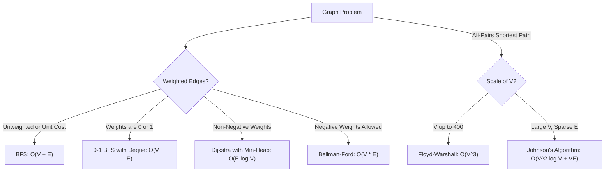

# 🧭 Algorithmic Patterns & Constraint-Shift Playbook
### How Changing Constraints Transforms Algorithms, Data Structures, and Big-O Complexity

---

## 📌 Overview: The Modern Coding Interview

In technical programming interviews, interviewers rarely stop at a single problem. A standard evaluation pattern is to take a problem you just solved and **systematically change one constraint**:

- *"What if the input array is sorted vs. unsorted?"*
- *"What if elements can be negative instead of strictly positive?"*
- *"What if this is an unbounded real-time stream instead of a static array?"*
- *"What if nodes in the graph cannot be revisited (simple path constraint)?"*
- *"What if the input size N drops from 100,000 to 18, or grows from 1,000 to 100,000,000?"*

Each constraint shift either breaks or grants a fundamental property. A single modification can transform a solution from a two-pointer scan into a hash map, from a polynomial dynamic program into an NP-hard search, or from an in-memory sort into a streaming reservoir sampler.

This playbook is a practical, quick-review guide that focuses directly on **the problem patterns, how constraint changes alter the approach, and the resulting time and space complexities**.

---

## 🗺️ Master Table of Contents

1. **The Constraint-to-Budget Rule** (Estimating target Big-O from input size N)
2. **The Core Invariant Principle** (Why solutions change when constraints shift)
3. **Master Constraint-Shift Reference Table**
4. **Deep Dive by Problem Pattern**:
   - **4.1 Arrays & Strings:** Two Pointers, Sliding Window, Prefix Sums, and Range Queries
   - **4.2 Searching & Selection:** Top-K Ladders and Binary Search on the Answer
   - **4.3 Monotonic Data Structures:** Next Greater Element and Sliding Window Extremes
   - **4.4 DFS vs. BFS:** Algorithmic Selection & Memory/Space Trade-offs
   - **4.5 Graphs:** Shortest Path Ladders, Node Reuse, and Dynamic Connectivity
   - **4.6 Dynamic Programming:** Knapsack Loop Directions, Aggregation Flips, and Special DP Archetypes
   - **4.7 Trees:** Bottom-Up vs. Top-Down Traversals and Lowest Common Ancestor
   - **4.8 Intervals & Sweep-Line:** Sorting Strategies and Event Overlaps
   - **4.9 Streaming & Memory Limits:** Exact vs. Approximate Online Algorithms
   - **4.10 Bounded Value Spaces:** Linear-Time Non-Comparison Sorting
5. **Handling Hard Problems:** Recognizing NP-Hard Problems and the 5 Practical Escape Hatches
6. **Hidden Complexity Traps:** Built-in Operations That Silently Kill Runtime
7. **The 60-Second Interview Decision Funnel**

---

## 1. The Constraint-to-Budget Rule

Execution environments typically enforce a 1.0 to 2.0-second time limit per test case. A CPU can execute roughly **10^8 basic operations per second** (or ~10^7 in Python). 

Reading the upper bound of the input size `N` tells you the maximum allowable time complexity before you write a single line of code:

| Constraint on N | Target Time Complexity | What It Allows | What It Rules OUT (Will TLE) |
|---|---|---|---|
| **N <= 10 - 12** | `O(N!)` or `O(N^2 * 2^N)` | Brute-force permutations, full backtracking | Nothing — almost any solution passes |
| **N <= 20 - 25** | `O(2^N)` or `O(2^N * N)` | Subset generation, Bitmask DP, Meet-in-the-Middle (`O(2^(N/2))`) | Factorial `O(N!)` |
| **N <= 100 - 400** | `O(N^3)` | Floyd-Warshall all-pairs shortest paths, Interval DP, 3 nested loops | Exponential `O(2^N)` |
| **N <= 2,000 - 5,000** | `O(N^2)` | 2D Dynamic Programming (Edit Distance, LCS), all-pairs comparisons | Cubic `O(N^3)` |
| **N <= 100,000 - 1,000,000** | `O(N log N)` or `O(N)` | Sorting, Binary Search, Two Pointers, Sliding Window, Heaps, BFS/DFS, Dijkstra | **Any O(N^2) nested loop** |
| **N >= 10,000,000** | `O(N)` or `O(log N)` or `O(1)` | Single linear pass, Prefix Sums, Bit manipulation, Math formulas | `O(N log N)` sorting is often too slow |
| **Answer is huge (up to 10^18)** | `O(log(Range))` | **Binary Search on the Answer Space**, Digit DP, Math | Linear scan across the answer range |

> **Practical Rule:**
> - If `N <= 20`, do not waste time searching for a clever linear trick. An **exponential search or Bitmask DP** is expected.
> - If `N >= 100,000`, immediately drop any idea involving nested loops. You must achieve `O(N)` or `O(N log N)`.

---

## 2. The Core Invariant Principle

When an interviewer modifies a constraint, they are either **breaking an assumption** (which invalidates your current algorithm) or **granting an assumption** (which unlocks a faster or lighter algorithm).

| Assumption / Property | Unlocks | Why It Works |
|---|---|---|
| **Sorted / Ordered Array** | Binary Search, Two Pointers | The direction of values is predictable. You can discard half the search space or move pointers without missing elements. |
| **All Numbers Positive** | Sliding Window | Expanding the window strictly increases the sum; shrinking it strictly decreases the sum. |
| **Non-Negative Edge Weights** | Dijkstra's Algorithm | Greedy choice works: once a node is popped from the min-heap, its shortest path is permanently finalized. |
| **History-Free (No Path Memory)** | Dynamic Programming | The optimal solution from the current state depends only on where you are now, not on the path taken to get here. |
| **Bounded Value Range (0 to K)** | Counting Sort, Radix Sort, Cyclic Sort | Direct index mapping avoids the `O(N log N)` comparison-based sorting barrier. |
| **Static Input (No Updates)** | Prefix Sums, Sparse Table | Precomputing in `O(N)` time allows answering range queries in `O(1)` time forever. |
| **Dynamic Updates to Data** | Fenwick Tree, Segment Tree | Tree structures balance both updates and queries to `O(log N)` each. |
| **Infinite Stream / Memory Limits** | Reservoir Sampling, Dual Heaps, Sketches | Maintains exact or bounded-error statistics without storing previous elements in memory. |

---

## 3. Master Constraint-Shift Reference Table

This table summarizes how common problem families transform when a single constraint changes:

| Problem Family | Constraint Switch | From Approach -> To Approach | Complexity Shift |
|---|---|---|---|
| **Array Search** | Unsorted -> **Sorted** | Linear Scan -> **Binary Search** | Time: `O(N)` -> `O(log N)` |
| **Two-Sum** | Unsorted -> **Sorted** | Hash Map -> **Two Pointers** | Space: `O(N)` -> `O(1)` |
| **Two-Sum** | Single Query -> **Q Repeated Queries** | Re-scan each time -> **Sort Once + Binary Search** | Time: `O(Q * N)` -> `O(N log N + Q log N)` |
| **Subarray Sum** | All Positive -> **Has Negative Numbers** | Sliding Window -> **Prefix Sum + Hash Map** | Space: `O(1)` -> `O(N)` |
| **Subarray Max Sum** | General Subarray -> **Contiguous Subarray** | Dynamic Programming -> **Kadane's Algorithm** | Space: `O(N)` -> `O(1)` |
| **Sequence Matching** | Contiguous Subarray -> **Non-Contiguous Subsequence** | Sliding Window -> **Dynamic Programming** | Time: `O(N)` -> `O(N^2)` |
| **Range Sum** | Static Array -> **With Point Updates** | Prefix Sum Array -> **Fenwick Tree (BIT)** | Updates: `O(N)` -> `O(log N)` |
| **Range Updates** | Point Updates -> **Batch Range Adds [L, R] += V** | Segment Tree -> **Difference Array** | Time per update: `O(log N)` -> `O(1)` |
| **Selection** | Top-K Elements -> **Just the Kth Element** | Min-Heap -> **Quickselect** | Time: `O(N log K)` -> `O(N)` average |
| **Shortest Path** | Unweighted -> **Weighted (non-negative)** | BFS -> **Dijkstra's Algorithm** | Time: `O(V + E)` -> `O(E log V)` |
| **Shortest Path** | Weights >= 0 -> **Negative Edge Weights** | Dijkstra -> **Bellman-Ford** | Time: `O(E log V)` -> `O(V * E)` |
| **Graph Traversal** | Node Reuse Allowed -> **No Node Reuse (Simple Path)** | Polynomial DP -> **Bitmask DP / NP-Hard** | Time: `O((V + E) * L)` -> `O(2^V * V)` |
| **Knapsack** | Infinite Item Reuse -> **Each Item Exactly Once** | Forward Loop DP -> **Reverse Loop DP (0/1)** | Same time `O(N * W)`, loop order flips |
| **Sorting** | General Comparisons -> **Bounded Integers [0, K]** | Quicksort / Mergesort -> **Counting / Radix Sort** | Time: `O(N log N)` -> `O(N + K)` |
| **Intervals** | Unordered -> **Sorted by Start/End Time** | Brute Pairwise Check -> **Line Sweep / Min-Heap** | Time: `O(N^2)` -> `O(N log N)` |
| **Streaming Stats** | Static Dataset -> **Unbounded Real-Time Stream** | Full Sort -> **Dual Heaps (Running Median)** | Memory: `O(N)` -> `O(1)` auxiliary |
| **Longest Increasing Seq** | Moderate N (2,000) -> **Large N (100,000)** | `O(N^2)` DP -> **Patience Sort + Binary Search** | Time: `O(N^2)` -> `O(N log N)` |
| **Word Search** | Single Word -> **Dictionary of W Words** | Repeated Word DFS -> **Trie + Backtracking** | Significant constant factor speedup |
| **Problem Scale** | Large N (100,000) -> **Small N (<= 20)** | Polynomial Target -> **Bitmask DP / Meet-in-Middle** | Exponential complexity passes |

---

## 4. Deep Dive by Problem Pattern

---

### 4.1 Arrays & Strings: Subarrays, Substrings, Subsequences, and Range Queries

#### Understanding the Terminology
Before choosing an algorithm, clarify which entity is required:

- **Subarray** (Numbers): Elements must be contiguous. Order is preserved. (Use Sliding Window, Prefix Sums, or Kadane).
- **Substring** (Characters): Characters must be contiguous. Order is preserved. (Use Sliding Window with frequency map or set).
- **Subsequence**: Elements do not need to be contiguous, but relative order must be maintained. (Use Dynamic Programming or Two Pointers).
- **Subset**: Elements do not need to be contiguous, and order does not matter. (Use Backtracking or Bitmasking).

```
"Do elements need to be directly next to each other?"
  ├── YES  -> Subarray / Substring (Sliding Window, Prefix Sum, Kadane)
  └── NO   -> "Does original order matter?"
               ├── YES -> Subsequence (Dynamic Programming)
               └── NO  -> Subset (Backtracking, Bitmask)
```

#### Constraint Shift 1: Unsorted -> Sorted (Two-Sum Pattern)
- **Unsorted Array:** You cannot know where the complementary value lives. You must store seen values in a hash map:
  - Check if `(target - num)` exists in the hash map.
  - **Time:** `O(N)`, **Space:** `O(N)`.
- **Sorted Array:** Sorted order gives direction. Place pointers at the beginning and end:
  - If `left + right > target`, move `right` inward to decrease the sum.
  - If `left + right < target`, move `left` inward to increase the sum.
  - **Time:** `O(N)`, **Space:** `O(1)`.

#### Constraint Shift 2: All Positive -> Negatives Present (Subarray Sum = K)
- **All Positive Numbers:** The running sum is monotonic. Expanding right always increases the sum; shrinking left always decreases it.
  - **Sliding Window:** `O(N)` time, `O(1)` space.
- **Negative Numbers Present:** Monotonicity is destroyed. Adding an element can decrease the sum; removing an element can increase it.
  - **Prefix Sum + Hash Map:** Store the frequency of cumulative sums seen so far. If `current_sum - target` was seen before, a valid subarray ends here.
  - **Time:** `O(N)`, **Space:** `O(N)`.

#### Constraint Shift 3: Contiguous Subarray -> Non-Contiguous Subsequence
- **Contiguous Maximum Subarray:** Use **Kadane's Algorithm**. At each index, decide whether to extend the current running sum or start fresh from the current number:
  - `current_sum = max(num, current_sum + num)`
  - **Time:** `O(N)`, **Space:** `O(1)`.
- **Non-Contiguous Longest Increasing Subsequence (LIS):** Elements can jump over gaps:
  - Standard DP: Compare index `i` against all previous indices `j < i`. `O(N^2)` time.
  - Optimized Patience Sorting: Maintain the smallest tail value for each subsequence length and use binary search (`bisect_left`).
  - **Time:** `O(N log N)`, **Space:** `O(N)`.

#### Constraint Shift 4: Static Array -> Dynamic Point Updates
- **Static Range Sum Queries:** Precompute prefix sums once in `O(N)` time. Any range `[L, R]` sum is computed in `O(1)` time as `prefix[R] - prefix[L - 1]`. But updating an element takes `O(N)` to recalculate prefix values.
- **Dynamic Array with Point Updates:** When updates and queries alternate:
  - **Fenwick Tree (Binary Indexed Tree):** `O(log N)` point updates, `O(log N)` range queries. Extremely simple to implement with minimal memory.
  - **Segment Tree:** `O(log N)` updates and range queries. Supports sum, min, max, and GCD with lazy propagation.

#### Constraint Shift 5: Point Updates -> Batch Range Updates [L, R] += V
- When multiple range updates must be applied before answering any queries, updating a segment tree takes `O(Q log N)`.
- **Difference Array:** Initialize `diff[i] = arr[i] - arr[i - 1]`.
  - For each range update `[L, R] += V`, simply do:
    - `diff[L] += V`
    - `diff[R + 1] -= V`
  - Each update takes **`O(1)` time**.
  - Reconstruct the final array with a single prefix sum pass in `O(N)` time.

---

### 4.2 Searching & Selection: Top-K Ladders and Binary Search on the Answer

#### The Top-K Selection Ladder

```
Selection Goal
├── Return all elements in sorted order -> Sort the array       O(N log N) time
├── Return the K largest/smallest items -> Min-Heap of size K   O(N log K) time, O(K) space
├── Return strictly the Kth value       -> Quickselect           O(N) average time, O(1) space
└── Streaming data (cannot fit in RAM)  -> Bounded Min-Heap     O(log K) per incoming item
```

- **Why use a Min-Heap for K Largest?**
  A min-heap of size `K` keeps the smallest of the top `K` items at the top. When a new element arrives, if it is larger than the heap's top, pop the top and push the new element. Total time is `O(N log K)` with only `O(K)` memory.

#### Binary Search on the Answer Space
When asked to **minimize a maximum**, **maximize a minimum**, or find the **smallest/largest threshold satisfying a condition**, check if the feasibility condition is monotonic:

> *"If value X is feasible, is every value larger than X also feasible?"*

If yes, binary search the answer space instead of scanning values:

```python
def binary_search_answer(low: int, high: int) -> int:
    ans = high
    while low <= high:
        mid = (low + high) // 2
        if is_feasible(mid):  # O(N) feasibility check
            ans = mid         # Valid candidate found
            high = mid - 1    # Try to find a smaller feasible value
        else:
            low = mid + 1     # Infeasible; must increase threshold
    return ans
```

- **Time Complexity:** `O(cost_of_feasibility * log(high - low))`.
- **Space Complexity:** `O(1)`.
- **Common Prompts:** Minimum capacity to ship packages within D days, Koko eating bananas at minimum speed, split array largest sum.

---

### 4.3 Monotonic Data Structures: Next Greater Elements and Sliding Window Extremes

#### Monotonic Stack
Used when each element needs to find the **nearest element larger or smaller than itself** to its left or right.

- **How It Works:** Maintain a stack of elements (or indices) in strictly decreasing (or increasing) order.
- When an incoming element violates the monotonic order, pop elements from the stack. The incoming element is the "next greater element" for everything it pops.
- **Time Complexity:** Each element is pushed once and popped at most once -> **`O(N)` overall**.
- **Space Complexity:** `O(N)`.
- **Common Prompts:** Daily Temperatures, Next Greater Element, Largest Rectangle in Histogram, Trapping Rain Water.

#### Monotonic Deque (Sliding Window Maximum)
- **Constraint Shift:** Find the maximum in a sliding window of size `K`.
  - Using a Heap: `O(N log K)` time.
  - Using a Monotonic Deque: **`O(N)` amortized time** and `O(K)` space.
- **How It Works:** Store indices in a double-ended queue such that values are strictly decreasing:
  1. Pop indices from the back whose values are less than or equal to the incoming element.
  2. Pop indices from the front if they have fallen outside the window boundary (`index <= i - K`).
  3. The front of the deque is always the maximum element for the current window.

---

### 4.4 DFS vs. BFS: Algorithmic Selection & Memory/Space Trade-offs

The decision between Depth-First Search (DFS) and Breadth-First Search (BFS) is one of the most frequent discussion points in technical interviews. While both visit all reachable nodes in `O(V + E)` time, **the shape of the graph/tree and the problem objective completely alter their memory consumption and suitability**.

#### 1. The Fundamental Mechanical Contrast

- **BFS (Queue - FIFO):** Expands radially in concentric rings. It visits all neighbors at distance `d` before touching any node at distance `d + 1`.
- **DFS (Stack / Call Stack - LIFO):** Dives down a single branch to its maximum depth before backtracking.

```
Tree Exploration Pattern:
BFS: Explores horizontally layer-by-layer (Queue stores the current level width).
DFS: Explores vertically path-by-path (Stack stores the current root-to-leaf path).
```

#### 2. How Graph / Tree Geometry Dictates Memory (Space Complexity)

The memory consumed by BFS vs. DFS depends directly on the **branching factor `B`** and the **tree height `H`**:

| Tree / Graph Geometry | DFS Space Complexity | BFS Space Complexity | Memory Winner |
|---|---|---|---|
| **Balanced / Wide Tree** (Height `H = log N`, Branching `B >= 2`) | **`O(log N)`** (Stack holds single root-to-leaf branch) | **`O(N)`** (Queue holds entire leaf level, ~`N/2` nodes) | **DFS** (uses exponentially less memory) |
| **Skewed / Narrow Tree** (Height `H = N`, like a linked list) | **`O(N)`** (Call stack depth equals `N`; risk of stack overflow) | **`O(1)`** (Queue holds at most 1 node at each level) | **BFS** (uses constant memory) |
| **2D Grid / Matrix (`R x C`)** | `O(R * C)` in worst winding snake path | `O(min(R, C))` (Queue holds the diagonal wavefront) | **BFS** has lower peak memory on open grids |

> **Interview Insight:**
> If asked *"Why did you choose DFS over BFS here?"*, answer in terms of tree shape and objective:
> *"For a balanced tree with N nodes, DFS only requires O(log N) stack memory to store the active path, whereas BFS would need O(N) queue memory to store the entire bottom layer."*

#### 3. When to Choose BFS (Decision Triggers)

- **Shortest Path in Unweighted Graphs:** BFS guarantees that the first time a target node is popped from the queue, it has been reached via the minimum number of edge hops. DFS cannot guarantee the shortest path without traversing all possible paths.
- **Level-by-Level Information:** When the problem requires grouping nodes by their depth (e.g., level-order traversal, zigzag order, right-side view of a binary tree).
- **Target is Known to Be Close to the Root:** If the target is at depth `d << H`, BFS finds it in `O(B^d)` operations. DFS might dive down an irrelevant branch of depth `H` first.
- **Bidirectional Search:** When both start and end nodes are known, running two simultaneous BFS searches from both ends reduces time and memory from `O(B^D)` to `O(2 * B^(D/2))` — an exponential speedup.

#### 4. When to Choose DFS (Decision Triggers)

- **Exhaustive Path Generation & Backtracking:** Generating all valid configurations, subsets, permutations, path sums, N-Queens, Sudoku.
- **Tree Property Aggregations:** Calculating tree diameter, maximum path sum, lowest common ancestor, or validating a binary search tree (bottom-up aggregation naturally matches post-order DFS).
- **Cycle Detection & Topological Sorting:** Directed cycle detection requires DFS 3-color states (`unvisited`, `visiting`, `visited`). Topological sorting uses post-order DFS reversal.
- **Connected Component Labeling on Grids (Flood Fill / Number of Islands):** Recursive DFS is far more concise and avoids the overhead of managing an explicit queue data structure.
- **Memory-Constrained Environments with High Branching Factors:** When a tree has a high branching factor (e.g., game trees like Chess/Go), BFS queues run out of memory almost immediately; DFS's `O(Depth)` memory is mandatory.

#### 5. The Hybrid: Iterative Deepening DFS (IDDFS)

When you need the **shortest path guarantee of BFS**, but the branching factor is so large that BFS **runs out of memory**:
- **Iterative Deepening DFS (IDDFS)** executes depth-limited DFS searches with increasing limits: `depth_limit = 0, 1, 2, 3, ...`
- **Guarantees:** Finds the shortest path (like BFS).
- **Memory:** Uses only `O(Depth)` stack space (like DFS).
- **Why it is efficient:** In a tree with branching factor `B >= 2`, the number of nodes at the bottom level (`B^D`) dominates the entire tree. Recomputing the upper levels adds only a tiny constant overhead (~`1.5x` to `2x` total work).

---

### 4.5 Graphs: Shortest Path Ladders, Node Reuse, and Dynamic Connectivity

Before writing a graph algorithm, establish these 5 properties:
1. Is the graph **weighted or unweighted**?
2. Are edge weights **strictly positive, or can they be zero or negative**?
3. Is the graph **directed or undirected**?
4. Can **cycles** exist?
5. Can **nodes be revisited**, or must paths be simple (each node visited at most once)?



#### Shortest Path Complexity Ladder

| Constraint | Optimal Algorithm | Time Complexity | Core Invariant |
|---|---|---|---|
| **Unweighted (Unit Cost)** | **Breadth-First Search (BFS)** | `O(V + E)` | First time a node is reached, that path is guaranteed to be the shortest. |
| **Weights are only 0 or 1** | **0-1 BFS (`collections.deque`)** | `O(V + E)` | 0-weight moves pushed to front; 1-weight to back. Replaces Dijkstra's heap with a deque. |
| **Weights >= 0** | **Dijkstra (Min-Heap)** | `O(E log V)` | Greedy choice: once a node is popped from the min-heap, its shortest distance is finalized. |
| **Negative Weights Allowed** | **Bellman-Ford** | `O(V * E)` | Relaxes all edges `V - 1` times. A `V`-th relaxation detects negative cycles. |
| **At Most K Stops** | **Bellman-Ford (K rounds)** | `O(K * E)` | Running relaxation for exactly `K` rounds restricts paths to at most `K` hops. |
| **All-Pairs Shortest Paths** | **Floyd-Warshall** (`V <= 400`) | `O(V^3)` | 3-nested DP loops over intermediate nodes: `dist[i][j] = min(dist[i][j], dist[i][k] + dist[k][j])`. |
| **Directed Acyclic Graph (DAG)** | **Topological Sort + DP** | `O(V + E)` | Process nodes in topological order. Finds shortest or longest paths in linear time. |

#### Node Reuse Allowed vs. No Node Reuse (The Simple Path Curse)
This constraint change often turns a fast polynomial algorithm into an exponential NP-hard search:

- **Node Reuse Allowed:** A path can visit the same node multiple times.
  - The state is simply `(current_node, step_count)`.
  - **Solvable via Dynamic Programming in polynomial time:** `O((V + E) * Steps)`.
- **No Node Reuse (Simple Path):** Each node can be visited at most once.
  - The algorithm must track which nodes have already been visited to prevent revisiting them.
  - The visited set becomes part of the state space (`2^V` combinations) -> **NP-Hard** (equivalent to Hamiltonian Path).
  - For `V <= 20`: Solvable using **Bitmask DP** in `O(2^V * V^2)` time.
  - For large `V`: Solvable only via pruned backtracking or heuristics.

#### Static vs. Dynamic Connectivity
- **Static Graph (Components, Connectivity):** DFS or BFS in `O(V + E)` time.
- **Dynamic Graph (Edges Added Online):** Re-running DFS/BFS on each new edge costs `O(E * (V + E))` (too slow).
  - **Disjoint Set Union (Union-Find) with Path Compression & Rank:**
  - Connects components and queries connectivity in **near `O(1)` amortized time** per operation (`O(alpha(N))`).

---

### 4.6 Dynamic Programming: Knapsack Directions, Aggregation Flips, and Special DPs

#### The 5-Step DP Formulation
When presenting DP solutions, walk through these 5 steps:
1. **State Definition:** What do the indices represent?
2. **Transition Formula:** How is the current state derived from previous states?
3. **Base Cases:** What are the starting values?
4. **Order of Evaluation:** In what direction should loops run so prerequisites are ready?
5. **Space Optimization:** Can the table be reduced from 2D to 1D?

#### Constraint Shift 1: Infinite Item Reuse vs. Use Each Item Once (Knapsack)
Both problems can use a 1D array of capacity `W`, but **the inner loop direction flips**:

```python
# Unbounded Knapsack (Items can be reused infinitely, e.g. Coin Change)
for coin in coins:
    for w in range(coin, W + 1):  # Ascending: allows re-consuming the same coin
        dp[w] = min(dp[w], dp[w - coin] + 1)

# 0/1 Knapsack (Each item can be used AT MOST ONCE)
for item_wt, item_val in items:
    for w in range(W, item_wt - 1, -1):  # Descending: prevents re-consuming the same item
        dp[w] = max(dp[w], dp[w - item_wt] + item_val)
```

> **Trap:** Looping ascending in 0/1 knapsack accidentally solves the unbounded knapsack problem because updated values in the current step are reused in the same pass.

#### Constraint Shift 2: Aggregation Objective Flips
The state transition structure is often identical; only the combining operation changes:

| Problem Objective | Combining Operation | Neutral Base Value | Early Exit Allowed? |
|---|---|---|---|
| **Count Total Ways** | Addition (`+`) | `0` | No — must explore all paths |
| **Optimize (Min / Max)** | `min(...)` or `max(...)` | `+infinity` or `-infinity` | Pruning branches if bound exceeded |
| **Feasibility (Is It Possible?)** | Boolean OR (`or`) | `False` | Yes — return `True` on first hit |

#### Special DP Archetypes

##### 1. Interval DP (`N <= 300 - 500`)
- Subproblems are defined over contiguous ranges `[i, j]`.
- Loop by interval length `L = 2 to N`, then calculate starting index `i` and ending index `j = i + L - 1`.
- **Time Complexity:** `O(N^3)`, **Space Complexity:** `O(N^2)`.
- **Examples:** Burst Balloons, Minimum Cost to Merge Stones.

##### 2. Bitmask DP (`N <= 20 - 25`)
- State represents a subset of chosen elements encoded as bits in an integer (`0 <= mask < 2^N`).
- Bit operations:
  - Check if element `i` is included: `(mask & (1 << i)) != 0`
  - Add element `i` to mask: `mask | (1 << i)`
- **Time Complexity:** `O(2^N * N)`.
- **Examples:** Traveling Salesperson, Minimum Work Sessions, Assignment Problem.

##### 3. Digit DP (Range up to `10^18`)
- Answers: *"How many numbers between L and R satisfy a property on their digits?"*
- Convert range query to prefix subtraction: `count(R) - count(L - 1)`.
- Build the number digit-by-digit from left to right with memoization:
  `dp(position, is_tight, is_started, state)`
- **Time Complexity:** `O(num_digits * state_size * 10)` — instantaneous even for huge numbers.

---

### 4.7 Trees: Bottom-Up vs. Top-Down Traversals and Lowest Common Ancestor

#### Bottom-Up vs. Top-Down DFS
- **Top-Down DFS ("Pass state down"):** Information flows from the root to leaves (e.g., current path sum, ancestors, depth).
- **Bottom-Up DFS ("Combine children and return up"):** Subtree answers are computed by child nodes and aggregated by the parent (e.g., tree diameter, max path sum, subtree validation).

#### Lowest Common Ancestor (LCA)
- **Single LCA Query:** Run a post-order traversal in `O(N)` time and `O(Height)` space.
- **Multiple Online LCA Queries (Q queries on tree of size N):**
  - Running linear traversal `Q` times costs `O(Q * N)` (too slow for `Q = 100,000`).
  - **Binary Lifting:** Precompute power-of-two ancestors (`up[node][k]` is the `2^k`-th ancestor).
  - Preprocessing: `O(N log N)` time and space.
  - Each query: `O(log N)` time.

---

### 4.8 Intervals & Sweep-Line: Sorting Strategies and Event Overlaps

#### How to Sort Intervals
The sorting criterion depends directly on the goal:

- **Sort by Start Time:** Used when merging overlapping intervals or finding gaps. Intervals that can overlap will appear sequentially.
- **Sort by End Time:** Used when selecting the maximum number of non-overlapping intervals (Greedy interval scheduling). Picking the earliest-ending interval leaves maximum room for remaining intervals.
- **Line Sweep Events `(time, +1 / -1)`:** Used to find peak concurrent overlaps (e.g., minimum meeting rooms required).
  - Convert each interval `[start, end)` into two events: `(start, +1)` and `(end, -1)`.
  - Sort events by timestamp. If timestamps match, process `-1` before `+1` for non-inclusive endpoints.
  - Sweep left-to-right with a running counter; the maximum counter value is the peak concurrency in `O(N log N)` time.

---

### 4.9 Streaming & Memory Limits: Exact vs. Approximate Online Algorithms

When the input data is too large to fit in memory or arrives as an unbounded real-time stream:

| Goal | In-Memory Algorithm | Streaming / Memory-Bounded Tool | Complexity & Guarantee |
|---|---|---|---|
| **Uniform Random Sample of K Items** | Shuffle array, take first K | **Reservoir Sampling** | `O(1)` memory per item. Guarantees exact uniform probability `K / N`. |
| **Continuous Running Median** | Sort array `O(N log N)` | **Dual Heaps** (Max-Heap + Min-Heap) | `O(log N)` per insert, `O(1)` median lookup. |
| **Sliding Window Maximum** | Priority Queue `O(N log K)` | **Monotonic Deque** | `O(N)` amortized time, `O(K)` space. |
| **Item Frequency Estimation** | Exact Hash Map `O(N)` space | **Count-Min Sketch** | Sublinear fixed memory; overestimates with bounded error. |
| **Set Membership Testing** | Exact Hash Set `O(N)` space | **Bloom Filter** | Sublinear bit array; 0% false negatives, tunable false positive rate. |
| **Count Distinct Elements** | Hash Set of unique values | **HyperLogLog (HLL)** | Tracks leading zero bits of hashed values; uses ~1.5 KB memory for 2% error. |

---

### 4.10 Bounded Value Spaces: Linear-Time Non-Comparison Sorting

Comparison-based sorting has a mathematical lower bound of `O(N log N)`. When input values belong to a bounded domain, you can bypass this barrier:

- **Counting Sort:** Values are integers in `[0, K]`. Count frequencies and compute output positions in `O(N + K)` time.
- **Radix Sort:** Values are d-digit integers. Sort digit-by-digit using stable counting sort in `O(d * (N + Base))` time.
- **Cyclic Sort:** Array contains `N` integers in the range `[1, N]`.
  - Every number belongs at index `val - 1`. If `arr[i] != arr[arr[i] - 1]`, swap them.
  - Each swap places at least one number into its correct position -> **`O(N)` time, `O(1)` space**.

---

## 5. Handling Hard Problems: Recognizing NP-Hard Problems and the 5 Escape Hatches

Interviewers sometimes give problems where no polynomial-time exact algorithm exists to test whether you recognize the boundary:

- **P (Polynomial Time):** Problems solvable efficiently in `O(N^k)` time (e.g., Shortest Path, MST, Sorting).
- **NP (Nondeterministic Polynomial):** Problems whose proposed solutions can be verified in polynomial time.
- **NP-Complete / NP-Hard:** The hardest problems (e.g., Boolean SAT, 0/1 Knapsack decision, Traveling Salesperson, Hamiltonian Path). Almost universally believed to have no polynomial-time exact algorithm.

### The 5 Practical Escape Hatches
When an interview problem is NP-Hard, do not attempt to find a linear or polynomial trick. Pivot immediately to one of five standard engineering strategies:

1. **Small-N Exact Algorithm:** If `N <= 20`, implement an exact **Bitmask DP** (`O(2^N * N)`) or pruned backtracking.
2. **Pseudo-Polynomial DP:** If numbers/capacities are small, use dynamic programming (e.g., 0/1 Knapsack runs in `O(N * Capacity)` time, which is polynomial in the magnitude of the capacity).
3. **Approximation Algorithm:** Use an algorithm with a proven approximation ratio (e.g., Greedy Set Cover is within `ln(N)` of optimal; Christofides is within `1.5x` of optimal for metric TSP).
4. **Heuristic / Greedy Approach:** Propose a greedy heuristic, local search, or simulated annealing that gives good solutions in practice.
5. **Structural Input Restrictions:** Check if the input is restricted to a special graph structure (e.g., on a Tree, DAG, or Interval Graph, many NP-hard problems become solvable in polynomial time).

---

## 6. Hidden Complexity Traps: Built-in Operations That Silently Kill Runtime

Many unexpected Time Limit Exceeded (TLE) errors come from hidden linear operations inside loops:

| Code Pattern | Hidden Cost | Actual Total Complexity | Correct Approach |
|---|---|---|---|
| `if x in my_list:` inside a loop | List lookup is `O(N)` | `O(N^2)` | Convert list to a `set` or `dict` (`O(1)` average lookup). |
| `my_list.pop(0)` or `insert(0, x)` | Shifts all `N` elements | `O(N^2)` over `N` pops | Use `collections.deque` (`popleft()` is `O(1)`). |
| String concatenation `s += ch` in loop | Strings are immutable; reallocates and copies | `O(N^2)` total copying | Append characters to a list and use `''.join(list)`. |
| Slicing `arr[mid:]` in recursive calls | Slicing copies the slice elements | Increases `O(N log N)` to `O(N^2)` | Pass boundary indices `(left, right)` instead of slicing arrays. |
| `min()` or `max()` inside a loop | Scans the whole list | `O(N^2)` | Maintain a running variable, Heap, or Monotonic Deque. |

---

## 7. The 60-Second Interview Decision Funnel

When given a coding problem, run this quick mental triage before writing code:

```
[00 - 15s] RESTATE & CLARIFY:
  • Confirm Input/Output types and edge cases (empty, negatives, duplicates).
  • Ask: "Is the input sorted? Can values be negative? Are updates allowed?"

[15 - 30s] CONSTRAINTS -> BUDGET:
  • Read N.
  • N <= 20     -> Budget is exponential (Backtracking / Bitmask DP).
  • N <= 5,000  -> Budget is O(N^2) (2D DP / nested loops).
  • N >= 100,000 -> Budget is strictly O(N) or O(N log N).

[30 - 45s] PATTERN MAPPING:
  • Subarray + All Positive         -> Sliding Window
  • Subarray + Negatives Allowed    -> Prefix Sum + Hash Map
  • Subsequence + Optimization      -> Dynamic Programming
  • "Min-Max" / Monotonic Condition -> Binary Search on the Answer
  • Graph + Unit Weights            -> BFS
  • Graph + Non-Negative Weights    -> Dijkstra

[45 - 60s] COMMUNICATE BEFORE CODING:
  • State the brute-force approach and its bottleneck.
  • State your chosen pattern, the invariant it uses, and expected Time and Space Big-O.
  • Begin implementation.
```
