# Part 1: The Funnel Blueprint, Vector Space Intelligence & Candidate Retrieval

> A comprehensive, staff-level guide to modern recommendation system design. Covers the multi-stage funnel architecture, classical baselines, Two-Tower contrastive encoders, Approximate Nearest Neighbor (ANN) vector indexing, multi-interest graph embeddings, and the frontier of Generative Retrieval with Semantic IDs.

---

## The 6-Part Master Architecture Roadmap

Before diving into retrieval, it is critical to understand the entire architectural landscape. Industrial recommendation systems are almost never single models; they are **multi-stage pipelines** engineered to balance trillions of possible user-item interactions against strict real-time latency budgets (typically sub-100ms P99).

Across this six-part series, we cover every component required to design, scale, and evaluate production recommendation systems at top-tier technology companies:

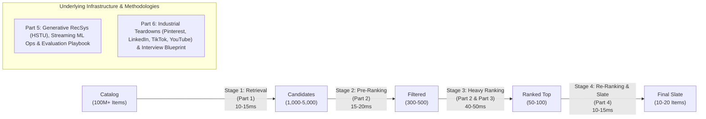

### The 6 Parts at a Glance:
1. **Part 1: The Funnel Blueprint, Vector Space Intelligence & Candidate Retrieval (This Guide)** — The coarse filter reducing $100\text{M}+$ items to $\approx 1,000$ candidates in $<15\text{ms}$. Covers Collaborative Filtering, Funk SVD, Implicit ALS, BPR, Deep Two-Tower models (InfoNCE, LogQ correction, hard negatives), ANN vector indices (IVF-PQ, HNSW), the "Metadata Filtering Dilemma" (LinkedIn GPU Exhaustive RAR), Pinterest PinnerSage/PinSage, and Semantic IDs (YouTube PLUM).
2. **Part 2: Pre-Ranking (L1) & Heavy Ranking (L2): Feature Crosses, DLRM & Multi-Task Learning** — Scoring candidates under tighter compute budgets. Covers the L1 distillation dilemma, Pinterest's Root-Leaf serving architecture, high-cardinality embedding tables, DCN-v2 (Rank-1 vs. Full-Rank & MoE math), DLRM model parallelism, and Multi-Task Learning (Shared-Bottom $\to$ MMoE $\to$ PLE).
3. **Part 3: Sequential User Behavior Modeling & Production Loss Engineering** — Modeling temporal user dynamics and real-world loss functions. Covers DIN, DIEN, SIM (10k sequence search), Pinterest TransAct, LinkedIn Feed SR ($O(N)$ single-pass transformer training), Position Bias (Shallow Tower vs. SNIPW), Negative Downsampling with log-odds correction, and delayed feedback modeling.
4. **Part 4: Re-Ranking, Diversity, Freshness, Business Logic & Slate Optimization** — The final stage transforming individual scores into a cohesive slate. Covers Maximal Marginal Relevance (MMR), Determinantal Point Processes (DPP), Submodular Optimization ($1 - 1/e$ bound), Seq2Slate (RL), Steck's Calibrated Recommendations, filter bubble breaking quotas, and LinkedIn Air Traffic Controller (ATC).
5. **Part 5: Generative RecSys (HSTU/LLMs), Real-Time Streaming Ops & Evaluation Playbook** — Cutting-edge architectures and operations. Covers Meta HSTU pointwise attention, Netflix Foundation Models, ByteDance Monolith online streaming learning, point-in-time feature stores, GAUC, Expected Calibration Error, Team Draft Interleaving (50x sensitivity), and debugging the Offline-to-Online correlation gap.
6. **Part 6: Real-World Industry Architectures Deconstructed & Staff Interview Playbook** — Full architectural teardowns of Pinterest, LinkedIn, TikTok, and YouTube; plus the 45-minute 6-stage interview execution blueprint, failure modes, and 20 staff-level grilling questions.

---

## Table of Contents

1. [The Multi-Stage Funnel & Latency Budgets](#1-the-multi-stage-funnel--latency-budgets)
2. [Classical Retrieval Foundations](#2-classical-retrieval-foundations)
   - [2.1 The User-Item Interaction Matrix](#21-the-user-item-interaction-matrix)
   - [2.2 Collaborative Filtering (UBCF vs. IBCF)](#22-collaborative-filtering-ubcf-vs-ibcf)
   - [2.3 Content-Based Filtering](#23-content-based-filtering)
   - [2.4 Matrix Factorization: Funk SVD, Implicit ALS, and BPR](#24-matrix-factorization-funk-svd-implicit-als-and-bpr)
   - [2.5 Hybrid Patterns & Why MF Survives in 2026](#25-hybrid-patterns--why-mf-survives-in-2026)
3. [Deep Two-Tower Neural Retrieval](#3-deep-two-tower-neural-retrieval)
   - [3.1 The Two-Tower Architecture & Dot-Product Constraint](#31-the-two-tower-architecture--dot-product-constraint)
   - [3.2 Contrastive Loss & In-Batch Negative Sampling](#32-contrastive-loss--in-batch-negative-sampling)
   - [3.3 Popularity Bias & The LogQ Correction Formula](#33-popularity-bias--the-logq-correction-formula)
   - [3.4 Hard Negative Mining & Curriculum Learning Schedule](#34-hard-negative-mining--curriculum-learning-schedule)
   - [3.5 The Temperature Parameter ($\tau$) Mathematical Behavior](#35-the-temperature-parameter-tau-mathematical-behavior)
4. [Vector Search Infrastructure & Approximate Nearest Neighbor (ANN)](#4-vector-search-infrastructure--approximate-nearest-neighbor-ann)
   - [4.1 Why Brute Force Fails: The Complexity Gap](#41-why-brute-force-fails-the-complexity-gap)
   - [4.2 Inverted File Index (IVF) & Product Quantization (PQ)](#42-inverted-file-index-ivf--product-quantization-pq)
   - [4.3 IVF-PQ with Residual Quantization Math](#43-ivf-pq-with-residual-quantization-math)
   - [4.4 Hierarchical Navigable Small World (HNSW) Graphs](#44-hierarchical-navigable-small-world-hnsw-graphs)
   - [4.5 The "Metadata Filtering Dilemma" & LinkedIn's GPU Exhaustive + RAR](#45-the-metadata-filtering-dilemma--linkedins-gpu-exhaustive--rar)
5. [Multi-Interest & Graph-Based Retrieval](#5-multi-interest--graph-based-retrieval)
   - [5.1 The Single-Vector Bottleneck](#51-the-single-vector-bottleneck)
   - [5.2 Pinterest PinnerSage: Multi-Modal Cluster Medoids](#52-pinterest-pinnersage-multi-modal-cluster-medoids)
   - [5.3 Graph Convolutions: Pinterest PinSage & LinkedIn PYMK](#53-graph-convolutions-pinterest-pinsage--linkedin-pymk)
   - [5.4 Multimodal Item Encoders (ItemSage)](#54-multimodal-item-encoders-itemsage)
6. [Generative Retrieval & The Semantic ID Revolution (2024–2026)](#6-generative-retrieval--the-semantic-id-revolution-20242026)
   - [6.1 The Paradigm Shift: From MIPS Vector Search to Token Generation](#61-the-paradigm-shift-from-mips-vector-search-to-token-generation)
   - [6.2 Semantic IDs via Residual Quantized VAE (RQ-VAE / TIGER)](#62-semantic-ids-via-residual-quantized-vae-rq-vae--tiger)
   - [6.3 Autoregressive Beam Search Decoding](#63-autoregressive-beam-search-decoding)
   - [6.4 YouTube's PLUM Framework (Production 2025 Deep-Dive)](#64-youtubes-plum-framework-production-2025-deep-dive)
   - [6.5 Generative Retrieval vs. Traditional Vector Search Trade-Offs](#65-generative-retrieval-vs-traditional-vector-search-trade-offs)
7. [Stage 1 Evaluation Metrics & System SLAs](#7-stage-1-evaluation-metrics--system-slas)
8. [Staff-Level Interview Questions & Detailed Answers](#8-staff-level-interview-questions--detailed-answers)

---

## 1. The Multi-Stage Funnel & Latency Budgets

In industrial systems (e.g., YouTube with 5 billion videos, Pinterest with 300 billion pins, Amazon with 350 million products), finding the optimal 10 items for a user is subject to a strict **compute-latency boundary**.

A state-of-the-art heavy ranking model (an 80-layer Multi-Gate Mixture-of-Experts with transformer attention over past behaviors) might require $5\text{ms}$ of GPU compute to score a single user-item pair. If you attempted to score the entire catalog of $10^8$ items on every user request, you would need:

$$\text{Compute Time} = 10^8 \times 5\text{ms} = 500,000\text{ seconds} \approx 5.8\text{ days per request}$$

Even parallelized across thousands of GPUs, the cost and tail latencies are prohibitive. Production recommendation systems therefore decompose the task into a **four-stage funnel**, where each stage trades catalog coverage for model expressiveness:

| Funnel Stage | Candidate Pool Size | Latency Budget (P99) | Model Complexity | Primary Optimization Metric |
| :--- | :--- | :--- | :--- | :--- |
| **Stage 1: Retrieval (Candidate Generation)** | $10^7 - 10^9 \to 1,000 - 5,000$ | **$10 - 15\text{ms}$** | Sub-linear search; Two-Tower dot products; Graph walks; Semantic IDs | **Recall@K** (Do not lose relevant items) |
| **Stage 2: Pre-Ranking (L1)** | $1,000 - 5,000 \to 300 - 500$ | **$15 - 20\text{ms}$** | Distilled DNN; Light GBDT; Root-Leaf item scoring | High-throughput ranking alignment |
| **Stage 3: Heavy Ranking (L2)** | $300 - 500 \to 50 - 100$ | **$40 - 50\text{ms}$** | DLRM; DCN-v2; MMoE / PLE; Sequential Transformers (TransAct, Feed SR) | **NDCG@K / GAUC** (Optimal order of engagement) |
| **Stage 4: Re-Ranking & Slate** | $50 - 100 \to 10 - 20$ | **$10 - 15\text{ms}$** | Rule engines; MMR; Determinantal Point Processes (DPP); Ad auctions | **Slate Utility** (Diversity, Freshness, Fair exposure, Revenue) |

### The Cardinal Rule of Retrieval: Recall vs. Precision
At the retrieval layer, **Precision does not matter; Recall is everything**. If an item is dropped during candidate retrieval, no downstream ranker—no matter how complex its multi-task cross-attention layers are—can ever surface it to the user.

```
       Candidate Universe: 100,000,000 Items
                   │
                   ▼
┌─────────────────────────────────────────────────────┐
│  Stage 1: Retrieval (Part 1)                        │
│  Channels: Two-Tower ANN + Multi-Medoids + Graph     │  <-- Cost: ~0.0001 ms/item
│  Result: Top 2,000 Candidates                       │
└──────────────────┬──────────────────────────────────┘
                   │
                   ▼
┌─────────────────────────────────────────────────────┐
│  Stage 2: Pre-Ranking / L1 (Part 2)                 │
│  Architecture: Root-Leaf / Distilled DNN             │  <-- Cost: ~0.01 ms/item
│  Result: Top 400 Candidates                         │
└──────────────────┬──────────────────────────────────┘
                   │
                   ▼
┌─────────────────────────────────────────────────────┐
│  Stage 3: Heavy Ranking / L2 (Part 2 & 3)           │
│  Architecture: MMoE + PLE + Sequential Transformers │  <-- Cost: ~0.1 ms/item
│  Result: Top 50 Items                               │
└──────────────────┬──────────────────────────────────┘
                   │
                   ▼
┌─────────────────────────────────────────────────────┐
│  Stage 4: Re-Ranking & Blending (Part 4)            │
│  Logic: DPP / MMR + Business Rules + Freshness      │  <-- Cost: Set/Slate Optimization
│  Result: Final 10 Items Displayed to User           │
└─────────────────────────────────────────────────────┘
```

---

## 2. Classical Retrieval Foundations

Before exploring deep learning representations and vector indexing, an interview candidate must understand classical Collaborative Filtering (CF) and Matrix Factorization (MF). Modern neural retrieval models directly inherit the geometric principles, loss objectives, and failure modes established by these baselines.

### 2.1 The User-Item Interaction Matrix

The foundation of collaborative filtering is the interaction matrix $R \in \mathbb{R}^{|U| \times |I|}$:

```
            Item 1 (Movie)   Item 2 (Doc)   Item 3 (Music)   ...   Item N
User 1          5               ?               1                     ?
User 2          ?               4               ?                     2
User 3          1               ?               ?                     5
  :             :               :               :                     :
User M          ?               ?               3                     ?
```

*   **Explicit Feedback:** Direct ratings (e.g., 1 to 5 stars, thumbs up/down). Extremely sparse ($< 0.01\%$ observed), high signal, but suffers from self-selection bias (users only rate items they feel strongly about).
*   **Implicit Feedback:** User actions (clicks, video dwell time, purchases, skips). Plentiful, but noisy (a click does not guarantee satisfaction; an unclicked item might mean the user never saw it, not that they dislike it).

### 2.2 Collaborative Filtering (UBCF vs. IBCF)

The core principle: *Users who agreed on item preferences in the past will agree on item preferences in the future.*

#### User-Based Collaborative Filtering (UBCF)
To predict rating $\hat{r}_{u, i}$ for user $u$ on item $i$:
1. Compute similarity $\text{sim}(u, v)$ between user $u$ and all other users $v \in U$.
2. Identify the $K$-nearest neighbor users who have rated item $i$.
3. Compute the normalized weighted average:

$$\hat{r}_{u, i} = \bar{r}_u + \frac{\sum_{v \in N_i(u)} \text{sim}(u, v) \cdot (r_{v, i} - \bar{r}_v)}{\sum_{v \in N_i(u)} |\text{sim}(u, v)|}$$

Where $\bar{r}_u$ is user $u$'s mean rating across all items (centering removes individual rating scale optimism/pessimism).

#### Item-Based Collaborative Filtering (IBCF)
To predict $\hat{r}_{u, i}$:
1. Compute similarity $\text{sim}(i, j)$ between item $i$ and items $j$ rated by user $u$.
2. Take the weighted average of user $u$'s ratings on those similar items:

$$\hat{r}_{u, i} = \frac{\sum_{j \in N_u(i)} \text{sim}(i, j) \cdot r_{u, j}}{\sum_{j \in N_u(i)} |\text{sim}(i, j)|}$$

#### Similarity Metrics: Why the Choice Matters
*   **Cosine Similarity:** Measures the cosine of the angle between two rating vectors:
    $$\text{sim}_{\text{cos}}(x, y) = \frac{x \cdot y}{\|x\|_2 \|y\|_2}$$
    *Limitation:* Does not account for differences in user rating baselines (a strict user's "4" means something different than a generous user's "4").
*   **Pearson Correlation Coefficient:** Centers vectors by subtracting each user's mean rating prior to computing the cosine:
    $$\text{sim}_{\text{Pearson}}(u, v) = \frac{\sum_{i \in I_{uv}} (r_{u, i} - \bar{r}_u)(r_{v, i} - \bar{r}_v)}{\sqrt{\sum_{i \in I_{uv}} (r_{u, i} - \bar{r}_u)^2} \sqrt{\sum_{i \in I_{uv}} (r_{v, i} - \bar{r}_v)^2}}$$
*   **Jaccard Similarity:** For implicit binary sets (items clicked by $u$ vs. $v$):
    $$J(A, B) = \frac{|A \cap B|}{|A \cup B|}$$

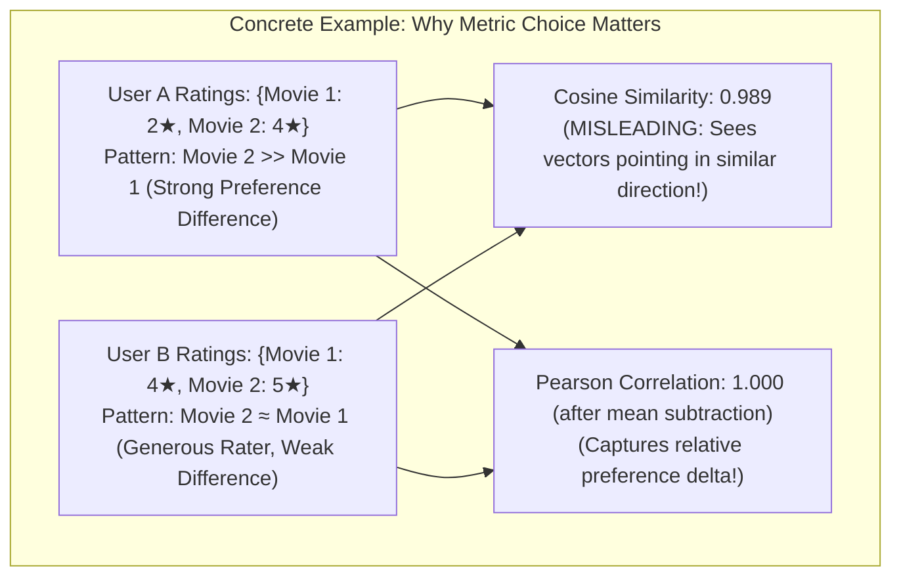

> **Why Industry Shifted from UBCF to IBCF:**
> In web applications, $|U| \gg |I|$ (e.g., Amazon has 300 million users and 10 million products). User taste vectors change constantly with every click, making the user similarity matrix $O(|U|^2)$ computationally intractable to maintain in real time. Items change much slower, and item similarity matrices $O(|I|^2)$ can be precomputed offline in nightly batch jobs.

### 2.3 Content-Based Filtering
While Collaborative Filtering relies strictly on interaction patterns, Content-Based Filtering builds an explicit feature representation for items and users:
*   **Item Profiles:** Feature vectors derived from metadata (TF-IDF of descriptions, genre tags, cast, pricing, categories).
*   **User Profiles:** The aggregated centroid of all item vectors the user has positively engaged with:
    $$u_{\text{profile}} = \frac{1}{|I_u^+|} \sum_{i \in I_u^+} w_i \cdot x_i$$
*   **Trade-off:** Completely solves the **New Item Cold-Start problem** (an item with zero interactions can be embedded immediately from its metadata). However, it suffers from severe **filter bubble entrapment** (cannot discover unexpected interests outside its lexical overlap) and cannot capture cross-user behavioral signals.

### 2.4 Matrix Factorization: Funk SVD, Implicit ALS, and BPR

Matrix Factorization compresses the sparse interaction matrix $R \in \mathbb{R}^{|U| \times |I|}$ into the low-rank product of two dense matrices: User Latent Factors $P \in \mathbb{R}^{|U| \times d}$ and Item Latent Factors $Q \in \mathbb{R}^{|I| \times d}$, where $d \ll \min(|U|, |I|)$ (typically $d \in [32, 256]$).

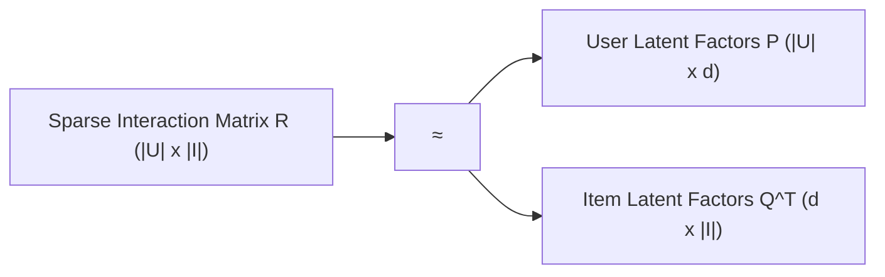

#### 1. Funk SVD (The Netflix Prize Baseline)
Simon Funk (2006) formulated the prediction of observed ratings as the dot product of latent vectors plus user and item bias scalars:

$$\hat{r}_{u, i} = \mu + b_u + b_i + p_u^T q_i$$

*   $\mu$: Global baseline rating across all users and items.
*   $b_u$: User bias (how much user $u$ systematically rates above/below average).
*   $b_i$: Item bias (how much item $i$ systematically rates above/below average).
*   $p_u, q_i \in \mathbb{R}^d$: Dense latent representations.

**Optimization Objective (Mean Squared Error with $L_2$ Regularization):**
$$\min_{P, Q, b} \sum_{(u, i) \in \mathcal{K}} \left( r_{u, i} - (\mu + b_u + b_i + p_u^T q_i) \right)^2 + \lambda \left( \|p_u\|_2^2 + \|q_i\|_2^2 + b_u^2 + b_i^2 \right)$$

Where $\mathcal{K}$ is strictly the set of *observed* ratings. Missing entries are ignored, completely bypassing the need for zero-imputation.

#### 2. SVD++ (Koren, 2008 — Integrating Implicit Feedback)
A user's explicit ratings ($1-5$ stars) are sparse, but their *implicit browsing history* (which items they viewed, clicked, or completed) carries tremendous signal regardless of whether they rated them. SVD++ augments the user factor $p_u$ with an implicit preference vector:

$$\hat{r}_{u, i} = \mu + b_u + b_i + q_i^T \left( p_u + |I_u|^{-\frac{1}{2}} \sum_{j \in I_u} y_j \right)$$

*   $I_u$: The set of all items user $u$ has interacted with implicitly.
*   $y_j \in \mathbb{R}^d$: A latent factor vector for item $j$ representing the preference signaled simply by choosing to examine item $j$.
*   $|I_u|^{-\frac{1}{2}}$: Normalization factor so active users don't dominate latent space magnitude.

#### 3. Implicit Alternating Least Squares (iALS)
In production, explicit ratings are rare. Platforms deal with clicks, page views, and completions. Hu, Koren, and Volinsky (2008) adapted matrix factorization for implicit data by introducing **confidence** and **preference**:

*   **Binary Preference:** $p_{u, i} = 1$ if user interacted with item $i$ ($r_{u, i} > 0$), else $p_{u, i} = 0$.
*   **Confidence Weight:** $c_{u, i} = 1 + \alpha r_{u, i}$ (where $\alpha$ is a hyperparameter, often $\alpha \approx 40$). If a user watched a video 10 times, confidence in preference is high; if $r_{u, i} = 0$, confidence is at its baseline floor of $1$.

**Objective Function:**
$$\min_{P, Q} \sum_{u} \sum_{i} c_{u, i} \left( p_{u, i} - p_u^T q_i \right)^2 + \lambda \left( \sum_u \|p_u\|_2^2 + \sum_i \|q_i\|_2^2 \right)$$

*Notice:* The summation runs over **all $|U| \times |I|$ pairs**, not just observed interactions. 

**Why Alternating Least Squares (ALS) and the Spark Sparsity Trick:**
Because both $p_u$ and $q_i$ are unknowns, the objective is non-convex. However, if you **fix $Q$**, the objective becomes a quadratic function of $P$ with a closed-form ridge regression solution for each user independently:

$$p_u = \left( Q^T C_u Q + \lambda I \right)^{-1} Q^T C_u p_u^*$$

Where $C_u$ is an $|I| \times |I|$ diagonal matrix of confidence values $c_{u, i}$, and $p_u^*$ is the binary preference vector for user $u$.

```
THE iALS COMPUTATIONAL BREAKTHROUGH:
Naively, computing Q^T C_u Q requires multiplying a [d x |I|] matrix by an [|I| x |I|] diagonal matrix, 
costing O(|I| · d^2) per user. Across 100M users and 10M items, this is computationally impossible.

The Mathematical Trick:
Rewrite C_u as:  C_u = I + (C_u - I)
Notice that (C_u - I) is EXTREMELY SPARSE: it is non-zero ONLY for the small handful of items 
user u actually interacted with (typically |R_u| ≈ 50 items)!

Substitute this back:
Q^T C_u Q = Q^T (I + (C_u - I)) Q = (Q^T Q) + Q^T (C_u - I) Q

1. Precompute (Q^T Q) ONCE per global iteration (takes O(|I| · d^2)) and share it across all users.
2. For each user u, compute Q^T (C_u - I) Q ONLY over their interacted items: O(|R_u| · d^2).
Compute cost drops from O(|I| · d^2) down to O(|R_u| · d^2 + d^3)!
This 1,000x to 100,000x speedup is why iALS scales to billions of interactions on Apache Spark.
```

#### 4. Bayesian Personalized Ranking (BPR)
Rendle et al. (2009) recognized that recommendation is not a rating prediction task, but a **ranking task**. A model does not need to predict whether an interaction score is $0.2$ or $0.8$; it only needs to ensure that positive items are scored higher than unobserved items.

BPR optimizes over triples $(u, i, j) \in D_S$, where user $u$ has engaged with item $i$ (positive) and has not engaged with item $j$ (negative):

$$\mathcal{L}_{\text{BPR}} = \sum_{(u, i, j) \in D_S} \ln \sigma(\hat{x}_{u, i, j}) - \lambda_\Theta \|\Theta\|_2^2$$

Where:
$$\hat{x}_{u, i, j} = \hat{r}_{u, i} - \hat{r}_{u, j} = p_u^T q_i - p_u^T q_j = p_u^T (q_i - q_j)$$

And $\sigma(z) = \frac{1}{1 + e^{-z}}$ is the sigmoid function. Maximizing $\ln \sigma(\hat{x}_{u, i, j})$ forces $p_u^T q_i \gg p_u^T q_j$, directly maximizing the area under the ROC curve (AUC).

### 2.5 Hybrid Patterns & Why MF Survives in 2026

Can classic Matrix Factorization be used as a final ranker today? **No.**
*   MF computes a static dot product $p_u^T q_i$.
*   It cannot ingest real-time contextual features (time of day, current device, network speed).
*   It cannot ingest sequential behavioral intent (what the user clicked 30 seconds ago).
*   It cannot perform non-linear cross-feature combinations (e.g., user age $\times$ item price category).

**Where MF Still Lives in Modern Systems:**
1.  **Lightweight Candidate Retrieval Channel:** Running parallel to deep neural retrieval, ALS or BPR vectors generated nightly on Spark provide high-quality candidate items for stable, long-term preferences at virtually zero inference cost.
2.  **Warm-Start Embeddings:** The factorized matrices $P$ and $Q$ serve as the static initialization weights for deep embedding layers in downstream neural rankers.

---

## 3. Deep Two-Tower Neural Retrieval

The **Two-Tower Architecture** (originating from Microsoft's DSSM and popularized for video recommendation by YouTube in 2016) is the bedrock of industrial candidate generation. It extends matrix factorization by replacing static lookup tables with deep neural networks capable of ingesting arbitrary sparse, dense, and sequential features.

### 3.1 The Two-Tower Architecture & Dot-Product Constraint

The architecture decouples the candidate generation space into two completely independent neural networks:

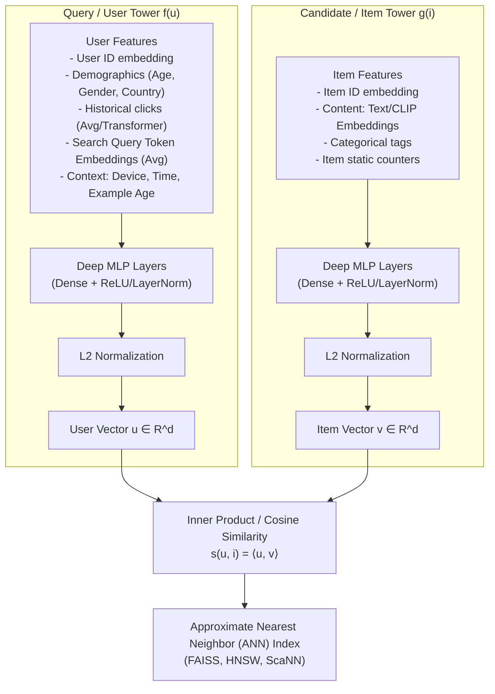

#### YouTube's 2016 Architectural Blueprints & The "Example Age" Trick
In YouTube's seminal 2016 candidate generation paper (Covington et al.), the User Tower introduced three foundational patterns adopted across the industry:
1.  **Variable-Length Sequence Pooling:** A user's sparse watch history sequence $\{v_1, v_2, \dots, v_N\}$ is mapped through a shared item embedding table, and averaged: $\bar{v} = \frac{1}{N} \sum_{k=1}^N v_k$. The same is done for search token unigrams and bigrams.
2.  **Selective Initialization:** Item embeddings in the Item Tower are initialized using pre-trained multimodal representations (e.g., text descriptions, video frames) rather than random noise, accelerating convergence.
3.  **The "Example Age" Feature Trick (Combating Freshness Decay):**
    *   *The Problem:* Users have a strong natural preference for fresh content, but machine learning models trained on historical logs are inherently biased toward older, established videos with millions of historical views.
    *   *The YouTube Innovation:* During training, feed the continuous feature $\text{Example Age} = t_{\text{training}} - t_{\text{event}}$ into the input layer. The model learns the baseline decay of video popularity over time.
    *   *At Serving Time:* Set $\text{Example Age} = 0$ (or a slightly negative value). This forces the model to predict video likelihood conditioned on the immediate present, naturally boosting fresh uploads to their peak initial engagement potential without manual heuristics!

#### The Fundamental Architectural Constraint
> **CRITICAL STAFF-LEVEL PRINCIPLE:**
> **No feature may cross between the User Tower and the Item Tower.**
> If user features and item features interact inside the neural layers (e.g., via concatenation or cross-attention), you can no longer precompute item representations.
> 
> Because the item tower $g(i)$ depends *only* on item features, all $100\text{M}+$ item embeddings $v_i \in \mathbb{R}^d$ can be precomputed offline, normalized to the unit hypersphere ($\|v_i\|_2 = 1$), and loaded into an Approximate Nearest Neighbor (ANN) vector database.
> 
> At inference time, only the User Tower $f(u)$ runs online ($2\text{ms}$). The resulting vector $u$ queries the ANN index via Maximum Inner Product Search (MIPS) to retrieve the top-1,000 items in under $10\text{ms}$.

### 3.2 Contrastive Loss & In-Batch Negative Sampling

Training a retrieval model over a catalog of $|I| = 10^8$ items using full multiclass cross-entropy is impossible because the softmax denominator requires summing over all items:

$$P(i \mid u) = \frac{\exp(s(u, v_i) / \tau)}{\sum_{j \in I} \exp(s(u, v_j) / \tau)}$$

Computing $\sum_{j=1}^{10^8} \exp(\dots)$ for every training step would melt any GPU cluster.

#### In-Batch Negative Sampling
Instead of sampling negatives uniformly from the catalog, modern two-tower models use **In-Batch Negatives**. Within a training batch of $B$ positive pairs $(u_1, v_1^+), (u_2, v_2^+), \dots, (u_B, v_B^+)$, for user $u_k$, item $v_k^+$ is the positive label, and all other $B-1$ items in the batch $\{v_j^+\}_{j \neq k}$ serve as negatives.

The similarity matrix $S \in \mathbb{R}^{B \times B}$ is computed via a single matrix multiplication:
$$S = U \cdot V^T \quad \text{where } U \in \mathbb{R}^{B \times d}, V \in \mathbb{R}^{B \times d}$$

The loss is the symmetrical InfoNCE (Information Noise-Contrastive Estimation) loss:

$$\mathcal{L} = -\frac{1}{B} \sum_{i=1}^B \log \frac{\exp(s(u_i, v_i^+) / \tau)}{\exp(s(u_i, v_i^+) / \tau) + \sum_{j \neq i}^B \exp(s(u_i, v_j^+) / \tau)}$$

*Computational Efficiency:* With $B = 4096$, each user is contrasted against 1 positive and 4,095 negatives with zero additional forward passes through the item tower.

### 3.3 Popularity Bias & The LogQ Correction Formula

While in-batch negative sampling is computationally elegant, it introduces a severe mathematical flaw: **Item Sampling Probability is Proportional to Item Popularity**.

If item $j$ is a viral video viewed by $10\%$ of all users, it will appear in random batches with frequency proportional to its popularity $p_j$. Consequently, item $j$ acts as a **negative example** far more frequently than a niche long-tail item. The InfoNCE loss penalizes item $j$'s embedding continuously, suppressing its predicted score simply because it appeared often in training batches.

#### The Mathematical Correction (Yi et al., Google 2019)
Let $p_j$ denote the background sampling probability of item $j$ (computed via running frequency in streaming data: $p_j = \frac{\text{count}(j)}{N_{\text{total}}}$).

We modify the raw similarity score $s(u_i, v_j)$ by subtracting the log of its sampling probability:

$$s'(u_i, v_j) = s(u_i, v_j) - \log(p_j)$$

Plugging this into the InfoNCE loss:

$$\mathcal{L}_{\text{LogQ}} = -\frac{1}{B} \sum_{i=1}^B \log \frac{\exp\left( \frac{s(u_i, v_i^+) - \log(p_i)}{\tau} \right)}{\exp\left( \frac{s(u_i, v_i^+) - \log(p_i)}{\tau} \right) + \sum_{j \neq i}^B \exp\left( \frac{s(u_i, v_j^+) - \log(p_j)}{\tau} \right)}$$

```
Derivation Intuition:
Why does subtracting log(p_j) fix the bias?
The probability that item j appears in a random batch of size B is approximately B * p_j.
The expected cross-entropy loss under in-batch sampling is:
E[Loss] ∝ exp(s(u, j)) * (B * p_j) = B * exp(s(u, j) + log(p_j))
By explicitly subtracting log(p_j) from s(u, j) inside the exponent, 
exp(s(u, j) - log(p_j) + log(p_j)) = exp(s(u, j)), 
the popularity factor p_j cancels out entirely, recovering the true uncorrupted distribution!
```

> **Interview Distinction:**
> At serving time, **do NOT subtract $\log(p_j)$**. The LogQ correction is strictly a training-time adjustment to prevent gradient penalization. At inference time, true item popularity *should* naturally help ranking; removing $\log(p_j)$ during serving would unfairly penalize popular items in real traffic.

### 3.4 Hard Negative Mining & Curriculum Learning Schedule

In-batch negatives are essentially **random negatives**. For a user browsing machine learning tutorials, an in-batch negative might be a cooking recipe, a hip-hop music video, or a makeup tutorial. These are "easy negatives"—the model learns to separate broadly different categories within the first few training steps.

Once the model achieves $>95\%$ accuracy on easy negatives, gradients vanish. The model cannot learn subtle, fine-grained distinctions (e.g., distinguishing an advanced PyTorch distributed training video from an introductory Python syntax video).

```
Candidate Negatives Spectrum:
[Easy / Random Negatives] ─────────► [Hard Negatives] ─────────► [False Positives (Danger)]
(Cooking video for ML query)     (Intro Python for ML query)     (Advanced CUDA video never clicked)
Gradient signal: ZERO            Gradient signal: OPTIMAL        Gradient signal: POISONOUS
```

#### How to Mine Hard Negatives in Production
1.  **Prior Retrieval Model Negatives:** Take items ranked at positions $100 - 1000$ by the current production retrieval system that the user saw or was offered in search/browse but did not click.
2.  **Graph Distance / Random Walk Negatives:** (Used at Pinterest): Items 2 hops away on the graph (share a category/board) but lack direct co-engagement.
3.  **Semantic Vector Negatives:** Query the vector index with user embedding $u$, find top-100 nearest neighbors, discard any that the user engaged with, and select items ranked between $50 - 200$.

#### The False Positive Trap & Manifold Collapse
If your mining strategy is too aggressive and pulls items ranked at positions $1 - 5$, you will mine **False Positives**—items that the user *would* have liked if shown, but simply hasn't seen yet. Penalizing these items as negatives destroys the geometric structure of the vector space (manifold collapse).

#### The Production Golden Ratio: 80 / 20 Mix
Never train exclusively on hard negatives. If every negative is a hard negative, the model loses its global calibration and forgets how to separate distant clusters.
The industry gold standard (Google, Meta, Pinterest) is:
$$\text{Batch Composition} = \mathbf{80\% \text{ Random In-Batch Negatives}} + \mathbf{20\% \text{ Mined Hard Negatives}}$$

#### Curriculum Learning Schedule
*   **Epochs 1–3:** Train on $100\%$ random in-batch negatives to establish stable cluster geometry.
*   **Epochs 4–7:** Introduce $10\%$ hard negatives mined from the 200–500 rank range.
*   **Epochs 8+:** Shift to the permanent production mix ($80\%$ in-batch $+ 20\%$ hard negatives).

### 3.5 The Temperature Parameter ($\tau$) Mathematical Behavior

In the InfoNCE loss, the inner product is divided by a scalar temperature $\tau > 0$:

$$\text{Logit} = \frac{\langle u, v \rangle}{\tau}$$

Why can't we leave $\tau = 1$?

Consider the gradient of the InfoNCE loss with respect to the positive user-item similarity $s_i = \langle u, v_i^+ \rangle$:

$$\frac{\partial \mathcal{L}}{\partial s_i} = -\frac{1}{\tau} \left( 1 - P(i \mid u) \right) = -\frac{1}{\tau} \sum_{j \neq i} P(j \mid u)$$

Where $P(j \mid u) = \frac{\exp(s_j / \tau)}{\sum_k \exp(s_k / \tau)}$ is the softmax probability assigned to negative item $j$.

#### 1. When $\tau$ is Large ($\tau \to 1.0$ or higher):
The probability distribution $P(j \mid u)$ approaches a uniform distribution. Every negative item receives an identical small penalty. The model treats an obvious wrong item (cooking video) with the same urgency as a hard negative (intro Python video). The gradient magnitude $\frac{1}{\tau}$ is small, causing slow convergence.

#### 2. When $\tau$ is Small ($\tau \to 0.01 - 0.07$):
The softmax becomes extremely sharp (approaching an argmax). $P(j \mid u)$ concentrates almost entirely on the **single hardest negative** in the batch (the item with the highest $s_j$). All other negatives receive near-zero gradient. 
*   *Advantage:* Forces the model to create large margins between similar items.
*   *Risk:* If $\tau$ is too small, gradients explode ($\frac{1}{\tau} \to \infty$) and the model overfits to noisy false positives.

**Empirical Production Range:** Across Meta, YouTube, and Pinterest, $\tau$ is tuned between **$0.05$ and $0.1$** (with normalized unit vectors where $\langle u, v \rangle \in [-1, 1]$).

---

## 4. Vector Search Infrastructure & Approximate Nearest Neighbor (ANN)

Once the Item Tower produces $100\text{M}+$ normalized vectors $v_i \in \mathbb{R}^d$, we must index them to support real-time querying.

### 4.1 Why Brute Force Fails: The Complexity Gap

To find the top-$K$ items by maximum cosine similarity:

$$i^* = \arg\max_{i \in I} \langle u, v_i \rangle$$

*   **Brute-Force Complexity:** $O(|I| \cdot d)$ floating-point operations per request.
*   For $|I| = 10^8$ items with embedding dimension $d = 128$:
    $$\text{Operations} = 10^8 \times 128 = 1.28 \times 10^{10} \text{ FLOPs per query}$$
*   At $10,000 \text{ QPS}$, this demands $128 \text{ TeraFLOPs/sec}$ of continuous compute just for candidate generation. Latency exceeds $200\text{ms}$ on CPU nodes.

**The ANN Principle:** We do not need the *exact* mathematical top-$K$ items. If an item ranked #1 has similarity $0.941$ and an item ranked #3 has similarity $0.939$, returning the #3 item does not harm user experience. We trade $1-2\%$ recall for a **$100\times - 1000\times$ speedup**.

### 4.2 Inverted File Index (IVF) & Product Quantization (PQ)

#### Inverted File Index (IVF)
IVF partitions the $d$-dimensional vector space into $C$ Voronoi cells using $k$-means clustering on offline item embeddings:

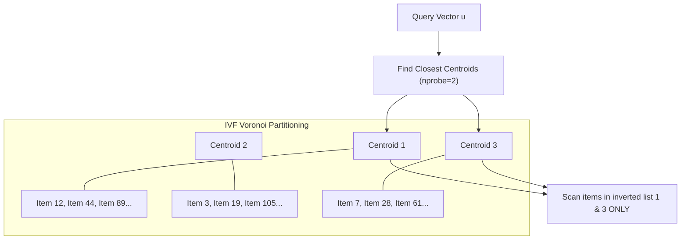

*   **Indexing:** Cluster $10^8$ vectors into $nlist$ centroids (e.g., $nlist = 65,536$). Assign each vector to its nearest centroid's posting list.
*   **Querying:** Given query vector $u$, compute distance to all $nlist$ centroids ($65,536 \times 128 \approx 8.3\text{M}$ FLOPs, very fast). Select the closest $nprobe$ centroids (e.g., $nprobe = 16$).
*   **Search:** Scan *only* the vectors stored in those 16 posting lists, pruning $>99.9\%$ of the catalog from consideration.

#### Product Quantization (PQ)
While IVF solves compute, it does not solve **RAM bottlenecks**. Storing $10^8$ float32 vectors of dimension $d = 128$ requires:

$$\text{Memory} = 10^8 \times 128 \times 4 \text{ bytes} = 51.2 \text{ GB RAM (uncompressed)}$$

Across multiple index shards and replicas, RAM costs explode. **Product Quantization (PQ)** compresses vectors into compact byte codes:

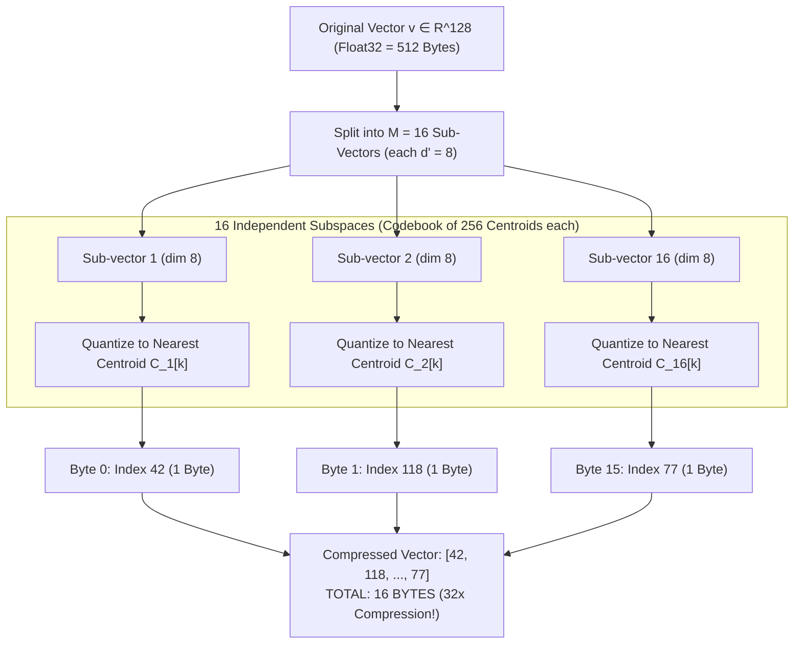

1.  Divide $d$-dimensional vector into $M$ distinct sub-vectors of dimension $d' = d / M$ (e.g., $M = 16, d' = 8$).
2.  Run $k$-means on each sub-space independently with $K^* = 256$ centroids.
3.  Each sub-vector is replaced by the **1-byte index** ($0 - 255$) of its closest centroid.
4.  A 128-d vector is compressed from **512 bytes down to 16 bytes**.

#### Asymmetric Distance Computation (ADC)
When a query $u$ arrives, we do not decompress the PQ codes. Instead:
1.  Divide query $u$ into $M$ sub-vectors $u_1, \dots, u_M$.
2.  Precompute an $M \times 256$ lookup table containing the distance from each query sub-vector $u_m$ to all 256 centroids of that subspace.
3.  Compute the distance to any item in the catalog via **$M$ simple table lookups and additions**, with zero vector-vector multiplications:

$$\text{Dist}(u, v) \approx \sum_{m=1}^M \text{Table}_m[\text{PQCode}(v)_m]$$

#### Google SCaNN: Anisotropic Vector Quantization
Standard Product Quantization minimizes $L_2$ reconstruction error: $\|v - \tilde{v}\|_2^2$. However, in recommendation retrieval, we care about **Maximum Inner Product Search (MIPS)**: $\langle u, v \rangle$, not $L_2$ distance.

Google's **SCaNN (Score-aware Quantization Loss)** (Guo et al., ICML 2020) recognized that quantization errors orthogonal to $v$ barely affect inner products with $u$, whereas quantization errors parallel to $v$ drastically alter the inner product ranking. SCaNN uses an **anisotropic loss function** that penalizes parallel quantization error up to $10\times$ more heavily than orthogonal error:

$$\mathcal{L}_{\text{SCaNN}}(v, \tilde{v}) = h_{\|}(v) \cdot \|(v - \tilde{v})_{\|}\|^2 + h_{\bot}(v) \cdot \|(v - \tilde{v})_{\bot}\|^2$$

*Result:* Yields **$2\times$ the throughput of standard FAISS IVF-PQ** at identical recall thresholds on MIPS benchmarks.

### 4.3 IVF-PQ with Residual Quantization Math

If you quantize raw vectors directly with PQ inside an IVF index, quantization error is high because the centroid distance dominates the variance. **IVF-PQ** solves this by quantizing the **residual vector** rather than the absolute vector:

Let $c(v)$ be the nearest IVF centroid for item vector $v$.
The residual vector is:
$$r_v = v - c(v)$$

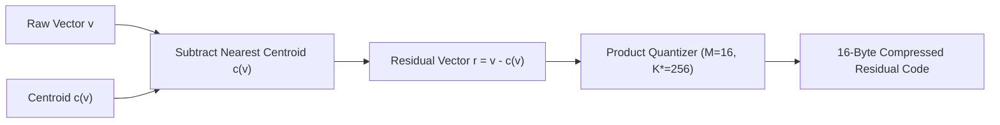

Because $\|r_v\| \ll \|v\|$, the dynamic range of values is concentrated near zero. Subspace quantization centroids fit the residual distribution with drastically lower reconstruction error, preserving fine-grained ranking margins.

### 4.4 Hierarchical Navigable Small World (HNSW) Graphs

While IVF-PQ is the king of memory compression, **HNSW (Hierarchical Navigable Small World)** is the undisputed king of **raw Recall vs. Latency performance** when memory is plentiful.

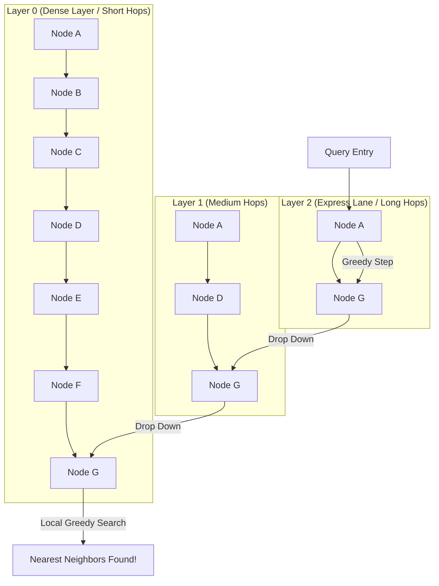

*   **Skip-List Analogy:** HNSW organizes vectors into a multi-layer graph. Upper layers have sparse nodes with long-range links ("expressways"). Bottom layers have dense nodes with short-range links ("local streets").
*   **Search Routing:**
    1.  Enter at the top sparse layer. Greedily hop to the neighbor closest to query $u$.
    2.  When no neighbor is closer to $u$ than the current node, step down to the next layer.
    3.  Repeat until reaching Layer 0, then perform a bounded priority-queue beam search ($efSearch$) to collect the top-$K$ nearest neighbors.
*   **Complexity:** Average search time scales logarithmically: $O(\log N)$.
*   **Trade-off:** High memory consumption. HNSW stores raw vectors plus graph adjacency lists ($\approx 1.5 - 2\times$ raw vector memory, needing up to $100\text{ GB}+$ RAM per $100\text{M}$ items).

### 4.5 The "Metadata Filtering Dilemma" & LinkedIn's GPU Exhaustive + RAR

In real production systems, you almost never query an unconstrained vector index. A recommendation request comes with heavy business and privacy filters:
*   *LinkedIn Job Search:* Candidate must be in "San Francisco", have "Python" skill, and company cannot be their current employer.
*   *E-commerce:* Item must be "In Stock", "Ships within 24 hours", and priced under 50 USD.

This introduces the **Metadata Filtering Dilemma**:


1.  **Post-Filtering Fails via "Liquidity Collapse":** If you retrieve top-1,000 items via ANN and then apply a filter that only $0.1\%$ of the catalog satisfies, on average **only 1 item survives**. The user sees an empty feed.
2.  **Pre-Filtering Fails in Standard ANN:** If you query relational metadata first and get 50,000 valid IDs, you cannot efficiently traverse a global HNSW graph because stepping onto an invalid node is disallowed, severing navigation paths.

#### LinkedIn's Production Solution: GPU Exhaustive + RAR (Retrieve and Rerank)
LinkedIn Engineering encountered this exact failure mode when scaling Member Search and Job Recommendations. With strict connection degrees, geographic boundaries, and enterprise privacy rules, ANN graphs frequently broke down.

**Their Solution:** Abandon graph ANN entirely for filtered surfaces in favor of **GPU Exhaustive Scoring + RAR**:

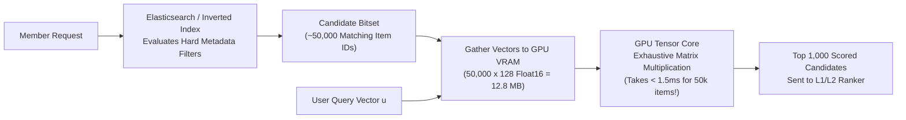

*   **Why It Works:** While scanning $10^8$ items on GPU is slow, running a dense matrix multiplication of $[1 \times 128] \times [128 \times 50,000]$ on modern NVIDIA Tensor Cores takes **less than $1.5\text{ms}$**.
*   **Takeaway:** If metadata filters prune the candidate space down to $\le 100,000$ items, **brute-force GPU matrix multiplication is faster, cheaper, and yields $100\%$ exact recall with zero index fragmentation**.

#### Vector Database Comparison for Production RecSys
When selecting an ANN engine for candidate retrieval, the trade-offs between pure C++ libraries (FAISS) and distributed managed vector databases (Milvus, Pinecone, Qdrant) depend heavily on scale, mutation frequency, and metadata filtering needs:

| Engine | Primary Index Types | Metadata Filtering Support | Real-Time Dynamic Mutations | Best For | Production Status |
| :--- | :--- | :--- | :--- | :--- | :--- |
| **FAISS (Meta)** | IVF-PQ, HNSW, Flat | Custom / Manual Bitsets | Requires periodic re-index rebuilds | Ultra-low latency embedded CPU/GPU serving | **Universal Industry Standard** (YouTube, Pinterest, Meta) |
| **Google ScaNN** | Anisotropic PQ + Tree | Basic | Read-only static shards | Maximum inner-product (MIPS) throughput | **Widely Used** across Google & YouTube |
| **Milvus** | HNSW, IVF-PQ, SCaNN | Native boolean payload filters | High (LSM-tree write buffers) | Billion-scale self-hosted distributed clusters | Deployed at large enterprise tech |
| **Qdrant** | Filterable HNSW | HNSW payload traversal filtering | High (Segment-based storage) | Real-time filtered retrieval & multimodal search | Rapidly growing enterprise adoption |
| **Pinecone** | Proprietary Graph/PQ | Serverless metadata indexing | Fully managed dynamic updates | Cloud-native rapid deployment without ops overhead | High SaaS adoption |
| **pgvector (Postgres)**| HNSW, IVFFlat | Full SQL relational joins & WHERE clauses | ACID transactional | Catalogs $< 5\text{M}$ items where metadata is relational | Standard for small-to-medium platforms |

---

## 5. Multi-Interest & Graph-Based Retrieval

### 5.1 The Single-Vector Bottleneck

Standard Two-Tower architectures compress all user history into a **single 128-dimensional embedding**. 

Consider a user who is:
1.  An ML engineer looking for deep learning papers (60% of past clicks).
2.  An amateur woodworker buying router bits (30% of past clicks).
3.  A parent looking for toddler bedtime stories (10% of past clicks).

If the User Tower averages these behaviors through an MLP into a single vector $u_{\text{avg}}$, that vector lands in an unoccupied geometric vacuum between machine learning, carpentry, and children's books:

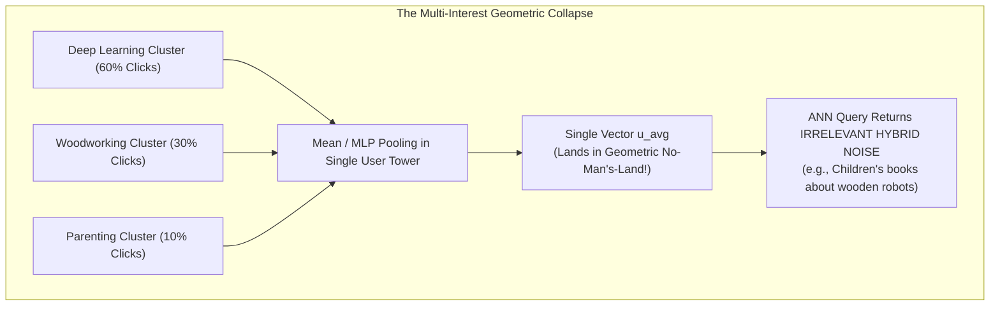

When $u_{\text{avg}}$ queries an ANN index, it retrieves irrelevant hybrid noise rather than high-relevance items from any of the three distinct domains.

### 5.2 Pinterest PinnerSage: Multi-Modal Cluster Medoids

Pinterest solved this with **PinnerSage** (Pancha et al., KDD 2020). Instead of forcing a user into a single embedding, PinnerSage represents a user by **multiple cluster medoids** in real time:

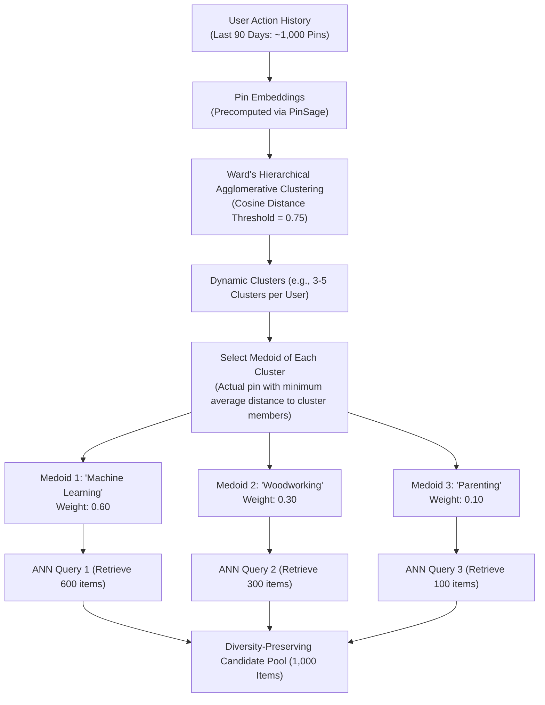

#### Why Medoids Instead of Centroids?
*   A centroid (mean vector) can drift away from the data manifold into an invalid region.
*   A **Medoid** is an *actual historical pin* that was engaged with by the user. It is guaranteed to lie on the valid pin manifold, ensuring clean ANN query results.
*   **Serving Architecture:** At request time, PinnerSage dispatches parallel ANN queries for each medoid, allocating candidate budgets proportional to cluster engagement frequency, completely eliminating the multi-interest collapse.

### 5.3 Graph Convolutions: Pinterest PinSage & LinkedIn PYMK

Recommendation platforms are naturally modeled as massive heterogeneous graphs:
*   *Pinterest:* Bipartite graph connecting Pins and Boards ($7.5\text{B}$ nodes, $18\text{B}$ edges).
*   *LinkedIn:* Graph connecting Members, Companies, Schools, and Posts.

#### Pinterest PinSage (Ying et al., KDD 2018)
Standard Graph Convolutional Networks (GCNs) require computing convolutions over the full neighborhood of every node, which is impossible on a billion-node web graph. PinSage introduced **localized random walk convolutions**:

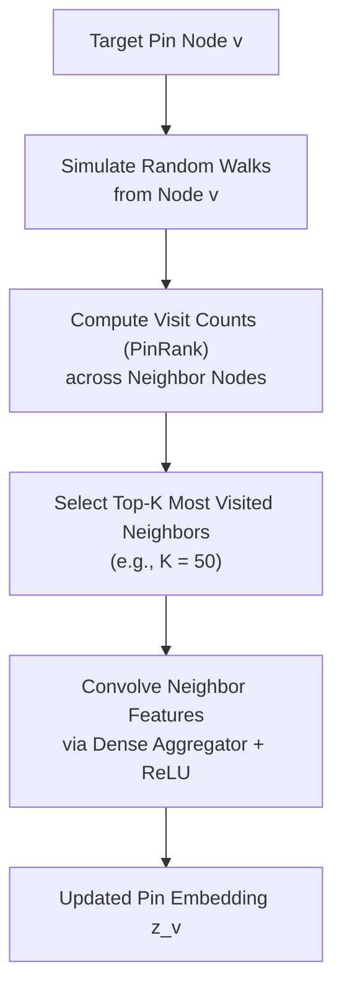

1.  **Importance Pooling via Random Walks:** From target node $v$, simulate random walks. Calculate the $L_1$-normalized visit count (PinRank) for all visited nodes. The top-$K$ nodes with highest visit counts become the computational neighborhood $\mathcal{N}(v)$.
2.  **Neighborhood Aggregation:** Aggregate neighbor representations weighted by their PinRank scores using a localized neural convolution:
    $$h_{\mathcal{N}(v)} = \text{ReLU}\left( W \cdot \text{MEAN}\left(\{ \gamma_u h_u, \forall u \in \mathcal{N}(v) \}\right) + b \right)$$
3.  **Hard Negative Mining via Graph Distance:** PinSage mines hard negatives directly from the graph: items that have high PinRank (2–3 hops away) but are *not* connected to node $v$ by an edge. These are visually and semantically similar items that users didn't pin, providing elite gradient signals.

#### LinkedIn People You May Know (PYMK)
LinkedIn uses graph link prediction based on **Random Walk with Restart (RWR)** and triangle-closing algorithms over the member-connection graph to identify potential connections based on mutual connections, shared employers, and shared educational institutions.

### 5.4 Multimodal Item Encoders (ItemSage)
Modern item towers do not rely solely on ID lookup tables. Systems like Pinterest's **ItemSage** fuse:
*   **Visual Embeddings:** Vision Transformer (ViT) vectors extracted from pin images.
*   **Textual Embeddings:** Transformer sentence embeddings from pin titles, descriptions, and OCR text.
*   **Graph Context:** PinSage graph neighborhood vectors.
*   **Fusion Layer:** A multi-modal cross-attention projection that maps vision, text, and graph into a unified item embedding space.

---

## 6. Generative Retrieval & The Semantic ID Revolution (2024–2026)

We are currently witnessing the largest paradigm shift in candidate retrieval since Two-Tower models emerged in 2016: **The Transition from Vector Search (MIPS) to Generative Retrieval using Semantic IDs**.

### 6.1 The Paradigm Shift: From MIPS Vector Search to Token Generation

```mermaid
flowchart TD
    subgraph Traditional ["Traditional Dual-Tower Retrieval (2016 - 2024)"]
        T1["User Interaction History"] --> T2["User Tower MLP"]
        T2 --> T3["Continuous User Vector u ∈ R^128"]
        T3 --> T4["ANN Index Search (FAISS / HNSW)"]
        T4 --> T5["Retrieve Top-K Item IDs via Dot-Product"]
    end

    subgraph Generative ["Generative Semantic ID Retrieval (2024 - 2026+)"]
        G1["User History as Semantic Token Sequence"] --> G2["Autoregressive Transformer Decoder<br/>(e.g., TIGER / YouTube PLUM)"]
        G2 --> G3["Generate Discrete Tokens<br/>P(c1 | hist) → P(c2 | hist, c1) → P(c3 | hist, c1, c2)"]
        G3 --> G4["Trie / Prefix Tree Beam Search"]
        G4 --> G5["Decoded Candidate Item IDs"]
    end
```

#### Why Replace Two-Tower Vector Search?
1.  **Memory Footprint:** Storing billions of 128-d float embeddings in FAISS requires hundreds of gigabytes of RAM.
2.  **Loss of Expressivity:** Dot products assume symmetric, linear geometric proximity. They cannot model complex multi-step reasoning or hierarchical taxonomy dependencies.
3.  **Vector Quantization Disconnect:** Training embedding representations and building an approximate vector index (IVF/HNSW) are two disconnected steps. Generative retrieval unifies indexing and retrieval into a single differentiable neural network.

### 6.2 Semantic IDs via Residual Quantized VAE (RQ-VAE / TIGER)

To generate items using a language model, **items must be represented as tokens**. However, assigning an arbitrary random integer ID (e.g., `item_481029`) fails because the model cannot generalize across unrelated numbers.

Instead, systems use **Residual Quantized Variational Autoencoders (RQ-VAE)** (Rajput et al., Google TIGER, NeurIPS 2023) to assign each item a **hierarchical Semantic ID tuple**:

$$\text{Item } i \longrightarrow \langle c_1, c_2, c_3 \rangle \quad \text{where } c_k \in \{0, \dots, 255\}$$

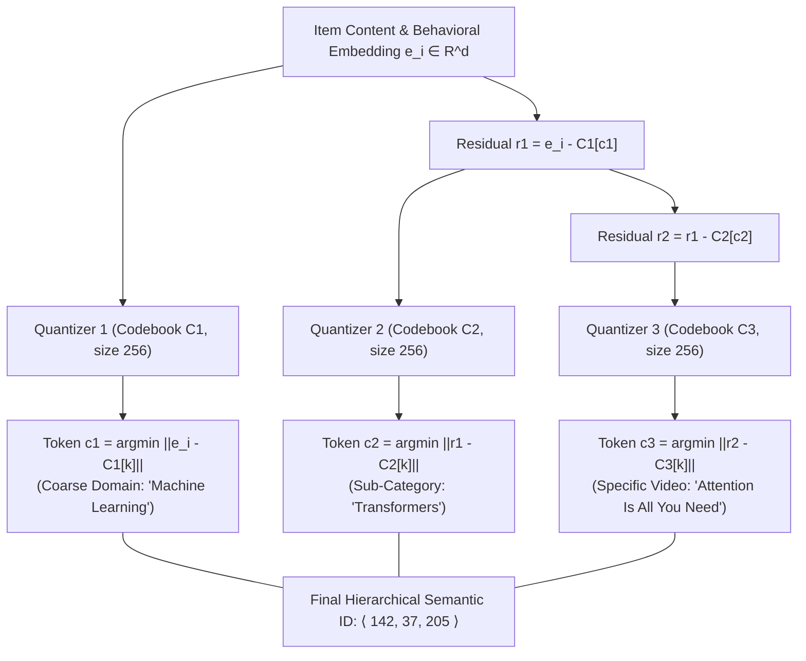

#### The Power of Semantic IDs:
*   Items with similar content and co-occurrence patterns **share token prefixes by construction**.
*   A newly uploaded item (cold start) can be passed through the frozen RQ-VAE to receive its semantic ID tuple immediately, making it **instantly retrievable** by the generative transformer without rebuilding indices!

### 6.3 Autoregressive Beam Search Decoding

Retrieval is formulated as sequence-to-sequence generation:
*   **Input Sequence:** User's recent interaction history encoded as semantic tokens:
    $$\text{Input} = [\langle 142, 37, 205 \rangle, \langle 142, 37, 891 \rangle, \langle 519, 8, 332 \rangle]$$
*   **Autoregressive Prediction:** The Transformer decoder predicts the next item's semantic tuple token by token:
    $$P(\text{Next Item}) = P(c_1 \mid \text{History}) \times P(c_2 \mid \text{History}, c_1) \times P(c_3 \mid \text{History}, c_1, c_2)$$
*   **Constrained Beam Search over a Trie:** To ensure the model generates only valid Semantic IDs corresponding to real catalog items, beam search decoding is constrained against a prefix tree (Trie) of existing catalog items. A beam width of $100$ produces the top-100 candidates in under $15\text{ms}$.

### 6.4 YouTube's PLUM Framework (Production 2025 Deep-Dive)

In 2025, YouTube Engineering open-sourced details of their production generative retrieval system: **PLUM (Prefix-based Language Models for Unified Multimodal Recommendation)** (arxiv 2510.07784), deployed at scale for **YouTube Shorts**:

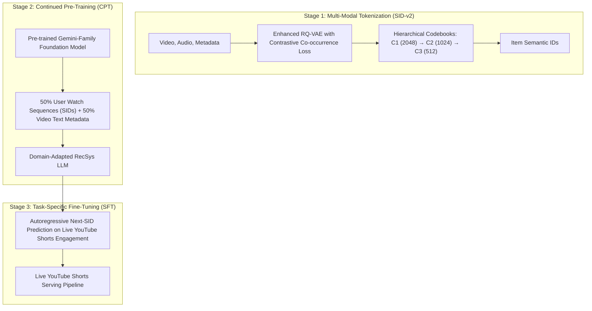

#### Production Results from YouTube:
*   **$+4.96\%$ Panel CTR Lift** on YouTube Shorts live A/B tests.
*   **$13.24\times$ Larger Effective Catalog Vocabulary:** Traditional two-tower models suffer from popularity head-bias; PLUM surfaced $13\times$ more unique long-tail videos to users.
*   **Scaling Laws:** Retrieval quality scaled monotonically with LLM parameter count (tested from 110M to 3B parameters).

### 6.5 Generative Retrieval vs. Traditional Vector Search Trade-Offs

| Evaluation Dimension | Traditional Two-Tower + ANN (FAISS/HNSW) | Generative Retrieval (TIGER / YouTube PLUM) |
| :--- | :--- | :--- |
| **Serving Latency** | **Extremely Low ($2 - 5\text{ms}$)** on CPU/GPU | **Moderate ($10 - 20\text{ms}$)** (sequential autoregressive beam search) |
| **Memory Footprint** | **Massive:** Hundreds of gigabytes for vector tables + indices | **Tiny:** Codebook size is trivial ($256 \times 3$ tokens); weights stay on GPU |
| **New Item Cold Start** | Requires adding vector to index (HNSW graph mutation) | Run content through RQ-VAE $\to$ immediate retrieval via existing tokens |
| **Non-Linear Expressivity** | Low: Limited to symmetric inner products ($u^T v$) | High: Deep transformer attention across historical token sequences |
| **Hardware Requirements** | Standard CPU nodes with large RAM | Demands modern GPU / TPU inference clusters |
| **2026 Production Reality** | The universal workhorse powering $\approx 90\%$ of platforms | Rapidly being deployed as an auxiliary high-recall channel for long-tail discovery |

---

## 7. Stage 1 Evaluation Metrics & System SLAs

When designing or defending the candidate generation layer in a system design interview, evaluate the system along two distinct pillars: **Model Quality Metrics** and **System / Infrastructure Metrics**.

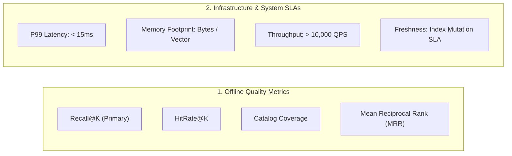

### 1. Offline Model Quality Metrics

#### Recall@K (The North Star of Retrieval)
Measures the proportion of ground-truth positive items that were successfully retrieved into the candidate pool of size $K$:

$$\text{Recall}@K = \frac{| \text{Retrieved Top-}K \cap \text{Relevant Items} |}{| \text{Relevant Items} |}$$

*   *Target:* In production systems feeding an L1/L2 ranker, target **$\text{Recall}@1000 \ge 0.80 - 0.90$**. If the top-1000 candidate set does not contain the item the user eventually clicked, the system failed at the first step.

#### HitRate@K
For single-session or single-target evaluation (e.g., predicting the exact next video watched):

$$\text{HitRate}@K = \frac{1}{|U|} \sum_{u \in U} \mathbb{I}(\text{Target Item}_u \in \text{Top-}K_u)$$

#### Catalog Coverage
Measures what percentage of the total item catalog $\mathcal{I}$ is retrieved across all users over a 24-hour test window:

$$\text{Coverage} = \frac{| \bigcup_{u \in U} \text{Top-}K_u |}{|\mathcal{I}|}$$

A Two-Tower model that achieves high Recall@K by repeatedly retrieving only the top-10,000 viral videos has a low coverage score, indicating extreme popularity bias and poor long-tail exploration.

### 2. Infrastructure & System SLAs

| Metric | Production Target | Failure Mitigation |
| :--- | :--- | :--- |
| **P99 Serving Latency** | **$\le 15\text{ms}$** | Shard ANN index across multiple nodes; lower $nprobe$ / $efSearch$; prune candidate sizes |
| **Throughput** | $\ge 10,000 \text{ QPS}$ per cluster | Horizontal replica scaling; batch query lookups |
| **Index Freshness** | Streaming items indexed within **$< 10\text{ minutes}$** | Hybrid index: static daily base index + dynamic in-memory buffer index |
| **RAM Footprint** | $\le 16\text{ bytes per item vector}$ | Product Quantization (PQ-16); INT8 quantization |

---

## 8. Staff-Level Interview Questions & Detailed Answers

### Question 1: Why can't we add user-item cross features (e.g., user age $\times$ item category) directly into the Two-Tower retrieval model?
**Candidate Answer:**
"Adding any feature that combines user attributes with item attributes directly inside the network violates the fundamental serving constraint of candidate retrieval. 

In a Two-Tower model, the User Tower $f(u)$ and Item Tower $g(i)$ are mathematically decoupled:

$$\text{Score}(u, i) = \langle f(u), g(i) \rangle$$

Because $g(i)$ depends *only* on item features, all 100 million item vectors can be computed once offline during nightly batch jobs and loaded into an ANN vector index (e.g., HNSW or ScaNN). At query time, we only run one single forward pass through $f(u)$ ($2\text{ms}$), followed by sub-linear vector search ($5\text{ms}$).

If we introduced a cross-feature $h(u, i)$, the item representation would become a function of the user: $g(i, u)$. We would have to recompute $g(i, u)$ for every single one of the 100 million items *for every incoming user request in real time*. That requires 100 million deep neural network forward passes per request, completely destroying our 15ms latency SLA. Cross-features must be reserved for the heavy ranking stage (L2), where candidate counts have already been pruned down to a few hundred."

---

### Question 2: In Two-Tower training with In-Batch Negatives, what is the mathematical mechanism of the LogQ correction, and what happens if you omit it?
**Candidate Answer:**
"In-Batch Negatives use the items from other users within the same mini-batch as negative examples. This means an item's probability of acting as a negative during gradient updates is directly proportional to its empirical popularity $p_j = \frac{\text{count}(j)}{N}$.

If we use vanilla InfoNCE loss without correction, popular items are penalized far more frequently than niche items. The model penalizes the logit of popular items simply because they appear frequently in batches, artificially crushing their embeddings.

The LogQ correction adjusts the raw similarity score before the softmax by subtracting the log of the background sampling probability:

$$s'(u_i, v_j) = s(u_i, v_j) - \log(p_j)$$

Under in-batch negative sampling, the expected probability of sampling item $j$ is $B \cdot p_j$. The term $\exp(s'(u_i, v_j)) = \exp(s(u_i, v_j) - \log(p_j)) = \frac{\exp(s(u_i, v_j))}{p_j}$. When multiplied by the sampling expectation $p_j$, the popularity factor cancels out mathematically, recovering the true uncorrupted catalog distribution. 

If you omit LogQ in production, your retrieval layer will suffer from **severe under-recommendation of head and trending items**, degrading recall on the platform's highest-converting inventory."

---

### Question 3: Explain the 'Metadata Filtering Dilemma' in Approximate Nearest Neighbor search. When would you choose LinkedIn's GPU Exhaustive + RAR approach over an HNSW index?
**Candidate Answer:**
"Standard ANN vector indices like HNSW build proximity graphs assuming unconstrained traversal across the entire vector space. In real systems, queries come with strict metadata filters (e.g., 'In Stock', 'Job located in London', '1st-degree connection').

*   **Post-Filtering** runs ANN search first to find top-1000 items, then filters out non-matching candidates. If the filter selectivity is high (e.g., only $0.1\%$ of items match), zero items survive, causing a catastrophic **liquidity collapse**.
*   **Pre-Filtering** filters the items first, but querying an arbitrary subset of IDs breaks the pre-built HNSW graph because traversing non-matching neighbor nodes is forbidden, disconnecting the search path.

**When to choose LinkedIn's GPU Exhaustive RAR:**
When metadata filters are highly selective and reduce the candidate universe down to $\approx 100,000$ items or fewer, building and maintaining complex filtered ANN graph structures is an antipattern. 

Instead, use an inverted index (e.g., Elasticsearch or Lucene) to evaluate the metadata filter and produce a matching ID bitset. Gather those 50,000 vectors into GPU memory. Modern NVIDIA Tensor Cores perform a dense matrix multiplication of $[1 \times 128] \times [128 \times 50,000]$ in **under $1.5\text{ms}$**. This achieves $100\%$ exact mathematical recall, eliminates graph fragmentation entirely, and is significantly cheaper to maintain."

---

### Question 4: Why does representing a multi-interest user with a single vector fail, and how does Pinterest's PinnerSage resolve this?
**Candidate Answer:**
"A single vector representation forces an embedding tower to compute an average across all historical behaviors. If a user is interested in Machine Learning (60%), Woodworking (30%), and Toddler Parenting (10%), the vector average lands in a geometric 'no-man's-land' between those distinct clusters. When passed to an ANN index, it retrieves irrelevant hybrid noise.

Pinterest's PinnerSage solves this by representing the user as **multiple cluster medoids**:
1. It takes the user's past 90 days of pin interactions (represented by their precomputed PinSage embeddings) and runs Ward's hierarchical agglomerative clustering with a cosine distance threshold.
2. For each resulting cluster (typically 3 to 5 clusters per user), it selects the **Medoid**—the actual physical pin with the minimal average distance to all other cluster members.
3. Because a medoid is an actual pin that exists on the valid data manifold, it never drifts into invalid space.
4. At inference time, PinnerSage dispatches parallel ANN queries for each medoid, allocating candidate quotas proportionally to cluster size (e.g., 600 ML pins, 300 woodworking pins, 100 parenting pins), ensuring diverse, high-precision candidate coverage."

---

### Question 5: What is Generative Retrieval with Semantic IDs (e.g., TIGER, YouTube PLUM), and what architectural trade-off does it make compared to Two-Tower MIPS?
**Candidate Answer:**
"Generative retrieval replaces vector search with **autoregressive token prediction**.

Instead of indexing continuous vectors in FAISS and performing Maximum Inner Product Search (MIPS), we discretize every item into a hierarchical Semantic ID tuple using Residual Quantized VAE (RQ-VAE):

$$\text{Item } i \longrightarrow \langle c_1, c_2, c_3 \rangle$$

Items with similar semantic content and user co-engagement naturally share prefix tokens (e.g., $c_1$ is broad category, $c_2$ is sub-genre, $c_3$ is specific video). A Transformer seq2seq model takes the user's historical sequence of Semantic IDs and autoregressively predicts the tuple tokens of the next item using beam search decoding constrained over a catalog prefix tree (Trie).

**The Architectural Trade-Off:**
*   *Advantage:* Massive memory reduction (eliminates hundreds of gigabytes of FAISS vector tables and index graphs; codebooks take $<1\text{MB}$); solves cold start because new items get an immediate Semantic ID via the frozen RQ-VAE; unifies indexing and retrieval into one end-to-end differentiable model.
*   *Disadvantage:* Compute latency is significantly higher ($10 - 20\text{ms}$ of sequential autoregressive GPU decoding vs. $2 - 5\text{ms}$ for MIPS on CPU). In 2026, it is primarily used as an auxiliary channel for high-value long-tail discovery (such as YouTube Shorts) alongside traditional Two-Tower retrieval."

---

### Question 6: What is the optimal strategy for mining hard negatives in Two-Tower models to prevent representation collapse?
**Candidate Answer:**
"Training strictly on random in-batch negatives causes vanishing gradients after a few epochs because the model easily distinguishes completely unrelated categories. However, mining negatives that are *too hard* introduces false positives (items the user would like but hasn't seen), causing gradient explosion and representation manifold collapse.

The production-tested strategy involves three components:
1.  **Mining Source:** Mine negatives from items ranked at positions $100 - 1000$ by the existing production system that the user was exposed to but did not engage with, or items 2 hops away on a bipartite interaction graph.
2.  **The 80/20 Mixing Ratio:** Never train exclusively on hard negatives. Always maintain **$80\%$ random in-batch negatives $+ 20\%$ mined hard negatives**. The random negatives preserve global cluster geometry, while the hard negatives force fine-grained decision boundaries.
3.  **Curriculum Learning Schedule:** Train the first 20-30% of epochs purely on in-batch negatives to establish stable geometric clusters, then gradually introduce hard negatives in later epochs with a well-calibrated temperature parameter ($\tau \approx 0.05 - 0.07$)."

---

## What's Next: Transitioning to Part 2

Now that we have successfully reduced a universe of $100\text{M}+$ items down to $\approx 1,000$ high-quality candidates in $<15\text{ms}$, we enter the next bottleneck: **Pre-Ranking (L1) and Heavy Ranking (L2)**.

In **Part 2**, we explore:
*   The **Pre-Ranking (L1) Dilemma**: Why L1 cannot simply be a smaller version of L2, and Pinterest's **Root-Leaf Serving Architecture**.
*   **Feature Crosses at Web Scale**: From Wide & Deep to **DCN-v2** (Rank-1 vs. Full-Rank Matrix and Low-Rank MoE math).
*   **DLRM (Meta)**: Embedding table sharding, Model Parallelism vs. Data Parallelism, and explicit dot-product interactions.
*   **Multi-Task Learning (MTL)**: Shared-Bottom $\to$ MMoE $\to$ **PLE (Progressive Layered Extraction)**, and why production teams decouple training loss weights from serving ranking value functions ($V = \sum w_i p_i$).
