# Part 2: Pre-Ranking (L1) & Heavy Ranking (L2): Feature Crosses, DLRM & Multi-Task Learning

> An in-depth, production-focused guide to modern scoring engines in recommendation systems. Covers the Pre-Ranking (L1) architectural dilemma, high-cardinality sparse feature engineering, polynomial feature crosses (DCN-v2 math), DLRM model parallelism, Multi-Task Learning (Shared-Bottom $`\to`$ MMoE $`\to`$ PLE), and the critical production decoupling of training loss weights from serving value functions.

---

## 1. The Scoring Engine at a Glance

Once the Candidate Retrieval stage (covered in [Part 1](./Part_1_Retrieval_and_Candidate_Generation.md)) filters $`100\text{M}+`$ items down to $`\approx 1,000 - 5,000`$ candidates, the system enters the **Scoring Funnel**:

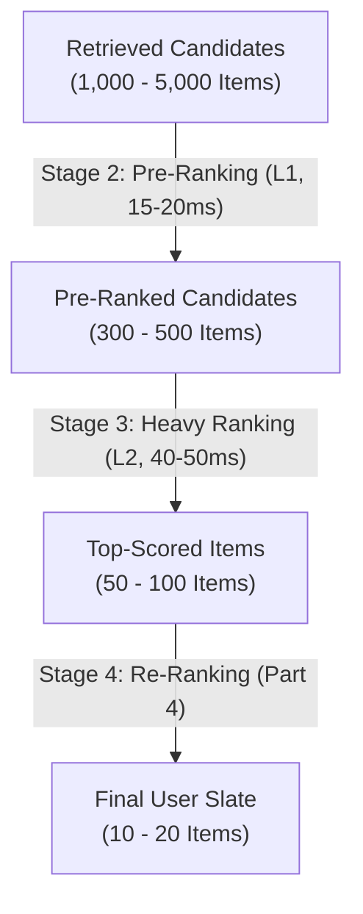

At this juncture, the mathematical formulation shifts fundamentally:
*   **In Retrieval (Stage 1):** We were constrained by the dot-product property: $`\text{Score} = \langle f(u), g(i) \rangle`$. No cross-features between user and item were allowed because item vectors had to be indexed offline.
*   **In Ranking (Stage 2 & Stage 3):** The candidate set is small enough that we can explicitly feed **user features, item features, contextual features, and real-time interaction crosses** into a single, unified neural network.

---

## Table of Contents

1. [The Scoring Engine at a Glance](#1-the-scoring-engine-at-a-glance)
2. [The Pre-Ranking (L1) Architecture & Dilemmas](#2-the-pre-ranking-l1-architecture--dilemmas)
   - [2.1 Why We Need Pre-Ranking](#21-why-we-need-pre-ranking)
   - [2.2 The "Feature Availability Trap": Why L1 Is Not Just a Smaller L2](#22-the-feature-availability-trap-why-l1-is-not-just-a-smaller-l2)
   - [2.3 Pinterest's Root-Leaf Serving Topology](#23-pinterests-root-leaf-serving-topology)
   - [2.4 L1 Training: Distillation vs. Early-Funnel Logging](#24-l1-training-distillation-vs-early-funnel-logging)
3. [The High-Cardinality Feature Space](#3-the-high-cardinality-feature-space)
   - [3.1 Feature Taxonomy: Dense, Sparse, and Crosses](#31-feature-taxonomy-dense-sparse-and-crosses)
   - [3.2 Terabyte Embedding Tables, Hash Collisions & Dynamic Eviction](#32-terabyte-embedding-tables-hash-collisions--dynamic-eviction)
   - [3.3 The Embedding Disconnect: Retrieval vs. Ranking vs. Semantic Spaces](#33-the-embedding-disconnect-retrieval-vs-ranking-vs-semantic-spaces)
   - [3.4 Training-Serving Skew, Point-in-Time Leakage & ID Dropout](#34-training-serving-skew-point-in-time-leakage--id-dropout)
4. [Explicit Feature Crosses: From GBDT+LR to DCN-v2](#4-explicit-feature-crosses-from-gbdtlr-to-dcn-v2)
   - [4.1 The Pre-Neural Era: GBDT + Logistic Regression (Facebook 2014)](#41-the-pre-neural-era-gbdt--logistic-regression-facebook-2014)
   - [4.2 Why Standard MLPs Fail at Feature Crosses](#42-why-standard-mlps-fail-at-feature-crosses)
   - [4.3 Wide & Deep Learning (Google 2016) & DeepFM](#43-wide--deep-learning-google-2016--deepfm)
   - [4.4 Deep & Cross Network (DCN-v1 vs. DCN-v2) Mathematical Derivation](#44-deep--cross-network-dcn-v1-vs-dcn-v2-mathematical-derivation)
   - [4.5 Low-Rank Approximation, MoE, Residual DCN & Dense Gating](#45-low-rank-approximation-moe-residual-dcn--dense-gating)
5. [DLRM (Deep Learning Recommendation Model — Meta)](#5-dlrm-deep-learning-recommendation-model--meta)
   - [5.1 The DLRM Architecture](#51-the-dlrm-architecture)
   - [5.2 Explicit Dot-Product Feature Interactions](#52-explicit-dot-product-feature-interactions)
   - [5.3 Systems Architecture: Model Parallelism vs. Data Parallelism](#53-systems-architecture-model-parallelism-vs-data-parallelism)
   - [5.4 Beyond DLRM: Modern Feature Interaction Architectures](#54-beyond-dlrm-modern-feature-interaction-architectures)
   - [5.5 LLM & Multimodal + DLRM / DCN Hybrid Ranking Architectures](#55-llm--multimodal--dlrm--dcn-hybrid-ranking-architectures)
   - [5.6 L2 Serving Optimization, Quantization & Continual Retraining](#56-l2-serving-optimization-quantization--continual-retraining)
6. [Multi-Task Learning (MTL) at Scale](#6-multi-task-learning-mtl-at-scale)
   - [6.1 The Multi-Objective Business Reality](#61-the-multi-objective-business-reality)
   - [6.2 Architecture Evolution: Shared-Bottom to MMoE to PLE](#62-architecture-evolution-shared-bottom-to-mmoe-to-ple)
   - [6.3 Multi-Task Loss Normalization, Watch-Time Modeling & Gradient Balancing](#63-multi-task-loss-normalization-watch-time-modeling--gradient-balancing)
   - [6.4 Sequential Task Dependencies: ESMM](#64-sequential-task-dependencies-esmm)
   - [6.5 IMPORTANT PRODUCTION INSIGHT: Training Losses vs. Serving Value Functions](#65-important-production-insight-training-losses-vs-serving-value-functions)
   - [6.6 Pointwise BCE vs. Pairwise & Listwise Ranking Losses](#66-pointwise-bce-vs-pairwise--listwise-ranking-losses)
7. [Ranking Evaluation Metrics (L1 & L2)](#7-ranking-evaluation-metrics-l1--l2)
8. [Deep-Dive Interview Questions & Detailed Answers](#8-deep-dive-interview-questions--detailed-answers)

---

## 2. The Pre-Ranking (L1) Architecture & Dilemmas

### 2.1 Why We Need Pre-Ranking

Consider the compute budget of Stage 3 (Heavy Ranking). A state-of-the-art ranker features:
*   Terabyte-scale sparse embedding lookups.
*   DCN-v2 full-rank interaction layers.
*   Sequential transformer attention across the user's last 100 actions.
*   Multi-task heads (predicting 6+ distinct probabilities).

Scoring a single candidate takes $`\approx 0.1\text{ms}`$. If Retrieval returns $3,000$ candidates:

$$
\text{Compute Time} = 3,000 \times 0.1\text{ms} = 300\text{ms}
$$

This violates the total end-to-end P99 SLA ($`\le 100\text{ms}`$). We need an intermediate, high-throughput filter: **Pre-Ranking (L1)**. Its goal is to prune $`3,000 \to 300`$ items in under $`15 - 20\text{ms}`$ while preserving ranking alignment with the heavy ranker.

```
                  Retrieval (Stage 1)
                Surfaces 3,000 Candidates
                          │
                          ▼
┌────────────────────────────────────────────────────────┐
│  Pre-Ranking / L1 (Stage 2)                            │
│  • Latency Budget: 15 - 20ms                           │
│  • Compute Allowance: ~0.005ms per item                │
│  • Cuts candidates by 90% (3,000 → 300 items)          │
└─────────────────────────┬──────────────────────────────┘
                          │
                          ▼
┌────────────────────────────────────────────────────────┐
│  Heavy Ranking / L2 (Stage 3)                          │
│  • Latency Budget: 40 - 50ms                           │
│  • Compute Allowance: ~0.1ms per item (batched GPU)    │
│  • Scores surviving 300 items with massive neural net  │
└────────────────────────────────────────────────────────┘
```

### 2.2 The "Feature Availability Trap": Why L1 Is Not Just a Smaller L2

A common misconception is:
> *"L1 is simply a smaller neural network with fewer layers trained on the exact same features as L2."*

**This is a critical architectural error.**

In a distributed production environment, **feature fetching latency dominates model inference latency**:
1.  **Network Bandwidth & Key-Value Serialization:** To score $`3,000`$ items with full L2 features, the scoring engine must fetch hundreds of dynamic features per item (e.g., real-time CTR counters over the past 5 minutes, user-item cross counters, deep content embeddings) from a remote low-latency feature store (e.g., Redis, DynamoDB, or internal KV stores).
2.  Fetching $`3,000`$ multi-feature payloads ($`\approx 600,000`$ total feature values, plus per-pair `(user, item)` cross lookups) over the network takes **$`30 - 60\text{ms}`$** in serialization and tail latency, exhausting the entire budget before the neural network even runs!

```
THE FEATURE AVAILABILITY TRAP:
Full L2 Feature Set:
[ User Demographics ]  +  [ 10k Historical Actions ]  +  [ Real-Time 5-Min Interaction Counters ]  +  [ Cross Features ]
        ▲                                                          ▲
        │                                                          │
 Available Online in Request                     Must fetch 3,000 heavy payloads (~600k feature values)
                                                 from remote KV store! Latency: 45ms (EXCEEDS SLA!)
```

#### The Architectural Solution:
L1 **must** use an asymmetrical, lightweight feature space:
*   **User Features:** Ingests the full user profile (available in memory in the request context).
*   **Item Features:** Ingests *only* static, coarse item features (pre-stored in local memory) or lightweight distilled embeddings.
*   **Cross Features:** Strictly prohibited or restricted to simple dot products.

### 2.3 Pinterest's Root-Leaf Serving Topology

Pinterest Engineering faced this exact throughput bottleneck when scaling Home Feed pre-ranking. Their original approach used separate two-tower models for each retrieval source, which caused poor cross-source calibration.

They solved this by deploying a **Joint Request-Level + Item-Level Model on a Root-Leaf Serving Architecture**:

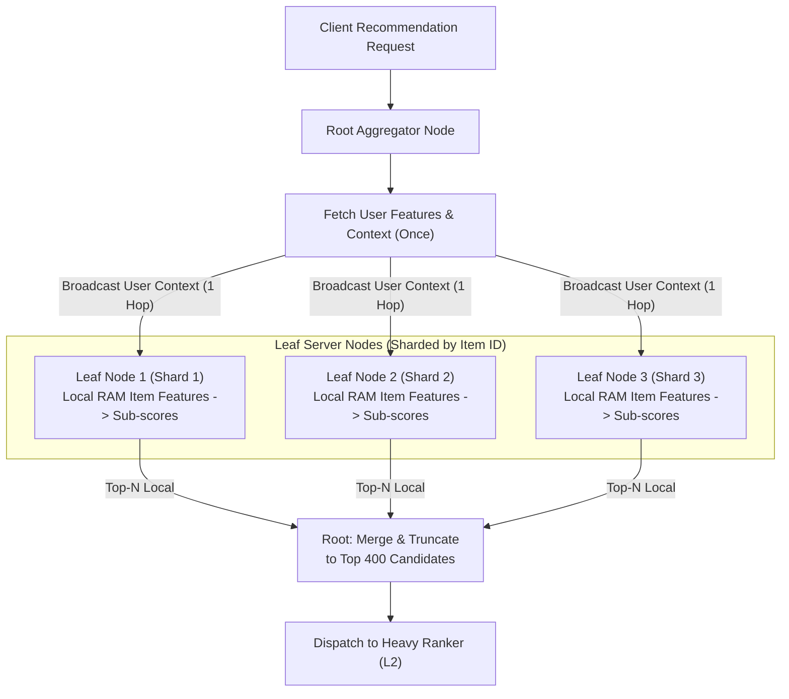

#### Why the Root-Leaf Pattern Wins (and Its Trade-Offs):
1.  **Zero Remote Network Fetch for Item Features:** Each leaf node stores static item embeddings and coarse features for its own partition *in local RAM*. Item features are never serialized over the data center network.
2.  **Amortized User Tower ($`1\times`$ Instead of $`3,000\times`$):** The Root node fetches the user profile and executes the heavy User/Request Tower **once**, broadcasting only the compact user representation to all leaf nodes in a single network hop.
3.  **Parallel Computation:** Each leaf scores its local candidate pool in parallel ($`\approx 5\text{ms}`$) and returns only its top-$`K`$ scored items to the Root aggregator.
*   **Trade-offs:** Holding item features in Leaf RAM increases fleet memory cost, introduces a **freshness lag** for newly updated item stats until leaf caches refresh, and makes end-to-end P99 latency vulnerable to **scatter-gather straggler shards** (mitigated via hedged requests or partial-result timeouts).
*   **Request-Level User Broadcasting & L1 Architecture Spectrum:** Within a GPU inference batch containing $`N`$ candidates for the same user, deduplicate unique users, execute user embedding lookups + user-tower layers once, and broadcast across all $`N`$ candidate rows (capping max unique users per batch to bound tail latency). Beyond Root-Leaf MLPs, production teams choose L1 architectures by hardware and inventory:
    *   **GPU MMoE + DCN Two-Tower L1:** High expressivity while remaining dot-product parallelizable on GPUs.
    *   **Per-Source First-Pass Rankers (FPR):** Used when heterogeneous inventories (posts vs. ads vs. jobs) have non-overlapping schemas.
    *   **Shallow LambdaMART (~200 trees, depth 4):** Fast baseline on CPU-only fleets.
    *   **ColBERT Late Interaction (L1.5 for Text/Search):** Precomputes per-token document embeddings offline and scores online via $`\text{MaxSim}(Q, D) = \sum_{i=1}^m \max_{j=1}^n \cos(q_i, d_j)`$ (~100x faster than full cross-encoders; *trade-off:* high token-vector storage, mitigated by centroid residual compression).
*   **Early Safety & Policy Gating:** Enforce deterministic blocklists and lightweight NSFW/spam classifiers at L1 so the system never burns expensive L2 GPU FLOPs scoring disqualifiable items.

### 2.4 L1 Training: Distillation vs. Early-Funnel Logging

How should you train the Pre-Ranking model? Because L1's job is strictly to avoid dropping L2's top items (not to predict calibrated ad auction probabilities), **relative ordering matters far more than exact logit values**. Two paradigms work together in production:

#### Approach 1: Distillation from L2 (Student-Teacher)
*   **Concept:** The heavy ranker (L2) serves as the "Teacher," and the lightweight L1 model serves as the "Student."
*   **Loss Formulation:** Production L1 models commonly combine early-funnel ground-truth BCE with **temperature-scaled listwise KL distillation** from L2 logits ($`O(B)`$) or pairwise ranking distillation ($`O(B^2)`$):

```math
\mathcal{L}_{\text{L1}} = \mathcal{L}_{\text{BCE}}(y, \hat{p}_{\text{L1}}) + w \cdot \text{KL}\left(\text{softmax}(z_{\text{L2}} / \tau) \thinspace \Vert \thinspace \text{softmax}(z_{\text{L1}} / \tau)\right)
```

*(Alternative pairwise form: $`\mathcal{L}_{\text{pair}} = -\sum_{(i, j): \thinspace z_{\text{L2}}(i) \gt z_{\text{L2}}(j)} \log \sigma(z_{\text{L1}}(i) - z_{\text{L1}}(j))`$.)*

*   **Advantage & Trade-offs:** L1 directly inherits L2's multi-task balance and debiasing without waiting for sparse ground-truth click labels. However, pure distillation **inherits any blind spots or biases of the L2 teacher** and requires extra offline GPU compute to score unshown candidates with L2.

#### Approach 2: Early-Funnel Logging (Combating Sample Selection Bias)
> **CRITICAL PRODUCTION PITFALL:**
> If you train L1 *only* on items that were displayed to the user (the final 10 items on the screen), your training data suffers from severe **Sample Selection Bias (Missing-Not-At-Random)**.
>
> The items that L1 needs to score in production include items ranked #1,500 by retrieval. If L1 only ever sees items that survived L2 ranking (the top 0.1%), it has no training signal on how to separate mediocre items from terrible items.

*   **The Industry Best Practice:** Log candidates at the **exit of Retrieval / entrance of L1**, generate offline L2 teacher pseudo-labels on a small uniform random sample (e.g., 1%) of those candidates, and pair that with a tiny random exploration slice so L1 still receives real user-outcome labels on non-top items *(trade-off: exploration slightly lowers short-term UX on that tiny traffic slice)*.

---

## 3. The High-Cardinality Feature Space

In industrial recommendation systems, tabular data dominates. Models must process a mixture of continuous numerical signals, high-cardinality categorical IDs, and dynamic temporal interactions.

### 3.1 Feature Taxonomy: Dense, Sparse, and Crosses


#### Preprocessing Dense Features:
Why not feed raw numerical features directly into an MLP? Real-world counters (views, impressions, price) span 7–8 orders of magnitude—a viral video has $`100\text{M}`$ views while a new video has $2$. Unscaled power-law inputs saturate activations and produce massive gradient spikes that destabilize optimization:
*   **Log-Transform, Normalization & Recency Decay:** Compress heavy tails via $`\log(1 + x)`$, Z-score, or **RobustScaler** $`(x - \text{median}) / \text{IQR}`$ (which resists extreme outliers without distorting the bulk distribution). For historical engagement counters, apply **exponential time decay** $`w(t) = e^{-\lambda \cdot \text{age}}`$ so stale counts do not overpower recent trends:

```math
x_{\text{norm}} = \log(1 + x) \quad \text{or} \quad x_{\text{norm}} = \frac{x - \mu}{\sigma}
```

*   **Quantile / Log Bucketization:** Discretize continuous features into $`B`$ buckets (e.g., 100 empirical quantiles, or the Criteo FFM trick $`\lfloor \log(x)^2 \rfloor`$ for $`x \gt 2`$) and map each bucket to an embedding vector (or soft-attend across bucket embeddings via **AutoDis**). This lets the model learn non-linear thresholds (e.g., price sensitivity jumps at `$10` and `$20`).
    *   *Trade-off:* Hard bucketization loses intra-bucket precision and suffers from **boundary drift** as distributions shift (requiring periodic quantile recomputation).
*   **Missing-Value Semantics:** Unlike GBDTs (which route `NaN` natively), neural rankers cannot ingest `NaN`. Pair zero/default imputation with **explicit binary missingness indicator flags** (`is_price_missing = 1`), and guarantee identical imputation code in training and serving so missing values never masquerade as real zeros.

### 3.2 Terabyte Embedding Tables, Hash Collisions & Dynamic Eviction

Why can't categorical IDs be fed directly into a neural network? Feeding raw integer IDs (`user_id = 48102` vs. `48103`) invents a fake ordinal relationship, while one-hot encoding a billion IDs creates an impossibly sparse $`10^9`$-dimensional input vector. Instead, each ID indexes into a learned **Embedding Table** $`E \in \mathbb{R}^{V \times d}`$:

$$
\text{Input: ID } k \longrightarrow \text{Embedding Vector } e_k = E[k] \in \mathbb{R}^d
$$

#### The Scale Problem:
*   Suppose an e-commerce platform has $`1\text{B}`$ users and $`100\text{M}`$ items with $`d = 64`$ in float32 ($`4\text{ bytes}`$).
*   User table weights alone: $`10^9 \times 64 \times 4\text{ bytes} = 256\text{ GB}`$.
*   **Optimizer State Multiplier:** Standard stateful optimizers (Adam, Adagrad) store 1–2 extra float32 moments per weight, **doubling or tripling memory to $`512\text{–}768\text{ GB}`$** for that single table (which is why production rankers rely on **Row-wise Adagrad**, storing only 1 scalar accumulator per row instead of $`d`$).
*   With auxiliary ID tables (queries, categories, creators), total embedding memory easily exceeds **$`1 - 2\text{ Terabytes}`$**, far beyond a single GPU's $`80\text{ GB}`$ HBM.

#### Handling Embedding Scale in Production:

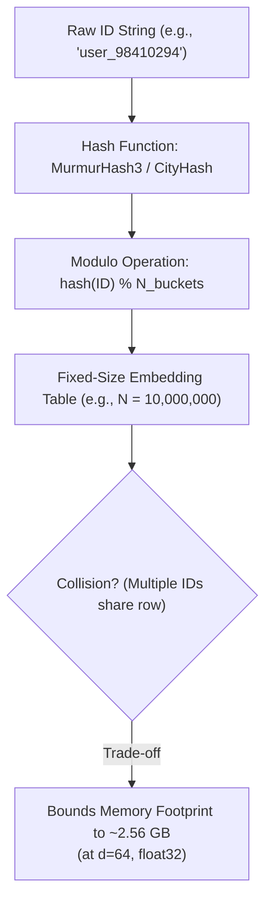

1.  **The Hashing Trick & Quotient-Remainder (QR) Compositional Hashing:** Map arbitrary ID strings to a fixed range $`[0, N-1]`$ via MurmurHash3:

```math
\text{Index} = \text{hash}(\text{ID}) \pmod N
```

*Trade-off:* Pure modulo hashing causes **hash collisions** (unrelated IDs share a row and corrupt each other's gradients). **QR Compositional Hashing** compresses an $`N`$-row table into two tiny tables ($`Q = \lceil N / R \rceil`$ and $`R`$) while keeping full-collision probability at $`\sim 1/(Q \cdot R)`$:

```math
e(\text{ID}) = E_Q[\text{ID} \div R] + E_R[\text{ID} \bmod R]
```

*(Example: $`4\text{B}`$ IDs $`\times 30\text{d}`$ float32 $`= 480\text{ GB}`$ shrinks with $`R = 1000`$ to $`\approx 0.48\text{ GB}`$—**1,000x compression**! Use **addition** rather than element-wise multiplication $`E_Q \odot E_R`$, because near-zero initialization causes multiplicative gradients to vanish.)*
2.  **Middle-Max 8-Bit Embedding Quantization:** Rather than standard min-max `uint8` quantization (which wastes precision on extreme tails), **Middle-Max** anchors to the center of Gaussian-distributed embeddings:

```math
\text{middle} = \frac{X_{\max} \cdot 128 + X_{\min} \cdot 127}{255}, \qquad \text{scale} = \frac{X_{\max} - X_{\min}}{255}, \qquad X_{\text{int8}} = \text{round}\left(\frac{X - \text{middle}}{\text{scale}}\right) \in [-128, 127]
```

Cuts embedding memory by **~73%** (storing `int8` rows + 2 `fp32` scalars per row) and often acts as mild regularization.
3.  **Frequency Filtering:** Do not allocate embedding slots to IDs with fewer than $`K`$ occurrences (e.g., $`K = 5`$). Assign rare tail IDs to an `__UNKNOWN__` fallback token. *Trade-off:* Degrades personalization for niche/cold-start items until they cross the threshold.
4.  **Collisionless Dynamic Tables & Eviction (LFU / LRU / TTL):** Streaming parameter-server systems like **ByteDance Monolith** replace modulo hashing with collisionless Cuckoo hash tables plus frequency cutoffs and **TTL eviction** (while GPU-cached trainers like HugeCTR/TorchRec evict cold rows from GPU HBM via LFU/LRU). *Trade-off:* Evicting rows untouched for 14 days resets learned representations for infrequent or seasonal returning users and items.

### 3.3 The Embedding Disconnect: Retrieval vs. Ranking vs. Semantic Spaces

> **CRITICAL ARCHITECTURAL DISTINCTION:**
> A common misconception is assuming that an Item ID has a single, universal embedding across the company's codebase.
>
> In reality, **every stage of the pipeline maintains its own completely decoupled embedding space**:

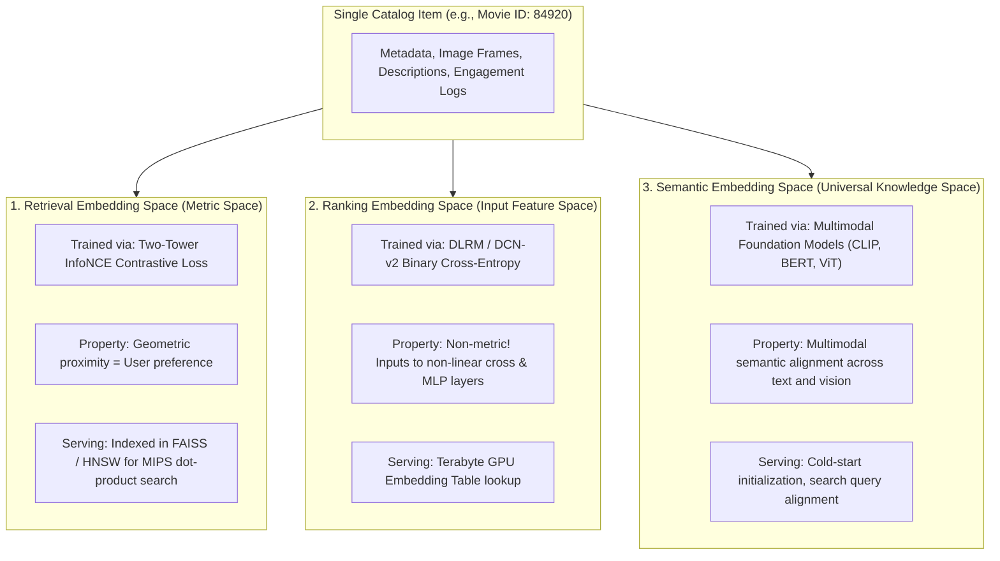

| Dimension | 1. Retrieval Embeddings | 2. Ranking Embeddings | 3. Semantic Embeddings |
| :--- | :--- | :--- | :--- |
| **Learned By** | Two-Tower contrastive InfoNCE loss | DLRM / DCN-v2 classification loss | CLIP, BERT, Vision Transformers (ViT) |
| **Geometric Property** | **Metric Space:** Dot product $`\langle u, v \rangle = \text{score}`$ | **Non-Metric Feature Space:** Raw dot products are not monotonic with rank | **Semantic Space:** Cosine distance = content similarity |
| **Index Method** | FAISS, HNSW, ScaNN vector indices | Sharded terabyte GPU tables (Model Parallel) | Precomputed offline feature store vectors |
| **Primary Role** | Fast candidate retrieval ($`10^8 \to 10^3`$) | Heavy non-linear ranking ($`10^3 \to 50`$) | Zero-shot cold-start & content enrichment |

**Why you cannot query an ANN index using Ranking Embeddings:**
Even in architectures like DLRM that compute dot products across feature fields, (1) two items from the *same* table ($`e_{i_1}, e_{i_2}`$) are never dot-producted against each other during training, and (2) even a cross-field user-item dot product $`\langle e_u, e_i \rangle`$ is merely one scalar among $`\binom{M+1}{2}`$ interactions fed into a deep non-linear Top MLP alongside dense features. Thus, ranking embeddings do not form a monotonic similarity metric space for ANN retrieval. *(To bridge Semantic $`\to`$ Ranking spaces cleanly, teams often use **Selective Initialization**: initialize the ranker's item embedding rows from projected pretrained LLM/CLIP vectors so cold items start semantically grounded while warm items adapt collaboratively.)*

### 3.4 Training-Serving Skew, Point-in-Time Leakage & ID Dropout

Even a flawless model architecture fails in production if its training features diverge from online serving features:
*   **Three-Tier Feature Stack & Feature Stores:** Match computation cadence to volatility—**Batch** (Spark, daily lifetime stats & offline embeddings), **Near-line Streaming** (Kafka $`\to`$ Flink, seconds-to-minutes windowed counters), and **Online** (request-time context/crosses)—unified under a **Feature Store** (single declarative feature code + layered client cache $`\to`$ Redis `HMGET`/Protobuf $`\to`$ distributed KV store) to eliminate train/serve code divergence.
*   **Point-in-Time Leakage & Log-and-Wait:** Joining an offline training log from `10:00 AM` against an end-of-day item CTR table leaks *future clicks* from `10:01 AM–11:59 PM` into the features, inflating offline AUC while crashing online performance. Prevent this with **Log-and-Wait**: snapshot the exact feature vector seen at serving time directly into the impression log, wait for the outcome window, and join labels onto the immutable logged features.
*   **Why DNN Rankers Have Larger Online-Offline Gaps Than GBDTs:** GBDTs bucketize continuous values at tree split thresholds, so tiny staleness drifts rarely flip decisions; parametric DNNs/DLRMs react continuously to exact float drift. Debug online drops systematically across (1) serving instability, (2) temporal data shift, and (3) feature lag or stale cached residuals lacking TTL eviction—monitoring per-feature **null/default rates** and **PSI** hourly and validating fixes via offline replay.
*   **In-Ranker Cold-Start Tricks (ID Dropout & Content Residuals):** High-cardinality ID embeddings memorize training examples in a single pass—which is why large CTR rankers often degrade sharply on Epoch 2+ (the **One-Epoch Phenomenon**) and starve fresh items with zero ID history. Production rankers combine:
    1. **ID Dropout:** Randomly mask `item_id` to `__UNKNOWN__` on 5%–15% of training examples so the ranker extracts strong signal from content, semantic, and creator features.
    2. **Content-Feature Residual Connections & Cold-Item Score Regularization:** Route text/image content embeddings directly to top layers so dense behavioral IDs cannot drown them out, and regularize against conservative score suppression on low-impression items (~5% parameter overhead).

---

## 4. Explicit Feature Crosses: From GBDT+LR to DCN-v2

### 4.1 The Pre-Neural Era: GBDT + Logistic Regression (Facebook 2014)

Before deep learning took over recommendation, the industry standard was Facebook's seminal paper: **Practical Lessons from Predicting Clicks on Ads at Facebook** (He et al., 2014).

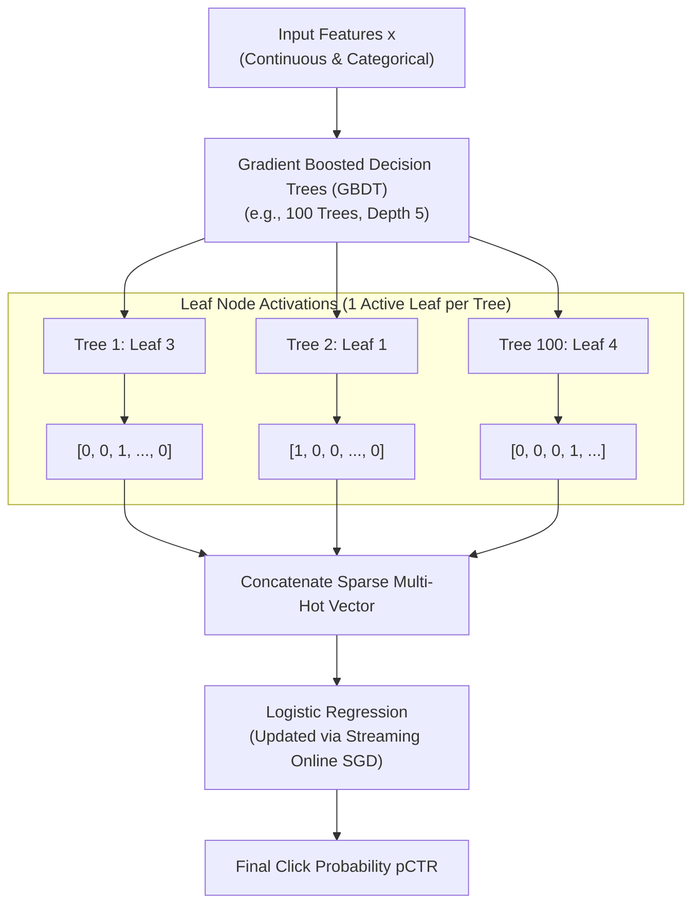

#### Why GBDT + LR Was a Masterstroke (and Why Industry Moved Beyond It):
1.  **Automated Non-Linear Crosses:** Each path from tree root to leaf is an explicit boolean feature cross (e.g., `IF Country = US AND Age > 25 AND Device = iPhone THEN Leaf 3`). The GBDT automatically discovers high-signal cross features without manual trial-and-error.
2.  **Decoupled Retraining Cadence:** Decision trees cannot be easily updated with streaming online data. Facebook decoupled the pipeline: the heavy GBDT was retrained **once a day** offline on batch data, while the lightweight linear Logistic Regression model was updated **in real time via streaming Online SGD** on live user clicks!
*   **Why Deep Learning Replaced It:** Decision trees struggle with **billion-cardinality sparse IDs** (user IDs, item IDs, query tokens) and cannot generalize to unseen ID combinations via dense geometric embeddings—motivating neural architectures.

### 4.2 Why Standard MLPs Fail at Feature Crosses

A Multilayer Perceptron (MLP) with non-linear activation functions (ReLU, GELU) is a universal function approximator. In theory, an MLP can learn any relationship.

In practice, **MLPs are notoriously inefficient at learning polynomial feature interactions** (e.g., $`x_1 \cdot x_2 \cdot x_3`$).

*   *Intuition:* A ReLU neuron computes $`\max(0, w^T x + b)`$—it **adds** features linearly and clips at zero; it has no native **multiplicative** gate to compute $`x_1 \cdot x_2`$ directly. Approximating a curved multiplicative surface via piecewise-linear ReLU tiles is highly parameter- and sample-inefficient.
*   In tabular CTR prediction, explicit combinations (e.g., `User_Installed_App = Netflix` $`\times`$ `Impression = Hulu Ad`) are among the strongest predictive signals. Relying solely on MLPs causes models to underfit on critical cross patterns.

### 4.3 Wide & Deep Learning (Google 2016) & DeepFM

Google's seminal Wide & Deep architecture (Cheng et al., 2016) decoupled recommendation into two complementary objectives: **Memorization** and **Generalization**.


*   **The Wide Component (Memorization):** A generalized linear model using explicit cross-product transformations over binary features $`x_j \in \lbrace 0, 1 \rbrace`$:

```math
\phi_k(x) = \prod_{j=1}^d x_j^{c_{kj}} \quad \text{where } c_{kj} \in \lbrace 0, 1 \rbrace
```

Learns specific, high-correlation rules ("memorizes" that users who downloaded app A rarely download app B).
*   **The Deep Component (Generalization):** An MLP over dense continuous features and low-dimensional categorical embeddings. Generalizes to unseen user-item pairs via semantic proximity.
*   **The Flaw of Wide & Deep:** The feature crosses in the Wide component had to be **manually engineered**. At web scale, maintaining manual cross transformations across thousands of features becomes impossible.
*   **Bridge to Automated Crosses — DeepFM (Guo et al., IJCAI 2017):** DeepFM replaced the manual Wide branch with a **Factorization Machine (FM)** sharing the exact same embedding vectors $`v_i \in \mathbb{R}^k`$ as the Deep MLP. Using the algebraic identity $`2ab = (a+b)^2 - (a^2 + b^2)`$, FM computes all $`\binom{M}{2}`$ pairwise field crosses in linear $`O(k \cdot M)`$ time instead of $`O(k \cdot M^2)`$:

```math
y_{\text{FM}} = w_0 + \sum_{i=1}^M w_i x_i + \frac{1}{2} \sum_{f=1}^k \left[ \left(\sum_{i=1}^M v_{i,f} x_i\right)^2 - \sum_{i=1}^M v_{i,f}^2 x_i^2 \right]
```

*Trade-offs:* Eliminates manual crosses cleanly, but forces a uniform embedding dimension $`k`$ across all fields and stops at **degree-2** interactions—motivating DCN for arbitrary higher-degree crosses.

### 4.4 Deep & Cross Network (DCN-v1 vs. DCN-v2) Mathematical Derivation

To automate arbitrary-degree feature crosses without manual feature engineering, Wang et al. (Google, 2017) created the **Deep & Cross Network (DCN)**, followed by **DCN-v2** (Wang et al., 2021).

*Core Intuition:* Each cross layer multiplies the current layer's state by the original input $`x_0`$—bumping the polynomial degree by $`+1`$ at every layer—and adds a residual skip connection so lower-degree signals are preserved.

#### DCN-v1 Cross Layer Formulation:
Let $`x_0 \in \mathbb{R}^d`$ be the input feature vector (concatenated embeddings and normalized dense features).
The $`(l+1)`$-th cross layer computes:

$$
x_{l+1} = x_0 x_l^T w_l + b_l + x_l
$$

Where $`w_l, b_l \in \mathbb{R}^d`$ are trainable weight and bias vectors.

```
DCN-v1 Mathematical Limitation (Rank-1 Bottleneck):
Notice the term:  (x_0 x_l^T) w_l
By matrix associativity:
  (x_0 x_l^T) w_l = x_0 (x_l^T w_l) = (x_0 w_l^T) x_l = α · x_0   where α = ⟨x_l, w_l⟩ is a scalar!
Equivalently, the effective linear map W_eff = x_0 w_l^T has RANK 1, and every cross term
is forced to point strictly along the base vector x_0—severely choking expressiveness.
```

#### DCN-v2: Full-Rank Matrix Cross Layers
DCN-v2 eliminates the rank-1 bottleneck by replacing the vector weight $`w_l`$ with a **full-rank weight matrix** $`W_l \in \mathbb{R}^{d \times d}`$:

$$
x_{l+1} = x_0 \odot (W_l x_l + b_l) + x_l
$$

Where $`\odot`$ denotes the element-wise Hadamard product.

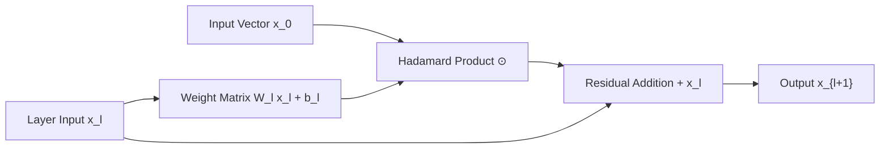

#### DCN-v2 Architectures: Stacked vs. Parallel
DCN-v2 can be deployed in two macro configurations depending on latency budgets and cross-feature importance:

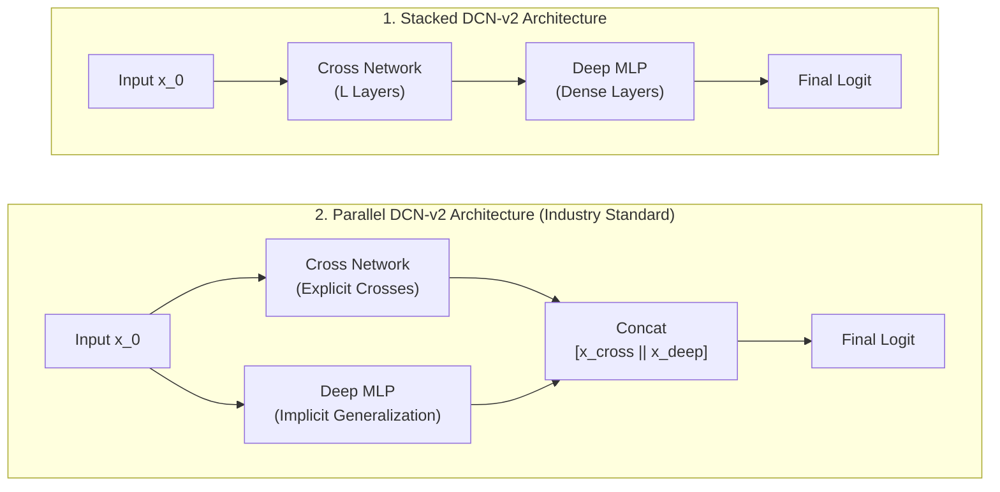

*   **Stacked Architecture:** Passes the output of the cross network directly into the deep MLP. Cross features undergo further non-linear compression.
*   **Parallel Architecture (Preferred in Production):** The Cross Network and Deep MLP run concurrently on the same input vector $`x_0`$. Their final representations are concatenated. This guarantees that explicit polynomial feature interactions pass directly into the output layer without being diluted by deep ReLU activations.

#### Worked Example: How DCN-v2 Automatically Builds Degree-2 Crosses
Let $`x_0`$ (degree 1) and weight matrix $`W_0`$ (omitting bias $`b_0`$ for clarity) be:

$$
x_0 = \begin{bmatrix} a \cr b \end{bmatrix}, \qquad W_0 = \begin{bmatrix} w_{11} & w_{12} \cr w_{21} & w_{22} \end{bmatrix}
$$

At Layer 1 ($`l=0`$), $`x_1 = x_0 \odot (W_0 x_0 + b_0) + x_0`$. First compute the linear projection:

$$
W_0 x_0 = \begin{bmatrix} w_{11} a + w_{12} b \cr w_{21} a + w_{22} b \end{bmatrix}
$$

Now, take the Hadamard (element-wise) product with $`x_0`$:

$$
x_0 \odot (W_0 x_0) = \begin{bmatrix} a \cr b \end{bmatrix} \odot \begin{bmatrix} w_{11} a + w_{12} b \cr w_{21} a + w_{22} b \end{bmatrix} = \begin{bmatrix} w_{11} \mathbf{a^2} + w_{12} \mathbf{ab} \cr w_{21} \mathbf{ab} + w_{22} \mathbf{b^2} \end{bmatrix}
$$

Adding the residual $`x_0`$:

$$
x_1 = \begin{bmatrix} w_{11} a^2 + w_{12} ab + a \cr w_{21} ab + w_{22} b^2 + b \end{bmatrix}
$$

**Every single degree-2 polynomial cross ($`a^2, ab, b^2`$) is explicitly generated with its own dedicated learned weight!** At layer $`L`$, the network contains all polynomial feature crosses up to degree $`L+1`$ (note: DCN-v2 crosses are *coordinate-wise* across the concatenated vector $`x_0`$, unlike DLRM's *field-wise* vector dot products).

### 4.5 Low-Rank Approximation, MoE, Residual DCN & Dense Gating

While DCN-v2's full-rank matrix $`W_l \in \mathbb{R}^{d \times d}`$ provides massive expressivity, it introduces $`O(d^2)`$ parameters per layer. If input dimension $`d = 1024`$, each cross matrix has $`1\text{M}`$ parameters. Empirically, learned cross matrices have rapidly decaying singular values because high-dimensional features cluster into correlated latent concepts.

To make DCN-v2 efficient for ultra-low latency serving, the authors introduced **Low-Rank Matrix Decomposition**:

$$
W_l \approx U_l \cdot V_l^T \quad \text{where } U_l \in \mathbb{R}^{d \times r}, \quad V_l \in \mathbb{R}^{d \times r}, \quad \text{with rank } r \ll d
$$

Parameter cost drops from $`d^2`$ down to $`2 \cdot d \cdot r`$ (a $`16\times`$ reduction for $`d=1024, r=32`$).

#### DCN-v2 Mixture of Experts (DCN-Mix):
To recover capacity lost by low-rank decomposition, DCN-Mix routes inputs through $K$ low-rank cross experts using a learned gating network:

$$
x_{l+1} = \sum_{k=1}^K g_k(x_l) \left( x_0 \odot (U_{l, k} V_{l, k}^T x_l + b_l) \right) + x_l
$$

Where $`g_k(x_l) = \text{Softmax}(W_g x_l)_k`$ assigns inputs to specialized sub-space experts *(the full DCN-Mix paper also inserts a small $`r \times r`$ transformation $`C_{l,k}`$ with $`\tanh`$ nonlinearities inside the low-rank subspace: $`U_{l,k} \tanh(C_{l,k} \tanh(V_{l,k}^T x_l))`$).*
*   *Trade-offs:* Reduces compute from $`O(d^2)`$ to $`O(K d r)`$, but adds gating overhead, extra memory bandwidth across $`K`$ experts, and potential **routing collapse** (where the gate routes most traffic to 1–2 experts).

#### Residual DCN & Dense Gating (LiRank, KDD 2024):
*   **Residual DCN:** Runs an **attention-weighted low-rank branch** inside the $`r`$-dimensional bottleneck ($`\text{Attn}_l = \text{softmax}(Q_l K_l^T / (\tau\sqrt{r}))`$) in parallel with a standard low-rank DCN-v2 branch, cutting parameters by ~7x vs. full-rank DCN-v2 while preserving training stability via the $`+ x_l`$ residual skip.
*   **Dense Gating (GateNet-style Gated MLP):** Applies an instance-conditioned sigmoid gate $`h_{l+1} = \sigma(W_l h_l + b_l) \odot \text{sigmoid}(W_g h_l + b_g)`$ to dynamically amplify or suppress hidden dimensions per `(user, item)` pair. *Production nuance:* Dense gating only justifies its $`2\times`$ parameter overhead when **personalized embeddings** are present; without them, gates collapse into static masks.

---

## 5. DLRM (Deep Learning Recommendation Model — Meta)

Developed by Meta (Naumov et al., 2019), **DLRM** is the foundational architecture powering click-through rate (CTR) prediction and ads ranking across Facebook and Instagram.

### 5.1 The DLRM Architecture

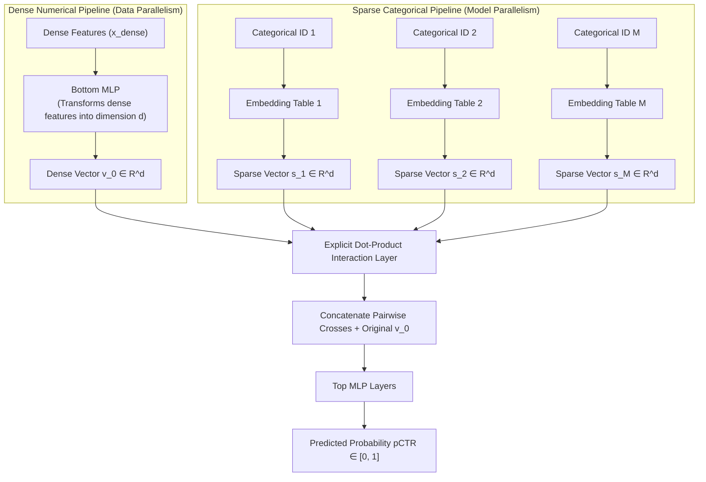

### 5.2 Explicit Dot-Product Feature Interactions

Whereas DCN-v2 crosses individual coordinates (`bit-wise`), DLRM generalizes Factorization Machines by computing **field-wise** vector dot products between every pair of sparse/dense representations (measuring semantic alignment between e.g. `User_Emb` and `Ad_Category_Emb`):

1.  **Bottom MLP:** Maps continuous numerical features into a single dense representation vector $`v_0 \in \mathbb{R}^d`$.
2.  **Embedding Lookups:** Maps $`M`$ categorical sparse features into $`M`$ embedding vectors $`s_1, s_2, \dots, s_M \in \mathbb{R}^d`$. Notice that **all sparse embeddings and the bottom MLP output share the exact same dimension $`d`$**.
3.  **Pairwise Dot Products:** Stack all $`M+1`$ column vectors as rows into a matrix:

```math
V = [v_0, s_1, s_2, \dots, s_M]^T \in \mathbb{R}^{(M+1) \times d}
```

Compute $`S = V \cdot V^T \in \mathbb{R}^{(M+1) \times (M+1)}`$, whose $`(i, j)`$-th entry is the scalar dot product:

```math
S_{i, j} = \langle V_i, V_j \rangle
```

4.  **Vectorization:** Because $`S`$ is symmetric ($`S_{i, j} = S_{j, i}`$) and the diagonal entries $`S_{i, i} = \lVert V_i \rVert_2^2`$ are self-norms, we extract **only the strictly lower triangular elements** $`\text{tril}_{\lt 0}(S)`$ (excluding the diagonal). The number of unique pairwise interaction terms is $`\binom{M+1}{2}`$:

```math
\text{Num Crosses} = \frac{(M+1) \cdot M}{2}
```

5.  **Top MLP:** Concatenate the flattened strictly lower-triangular interaction vector with $`v_0`$ and pass through the Top MLP:

```math
\text{Input to Top MLP} = \left[v_0 \thinspace \Vert \thinspace \text{tril}_{<0}(S)\right] \in \mathbb{R}^{d + \frac{(M+1)M}{2}}
```

*   **Key Production Trade-offs of DLRM:**
    1.  **Forced Uniform Dimension $`d`$:** Tiny tables (`gender`, 3 values) and massive tables (`item_id`, 100M values) must project to the exact same $`d`$, wasting capacity or forcing extra linear projections.
    2.  **$`O(M^2)`$ Interaction Blow-up:** With $`M = 1,000`$ sparse features, $`\binom{1001}{2} \approx 500,000`$ scalar crosses explode the Top MLP input width.
    3.  **Degree-2 Explicit Ceiling:** The dot-product layer only produces 2nd-order interactions explicitly; higher-order crosses rely on the Top MLP.

### 5.3 Systems Architecture: Model Parallelism vs. Data Parallelism

DLRM is not just a neural network; it is a **hardware-co-designed distributed system**. The architecture intentionally isolates memory bottlenecks from compute bottlenecks:

| Dimension | Sparse Embedding Tables | Dense MLPs (Bottom & Top) |
| :--- | :--- | :--- |
| **System Bottleneck** | **Memory-Bound (VRAM Capacity)** | **Compute-Bound (FLOPs / ALU Throughput)** |
| **Parameter Footprint** | **Terabytes** (Billions of sparse weights) | **Megabytes** ($`\lt 100\text{MB}`$ parameters) |
| **FLOP Requirements** | Low: Simple $`O(1)`$ memory lookups and pooling | Heavy: Dense matrix-matrix multiplications |
| **Parallelism Strategy** | **Model Parallelism:** Tables are partitioned across GPU VRAM | **Data Parallelism:** MLPs are replicated across all nodes |
| **Collective Comm** | **All-to-All:** Exchange embedding vectors across micro-batches | **All-Reduce:** Synchronize backward gradient updates |

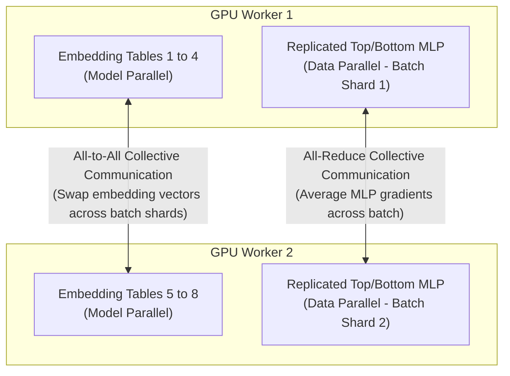

1.  **Model Parallelism (Sparse):** Table 1 lives on GPU 1; Table 2 lives on GPU 2. Each GPU executes embedding lookups for its local tables across the **entire global batch** (while simultaneously computing Bottom MLP on its local batch shard).
2.  **All-to-All Communication (The Bridge):** GPUs run an **All-to-All collective** over NVLink / InfiniBand, transposing from *table-sharded* to *batch-sharded* so each GPU receives all $`M`$ sparse embeddings for its own batch slice. *(In the backward pass, another All-to-All routes sparse gradients back to the owning tables.)*
3.  **Data Parallelism (Dense):** Once each GPU holds all embeddings for its assigned samples, the Dot-Product Interaction and Top MLP execute independently. Dense MLP gradients are averaged across GPUs via **All-Reduce**.
*   **Systems Trade-off (All-to-All Stragglers):** Because embedding tables vary wildly in size and pooling length (e.g., 100-item history vs. single `country` ID), naive table-wise sharding creates **straggler GPUs** that stall the synchronous All-to-All barrier. Modern **TorchRec / FBGEMM** planners use **column-wise and row-wise hybrid sharding** to balance VRAM and network bandwidth across GPUs.

### 5.4 Beyond DLRM: Modern Feature Interaction Architectures

Because DLRM's dot-product layer scales as $`O(M^2)`$ and stops at degree-2 crosses, modern production rankers have moved toward deeper, scalable interaction backbones:

| Architecture | Core Mechanism | What Problem It Solves | Trade-Off |
| :--- | :--- | :--- | :--- |
| **DHEN (Meta, 2022)** | Hierarchical stacking of heterogeneous interaction modules (MLP + DCN + Self-Attention + PNN) on the prior layer's fused output | Computes **interactions-of-interactions** (e.g., $`\text{DCN}(\text{SelfAttn}(X_0))`$), beating diminishing returns of stacking identical layers | Higher serving complexity & tuning cost |
| **MaskNet / FinalMLP (2021 / 2023)** | Instance-guided feature-wise gating (element-wise multiplicative masks) + bilinear fusion of two MLPs | Matches complex cross networks at low serving latency with simple GEMMs | Less interpretable explicit polynomial degree than DCN-v2 |
| **Wukong (Meta, ICML 2024)** | Stacked Factorization Machine Blocks (FMB) + Linear Compression Blocks (LCB) | Establishes **scaling laws for dense rankers**, capturing arbitrary high-order interactions without DLRM's $`O(M^2)`$ Top-MLP blow-up | Requires modern GPU compute budgets to realize scaling gains |

*(Note: Production L2 pipelines also frequently deploy **L2 sub-cascades**—e.g., fast CPU LambdaMART or sparse binary models on 1,000 items $`\to`$ GPU DCN-v2/DLRM on top 200 $`\to`$ optional compact SLM cross-encoder on top 50—combining crisp factual memorization with deep semantic generalization.)*

### 5.5 LLM & Multimodal + DLRM / DCN Hybrid Ranking Architectures

Running a 7B+ LLM online to score 300 candidates per request is latency-impossible ($`300 \times 20\text{ms} = 6,000\text{ms}`$ vs. a $`40\text{–}50\text{ms}`$ L2 SLA). Instead, production teams combine the **world knowledge and reasoning of LLMs** with the **ID memorization and sub-50ms throughput of DLRM / DCN-v2** through four proven patterns:

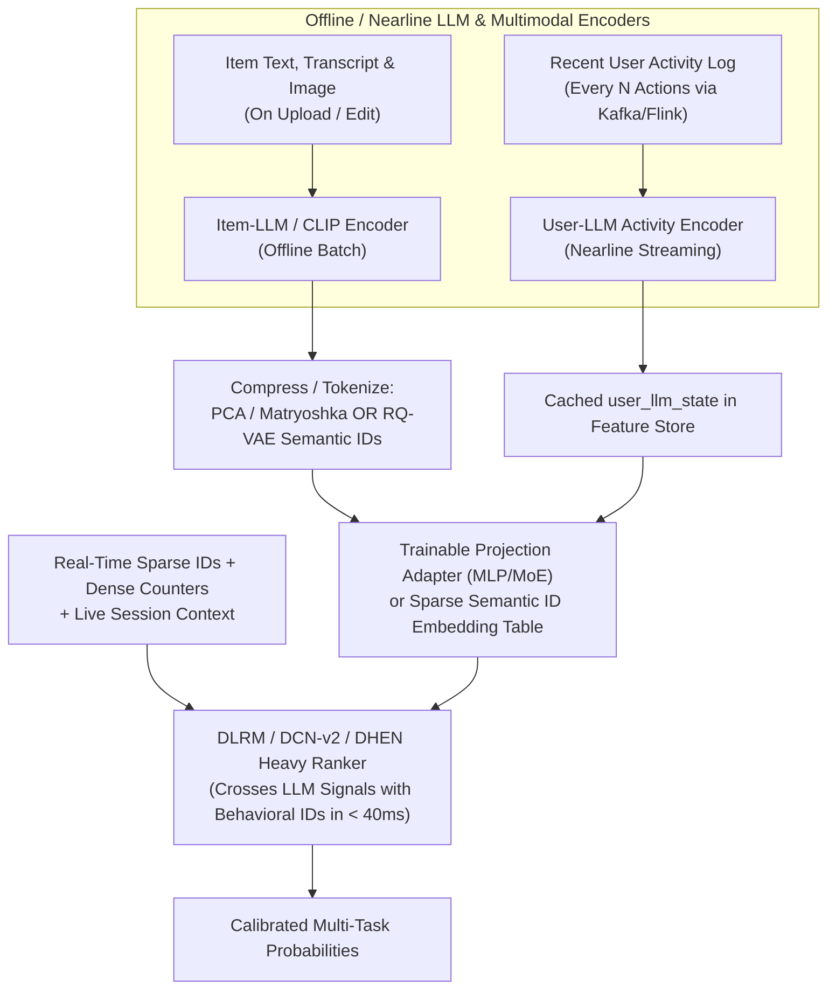

1.  **Async Item-LLM + Nearline User-LLM $`\to`$ Projection Adapter $`\to`$ DLRM / DCN-v2 (e.g., ByteDance HLLM):**
    *   *How it works:* Encode item text/multimodal metadata **offline on upload**, and encode a user's textualized recent activity (*"searched X, watched Y for 4 min, saved Z"*) **nearline via streaming** every $`N`$ clicks into a cached `user_llm_state` vector. At L2 serving time, fetch the cached vectors in `< 2ms` and pass them through a **trainable low-rank MLP / MoE projection adapter** ($`\mathbb{R}^{d_{\text{LLM}}} \to \mathbb{R}^d`$ + LayerNorm) before crossing with sparse IDs inside DLRM / DCN-v2.
    *   *Why raw frozen LLM vectors fail without adapters:* Raw 4,096-d embeddings bloat network payloads (`300 × 4096 × 2B ≈ 2.4 MB/request`) and live in *linguistic* space rather than *behavioral click* space. Compression (PCA / Matryoshka embeddings) + trainable adapters (plus LoRA behavioral alignment and ID Dropout so `item_id` doesn't starve adapter gradients) are required for real GAUC lift.
    *   *Trade-off:* Nearline User-LLM embeddings lag by seconds to minutes, so they *complement*—never replace—lightweight real-time sequential attention (`DIN`/`TransAct`, Part 3) for the user's last few clicks.
2.  **Semantic IDs as Native Sparse Ranking Features (Google / YouTube, RecSys 2024):**
    *   Quantize multimodal LLM item embeddings offline via **RQ-VAE** into discrete hierarchical tuples $`\langle c_1, c_2, c_3 \rangle`$ (plus prefix n-grams like `(c1, c2)`) and feed them into DLRM / DCN-v2 as **native sparse categorical features** with trainable embedding tables.
    *   *Trade-off:* Tiny payload (3–4 integers/item) and strong cold-start generalization, at the cost of coupling feature tables to the RQ-VAE codebook version.
3.  **Multimodal Feature Fusion Strategies (Early vs. Mid vs. Late):**
    *   **Late Fusion** (independent ViT/audio/text encoders combined at top-MLP/score level): modular and resilient to missing modalities, but misses fine cross-modal interactions.
    *   **Early Fusion** (interleaving visual/text tokens in a shared transformer): richest cross-modal alignment (e.g., query text $`\times`$ image region), highest serving cost.
    *   **Mid Fusion** (modality-specific stems + learned gated/attention fusion feeding DCN/DLRM): the standard production trade-off.
4.  **LLM-as-Oracle Distillation & MixLM + In-Batch Prefix Caching (IBPC):**
    *   *Offline Teacher Distillation:* Run a heavy LLM judge offline on cold-start or long-tail `(user_history_text, item_text)` pairs, map graded relevance $`g \in \lbrace 1,2,3,4 \rbrace`$ to sharp soft labels via **sigmoid mapping** $`\tilde{y} = \sigma(\alpha(g - m))`$, and distill into either DLRM/DCN (**zero extra online latency**) or a compact **0.3B–0.6B SLM Cross-Encoder** via multi-teacher KL loss (extracting `Yes/No` first-token logits with **scoring-only prefill**, skipping autoregressive decode).
    *   *MixLM + IBPC (Scaling SLM Cross-Encoders to L2):* Standard cross-encoder prefill attention over $`N`$ candidates with shared user/query prefix length $`T_q`$ and candidate length $`T_i`$ scales as:

```math
F_{\text{att}} \propto T_q^2 + N \cdot \left(2 T_i T_q + T_i^2\right)
```

**In-Batch Prefix Caching (IBPC)** computes the shared user prefix KV cache ($`T_q`$) *once* per request, while **MixLM** compresses each candidate item ($`T_i`$) offline into ~1 cached embedding token that the SLM cross-attends to directly—cutting marginal per-candidate prefill cost by $`10\times\text{–}76\times`$.

### 5.6 L2 Serving Optimization, Quantization & Continual Retraining

*   **Production GPU Serving Stack:** Combine **dynamic batching** (e.g., Triton, lifting GPU utilization from ~20% to 80%+), **FP16 / BF16 / INT8 TensorRT compilation**, **structured pruning** (removing whole MLP neurons or layers for real GEMM speedups, unlike unstructured zeroing), tiered embedding storage (GPU HBM hot / CPU DRAM warm / SSD cold), and **PID-controlled Dynamic Scoring Depth** (automatically trimming L2 candidate count during traffic spikes to protect P99 SLA).
*   **Continual Incremental Training with Dual-Reference Fisher Regularization (EWC):** Re-training a terabyte ranker from scratch over 21 days of logs daily is prohibitively expensive, yet naive daily warm-starting on 1 day of fresh data causes **catastrophic forgetting**. Anchoring daily fine-tuning to **both** a periodic cold-start checkpoint $`w_0`$ and yesterday's checkpoint $`w_{t-1}`$ via diagonal empirical Fisher importance $`H_{jj} \approx \mathbb{E}[(\partial \mathcal{L} / \partial w_j)^2]`$:

```math
\mathcal{L}(w) = \mathcal{L}_{D_t}(w) + \frac{\lambda_f}{2} \left[\alpha (w - w_0)^T H_0 (w - w_0) + (1 - \alpha)(w - w_{t-1})^T H_{t-1} (w - w_{t-1})\right]
```

(with warm init $`w_{\text{init}} = \alpha w_0 + (1-\alpha)w_{t-1}`$, $`\alpha \approx 0.3`$) cuts daily retraining cost by ~96% without long-term drift or KL-distillation's $`2\times`$ forward-pass GPU overhead.

---

## 6. Multi-Task Learning (MTL) at Scale

### 6.1 The Multi-Objective Business Reality

Modern ranking systems never optimize for a single metric. If you train a model strictly to maximize Click-Through Rate (CTR), you create a **clickbait engine**: users click sensational headlines, find low-quality content, and abandon the platform within a week.

In production, recommendations must balance multiple, often conflicting user behaviors simultaneously:
*   $`P(\text{Click})`$: Did the user tap the post? (Short-term engagement)
*   $`P(\text{Long Dwell})`$: Did the user spend $`\gt 30\text{ seconds}`$ consuming the content? (True satisfaction)
*   $`P(\text{Like})`$ / $`P(\text{Share})`$: Did the user endorse the item to their network? (Social validation)
*   $`P(\text{Negative Action})`$: Did the user click "Hide", "Report", or "Not Interested"? (Dissatisfaction signal)

### 6.2 Architecture Evolution: Shared-Bottom to MMoE to PLE

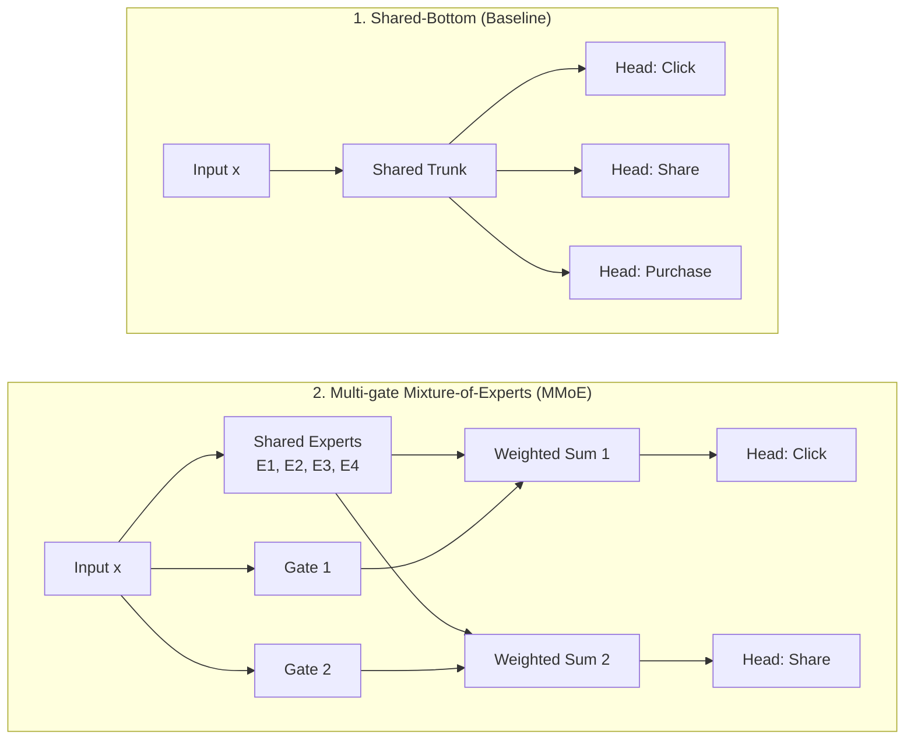

#### 1. Shared-Bottom Architecture (Baseline)
All tasks share a common deep neural trunk. Task-specific towers sit on top of the final shared layer.
*   *Failure Mode:* **Negative Transfer (Task Conflict)**.
    If Task A (Click) and Task B (Purchase) have conflicting gradient vectors:

```math
\langle \nabla \mathcal{L}_A, \nabla \mathcal{L}_B \rangle < 0
```

The shared parameters receive contradictory updates, resulting in worse performance than training two separate single-task models.

#### 2. Multi-gate Mixture-of-Experts (MMoE — Google 2018)
MMoE (Ma et al., 2018) replaces the rigid shared trunk with $`E`$ independent Expert MLPs ($`E_1, \dots, E_E`$). Each task $`k`$ is given its own **gating network** $`g_k(x)`$:

$$
y_k = h_k\left( \sum_{i=1}^E g_k(x)_i \cdot E_i(x) \right)
$$

Where $`g_k(x) = \text{Softmax}(W_{g, k} x) \in \mathbb{R}^E`$.
*   *Advantage:* If Task A and Task B conflict, Gate A can assign 90% weight to Expert 1, while Gate B assigns 90% weight to Expert 2. Experts dynamically specialize without manual parameter partitioning.
*   *Limitation:* **Expert Crowding / Entanglement**. Because all experts are shared across all tasks, gradients from a dominant high-volume task (Click) can still bleed into and destabilize an expert that a rare task (Purchase) relies on.

#### 3. Progressive Layered Extraction (PLE — Tencent 2020)
PLE (Tang et al., 2020) solves expert entanglement by strictly partitioning **Task-Specific Experts** from **Shared Experts**. In a single-layer block (**CGC**, Customized Gate Control), there is no Shared Gate and each task tower reads *only* its own private experts + shared experts; in **multi-layer PLE**, intermediate layers add a **Shared Gate** that fuses all experts into the next layer's shared input:

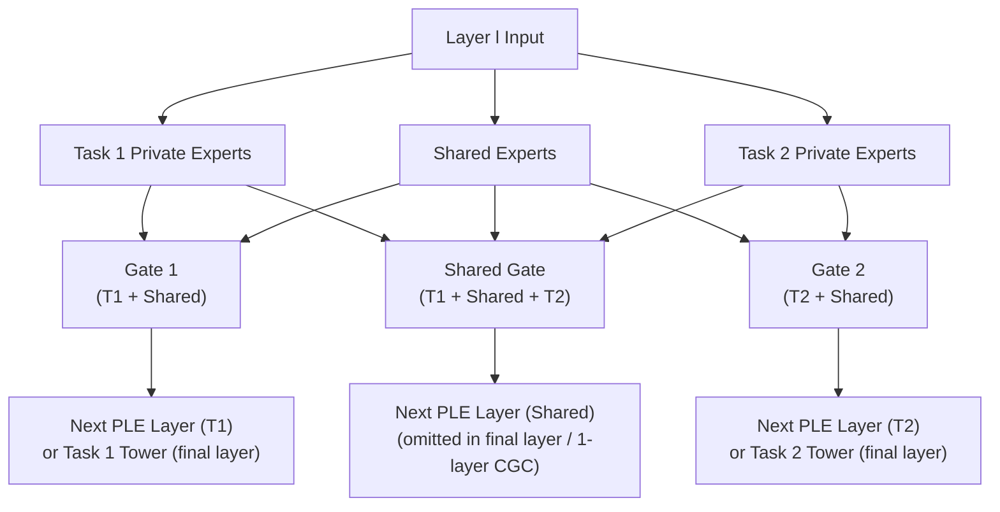

*   **How Isolation Actually Works:**
    *   In **1-layer CGC** (and in the **final extraction layer** of multi-layer PLE), Task 2 gradients literally cannot reach Task 1's private experts—guaranteeing strict parameter isolation.
    *   In **intermediate layers of multi-layer PLE**, the Shared Gate lets cross-task signal flow into deeper shared representations (meaning Layer-1 private experts receive heavily attenuated indirect signal from other tasks, balancing transfer with isolation).
*   **Trade-off:** Parameter count and inference FLOPs scale linearly with the number of tasks $`K`$ (e.g., 15 tasks $`\times`$ 2 private experts = 30+ expert MLPs per candidate per layer), and softmax gates can suffer from gating collapse without dropout or load-balancing regularization.

#### 4. Multi-Domain Unification vs. Segmentation & MoE Stability Tricks
*   **When to Unify vs. Segment:** Unifying multiple surfaces (e.g., Home Feed + Search) works well when schemas overlap: share the embedding + MMoE/PLE backbone, attach **surface-specific towers and calibration layers**, and export surface-specific checkpoints. Conversely, when two domains have radically different label densities (1–5% clicks vs. <0.1% purchases) *and* disjoint schemas (creative features vs. structured catalog specs), forcing one shared cross-network creates noisy cross-terms—splitting into dedicated models often cuts loss by 5–10% and doubles iteration speed.
*   **MoE Stability in Tabular Rankers:** Prevent routing collapse via auxiliary **load-balancing + router z-loss** (penalizing large router logits); prefer **dense soft routing** over sparse top-$`k`$ routing when tabular features overlap heavily; always use **LayerNorm (never BatchNorm)** inside sparse experts so single-sample expert batches ($`B=1`$) cannot collapse variance; and feed explicit **missingness masks** to the router when combining heterogeneous data sources.

### 6.3 Multi-Task Loss Normalization, Watch-Time Modeling & Gradient Balancing

During multi-task training, the total loss combines $K$ task heads:

$$
\mathcal{L}_{\text{total}} = \sum_{k=1}^K \alpha_k \mathcal{L}_k
$$

#### Why Raw Multi-Task Losses Break (Simple Intuition)
If you simply sum raw losses ($`\alpha_k = 1`$), three distinct failure modes immediately derail training:
1.  **Scale Explosion Across Loss Types (BCE vs. Regression):** Binary Cross-Entropy (BCE) for clicks or likes sits in the range **`0.1 – 0.5`**. Meanwhile, raw Mean Squared Error (MSE) on video watch time in seconds can sit in **`1,000 – 10,000`**! The regression head produces gradients $`100\times\text{–}10,000\times`$ larger than the click head, completely hijacking the shared trunk.
2.  **Positive-Rate Imbalance Across Binary Tasks:** Even when *all* heads use BCE, base rates differ wildly. A 5% Click task has baseline entropy $`H(0.05) \approx 0.199`$, while a 0.1% Share or Purchase task has $`H(0.001) \approx 0.0079`$ (**$`25\times`$ smaller raw loss**, with ~50 positives vs. ~1 positive per batch of 1,024). High-frequency tasks drown out rare, high-value tasks.
3.  **Magnitude Imbalance vs. Direction Conflict:** Scale/base-rate mismatch causes one task's gradient norm to overpower another (fixed by **normalization / loss weighting**). Opposing gradient directions ($`\langle g_i, g_j \rangle \lt 0`$) pull shared weights in opposite directions (fixed by **architecture like PLE** or **gradient surgery like PCGrad**).

#### Step 1: Normalize Continuous Targets & Watch-Time Heads First
Before tuning $`\alpha_k`$, put every task on a clean, comparable numerical scale:
*   **Transform & Clip Regression Targets:** Predict $`\log(1 + \text{watch time})`$ (or z-scored duration) using **Huber / Smooth-L1 loss** instead of raw MSE so a single 3-hour outlier video cannot explode batch gradients.
*   **Watch-Time Bucketing / Ordinal Classification:** Discretize watch time into quantile or threshold buckets (e.g., `>10s`, `>30s`, `>60s`, `>180s`) and train binary/ordinal cross-entropy heads. Every head now lives on the exact same nat/probability scale!
*   **Weighted Logistic Regression (WLR, YouTube 2016):** Weight each positive click example by its watch time $`T_i`$ (and negative impressions by $`1`$) inside standard BCE. Under small CTR, the learned odds $`e^{z}`$ approximate **expected watch time** $`\mathbb{E}[T \mid x]`$—avoiding MSE entirely.
*   **Right-Censored & Survival Watch-Time Loss:** Users still watching at snapshot time yield **right-censored** labels ($`T \ge t_{\text{obs}}`$). Dropping them biases toward short views; treating $`t_{\text{obs}}`$ as final underestimates long views. Fix via **censored hinge loss** $`\mathcal{L}_{\text{censored}} = \max(0, t_{\text{obs}} - \hat{t})`$ or by predicting a discrete **survival curve** $`S(t) = P(T \gt t)`$ and integrating $`\mathbb{E}[T] = \sum_t S(t)`$.
*   **Focal Loss, Label Smoothing & Loss Masking for Rare / Noisy Binary Heads:**
    *   **Focal Loss:** $`\mathcal{L}_{\text{focal}} = -\left[y(1-\hat{p})^\gamma \log \hat{p} + (1-y)\hat{p}^\gamma \log(1-\hat{p})\right]`$ ($`\gamma = 2`$ downweights easy negatives by $`0.05^2 = 0.0025`$) focuses capacity on hard boundary samples. *Critical caveat:* Focal loss **breaks probability calibration** and requires post-hoc calibration before serving.
    *   **Label Smoothing** ($`y_{\text{smooth}} = y(1-\varepsilon) + (1-y)\varepsilon`$, $`\varepsilon \approx 0.05`$) curbs overconfidence on noisy accidental taps; **in-context loss masking** computes gradients for ultra-rare heads (e.g., Follow, Message) only on sessions where that action was applicable.
*   **Critical Calibration Rule (`alpha_k` vs. `pos_weight`):** Multiplying an **entire** BCE task loss by $`\alpha_k`$ rescales its gradient magnitude *without* shifting the Bayes-optimal probability calibration. By contrast, upweighting only positive examples (`pos_weight > 1`) *does* warp predicted probabilities and requires a post-hoc log-odds shift before serving!

#### Step 2: Static & Dynamic Loss / Gradient Balancing

1.  **Inverse-Entropy Scaling + Manual Sweep (Production Default):**
    Initialize $`\alpha_k`$ inversely proportional to each task's initial loss or baseline entropy ($`\alpha_k \propto 1 / \mathcal{L}_k^{(0)}`$ or $`1 / H(p_k)`$) so every task enters training at comparable gradient scale, then sweep a small grid offline.
    *   *Trade-off:* Zero extra training compute, fully deterministic, and easy to debug—though weights stay fixed even as easy tasks converge faster than hard tasks.

2.  **Uncertainty Weighting (Kendall et al., 2018):**
    Learn a homoscedastic noise parameter $`\sigma_k`$ per task (parameterized via log-variance $`s_k = \log \sigma_k^2`$ for numerical stability):

```math
\mathcal{L}_{\text{reg}}(W, s_k) = \frac{1}{2} e^{-s_k} \mathcal{L}_k(W) + \frac{1}{2} s_k, \qquad \mathcal{L}_{\text{BCE}}(W, s_k) = e^{-s_k} \mathcal{L}_k(W) + \frac{1}{2} s_k
```

*   *Intuition (The Tug-of-War):* Notice the first term shrinks a noisy task's weight as $`s_k = \log\sigma_k^2`$ grows (preventing noisy gradients from destabilizing the trunk), while the $`+\frac{1}{2} s_k`$ regularizer prevents the model from cheating by sending $`\sigma_k \to \infty`$. *(Note: Regression includes the $`\frac{1}{2}`$ factor on the first term; classification/BCE omits it.)*
*   *Trade-off:* Very cheap (only $`K`$ scalar parameters), but $`\frac{1}{2}\log\sigma_k^2`$ can go negative when $`\sigma_k \lt 1`$ (fixed in practice via $`\log(1 + \sigma_k^2)`$, Liebel & Körner 2018) and still tends to under-weight ultra-sparse tasks under 5% vs. 0.1% skew.

3.  **GradNorm (Chen et al., 2018):**
    Directly measures each task's weighted gradient norm on the last shared layer, $`G_W^{(k)} = \lVert \nabla_{W_{\text{shared}}} (\alpha_k \mathcal{L}_k) \rVert_2`$, and updates $`\alpha_k`$ dynamically so every task matches the target norm $`\bar{G}_W \cdot [r_k(t)]^\gamma`$ (where $`r_k(t)`$ is task $`k`$'s relative inverse training rate: slower-learning tasks get *higher* gradient weight).
    *   *Trade-off:* Balances both scale and learning speed automatically, but requires **$`K`$ separate backward passes** to the shared layer per step—expensive when $`K \ge 10`$.

4.  **PCGrad — Projecting Conflicting Gradients (Yu et al., NeurIPS 2020):**
    When two tasks have opposing gradients ($`\langle g_i, g_j \rangle \lt 0`$), PCGrad removes the destructive component by projecting $`g_i`$ onto the normal plane of $`g_j`$ before summing:

```math
g_i \leftarrow g_i - \frac{\langle g_i, g_j \rangle}{\lVert g_j \rVert_2^2} g_j \qquad \text{whenever } \langle g_i, g_j \rangle < 0
```

*   *Trade-off:* Directly eliminates destructive directional conflict in shared parameters, but computing pairwise task gradients costs $`O(K^2)`$ projection overhead and $`K\times`$ gradient memory.

### 6.4 Sequential Task Dependencies: ESMM

In e-commerce and ads ranking, conversion ($`P(\text{Purchase} \mid \text{Click})`$) only occurs *after* a click. Training the CVR head strictly on clicked impressions causes **Sample Selection Bias** (at serving time, the model must score *unclicked* impressions!) and data sparsity.

**ESMM (Entire Space Multi-Task Model, Ma et al., SIGIR 2018)** trains both $`\hat{p}_{\text{CTR}}`$ and $`\hat{p}_{\text{CVR}}`$ over the **entire impression space** by optimizing two observable losses: $`\mathcal{L}_{\text{CTR}}`$ on clicks and $`\mathcal{L}_{\text{CTCVR}}`$ on the joint probability:

$$
\hat{p}_{\text{CTCVR}} = \hat{p}_{\text{CTR}} \times \hat{p}_{\text{CVR}}
$$

*   *Trade-off:* Eliminates selection bias cleanly, but because $`\hat{p}_{\text{CVR}}`$ is only supervised indirectly through the product $`\hat{p}_{\text{CTR}} \cdot \hat{p}_{\text{CVR}}`$, its standalone calibration can drift (especially when $`\hat{p}_{\text{CTR}}`$ is very small), often requiring an auxiliary click-space loss or post-hoc calibration.

---

### 6.5 IMPORTANT PRODUCTION INSIGHT: Training Losses vs. Serving Value Functions

> **A CLASSIC HIGH-SIGNAL INTERVIEW QUESTION:**
> Interviewers frequently ask:
> "If you want to increase User Long Dwell Time by 20% on the platform, do you increase the dwell time loss weight $`\alpha_{\text{dwell}}`$ in your multi-task neural network during training?"

#### The Correct Answer: **NO.**

**You NEVER modify training loss weights to adjust production business priorities.**

Here is why:
1.  **Training Loss Weights ($`\alpha_k`$) Control Estimation Quality, Not Ranking Utility:**
    The sole purpose of $`\alpha_k`$ during backpropagation is to balance gradients across shared layers so every head accurately estimates its true event probability. Even if you make the Dwell head slightly more accurate by increasing $`\alpha_{\text{dwell}}`$, a better-calibrated $`\hat{p}_{\text{dwell}}`$ does *not* make the ranker prioritize dwell time over clicks—and cranking $`\alpha_{\text{dwell}}`$ up by $`5\times`$ starves shared capacity from $`P(\text{Click})`$ and $`P(\text{Like})`$, degrading their accuracy and finite-sample calibration.
2.  **Model Heads Must Output True, Calibrated Probabilities:**
    Downstream systems expect each head $k$ to output the uncorrupted, physical probability of that event occurring:

```math
\hat{p}_{\text{click}} = P(\text{Click} = 1 \mid x), \qquad \hat{p}_{\text{dwell}} = P(\text{Dwell} > 30\text{s} \mid x)
```

#### The Production Separation: The Serving Value Function
The ranking order of items presented to the user is determined at **serving time** by an external **Value Function** (also known as a Scoring Utility Function or Policy Model):

$$
\text{Final Serving Score}(x) = w_1 \cdot \hat{p}_{\text{click}} + w_2 \cdot \hat{p}_{\text{dwell}} + w_3 \cdot \hat{p}_{\text{like}} + w_4 \cdot \hat{p}_{\text{share}} - w_5 \cdot \hat{p}_{\text{hide}}
$$

> **Note & Trade-offs of Serving Value Functions:** Production teams also frequently use **multiplicative / log-linear** combinations—e.g., $`\text{eCPM} = \text{Bid} \times \hat{p}_{\text{CTR}} \times \hat{p}_{\text{CVR}}`$ in Ads, or $`\hat{p}_{\text{click}}^{w_1} \cdot (1 + \mathbb{E}[\text{watch time}])^{w_2}`$ in video feeds—making accurate probability calibration across heads non-negotiable. Static global weights $`w_k`$ are fast and interpretable, but ignore **user heterogeneity** (e.g., passive lurkers vs. heavy likers) and require periodic re-tuning via online **Bayesian Optimization** whenever model calibration shifts.

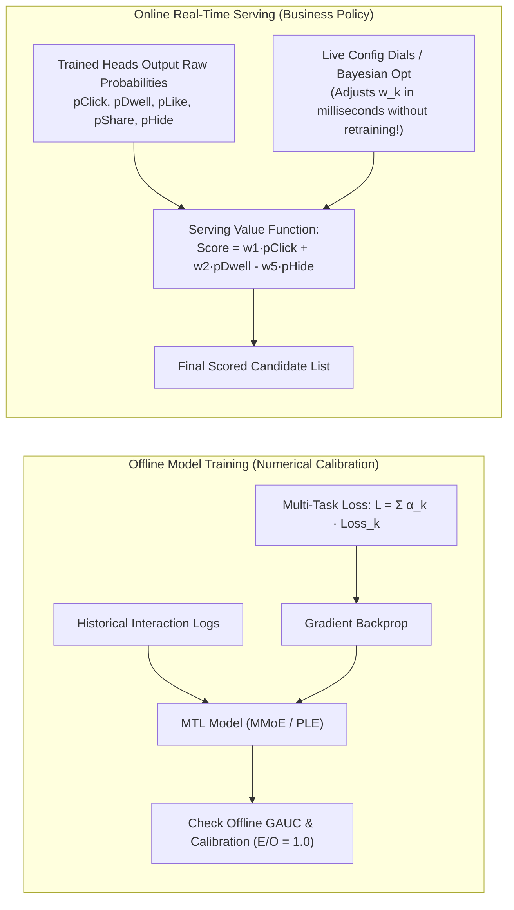

| Dimension | Offline Training Phase | Online Serving Phase |
| :--- | :--- | :--- |
| **Primary Objective** | Learn uncorrupted, well-calibrated physical event probabilities $`P(Y_k = 1 \mid x)`$ | Maximize ecosystem utility, 30-day retention, creator diversity, and revenue |
| **Control Parameters** | Task loss weights $`\alpha_k`$ in $`\mathcal{L} = \sum \alpha_k \mathcal{L}_k`$ | Business value weights $`w_k`$ in $`\text{Score} = \sum w_k \hat{p}_k`$ |
| **Tuning Mechanism** | Swept via offline grid search or Uncertainty Weighting for gradient stability | Tuned via online A/B testing and Bayesian Optimization directly on live traffic |
| **Retraining Cost** | High: Retraining takes $`12 - 24\text{ hours}`$ across distributed GPU clusters | **Zero:** Adjusting $`w_k`$ is an instant real-time configuration push |

If the executive team decides to prioritize long-form video dwell time over quick clicks, **no engineer touches model training code**. They adjust the serving weight $`w_2`$ in the real-time scoring configuration, instantly altering platform distribution across all live traffic.

> **How Serving Weights Are Tuned Online (Constrained Bayesian Optimization):** Instead of manual grid-searching over $`w_1, \dots, w_K`$ in dozens of sequential A/B tests, teams formulate $`\max_w f_{\text{primary}}(w)`$ subject to guardrails $`f_i(w) \ge c_i`$. A **Gaussian Process (GP)** surrogate models each noisy online metric, folds guardrails into a penalized utility $`U(w) = f_{\text{primary}}(w) + \bar{\lambda}\sum_i \mathbb{I}(f_i(w) \ge c_i)`$, and uses **Thompson Sampling** to dynamically shift live traffic toward feasible high-utility weights—optionally learning separate **per-cohort** weights to capture user heterogeneity.

### 6.6 Pointwise BCE vs. Pairwise & Listwise Ranking Losses

Most industrial L2 rankers start with **Pointwise Binary Cross-Entropy (BCE)** because it outputs **calibrated probabilities** required for ad auctions (`eCPM = Bid × pCTR`) and multi-task value functions. However, pointwise BCE treats each item independently and does not directly optimize intra-session relative order!

| Loss Paradigm | Core Objective | Calibration? | Ranking Power (GAUC / NDCG) | Production Trade-Off |
| :--- | :--- | :--- | :--- | :--- |
| **Pointwise (BCE)** | Predict exact $`P(y_i = 1 \mid x_i)`$ independently | **Yes** (strictly proper scoring rule) | Good, but ignores within-request relative margins | Can waste capacity modeling global base-rate shifts instead of top-slot ordering |
| **Pairwise (RankNet / BPR)** | Push positive item logit above negative item logit within the same user session | **No** (shift-invariant logits) | Higher intra-session AUC/GAUC | Destroys probability calibration; $`O(n^2)`$ pairs per session |
| **Listwise (LambdaRank / ListNet / Softmax)** | Optimize top-heavy slate metrics (NDCG) directly over the displayed session | **No** (invariant to additive constants) | Strongest top-$`K`$ NDCG focus | Destroys standalone probability calibration |
| **Production Hybrid (BCE + Rank)** | $`\mathcal{L} = \mathcal{L}_{\text{BCE}} + \lambda \mathcal{L}_{\text{rank}}`$ | **Preserved** (with small $`\lambda`$ or post-hoc calibration) | Best of both worlds | Extra hyperparameter $`\lambda`$; widely used at Google, Meta, and LinkedIn |

#### Why LambdaRank & LambdaMART Dominate Top-Heavy Ranking
Standard pairwise RankNet treats swapping positions `(1, 2)` identically to swapping `(99, 100)`. **LambdaRank** defines an implicit listwise gradient that multiplies each pair's RankNet gradient by the exact NDCG change from swapping $`i`$ and $`j`$ (for $`\text{rel}_i \gt \text{rel}_j`$):

$$
\lambda_{ij} = -\sigma(s_j - s_i) \cdot \left|\Delta \text{NDCG}_{ij}\right|
$$

**LambdaMART** fits GBDT regression trees directly to the aggregated per-item pseudo-residuals $`\lambda_i = \sum_j \lambda_{ij}`$—remaining a top baseline for CPU tabular rankers—while neural listwise rankers use **ListNet** (top-1 softmax KL), **ListMLE**, or **ApproxNDCG** inside the hybrid $`\mathcal{L}_{\text{BCE}} + \lambda \mathcal{L}_{\text{rank}}`$ objective.

---

## 7. Ranking Evaluation Metrics (L1 & L2)

At the ranking stages, we evaluate both **L1-to-L2 funnel alignment** and **L2 discrimination + probability calibration**.

### 1. L1 Pre-Ranking Alignment Metrics
Because L1's goal is strictly to avoid dropping L2's best candidates, evaluate L1 against L2's ordering:
*   **Recall@K of L2 Top-$`M`$:** What fraction of L2's top 20 items survive inside L1's top 300? (Production target: ≥ 95%.)
*   **Pairwise Rank Correlation (Kendall's $`\tau`$ / Spearman's $`\rho`$):** Measures global order agreement between L1 and L2 over early-funnel logged candidates.

### 2. Normalized Entropy (NE) & LogLoss (Meta's Unified Metric)
Normalized Entropy (He et al., Facebook 2014) divides predictive LogLoss by the baseline entropy of a constant model predicting the global empirical CTR $p$:

$$
\text{NE} = \frac{-\frac{1}{N}\sum_{i=1}^N \left( y_i \log \hat{p}_i + (1 - y_i) \log(1 - \hat{p}_i) \right)}{-\left( p \log p + (1 - p) \log(1 - p) \right)}
$$

*   *Why NE matters:* Unlike AUC/GAUC (which ignore calibration), **NE simultaneously captures both ranking discrimination AND probability calibration** while normalizing out seasonal shifts in background CTR $`p`$ (lower is better; $`\text{NE} = 1.0`$ equals a trivial constant predictor).

### 3. NDCG@K (Normalized Discounted Cumulative Gain)
The gold standard metric for ranking with graded relevance (e.g., $`3 = \text{Purchase}`$, $`2 = \text{Add-to-Cart}`$, $`1 = \text{Click}`$, $`0 = \text{Skip}`$):

$$
\text{DCG@}K = \sum_{i=1}^K \frac{2^{\text{rel}_i} - 1}{\log_2(i + 1)}
$$

$$
\text{NDCG@}K = \frac{\text{DCG@}K}{\text{IDCG@}K}
$$

Where $`\text{IDCG@}K`$ is the Ideal DCG score obtained by sorting the ground-truth items in perfect descending relevance order. NDCG heavily penalizes models that place relevant items down at rank #8 instead of rank #1. *(Quick rule: use **NDCG@K** for graded relevance, **MAP@K** for binary multi-relevant lists, and **MRR** when only the first relevant hit matters.)*

### 4. Group AUC (GAUC) & PR-AUC for Rare Heads
Standard Global AUC measures:

$$
\text{AUC} = P(\text{Score}(x^+) > \text{Score}(x^-))
$$

**Why Global AUC Lies in RecSys:**
Suppose User A is an active power user who clicks 50% of items, and User B is an inactive user who clicks 1% of items. A model can achieve a high global AUC of $`0.85`$ simply by assigning User A higher scores than User B, while completely failing to rank items correctly *for User A*!

**Group AUC (GAUC)** calculates the AUC for each user independently (excluding users with all-positive or all-negative impressions, where $`\text{AUC}_u`$ is undefined) and averages them, weighted by each user's impression volume:

$$
\text{GAUC} = \frac{\sum_{u \in U} w_u \cdot \text{AUC}_u}{\sum_{u \in U} w_u} \quad \text{where } w_u = \text{Impressions}_u
$$

In mature billion-user rankers (e.g., Meta, Alibaba), an offline improvement of **`+0.001` GAUC (10 bps)** is already statistically significant and shippable, while **`+0.005` GAUC** represents a major architectural breakthrough.
*   *Trade-off:* Because GAUC drops single-class users (users with zero clicks in the eval window) and weights by impressions, it biases slightly toward high-activity users.
*   **PR-AUC (AUPRC) for Ultra-Rare MTL Heads:** On 0.1% Conversion, Share, or Report heads (1:1000 imbalance), massive True Negatives keep $`\text{FPR} = \text{FP} / (\text{FP} + \text{TN})`$ artificially tiny—so ROC-AUC/GAUC can look deceptively strong (~0.95) even when top-decile precision is poor. Always pair GAUC with **PR-AUC** on rare heads.

### 5. Calibration Metrics & Production Calibration Architectures
A model can have excellent GAUC but terrible calibration.

If the model predicts $`\hat{p} = 0.80`$ for an ad, and across 10,000 such impressions only 2,000 users click, the true CTR is $`0.20`$. In ad auctions where bids are multiplied by predicted CTR ($`\text{eCPM} = \text{Bid} \times \text{pCTR}`$), a $`4\times`$ over-prediction inflates expected value $`4\times`$, breaking GSP/VCG auction truthfulness, misallocating impressions, and rapidly depleting advertiser budgets on low-ROI clicks.

*   **Calibration Ratio (Expected / Observed, or E/O):**

```math
\text{Ratio} = \frac{\sum_{i=1}^N \hat{p}_i}{\sum_{i=1}^N y_i} \quad \text{(Target: } 1.000 \text{)}
```

*Trade-off:* Global E/O $`= 1.000`$ can mask severe **slice-level miscalibration** (e.g., over-predicting new items by +30% while under-predicting popular items by -30%). Always monitor **slice E/O** across device, geo, and item-age buckets.

*   **Expected Calibration Error (ECE), Brier Score & Max Calibration Error (MCE):** Partition predictions into $`M`$ bins $`B_1, \dots, B_M`$ (in low-CTR surfaces like 0.5% Ads CTR, use **equal-mass / quantile bins** rather than equal-width bins so 99% of predictions don't pile into Bin 1), comparing each bin's empirical positive rate $`\text{acc}(B_m) = \frac{1}{|B_m|} \sum_{i \in B_m} y_i`$ against its mean predicted probability $`\text{conf}(B_m) = \frac{1}{|B_m|} \sum_{i \in B_m} \hat{p}_i`$:

```math
\text{ECE} = \sum_{m=1}^M \frac{|B_m|}{N} \left| \text{acc}(B_m) - \text{conf}(B_m) \right|, \qquad \text{MCE} = \max_{m} \left|\text{acc}(B_m) - \text{conf}(B_m)\right|, \qquad \text{Brier} = \frac{1}{N}\sum_{i=1}^N (\hat{p}_i - y_i)^2
```

**Brier Score** simultaneously measures calibration + discrimination; **MCE** exposes worst-case error in a single tail bin (critical for ad-auction cutoffs); and **Reliability Diagrams** plot $`\text{acc}(B_m)`$ vs. $`\text{conf}(B_m)`$ to diagnose overconfidence (curve below diagonal) or S-shaped bias.

**Production Calibration Methods:**

1. **Post-Hoc Calibration:** **Temperature Scaling** ($`\sigma(z/T)`$, 1 param, rank-preserving), **Platt Scaling** ($`\sigma(az+b)`$, fixes S-curves), or **Isotonic Regression** (non-parametric piecewise-constant monotonic fit; overfits if holdout $`\lt 1,000`$ samples). *(For negative downsampling at keep-rate $`s \in (0, 1)`$, apply the exact log-odds shift $`\text{logit}' = \text{logit} + \log s`$ first.)*
2. **Joint Feature-Conditioned Isotonic Layer (LiRank, KDD 2024):** Bucketizes raw logit $`y`$ into uniform intervals $`v_i`$ up to bucket $`k`$ and learns strictly non-negative context-conditioned slopes via ReLU ($`e_i = f(\text{device}, \text{surface}, \text{category})`$):

```math
y_{\text{cal}} = \sum_{i=0}^{k} \text{ReLU}(e_i + w_i) \cdot v_i + b
```

Guarantees monotonicity ($`\text{ReLU} \ge 0`$ never flips rank), calibrates per slice automatically, and trains end-to-end with BCE.
3. **Multi-Head Position-Conditional Calibration:** Outputs 1 global head $`\hat{p}_{\text{global}}`$ plus $`R`$ per-rank heads $`\lbrace \hat{p}^{(r)} \rbrace_{r=1}^R`$ trained via **loss masking** so every impression updates $`\hat{p}_{\text{global}}`$ while only the shown slot head $`r_{\text{shown}}`$ updates—yielding counterfactual per-position probabilities for auctions and slate optimization.

### 6. Bridging Offline to Online: Correlation Gaps & Interleaving
Why do strong offline GAUC gains frequently turn flat or negative in live A/B tests? (1) **Logging policy bias** (offline logs only contain items shown by the *old* ranker), (2) **random-negative eval sets** that are far easier than post-retrieval hard negatives, (3) **temporal leakage** from random train/test splits, and (4) **aggregate metrics masking tail/slice regressions**.
*   **Three-Phase L2 Validation Pipeline:** Enforce strict **temporal splits** and **slice-stratified GAUC/NE** offline $`\to`$ run **Team-Draft Interleaving** (blending Ranker A and Ranker B inside the *same* user request to cancel inter-user variance, yielding **$`50\times\text{–}100\times`$ higher sensitivity** on ~6% of A/B traffic) $`\to`$ graduate winners to multi-week user-split **A/B tests** to verify long-term retention and revenue guardrails.

---

## 8. Deep-Dive Interview Questions & Detailed Answers

### Question 1: Why is it an architectural failure to design the Pre-Ranking (L1) model as a simple miniature replica of the Heavy Ranking (L2) model?
**Candidate Answer:**
"Treating L1 as just an L2 model with fewer layers ignores the fundamental engineering bottleneck of large-scale distributed scoring: **Feature Fetching Latency**.

Scoring 3,000 candidates with full L2 features requires fetching 3,000 heavy multi-feature payloads ($`\approx 600,000`$ dynamic counters and user-item cross values) from remote key-value stores. Serializing and transferring that payload over the network takes $`30 - 60\text{ms}`$, exhausting the latency budget before the neural network even executes a forward pass.

An architecturally sound L1 model must use an **asymmetrical feature schema**. It runs the heavy User Tower once on the Root node (using the request's local user profile), broadcasts that user representation in a single hop, and scores static, coarse item features pre-cached in local Leaf RAM. Pinterest's Root-Leaf serving pattern is the gold standard for this: leaf nodes hold item feature shards in local RAM, scoring items in parallel with zero network transport for item features."

---

### Question 2: Walk through the mathematical difference between DCN-v1 and DCN-v2. Why does DCN-v2 outperform DCN-v1 on complex tabular data?
**Candidate Answer:**
"In DCN-v1, the cross layer is formulated as:

$$
x_{l+1} = x_0 x_l^T w_l + b_l + x_l
$$

Because vector-matrix associativity allows us to rewrite $`(x_0 x_l^T) w_l`$ as $`x_0 (x_l^T w_l) = (x_0 w_l^T) x_l`$, the term $`(x_l^T w_l)`$ is a scalar and the effective transformation matrix $`W = x_0 w_l^T`$ has a **mathematical rank of 1**. Every generated feature interaction is constrained to be a scalar multiple of the base input vector $`x_0`$, severely choking expressiveness.

DCN-v2 resolves this by replacing the weight vector $`w_l`$ with a full-rank matrix $`W_l \in \mathbb{R}^{d \times d}`$:

$$
x_{l+1} = x_0 \odot (W_l x_l + b_l) + x_l
$$

Because $`W_l`$ is full-rank, every single degree-2 cross term (e.g., $`x_i x_j`$) is multiplied by an independent, learnable weight parameter. To make this computationally feasible for ultra-low latency serving ($`O(d^2)`$ parameters), DCN-v2 uses a low-rank decomposition $`W_l = U_l V_l^T`$ with a Mixture of Experts gating network (DCN-Mix), achieving rich polynomial crosses at $`O(K d r)`$ cost—linear in feature dimension $`d`$."

---

### Question 3: How does DLRM handle the dual scaling challenges of terabyte-scale embedding tables and FLOP-heavy MLP computation?
**Candidate Answer:**
"DLRM decouples its architecture along hardware specialization lines: **Model Parallelism for Memory-Bound Sparse Tables**, and **Data Parallelism for Compute-Bound Dense MLPs**.

1.  **Sparse Embeddings (Model Parallel):** Terabyte embedding tables (often $`2\times\text{–}3\times`$ larger once Adam/Adagrad optimizer states are included) cannot fit on a single GPU. Tables are sharded across the VRAM of multiple GPU nodes (using hybrid table/column/row sharding in TorchRec to avoid stragglers). Each GPU executes lookups locally for its assigned tables across the global batch.
2.  **All-to-All Communication:** GPUs exchange the retrieved embedding vectors across the cluster using high-speed NVLink / InfiniBand interconnects, transposing from table-sharded to batch-sharded layout.
3.  **Dense Layers & MLPs (Data Parallel):** Once each GPU receives all embeddings for its batch slice, it computes the explicit pairwise dot-product interactions ($`\frac{(M+1)M}{2}`$ terms) and passes them through the Top MLP. The MLPs have small parameter footprints ($`\lt 100\text{MB}`$) but heavy FLOP requirements, so they are replicated across all GPUs. Gradients are synchronized across nodes using an All-Reduce collective operation."

---

### Question 4: What is Negative Transfer in Multi-Task Learning, and how does Progressive Layered Extraction (PLE) solve it compared to MMoE?
**Candidate Answer:**
"Negative Transfer occurs when two tasks have conflicting optimization gradients ($`\langle \nabla \mathcal{L}_A, \nabla \mathcal{L}_B \rangle \lt 0`$). In a Shared-Bottom network, updates from Task A destabilize Task B's performance.

MMoE attempts to resolve this by introducing shared experts with task-specific softmax gating networks. However, MMoE still suffers from **Expert Crowding / Entanglement**: because every expert is shared across all tasks, a high-volume dominant task (e.g., Clicks) can dominate the gradients of all experts, hurting rare, high-value tasks (e.g., Purchases).

PLE solves this by explicitly partitioning experts into **Task-Specific Experts** and **Shared Experts**:
*   Task 1 and Task 2 each have dedicated private experts alongside a pool of Shared Experts.
*   In **1-layer CGC** (and in the **final extraction layer** of multi-layer PLE), Task 1's gate reads *only* Task 1 private experts and Shared Experts—so Task 2 gradients literally cannot reach Task 1's private parameters.
*   In **intermediate layers of multi-layer PLE**, a Shared Gate combines all experts to feed the next layer's shared representation, preserving cross-task knowledge transfer while heavily attenuating cross-task interference. *(The main trade-off is linear parameter/FLOP growth as the number of tasks $`K`$ scales.)*"

---

### Question 5: Why do production ML teams decouple training multi-task loss weights from serving ranking value functions?
**Candidate Answer:**
"Training loss weights ($`\alpha_k`$ in $`\mathcal{L} = \sum \alpha_k \mathcal{L}_k`$) and serving value weights ($`w_k`$ in $`\text{Score} = \sum w_k \hat{p}_k`$) solve two completely different problems.

1.  **Training weights exist strictly for numerical optimization and gradient balance.** Because tasks span different loss scales (e.g., BCE vs. watch-time regression) and base rates (5% clicks vs. 0.1% shares), $`\alpha_k`$ prevents dominant tasks from drowning out rare tasks so every head outputs well-calibrated probabilities ($`\hat{p} \approx P(Y=1 \mid x)`$). Increasing $`\alpha_{\text{dwell}}`$ improves estimation focus on dwell time at the expense of shared capacity for other heads—it does *not* tell the ranker to prefer dwell over clicks.
2.  **Serving weights reflect business and ecosystem utility.** The ranking order is computed online via a serving value function:

```math
\text{Final Score} = w_{\text{click}} \hat{p}_{\text{click}} + w_{\text{dwell}} \hat{p}_{\text{dwell}} - w_{\text{hide}} \hat{p}_{\text{hide}}
```

If leadership wants to prioritize long dwell time over clicks, engineers adjust the serving weight $`w_{\text{dwell}}`$ in real-time configuration (or tune it via online Bayesian Optimization). This shifts platform utility instantly across live traffic with **zero model retraining** and zero gradient instability."

---

### Question 6: How do you combine LLMs with DLRM / DCN-v2 rankers in production without breaking a 40–50ms L2 latency SLA?
**Candidate Answer:**
"You cannot run a 7B LLM online over 300 candidates per request—that takes seconds. Production systems decouple LLM compute from the real-time L2 hot path using three complementary patterns:

1.  **Async Item-LLM + Nearline User-LLM $`\to`$ Projection Adapter:** Run the Item-LLM offline upon upload and run the User-LLM asynchronously via Kafka/Flink every $`N`$ user actions to cache a compressed `user_llm_state` vector in the feature store. At serving time, DLRM/DCN fetches the cached vectors in `< 2ms` and passes them through a **trainable low-rank MLP/MoE projection adapter** (bridging linguistic space to behavioral click space, paired with ID Dropout so `item_id` doesn't starve adapter gradients).
2.  **Semantic IDs as Native Sparse Ranking Features:** Quantize multimodal LLM embeddings via RQ-VAE into discrete tuples $`\langle c_1, c_2, c_3 \rangle`$ (plus prefix n-grams) and feed them into DLRM/DCN as tiny native sparse IDs—eliminating multi-megabyte dense vector payloads while boosting cold-start generalization.
3.  **Offline Teacher Distillation & MixLM + IBPC:** Distill offline LLM relevance scores (via sigmoid soft labels) into DLRM/DCN for **zero online overhead**, or into a compact 0.3B–0.6B SLM cross-encoder on the top ~50 candidates using **In-Batch Prefix Caching** (computing the user prefix KV cache once) and **MixLM** (compressing each candidate offline into ~1 cached embedding token)."

---

## What's Next: Transitioning to Part 3

Now that we have covered how the scoring engine models feature interactions and multi-task objectives, we must address the most dynamic dimension of modern recommendation: **Time and Real-Time Sequential Behavior**.

In **Part 3**, we explore:
*   **Sequential User Behavior Models**: From static profiles to dynamic attention with **DIN** (Deep Interest Network) and **DIEN** (AUGRU interest evolution).
*   **Scaling Sequences to 10,000+ Items**: Alibaba's **SIM** (General Search Unit + Exact Search Unit).
*   **Industrial Real-Time Action Transformers**: Pinterest **TransAct** and LinkedIn **Feed SR** (achieving $`O(N)`$ single-pass transformer training).
*   **Production Loss Engineering & Debiasing**: Position bias mitigation (**Shallow Tower** vs. **SNIPW**), negative downsampling with log-odds calibration ($`\text{logit}' = \text{logit} + \log s`$ for keep-rate $`s`$), and delayed conversion modeling.
