# Part 2: Pre-Ranking (L1) & Heavy Ranking (L2): Feature Crosses, DLRM & Multi-Task Learning

> A comprehensive, staff-level guide to modern scoring engines in recommendation systems. Covers the Pre-Ranking (L1) architectural dilemma, high-cardinality sparse feature engineering, polynomial feature crosses (DCN-v2 math), DLRM model parallelism, Multi-Task Learning (Shared-Bottom $\to$ MMoE $\to$ PLE), and the critical production decoupling of training loss weights from serving value functions.

---

## 1. The Scoring Engine at a Glance

Once the Candidate Retrieval stage (covered in [Part 1](./Part_1_Retrieval_and_Candidate_Generation.md)) filters $100\text{M}+$ items down to $\approx 1,000 - 5,000$ candidates, the system enters the **Scoring Funnel**:

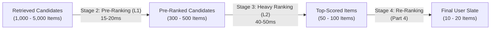

At this juncture, the mathematical formulation shifts fundamentally:
*   **In Retrieval (Stage 1):** We were constrained by the dot-product property: $\text{Score} = \langle f(u), g(i) \rangle$. No cross-features between user and item were allowed because item vectors had to be indexed offline.
*   **In Ranking (Stage 2 & Stage 3):** The candidate set is small enough that we can explicitly feed **user features, item features, contextual features, and real-time interaction crosses** into a single, unified neural network.

---

## Table of Contents

1. [The Scoring Engine at a Glance](#1-the-scoring-engine-at-a-glance)
2. [The Pre-Ranking (L1) Architecture & Dilemmas](#2-the-pre-ranking-l1-architecture--dilemmas)
   - [2.1 Why We Need Pre-Ranking](#21-why-we-need-pre-ranking)
   - [2.2 The "Feature Availability Trap": Why L1 Is Not Just a Smaller L2](#22-the-feature-availability-trap-why-l1-is-not-just-a-smaller-l2)
   - [2.3 Pinterest's Root-Leaf Serving Topology](#23-pinterests-root-leaf-serving-topology)
   - [2.4 L1 Training: Distillation vs. Early-Funnel Logging](#24-l1-training-distillation-vs-early-funnel-logging)
3. [The High-Cardinality Feature Space](#3-the-high-cardinality-feature-space)
   - [3.1 Feature Taxonomy: Dense, Sparse, and Crosses](#31-feature-taxonomy-dense-sparse-and-crosses)
   - [3.2 Terabyte Embedding Tables, Hash Collisions & Dynamic Eviction](#32-terabyte-embedding-tables-hash-collisions--dynamic-eviction)
   - [3.3 The Embedding Disconnect: Retrieval vs. Ranking vs. Semantic Spaces](#33-the-embedding-disconnect-retrieval-vs-ranking-vs-semantic-spaces)
4. [Explicit Feature Crosses: From Wide & Deep to DCN-v2](#4-explicit-feature-crosses-from-wide--deep-to-dcn-v2)
   - [4.1 Why Standard MLPs Fail at Feature Crosses](#41-why-standard-mlps-fail-at-feature-crosses)
   - [4.2 Wide & Deep Learning (Google 2016)](#42-wide--deep-learning-google-2016)
   - [4.3 Deep & Cross Network (DCN-v1 vs. DCN-v2) Mathematical Derivation](#43-deep--cross-network-dcn-v1-vs-dcn-v2-mathematical-derivation)
   - [4.4 Low-Rank Approximation & Mixture of Experts Cross Layers](#44-low-rank-approximation--mixture-of-experts-cross-layers)
5. [DLRM (Deep Learning Recommendation Model — Meta)](#5-dlrm-deep-learning-recommendation-model--meta)
   - [5.1 The DLRM Architecture](#51-the-dlrm-architecture)
   - [5.2 Explicit Dot-Product Feature Interactions](#52-explicit-dot-product-feature-interactions)
   - [5.3 Systems Architecture: Model Parallelism vs. Data Parallelism](#53-systems-architecture-model-parallelism-vs-data-parallelism)
6. [Multi-Task Learning (MTL) at Scale](#6-multi-task-learning-mtl-at-scale)
   - [6.1 The Multi-Objective Business Reality](#61-the-multi-objective-business-reality)
   - [6.2 Architecture Evolution: Shared-Bottom $\to$ MMoE $\to$ PLE](#62-architecture-evolution-shared-bottom-to-mmoe-to-ple)
   - [6.3 Loss Weighting in Training (Uncertainty, GradNorm, Manual)](#63-loss-weighting-in-training-uncertainty-gradnorm-manual)
   - [6.4 CRITICAL STAFF NUANCE: Training Losses vs. Serving Value Functions](#64-critical-staff-nuance-training-losses-vs-serving-value-functions)
7. [Stage 2 Evaluation Metrics](#7-stage-2-evaluation-metrics)
8. [Staff-Level Interview Questions & Detailed Answers](#8-staff-level-interview-questions--detailed-answers)

---

## 2. The Pre-Ranking (L1) Architecture & Dilemmas

### 2.1 Why We Need Pre-Ranking

Consider the compute budget of Stage 3 (Heavy Ranking). A state-of-the-art ranker features:
*   Terabyte-scale sparse embedding lookups.
*   DCN-v2 full-rank interaction layers.
*   Sequential transformer attention across the user's last 100 actions.
*   Multi-task heads (predicting 6+ distinct probabilities).

Scoring a single candidate takes $\approx 0.1\text{ms}$. If Retrieval returns $3,000$ candidates:
$$\text{Compute Time} = 3,000 \times 0.1\text{ms} = 300\text{ms}$$

This violates the total end-to-end P99 SLA ($\le 100\text{ms}$). We need an intermediate, high-throughput filter: **Pre-Ranking (L1)**. Its goal is to prune $3,000 \to 300$ items in under $15 - 20\text{ms}$ while preserving ranking alignment with the heavy ranker.

```
                  Retrieval (Stage 1)
                Surfaces 3,000 Candidates
                          │
                          ▼
┌────────────────────────────────────────────────────────┐
│  Pre-Ranking / L1 (Stage 2)                            │
│  • Latency Budget: 15 - 20ms                           │
│  • Compute Allowance: ~0.005ms per item                │
│  • Cuts candidates by 90% (3,000 → 300 items)          │
└─────────────────────────┬──────────────────────────────┘
                          │
                          ▼
┌────────────────────────────────────────────────────────┐
│  Heavy Ranking / L2 (Stage 3)                          │
│  • Latency Budget: 40 - 50ms                           │
│  • Compute Allowance: ~0.15ms per item                 │
│  • Scores surviving 300 items with massive neural net  │
└────────────────────────────────────────────────────────┘
```

### 2.2 The "Feature Availability Trap": Why L1 Is Not Just a Smaller L2

A junior or mid-level candidate will often say:
> *"L1 is simply a smaller neural network with fewer layers trained on the exact same features as L2."*

**This is a critical architectural error.**

In a distributed production environment, **feature fetching latency dominates model inference latency**:
1.  **Network Bandwidth & Key-Value Serialization:** To score $3,000$ items with full L2 features, the scoring engine must fetch hundreds of real-time features per item (e.g., real-time CTR counters over the past 5 minutes, item-user co-visitation matrices, deep content embeddings) from a remote low-latency feature store (e.g., Redis, DynamoDB, or internal key-value stores).
2.  Fetching $3,000 \times 200 \text{ features} = 600,000 \text{ keys}$ over the network takes **$30 - 60\text{ms}$**, exhausting the entire latency budget before the neural network even begins its forward pass!

```
THE FEATURE AVAILABILITY TRAP:
Full L2 Feature Set:
[ User Demographics ]  +  [ 10k Historical Actions ]  +  [ Real-Time 5-Min Interaction Counters ]  +  [ Cross Features ]
        ▲                                                          ▲
        │                                                          │
 Available Online in Request                               Must fetch 600,000 keys from remote KV store!
                                                            Latency: 45ms (EXCEEDS SLA!)
```

#### The Architectural Solution:
L1 **must** use an asymmetrical, lightweight feature space:
*   **User Features:** Ingests the full user profile (available in memory in the request context).
*   **Item Features:** Ingests *only* static, coarse item features (pre-stored in local memory) or lightweight distilled embeddings.
*   **Cross Features:** Strictly prohibited or restricted to simple dot products.

### 2.3 Pinterest's Root-Leaf Serving Topology

Pinterest Engineering faced this exact throughput bottleneck when scaling Home Feed pre-ranking. Their original approach used separate two-tower models for each retrieval source, which caused poor cross-source calibration.

They solved this by deploying a **Joint Request-Level + Item-Level Model on a Root-Leaf Serving Architecture**:

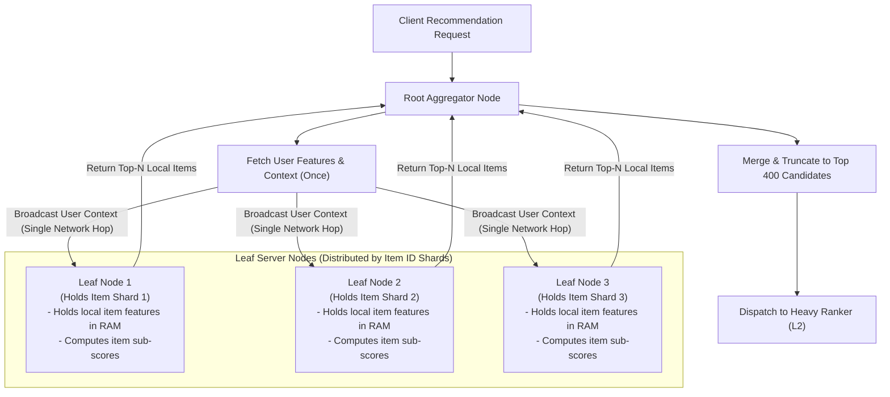

#### Why the Root-Leaf Pattern Wins:
1.  **Zero Remote Network Fetch for Item Features:** Each leaf node stores the static item embeddings and features for its own partition *in local RAM*. Item features are never serialized over the data center network.
2.  **Single User Broadcast:** The Root node fetches the user profile once and broadcasts it to all leaf nodes in a single network hop.
3.  **Parallel Computation:** Each leaf scores its local candidate pool in parallel ($\approx 5\text{ms}$) and returns only its top-$K$ scored items to the Root aggregator.

### 2.4 L1 Training: Distillation vs. Early-Funnel Logging

How should you train the Pre-Ranking model? There are two primary paradigms:

#### Approach 1: Distillation from L2 (Student-Teacher)
*   **Concept:** The heavy ranker (L2) serves as the "Teacher," and the lightweight L1 model serves as the "Student."
*   **Loss Formulation:** L1 is trained to match the output prediction logits of L2 using Kullback-Leibler (KL) divergence or Mean Squared Error:
    $$\mathcal{L}_{\text{distill}} = \text{MSE}(\hat{y}_{\text{L1}}, \hat{y}_{\text{L2}}) = \frac{1}{B} \sum_{i=1}^B (\text{logit}_{\text{L1}}(x_i) - \text{logit}_{\text{L2}}(x_i))^2$$
*   **Advantage:** L1 directly learns the complex decision boundary of L2 without needing human ground-truth labels. It automatically inherits L2's position debiasing and multi-task balance.

#### Approach 2: Early-Funnel Logging (Combating Sample Selection Bias)
> **CRITICAL INTERVIEW TRAP:**
> If you train L1 *only* on items that were displayed to the user (the final 10 items on the screen), your training data suffers from severe **Sample Selection Bias (Missing-Not-At-Random)**. 
> 
> The items that L1 needs to score in production include items ranked #1,500 by retrieval. If L1 only ever sees items that survived L2 ranking (the top 0.1%), it has no training signal on how to separate mediocre items from terrible items.

*   **The Industry Best Practice:** Log candidates at the **exit of the Retrieval / entrance of the L1 stage**. Assign pseudo-labels generated by running offline L2 teacher scoring on a small, uniformly sampled fraction of early-funnel candidates ($1\%$).

---

## 3. The High-Cardinality Feature Space

In industrial recommendation systems, tabular data dominates. Models must process a mixture of continuous numerical signals, high-cardinality categorical IDs, and dynamic temporal interactions.

### 3.1 Feature Taxonomy: Dense, Sparse, and Crosses

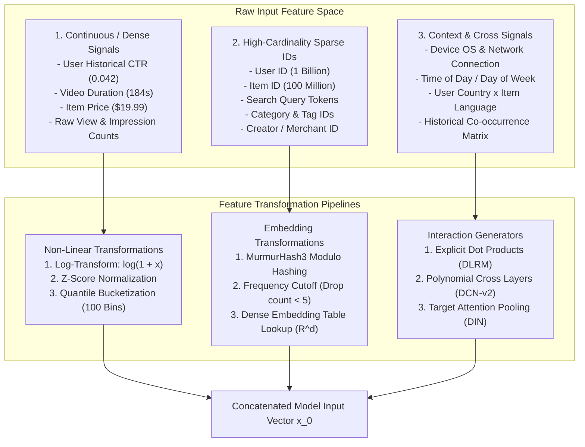

#### Preprocessing Dense Features:
*   **Log-Transform & Normalization:** Real-world counters (e.g., historical impression count) follow extreme power-law distributions. A viral video has $100\text{M}$ views; a new video has $2$. Raw values destroy gradient descent. Apply non-linear scaling:
    $$x_{\text{norm}} = \log(1 + x) \quad \text{or} \quad x_{\text{norm}} = \frac{x - \mu}{\sigma}$$
*   **Quantile Bucketization:** Discretize continuous features into $B$ discrete buckets (e.g., 100 quantiles) and project each bucket into an embedding table. This allows the model to learn non-linear step functions (e.g., price sensitivity jumps at \$10 and \$20).

### 3.2 Terabyte Embedding Tables, Hash Collisions & Dynamic Eviction

High-cardinality categorical IDs cannot be fed as raw integers into neural networks. Each ID is mapped to a continuous dense vector via an **Embedding Table** $E \in \mathbb{R}^{V \times d}$:

$$\text{Input: ID } k \longrightarrow \text{Embedding Vector } e_k = E[k] \in \mathbb{R}^d$$

#### The Scale Problem:
*   Suppose an e-commerce platform has $1\text{B}$ users and $100\text{M}$ items.
*   Embedding dimension $d = 64$ in float32 ($4\text{ bytes}$).
*   User table memory: $10^9 \times 64 \times 4\text{ bytes} = 256\text{ GB}$.
*   With auxiliary ID tables (queries, categories, creators), total embedding memory exceeds **$1 - 2\text{ Terabytes}$**.
*   Standard GPU VRAM (e.g., NVIDIA H100 with $80\text{ GB}$) cannot fit these tables on a single chip!

#### Handling Embedding Scale in Production:

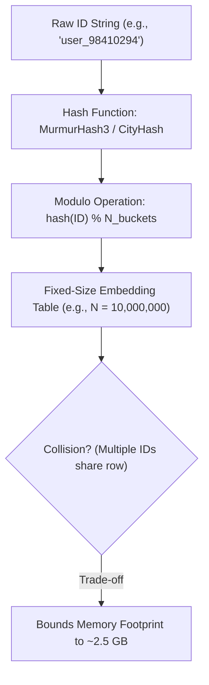

1.  **The Hashing Trick (Modulo Hashing):** Map arbitrary ID strings to a fixed range $[0, N-1]$ via hash functions (e.g., MurmurHash3):
    $$\text{Index} = \text{hash}(\text{ID}) \pmod N$$
    *Trade-off:* Introduces **hash collisions** (two different users share the exact same embedding row). If $N$ is too small, collision rates spike, causing gradient noise.
2.  **Frequency Filtering:** Do not allocate embedding slots to IDs with fewer than $K$ occurrences (e.g., $K = 5$). Assign all rare tail items to an `__UNKNOWN__` fallback token.
3.  **Dynamic Embedding Eviction (LFN / TTL):** Production systems like ByteDance's parameter servers monitor access recency. If an embedding row is not accessed within 14 days, it is evicted from GPU VRAM to cold storage.

### 3.3 The Embedding Disconnect: Retrieval vs. Ranking vs. Semantic Spaces

> **CRITICAL STAFF-LEVEL DISTINCTION:**
> A common interview misconception is assuming that an Item ID has a single, universal embedding across the company's codebase.
> 
> In reality, **every stage of the pipeline maintains its own completely decoupled embedding space**:


| Dimension | 1. Retrieval Embeddings | 2. Ranking Embeddings | 3. Semantic Embeddings |
| :--- | :--- | :--- | :--- |
| **Learned By** | Two-Tower contrastive InfoNCE loss | DLRM / DCN-v2 classification loss | CLIP, BERT, Vision Transformers (ViT) |
| **Geometric Property** | **Metric Space:** Dot product $\langle u, v \rangle = \text{score}$ | **Feature Space:** Dot product $\langle e_i, e_j \rangle$ is meaningless | **Semantic Space:** Cosine distance = content similarity |
| **Index Method** | FAISS, HNSW, SCaNN vector indices | Sharded terabyte GPU tables (Model Parallel) | Precomputed offline feature store vectors |
| **Primary Role** | Fast candidate retrieval ($10^8 \to 10^3$) | Heavy non-linear ranking ($10^3 \to 50$) | Zero-shot cold-start & content enrichment |

**Why you cannot query an ANN index using Ranking Embeddings:**
In DLRM, an item embedding $e_i$ is trained purely to maximize classification accuracy when concatenated and crossed with dense features inside a deep MLP. The dot product between two ranking embeddings $\langle e_i, e_j \rangle$ is completely meaningless and has no geometric distance interpretation!

---

## 4. Explicit Feature Crosses: From GBDT+LR to DCN-v2

### 4.0 The Pre-Neural Era: GBDT + Logistic Regression (Facebook 2014)

Before deep learning took over recommendation, the industry standard was Facebook's seminal paper: **Practical Lessons from Predicting Clicks on Ads at Facebook** (He et al., 2014).

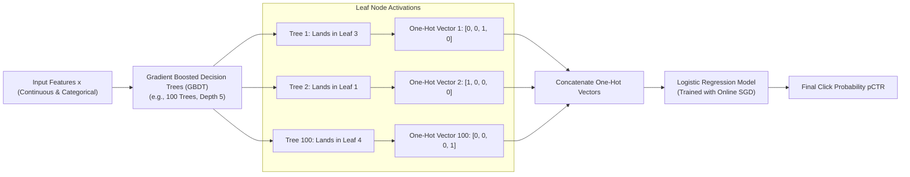

#### Why GBDT + LR Was a Masterstroke:
1.  **Automated Non-Linear Crosses:** Each path from tree root to leaf is an explicit boolean feature cross (e.g., `IF Country = US AND Age > 25 AND Device = iPhone THEN Leaf 3`). The GBDT automatically discovers high-signal cross features without manual human trial-and-error.
2.  **Decoupled Retraining Cadence:** Decision trees cannot be easily updated with streaming online data. Facebook decoupled the pipeline: the heavy GBDT was retrained **once a day** offline on batch data, while the lightweight linear Logistic Regression model was updated **in real time via streaming Online SGD** on live user clicks!

### 4.1 Why Standard MLPs Fail at Feature Crosses

A Multilayer Perceptron (MLP) with non-linear activation functions (ReLU, GELU) is a universal function approximator. In theory, an MLP can learn any relationship. 

In practice, **MLPs are notoriously inefficient at learning polynomial feature interactions** (e.g., $x_1 \cdot x_2 \cdot x_3$).

*   *Theoretical Insight:* To approximate an explicit multiplicative feature cross of degree $D$ (e.g., $\text{Country} \times \text{Device} \times \text{Category}$), a standard MLP requires an exponentially large number of hidden units and parameters, and requires billions of training examples to generalize.
*   In tabular CTR prediction, explicit combinations (e.g., `User_Installed_App = Netflix` $\times$ `Impression = Hulu Ad`) are the strongest predictive signals. Relying solely on MLPs causes models to underfit on critical cross patterns.

### 4.2 Wide & Deep Learning (Google 2016)

Google's seminal Wide & Deep architecture (Cheng et al., 2016) decoupled recommendation into two complementary objectives: **Memorization** and **Generalization**.

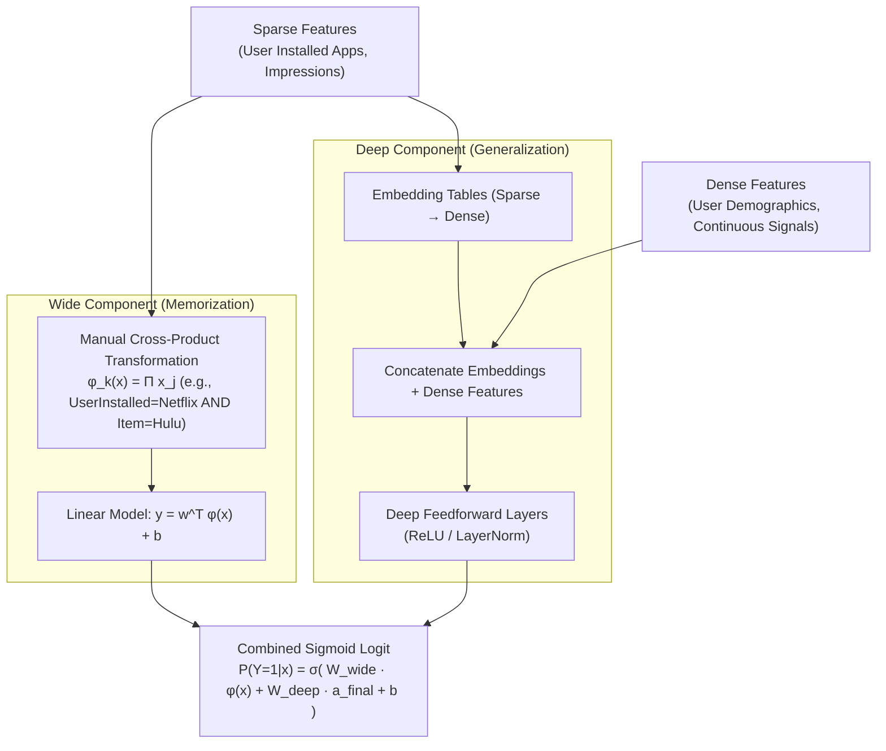

*   **The Wide Component (Memorization):** A generalized linear model using explicit cross-product feature transformations:
    $$\phi_k(x) = \prod_{j=1}^d x_j^{c_{kj}} \quad \text{where } c_{kj} \in \{0, 1\}$$
    Learns specific, high-correlation rules ("memorizes" that users who downloaded app A rarely download app B).
*   **The Deep Component (Generalization):** An MLP over dense continuous features and low-dimensional categorical embeddings. Generalizes to unseen user-item pairs via semantic proximity.
*   **The Flaw of Wide & Deep:** The feature crosses in the Wide component had to be **manually engineered by data scientists**. At web scale, maintaining manual cross transformations across thousands of features becomes impossible.

### 4.3 Deep & Cross Network (DCN-v1 vs. DCN-v2) Mathematical Derivation

To automate feature crosses without manual feature engineering, Wang et al. (Google, 2017) created the **Deep & Cross Network (DCN)**, followed by **DCN-v2** (Wang et al., 2021).

#### DCN-v1 Cross Layer Formulation:
Let $x_0 \in \mathbb{R}^d$ be the input feature vector (concatenated embeddings and normalized dense features).
The $(l+1)$-th cross layer computes:

$$x_{l+1} = x_0 x_l^T w_l + b_l + x_l$$

Where $w_l, b_l \in \mathbb{R}^d$ are trainable weight and bias vectors.

```
DCN-v1 Mathematical Limitation (Rank-1 Bottleneck):
Notice the term:  x_0 x_l^T w_l
Because matrix multiplication is associative:
x_0 (x_l^T w_l) = x_0 · ⟨x_l, w_l⟩ = α · x_0   (where α is a scalar!)
This means the outer product matrix  W = x_0 w_l^T  has RANK 1!
Every feature cross is constrained to be a scalar multiple of the base input vector x_0.
This severely limits the expressive capacity of DCN-v1.
```

#### DCN-v2: Full-Rank Matrix Cross Layers
DCN-v2 eliminates the rank-1 bottleneck by replacing the vector weight $w_l$ with a **full-rank weight matrix** $W_l \in \mathbb{R}^{d \times d}$:

$$x_{l+1} = x_0 \odot (W_l x_l + b_l) + x_l$$

Where $\odot$ denotes the element-wise Hadamard product.

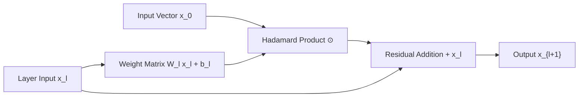

#### DCN-v2 Architectures: Stacked vs. Parallel
DCN-v2 can be deployed in two macro configurations depending on latency budgets and cross-feature importance:

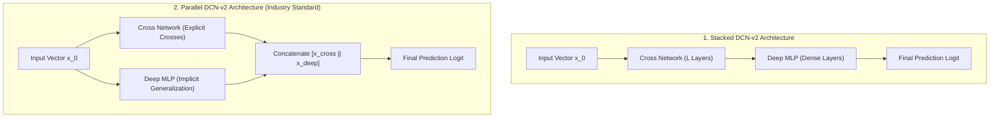

*   **Stacked Architecture:** Passes the output of the cross network directly into the deep MLP. Cross features undergo further non-linear compression.
*   **Parallel Architecture (Preferred in Production):** The Cross Network and Deep MLP run concurrently on the same input vector $x_0$. Their final representations are concatenated. This guarantees that explicit polynomial feature interactions pass directly into the output layer without being diluted by deep ReLU activations.

#### Worked Example: How DCN-v2 Automatically Builds Degree-2 Crosses
Let $x_0 = \begin{bmatrix} a \\ b \end{bmatrix}$ (degree 1).
At Layer 1 ($l=0$):
$$x_1 = x_0 \odot (W_0 x_0 + b_0) + x_0$$
Let $W_0 = \begin{bmatrix} w_{11} & w_{12} \\ w_{21} & w_{22} \end{bmatrix}$ and ignore bias $b_0$ for clarity:

$$W_0 x_0 = \begin{bmatrix} w_{11} a + w_{12} b \\ w_{21} a + w_{22} b \end{bmatrix}$$

Now, perform the Hadamard product with $x_0$:

$$x_0 \odot (W_0 x_0) = \begin{bmatrix} a \\ b \end{bmatrix} \odot \begin{bmatrix} w_{11} a + w_{12} b \\ w_{21} a + w_{22} b \end{bmatrix} = \begin{bmatrix} w_{11} \mathbf{a^2} + w_{12} \mathbf{ab} \\ w_{21} \mathbf{ab} + w_{22} \mathbf{b^2} \end{bmatrix}$$

Adding the residual $x_0$:
$$x_1 = \begin{bmatrix} w_{11} a^2 + w_{12} ab + a \\ w_{21} ab + w_{22} b^2 + b \end{bmatrix}$$

**Every single degree-2 polynomial cross ($a^2, ab, b^2$) is explicitly generated with its own dedicated learned weight!** At layer $L$, the network contains all polynomial feature crosses up to degree $L+1$.

### 4.4 Low-Rank Approximation & Mixture of Experts Cross Layers

While DCN-v2's full-rank matrix $W_l \in \mathbb{R}^{d \times d}$ provides massive expressivity, it introduces $O(d^2)$ parameters per layer. If input dimension $d = 1024$, each cross matrix has $1\text{M}$ parameters.

To make DCN-v2 efficient for ultra-low latency serving, the authors introduced **Low-Rank Matrix Decomposition**:

$$W_l \approx U_l \cdot V_l^T \quad \text{where } U_l \in \mathbb{R}^{d \times r}, V_l \in \mathbb{R}^{d \times r}, \text{ with rank } r \ll d$$

Parameter cost drops from $d^2$ down to $2 \cdot d \cdot r$ (a $16\times$ reduction for $d=1024, r=32$).

#### DCN-v2 Mixture of Experts (MoE):
To recover non-linear capacity lost by low-rank decomposition, DCN-v2 routes the input through $K$ low-rank cross experts using a learned gating network:

$$x_{l+1} = \sum_{k=1}^K g_k(x_l) \left( x_0 \odot (U_{l, k} V_{l, k}^T x_l + b_l) \right) + x_l$$

Where $g_k(x_l) = \text{Softmax}(W_g x_l)_k$ dynamically assigns input vectors to specialized sub-space experts.

---

## 5. DLRM (Deep Learning Recommendation Model — Meta)

Developed by Meta (Naumov et al., 2019), **DLRM** is the foundational architecture powering click-through rate (CTR) prediction and ads ranking across Facebook and Instagram.

### 5.1 The DLRM Architecture


### 5.2 Explicit Dot-Product Feature Interactions

The defining architectural hallmark of DLRM is how it computes interactions between sparse and dense features.

1.  **Bottom MLP:** Maps continuous numerical features into a single dense representation vector $v_0 \in \mathbb{R}^d$.
2.  **Embedding Lookups:** Maps $M$ categorical sparse features into $M$ embedding vectors $s_1, s_2, \dots, s_M \in \mathbb{R}^d$. Notice that **all sparse embeddings and the bottom MLP output share the exact same dimension $d$**.
3.  **Pairwise Dot Products:** Form a matrix of all representations:
    $$V = [v_0, s_1, s_2, \dots, s_M] \in \mathbb{R}^{(M+1) \times d}$$
    Compute the matrix product $S = V \cdot V^T \in \mathbb{R}^{(M+1) \times (M+1)}$.
    The $(i, j)$-th entry of this matrix is the scalar dot product:
    $$S_{i, j} = \langle V_i, V_j \rangle$$
4.  **Vectorization:** Because $S$ is symmetric ($S_{i, j} = S_{j, i}$) and the diagonal entries $S_{i, i} = \|V_i\|_2^2$ are self-norms, we extract strictly the **strictly lower triangular elements**.
    The number of unique pairwise interaction terms is:
    $$\text{Num Crosses} = \frac{(M+1) \cdot M}{2}$$
5.  **Top MLP:** Concatenate the interaction vector with the original dense vector $v_0$ and pass through the Top MLP to produce the final probability:
    $$\text{Input to Top MLP} = [v_0 \,\|\, \text{vech}(S)]$$

### 5.3 Systems Architecture: Model Parallelism vs. Data Parallelism

DLRM is not just a neural network; it is a **hardware-co-designed distributed system**. The architecture intentionally isolates memory bottlenecks from compute bottlenecks:

| Dimension | Sparse Embedding Tables | Dense MLPs (Bottom & Top) |
| :--- | :--- | :--- |
| **System Bottleneck** | **Memory-Bound (VRAM Capacity)** | **Compute-Bound (FLOPs / ALU Throughput)** |
| **Parameter Footprint** | **Terabytes** (Billions of sparse weights) | **Megabytes** ($< 100\text{MB}$ parameters) |
| **FLOP Requirements** | Low: Simple $O(1)$ memory lookups and pooling | Heavy: Dense matrix-matrix multiplications |
| **Parallelism Strategy** | **Model Parallelism:** Tables are partitioned across GPU VRAM | **Data Parallelism:** MLPs are replicated across all nodes |
| **Collective Comm** | **All-to-All:** Exchange embedding vectors across micro-batches | **All-Reduce:** Synchronize backward gradient updates |

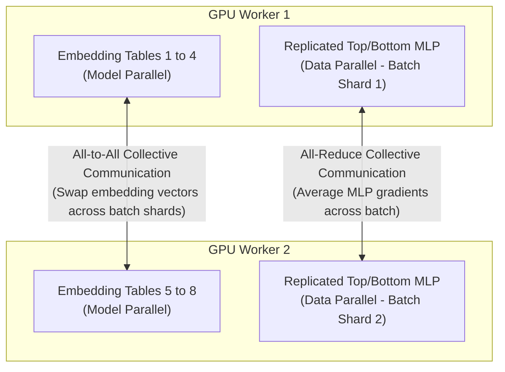

1.  **Model Parallelism (Sparse):** Table 1 lives on GPU 1; Table 2 lives on GPU 2. Each GPU performs lookups for its local tables on the current micro-batch.
2.  **All-to-All Communication:** GPUs perform an **All-to-All collective operation** over NVLink / InfiniBand, distributing the retrieved embedding vectors to the specific GPU handling that training sample.
3.  **Data Parallelism (Dense):** Once each GPU has all embedding vectors for its assigned data batch, the Dot-Product Interaction and Top MLP run independently in parallel. Gradients for the MLPs are synchronized across nodes via **All-Reduce**.

---

## 6. Multi-Task Learning (MTL) at Scale

### 6.1 The Multi-Objective Business Reality

Modern ranking systems never optimize for a single metric. If you train a model strictly to maximize Click-Through Rate (CTR), you create a **clickbait engine**: users click sensational headlines, find low-quality content, and abandon the platform within a week.

In production, recommendations must balance multiple, often conflicting user behaviors simultaneously:
*   $P(\text{Click})$: Did the user tap the post? (Short-term engagement)
*   $P(\text{Long Dwell})$: Did the user spend $>30\text{ seconds}$ consuming the content? (True satisfaction)
*   $P(\text{Like})$ / $P(\text{Share})$: Did the user endorse the item to their network? (Social validation)
*   $P(\text{Negative Action})$: Did the user click "Hide", "Report", or "Not Interested"? (Dissatisfaction signal)

### 6.2 Architecture Evolution: Shared-Bottom $\to$ MMoE $\to$ PLE

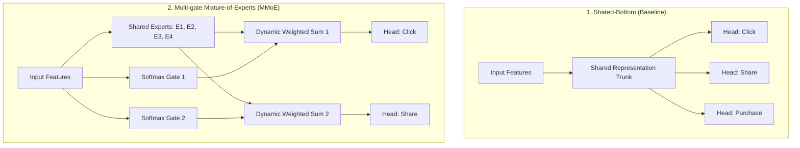

#### 1. Shared-Bottom Architecture (Baseline)
All tasks share a common deep neural trunk. Task-specific towers sit on top of the final shared layer.
*   *Failure Mode:* **Negative Transfer (Task Conflict)**.
    If Task A (Click) and Task B (Purchase) have conflicting gradient vectors:
    $$\langle \nabla \mathcal{L}_A, \nabla \mathcal{L}_B \rangle < 0$$
    The shared parameters receive contradictory updates, resulting in performance that is worse than training two separate single-task models.

#### 2. Multi-gate Mixture-of-Experts (MMoE — Google 2018)
MMoE (Ma et al., 2018) replaces the rigid shared trunk with $E$ independent Expert MLPs ($E_1, \dots, E_E$). Each task $k$ is given its own **gating network** $g_k(x)$:

$$y_k = h_k\left( \sum_{i=1}^E g_k(x)_i \cdot E_i(x) \right)$$

Where $g_k(x) = \text{Softmax}(W_{g, k} x) \in \mathbb{R}^E$.
*   *Advantage:* If Task A and Task B conflict, Gate A can assign 90% weight to Expert 1, while Gate B assigns 90% weight to Expert 2. Experts dynamically specialize without manual parameter partitioning.
*   *Limitation:* **Expert Crowding / Entanglement**. Because all experts are shared across all tasks, gradients from a dominant high-volume task (Click) can still bleed into and destabilize an expert that a rare task (Purchase) relies on.

#### 3. Progressive Layered Extraction (PLE — Tencent 2020)
PLE (Tang et al., 2020) solves expert entanglement by strictly isolating **Task-Specific Experts** from **Shared Experts**:

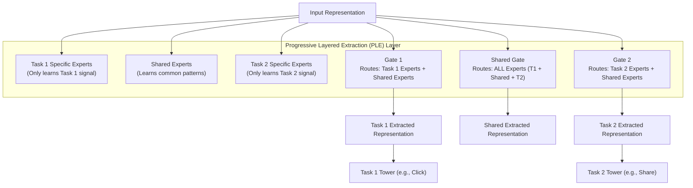

*   **Extraction Routing:**
    *   Task 1 Tower receives information *only* from its dedicated Task 1 Experts and the Shared Experts. It is mathematically impossible for Task 2 gradients to alter Task 1's private experts!
    *   The Shared Gate routes signals across all experts to maximize cross-domain transfer.
*   **Result:** PLE consistently eliminates negative transfer in industrial benchmarks, allowing simultaneous gains across clicks, conversions, and retention.

### 6.3 Loss Weighting in Training (Uncertainty, GradNorm, Manual)

During model training, the multi-task loss is a weighted sum:

$$\mathcal{L}_{\text{total}} = \sum_{k=1}^K \alpha_k \mathcal{L}_k$$

How do we set $\alpha_k$?

1.  **Manual Grid Search (The Production Default):** Engineers run parallel training jobs sweeping across fixed weight combinations ($\alpha_{\text{click}} = 1.0, \alpha_{\text{share}} = 5.0, \alpha_{\text{dwell}} = 0.5$). Simple, fully deterministic, and easily debuggable.
2.  **Uncertainty Weighting (Kendall et al., 2018):** Treats task weights as learned homoscedastic uncertainty parameters $\sigma_k$:
    $$\mathcal{L}(W, \sigma) = \sum_{k=1}^K \left( \frac{1}{2\sigma_k^2} \mathcal{L}_k(W) + \log \sigma_k \right)$$
    Tasks with high intrinsic noise (e.g., viral shares) automatically receive smaller weights ($\sigma_k$ increases), preventing gradient explosion.
3.  **GradNorm (Chen et al., 2018):** Dynamically adjusts weights at each step so that the gradient norms of all task heads backpropagate at similar training rates relative to their initial loss values.

---

### 6.4 CRITICAL STAFF NUANCE: Training Losses vs. Serving Value Functions

> **THE NUMBER ONE INTERVIEW TEST FOR STAFF CANDIDATES:**
> Interviewers frequently ask:
> *"If you want to increase User Long Dwell Time by 20% on the platform, do you increase the dwell time loss weight $\alpha_{\text{dwell}}$ in your multi-task neural network during training?"*

#### The Correct Answer: **NO.**

**You NEVER modify training loss weights to adjust production business priorities.**

Here is why:
1.  **Training Loss Weights ($\alpha_k$) Exist Strictly for Numerical Optimization:**
    The purpose of $\alpha_k$ during backpropagation is to ensure that task gradients are calibrated and do not overpower each other. If you crank $\alpha_{\text{dwell}}$ up by $5\times$, you destroy the gradient stability of the shared layers, degrading the calibration of $P(\text{Click})$ and $P(\text{Like})$.
2.  **Model Heads Must Output True, Calibrated Probabilities:**
    Downstream systems expect each head $k$ to output the uncorrupted, physical probability of that event occurring:
    $$\hat{p}_{\text{click}} = P(\text{Click} = 1 \mid x), \quad \hat{p}_{\text{dwell}} = P(\text{Dwell} > 30\text{s} \mid x)$$

#### The Production Separation: The Serving Value Function
The ranking order of items presented to the user is determined at **serving time** by an external **Value Function** (also known as a Scoring Utility Function or Policy Model):

$$\text{Final Serving Score}(x) = w_1 \cdot \hat{p}_{\text{click}} + w_2 \cdot \hat{p}_{\text{dwell}} + w_3 \cdot \hat{p}_{\text{like}} + w_4 \cdot \hat{p}_{\text{share}} - w_5 \cdot \hat{p}_{\text{hide}}$$

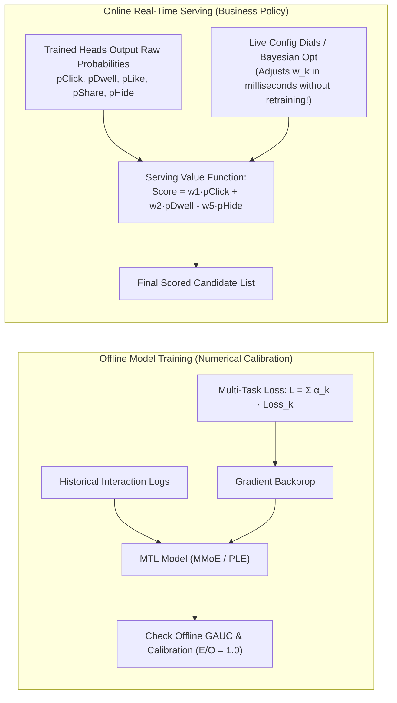

| Dimension | Offline Training Phase | Online Serving Phase |
| :--- | :--- | :--- |
| **Primary Objective** | Learn uncorrupted, well-calibrated physical event probabilities $P(Y_k = 1 \mid x)$ | Maximize ecosystem utility, 30-day retention, creator diversity, and revenue |
| **Control Parameters** | Task loss weights $\alpha_k$ in $\mathcal{L} = \sum \alpha_k \mathcal{L}_k$ | Business value weights $w_k$ in $\text{Score} = \sum w_k \hat{p}_k$ |
| **Tuning Mechanism** | Swept via offline grid search or Uncertainty Weighting for gradient stability | Tuned via online A/B testing and Bayesian Optimization directly on live traffic |
| **Retraining Cost** | High: Retraining takes $12 - 24\text{ hours}$ across distributed GPU clusters | **Zero:** Adjusting $w_k$ is an instant real-time configuration push |

If the executive team decides to prioritize long-form video dwell time over quick clicks, **no engineer touches model training code**. They adjust the serving weight $w_2$ in the real-time scoring configuration, instantly altering platform distribution across all live traffic.

---

## 7. Stage 2 Evaluation Metrics

At the ranking stage, we evaluate how well the model discriminates between engaged and unengaged items within the candidate pool.

### 1. NDCG@K (Normalized Discounted Cumulative Gain)
The gold standard metric for ranking with graded relevance (e.g., $3 = \text{Purchase}$, $2 = \text{Add-to-Cart}$, $1 = \text{Click}$, $0 = \text{Skip}$):

$$\text{DCG}@K = \sum_{i=1}^K \frac{2^{\text{rel}_i} - 1}{\log_2(i + 1)}$$

$$\text{NDCG}@K = \frac{\text{DCG}@K}{\text{IDCG}@K}$$

Where $\text{IDCG}@K$ is the Ideal DCG score obtained by sorting the ground-truth items in perfect descending relevance order. NDCG heavily penalizes models that place relevant items down at rank #8 instead of rank #1.

### 2. Group AUC (GAUC — The RecSys AUC)
Standard Global AUC measures:
$$\text{AUC} = P(\text{Score}(x^+) > \text{Score}(x^-))$$

**Why Global AUC Lies in RecSys:**
Suppose User A is an active power user who clicks 50% of items, and User B is an inactive user who clicks 1% of items. A model can achieve a high global AUC of $0.85$ simply by assigning User A higher scores than User B, while completely failing to rank items correctly *for User A*!

**Group AUC (GAUC)** calculates the AUC for each user independently and averages them, weighted by each user's impression volume:

$$\text{GAUC} = \frac{\sum_{u \in U} w_u \cdot \text{AUC}_u}{\sum_{u \in U} w_u} \quad \text{where } w_u = \text{Impressions}_u$$

In production ranking teams (e.g., Meta, Alibaba), an offline improvement of **$+0.005$ GAUC** is considered statistically significant and almost always translates to an online A/B test win.

### 3. Calibration & Expected Calibration Error (ECE)
A model can have excellent GAUC but terrible calibration. 

If the model predicts $\hat{p} = 0.80$ for an ad, and across 10,000 such impressions only 2,000 users click, the true CTR is $0.20$. In ad auctions where bids are multiplied by predicted CTR ($\text{eCPM} = \text{Bid} \times \text{pCTR}$), a miscalibrated model causes catastrophic advertiser overbilling.

*   **Calibration Ratio (E/O):**
    $$\text{Ratio} = \frac{\sum_{i=1}^N \hat{p}_i}{\sum_{i=1}^N y_i} \quad \text{(Target: Exactly 1.000)}$$
*   **Expected Calibration Error (ECE):** Partition predictions into $M$ equal-width probability bins:
    $$\text{ECE} = \sum_{m=1}^M \frac{|B_m|}{N} \left| \text{acc}(B_m) - \text{conf}(B_m) \right|$$

---

## 8. Staff-Level Interview Questions & Detailed Answers

### Question 1: Why is it an architectural failure to design the Pre-Ranking (L1) model as a simple miniature replica of the Heavy Ranking (L2) model?
**Candidate Answer:**
"Treating L1 as just an L2 model with fewer layers ignores the fundamental engineering bottleneck of large-scale distributed scoring: **Feature Fetching Latency**.

Scoring 3,000 candidates with full L2 features requires fetching thousands of dynamic, real-time counters and historical cross features from remote key-value stores. Serializing and transferring $3,000 \times 200\text{ features}$ over the network takes $30 - 60\text{ms}$, which exhausts the entire latency budget before the neural network can even execute a forward pass.

An architecturally sound L1 model must use an **asymmetrical feature schema**. It ingests the rich user profile (available locally in memory from the request), but uses *only* static, coarse item features that can be pre-cached in local memory, completely bypassing remote network lookups. Pinterest's Root-Leaf serving pattern is the gold standard for this: leaf nodes hold item feature shards in local RAM, scoring items locally in parallel with zero network transport for item features."

---

### Question 2: Walk through the mathematical difference between DCN-v1 and DCN-v2. Why does DCN-v2 outperform DCN-v1 on complex tabular data?
**Candidate Answer:**
"In DCN-v1, the cross layer is formulated as:
$$x_{l+1} = x_0 x_l^T w_l + b_l + x_l$$

Because vector-matrix associativity allows us to rewrite $x_0 x_l^T w_l$ as $x_0 (x_l^T w_l)$, the term $(x_l^T w_l)$ is a scalar. This means the transformation matrix $W = x_0 w_l^T$ has a **mathematical rank of 1**. Every generated feature interaction is constrained to be a scalar multiple of the base input vector $x_0$, severely choking expressiveness.

DCN-v2 resolves this by replacing the weight vector $w_l$ with a full-rank matrix $W_l \in \mathbb{R}^{d \times d}$:
$$x_{l+1} = x_0 \odot (W_l x_l + b_l) + x_l$$

Because $W_l$ is full-rank, every single degree-2 cross term (e.g., $x_i x_j$) is multiplied by an independent, learnable weight parameter. To make this computationally feasible for ultra-low latency serving ($O(d^2)$ parameters), DCN-v2 uses a low-rank decomposition $W_l = U_l V_l^T$ with a Mixture of Experts gating network, providing rich non-linear polynomial crosses at linear computational cost."

---

### Question 3: How does DLRM handle the dual scaling challenges of terabyte-scale embedding tables and FLOP-heavy MLP computation?
**Candidate Answer:**
"DLRM decouples its architecture along hardware specialization lines: **Model Parallelism for Memory-Bound Sparse Tables**, and **Data Parallelism for Compute-Bound Dense MLPs**.

1.  **Sparse Embeddings (Model Parallel):** Terabyte embedding tables cannot fit on a single GPU. Tables are sharded across the VRAM of multiple GPU nodes. Each GPU executes lookups locally on its assigned slice of categorical features for the incoming batch.
2.  **All-to-All Communication:** GPUs exchange the retrieved embedding vectors across the cluster using high-speed NVLink / InfiniBand interconnects.
3.  **Dense Layers & MLPs (Data Parallel):** Once each GPU receives the necessary embeddings for its batch slice, it computes the explicit pairwise dot-product interactions ($\frac{(M+1)M}{2}$ terms) and passes them through the Top MLP. The MLPs have small parameter footprints ($<100\text{MB}$) but heavy FLOP requirements, so they are replicated across all GPUs. Gradients are synchronized across nodes using an All-Reduce collective operation."

---

### Question 4: What is Negative Transfer in Multi-Task Learning, and how does Progressive Layered Extraction (PLE) solve it compared to MMoE?
**Candidate Answer:**
"Negative Transfer occurs when two tasks have conflicting optimization gradients ($\langle \nabla \mathcal{L}_A, \nabla \mathcal{L}_B \rangle < 0$). In a Shared-Bottom network, updates from Task A destabilize Task B's performance.

MMoE attempts to resolve this by introducing shared experts with task-specific softmax gating networks. However, MMoE still suffers from **Expert Crowding / Entanglement**: because every expert is shared across all tasks, a high-volume dominant task (e.g., Clicks) can dominate the gradients of all experts, hurting rare, high-value tasks (e.g., Purchases).

PLE solves this by explicitly partitioning experts into **Task-Specific Experts** and **Shared Experts**:
*   Task 1 has dedicated private experts that *only* backpropagate gradients from Task 1 loss.
*   Task 2 has dedicated private experts that *only* backpropagate Task 2 loss.
*   A set of Shared Experts learns generalized cross-task representations.
*   The Task 1 routing gate can only pull signals from Task 1 experts and shared experts—it is structurally isolated from Task 2's private parameters. This completely eliminates negative transfer while preserving positive knowledge transfer."

---

### Question 5: Why do production ML teams decouple training multi-task loss weights from serving ranking value functions?
**Candidate Answer:**
"Training loss weights ($\alpha_k$ in $\mathcal{L} = \sum \alpha_k \mathcal{L}_k$) and serving value weights ($w_k$ in $\text{Score} = \sum w_k \hat{p}_k$) solve two completely different problems.

1.  **Training weights exist for numerical optimization.** Their sole role during backpropagation is to prevent gradients from one task from dominating another, ensuring that each head outputs well-calibrated, uncorrupted probabilities ($\hat{p} \approx P(Y=1 \mid x)$). If you modify $\alpha_k$ to satisfy a business whim, you corrupt probability calibration across all heads.
2.  **Serving weights reflect business and ecosystem utility.** The ranking score is computed online via a policy value function:
    $$\text{Final Score} = w_{\text{click}} \hat{p}_{\text{click}} + w_{\text{dwell}} \hat{p}_{\text{dwell}} - w_{\text{hide}} \hat{p}_{\text{hide}}$$
    If leadership wants to increase long-term user retention by prioritizing long dwell time over clicks, engineers adjust the serving weight $w_{\text{dwell}}$ in real-time configuration files. This alters platform distribution instantly across live traffic with **zero model retraining** and zero risk of numerical gradient instability."

---

## What's Next: Transitioning to Part 3

Now that we have covered how the scoring engine models feature interactions and multi-task objectives, we must address the most dynamic dimension of modern recommendation: **Time and Real-Time Sequential Behavior**.

In **Part 3**, we explore:
*   **Sequential User Behavior Models**: From static profiles to dynamic attention with **DIN** (Deep Interest Network) and **DIEN** (AUGRU interest evolution).
*   **Scaling Sequences to 10,000+ Items**: Alibaba's **SIM** (General Search Unit + Exact Search Unit).
*   **Industrial Real-Time Action Transformers**: Pinterest **TransAct** and LinkedIn **Feed SR** (achieving $O(N)$ single-pass transformer training).
*   **Production Loss Engineering & Debiasing**: Position bias mitigation (**Shallow Tower** vs. **SNIPW**), negative downsampling with log-odds calibration ($\text{logit}' = \text{logit} - \log s$), and delayed conversion modeling.
