# Part 3: Sequential User Behavior Modeling & Production Loss Debiasing

> An in-depth, production-focused guide to modeling dynamic, lifelong user behavior sequences and correcting the systemic observational biases hidden inside production interaction logs. Covers Target-Agnostic vs. Target-Aware sequential paradigms (**GRU4Rec / SASRec / BERT4Rec / TiSASRec** vs. **DIN / DIEN / BST / DFN**), scaling to 10,000–100,000+ lifelong actions (**MIMN / SIM / TWIN / TWIN-V2 / SDIM**), modern real-time action transformers (**TransAct / TransAct V2 / PinnerFormer / Feed SR / HSTU**), and the three pillars of production loss debiasing (**Position & Exposure Bias**, **Negative Downsampling & Prior-Shift Calibration**, and **Delayed Conversion Feedback**).

---

## 1. The Temporal & Counterfactual Imperative

In [Part 1](./Part_1_Retrieval_and_Candidate_Generation.md), we compressed billion-item catalogs into top-$`K`$ candidates via Two-Tower retrieval, LogQ correction, ANN search, graphs, and generative Semantic IDs. In [Part 2](./Part_2_Ranking_PreRanking_and_Feature_Engineering.md), we built the L1/L2 scoring engine—crossing sparse and dense features via DCN-v2/DLRM and predicting calibrated multi-task probabilities via MMoE/PLE and ESMM.

Yet even the sharpest feature-crossing ranker fails in production if two foundational realities are ignored:

1.  **User intent is neither static nor single-mode:** A user who researched marathon sneakers yesterday, bought noise-canceling headphones an hour ago, and just clicked three Kyoto travel guides is exhibiting multi-faceted, rapidly evolving intent. Compressing their history into a static bag-of-items vector destroys both *which* interest matches the current candidate and *how* that interest evolved over time.
2.  **Production training logs are systematically biased counterfactuals:** A model trained blindly with pointwise Binary Cross-Entropy (BCE) on logged clicks and conversions does *not* learn true user relevance $`P(R=1 \mid x)`$. It learns a distorted mixture of **where the old ranker placed the item** (Position Bias), **how training negatives were subsampled** (Prior-Shift Distortion), and **whether a conversion had time to arrive before the training snapshot** (Delayed Feedback False Negatives).

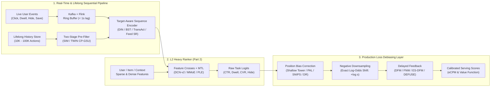

---

## Table of Contents

1. [The Temporal & Counterfactual Imperative](#1-the-temporal--counterfactual-imperative)
2. [Why Static Pooling Fails & The Sequential Intent Paradigm](#2-why-static-pooling-fails--the-sequential-intent-paradigm)
   - [2.1 The Mean-Pooling Collapse (Worked Example)](#21-the-mean-pooling-collapse-worked-example)
   - [2.2 Two Paradigms: Target-Agnostic Sequence Encoders vs. Target-Aware Ranking Attention](#22-two-paradigms-target-agnostic-sequence-encoders-vs-target-aware-ranking-attention)
3. [Target-Aware & Interest-Evolution Architectures (DIN, DIEN, BST & Dual Feedback)](#3-target-aware--interest-evolution-architectures-din-dien-bst--dual-feedback)
   - [3.1 Alibaba DIN (Deep Interest Network — KDD 2018)](#31-alibaba-din-deep-interest-network--kdd-2018)
   - [3.2 Alibaba DIEN (Deep Interest Evolution Network — AAAI 2019)](#32-alibaba-dien-deep-interest-evolution-network--aaai-2019)
   - [3.3 Alibaba BST (Behavior Sequence Transformer — DLP-KDD 2019)](#33-alibaba-bst-behavior-sequence-transformer--dlp-kdd-2019)
   - [3.4 Multi-Timescale Intent, Session Boundaries & Negative Feedback (DFN)](#34-multi-timescale-intent-session-boundaries--negative-feedback-dfn)
4. [Scaling to Ultra-Long Lifelong Sequences (10,000+ Actions): SIM, TWIN, TWIN-V2 & SDIM](#4-scaling-to-ultra-long-lifelong-sequences-10000-actions-sim-twin-twin-v2--sdim)
   - [4.1 The Lifelong Compute Wall & Early Stepping Stones (MIMN, UBR4CTR)](#41-the-lifelong-compute-wall--early-stepping-stones-mimn-ubr4ctr)
   - [4.2 Alibaba SIM (Search-based Interest Model — CIKM 2020)](#42-alibaba-sim-search-based-interest-model--cikm-2020)
   - [4.3 Kuaishou TWIN (KDD 2023) & TWIN-V2 (CIKM 2024)](#43-kuaishou-twin-kdd-2023--twin-v2-cikm-2024)
   - [4.4 Meituan SDIM (Sampling-based Deep Interest Modeling — CIKM 2022)](#44-meituan-sdim-sampling-based-deep-interest-modeling--cikm-2022)
5. [Industrial Real-Time Action Transformers & Low-Latency Serving (2023–2026)](#5-industrial-real-time-action-transformers--low-latency-serving-20232026)
   - [5.1 Pinterest TransAct (KDD 2023), TransAct V2 (2025) & PinnerFormer (KDD 2022)](#51-pinterest-transact-kdd-2023-transact-v2-2025--pinnerformer-kdd-2022)
   - [5.2 LinkedIn Feed SR (CIKM 2026), Meta HSTU & Single-Pass O(N) Session Training](#52-linkedin-feed-sr-cikm-2026-meta-hstu--single-pass-on-session-training)
   - [5.3 Real-Time Event Ingestion, Feature Serving & Sub-10ms Sequence Engineering](#53-real-time-event-ingestion-feature-serving--sub-10ms-sequence-engineering)
6. [Production Loss Debiasing — Part A: Position, Exposure & Popularity Bias](#6-production-loss-debiasing--part-a-position-exposure--popularity-bias)
   - [6.1 The Confounded Click Log & Examination Hypothesis](#61-the-confounded-click-log--examination-hypothesis)
   - [6.2 Model-Based Debiasing: Shallow Position Tower (YouTube) & PAL](#62-model-based-debiasing-shallow-position-tower-youtube--pal)
   - [6.3 Counterfactual Debiasing: IPS, SNIPS & Doubly Robust (DR) Estimators](#63-counterfactual-debiasing-ips-snips--doubly-robust-dr-estimators)
   - [6.4 Bridging Popularity & Selection Bias (LogQ, ESMM & MACR)](#64-bridging-popularity--selection-bias-logq-esmm--macr)
7. [Production Loss Debiasing — Part B: Negative Downsampling & Prior-Shift Calibration](#7-production-loss-debiasing--part-b-negative-downsampling--prior-shift-calibration)
   - [7.1 Why Production Pipelines Downsample Negatives](#71-why-production-pipelines-downsample-negatives)
   - [7.2 Exact Bayes' Theorem Log-Odds Calibration Derivation](#72-exact-bayes-theorem-log-odds-calibration-derivation)
   - [7.3 Worked Numerical Example: Preventing a 5.5x Ads eCPM Bidding Disaster](#73-worked-numerical-example-preventing-a-55x-ads-ecpm-bidding-disaster)
   - [7.4 Non-Uniform Sampling vs. BCE Sample Weighting (The Gradient Variance Trap)](#74-non-uniform-sampling-vs-bce-sample-weighting-the-gradient-variance-trap)
8. [Production Loss Debiasing — Part C: Delayed Feedback & Conversion Modeling (CVR)](#8-production-loss-debiasing--part-c-delayed-feedback--conversion-modeling-cvr)
   - [8.1 The Freshness vs. Label-Correctness Dilemma](#81-the-freshness-vs-label-correctness-dilemma)
   - [8.2 DFM (Delayed Feedback Model — Chapelle, KDD 2014)](#82-dfm-delayed-feedback-model--chapelle-kdd-2014)
   - [8.3 Importance Weighting for Delayed Feedback: FNW/FNC, FSIW & ES-DFM](#83-importance-weighting-for-delayed-feedback-fnwfnc-fsiw--es-dfm)
   - [8.4 Real Negatives & Modern Streaming Pipelines: DeFER, DEFUSE & Kafka Late-Event Joins](#84-real-negatives--modern-streaming-pipelines-defer-defuse--kafka-late-event-joins)
   - [8.5 Auxiliary Loss Modifiers & The Unified Composite Production Loss](#85-auxiliary-loss-modifiers--the-unified-composite-production-loss)
   - [8.6 Unified Production Debiasing Comparison Matrix](#86-unified-production-debiasing-comparison-matrix)
9. [Deep-Dive Interview Questions & Detailed Answers](#9-deep-dive-interview-questions--detailed-answers)

---

## 2. Why Static Pooling Fails & The Sequential Intent Paradigm

### 2.1 The Mean-Pooling Collapse (Worked Example)

Early deep rankers (YouTube DNN 2016, Wide & Deep, baseline DLRM) represented a user's historical behavior sequence $`S_u = [e_1, e_2, \dots, e_L]`$ by compressing all $`L`$ item embeddings into a single fixed-length vector via **mean pooling** or **sum pooling**:

```math
v_u = \frac{1}{L} \sum_{i=1}^{L} e_i
```

**Why does this break down immediately on real multi-interest users?**

Because user interests are **multi-modal** (distinct clusters in embedding space) and **non-stationary** (drifting across sessions). Averaging orthogonal interest vectors pulls the resulting representation into an empty "dead zone" between clusters—weakening similarity to *every* genuine interest!

#### Concrete Worked Numerical Example
Suppose an e-commerce embedding space has three orthogonal semantic axes: `Axis 1 = Athletic Footwear`, `Axis 2 = Audio Electronics`, and `Axis 3 = Travel / Flights`. A user has three recent clicks:
*   $`e_1 = [1.0, 0.0, 0.0]`$ (Running Sneakers)
*   $`e_2 = [0.0, 1.0, 0.0]`$ (Noise-Canceling Headphones)
*   $`e_3 = [0.0, 0.0, 1.0]`$ (Tokyo Flight Tickets)

Under **static mean pooling**, the user vector collapses to:

```math
v_u^{\text{mean}} = \frac{1}{3}(e_1 + e_2 + e_3) = [0.333,\; 0.333,\; 0.333]
```

Now score a perfectly relevant candidate—**Asics Marathon Sneakers** $`e_{\text{cand}} = [1.0, 0.0, 0.0]`$:
*   **With Static Mean Pooling:** Dot product $`\langle v_u^{\text{mean}}, e_{\text{cand}} \rangle = 0.333`$. Even worse, cosine similarity is $`0.333 / \sqrt{3 \times 0.333^2} = 0.577`$, and with $`K = 10`$ orthogonal interests, similarity collapses to $`1/\sqrt{10} = 0.316`$! Meanwhile, a mediocre "average" gadget carrying $`[0.58, 0.58, 0.58]`$ scores $`\langle v_u^{\text{mean}}, e_{\text{mediocre}} \rangle = 0.58`$—beating the exact sneaker match!
*   **With Target-Aware Attention:** When scoring `Asics Marathon Sneakers`, attention assigns high weight ($`a_1 \approx 0.90`$) to `Running Sneakers` and near-zero weight ($`a_2 \approx 0.02, a_3 \approx 0.01`$) to `Headphones` and `Flights`, yielding $`v_u(e_{\text{cand}}) \approx [0.90, 0.02, 0.01]`$ and dot product $`0.90`$. When scoring **Sony WH-1000XM5 Headphones** $`[0.0, 1.0, 0.0]`$ for the *exact same user*, the vector dynamically shifts to $`[0.02, 0.92, 0.01]`$.

```
STATIC POOLING (One blurry vector for all candidates):
  History: [Sneakers (1,0,0)] + [Headphones (0,1,0)] + [Flights (0,0,1)]
                                │
                                ▼  Mean Pool
                  v_u = [0.33, 0.33, 0.33]  ← Falls into dead space!
                   (Weak match for Sneakers, Headphones, AND Flights)

TARGET-AWARE ATTENTION (Dynamic vector conditioned on each candidate):
  Candidate = Asics Sneakers  ──► activates Sneakers (0.90)  ──► v_u ≈ [0.90, 0.02, 0.01]
  Candidate = Sony Headphones ──► activates Headphones (0.92) ──► v_u ≈ [0.02, 0.92, 0.01]
  Candidate = Kyoto Hotel     ──► activates Flights (0.88)   ──► v_u ≈ [0.01, 0.02, 0.88]
```

A second failure mode of static pooling is **order blindness**: `[iPhone 16 -> Phone Case -> Screen Protector]` implies the user already bought the phone and now wants accessories; reversing the sequence does not change a bag-of-items average at all.

---

### 2.2 Two Paradigms: Target-Agnostic Sequence Encoders vs. Target-Aware Ranking Attention

Sequential models in recommendation systems divide into **two fundamentally distinct architectural paradigms**—mixing them up is a classic system design error because they live in *different stages* of the funnel and obey *different serving complexity bounds*.

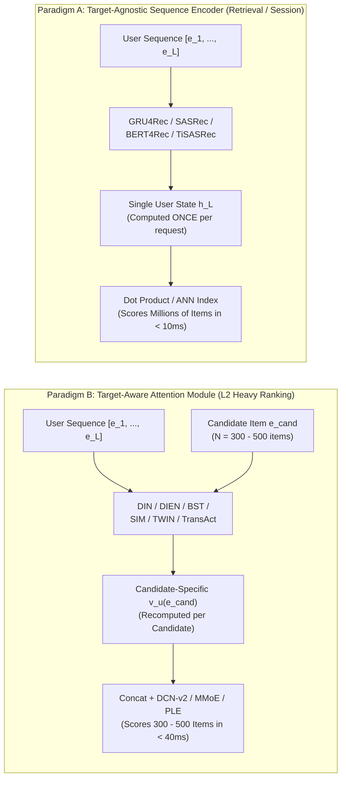

#### Paradigm A: Target-Agnostic Sequence Encoders (Retrieval & Anonymous Sessions)
These models take *only* the user's historical sequence $`[e_1, \dots, e_L]`$, process it once per request to emit a user state $`h_L`$, and score candidates via simple inner product $`\langle h_L, e_j \rangle`$ (making them **ANN-indexable** for Stage 1 Retrieval or standalone session-based recommendation).

1.  **GRU4Rec (Hidasi et al., ICLR 2016):**
    The first deep session-based recommender, built for anonymous e-commerce sessions with no user ID. A Gated Recurrent Unit (GRU) updates $`h_t = \text{GRU}(h_{t-1}, e_t)`$ step-by-step. Key training innovations: **session-parallel mini-batches** (packing variable-length sessions without padding waste) and **ranking losses** (BPR and TOP1) over mini-batch negatives instead of an expensive full-catalog softmax. *Limitation:* Compresses the entire session into a fixed-size hidden vector $`h_t`$, causing earlier interests to decay across long sessions.
2.  **SASRec — Self-Attentive Sequential Recommendation (Kang & McAuley, ICDM 2018):**
    Replaces the sequential GRU with a **causal (left-to-right) Transformer** using learned positional embeddings $`P \in \mathbb{R}^{L \times d}`$ and an upper-triangular causal mask so position $`t`$ attends directly to all positions $`1 \dots t`$ in $`O(1)`$ path length. Because training (causal next-item prediction) mirrors online inference exactly, SASRec became the production workhorse for sequential retrieval encoders (and the ancestor of PinnerFormer and HSTU).
3.  **BERT4Rec (Sun et al., CIKM 2019):**
    Applies **bidirectional self-attention** trained via a Cloze objective (randomly masking ~15% of items in the sequence and predicting them from both left and right context). *Production trade-off:* Richer training supervision for sparse domains (e.g., travel/hotels), but suffers from a **train-serve mismatch**—at inference time, the `[MASK]` token is *always* appended at the very end, reducing serving to unidirectional conditioning unless fine-tuned specifically on tail masks.
4.  **TiSASRec — Time-Interval Aware Self-Attention (Li et al., WSDM 2020):**
    Ordinal positions ($`1, 2, 3, 4`$) cannot distinguish between two clicks separated by **30 seconds** (same browsing intent) versus **3 months** (seasonal shift). TiSASRec computes a user-normalized relative time-interval matrix $`M_{ij} = \text{clip}\!\left(\lfloor |t_i - t_j| / r_u^{\min} \rfloor,\; k_{\max}\right)`$ (where $`r_u^{\min}`$ is user $`u`$'s minimum non-zero inter-click interval) and pairs absolute position embeddings $`P^K_j, P^V_j`$ with learned relative key/value time-interval embeddings $`R^K_{M_{ij}}, R^V_{M_{ij}}`$ directly inside scaled dot-product attention:

```math
e_{ij} = \frac{(x_i W^Q)\left(x_j W^K + R^K_{M_{ij}} + P^K_{j}\right)^T}{\sqrt{d}}, \qquad z_i = \sum_{j=1}^{i} \alpha_{ij} \left(x_j W^V + R^V_{M_{ij}} + P^V_{j}\right)
```

#### Paradigm B: Target-Aware Attention in Heavy Ranking (L2)
In Heavy Ranking, the candidate pool has already been pruned to $`N \approx 300 - 500`$ items. We no longer need an ANN-decomposable dot product—we can condition the sequence encoder *directly on each candidate* $`e_{\text{cand}}`$ (DIN, DIEN, BST, SIM, TWIN, TransAct) to extract a bespoke user interest vector $`v_u(e_{\text{cand}})`$, then feed $`v_u(e_{\text{cand}})`$ into the DCN-v2/DLRM + MMoE/PLE backbone.

**Iconic Production Paradigm A Deployments & The Prediction-Head Contrast:** Beyond academic benchmarks, Paradigm A powers web-scale sequential retrieval when enriched with context and session structure—notably **YouTube GRU + Latent Cross** (Beutel et al., WSDM 2018), which injects contextual signals (time-of-day, device, page) via multiplicative gating $`h_t \odot (1 + w_{\text{ctx}})`$ directly onto the RNN hidden state, and **Spotify CoSeRNN** (Hansen et al., RecSys 2020), which models hierarchical intra-session and cross-session music trajectories. Crucially, the two paradigms also diverge in **weight-tying and prediction heads**: Paradigm A **ties** its input item embedding table with its output softmax projection so the final hidden state $`h_L`$ scores the entire catalog via Sampled Softmax / ANN dot product, whereas Paradigm B outputs an intermediate feature vector $`v_u(e_{\text{cand}})`$ fed into a downstream ranking MLP—so no full-catalog softmax exists at all.

| Dimension | Paradigm A: Target-Agnostic (GRU4Rec / SASRec / BERT4Rec / TiSASRec) | Paradigm B: Target-Aware Attention (DIN / DIEN / BST / SIM / TransAct) |
| :--- | :--- | :--- |
| **Role in Funnel** | Standalone Retrieval Encoder (Stage 1) or Session-Only Ranker | Plug-in Sequence Module inside L2 Heavy Ranker (Stage 3) |
| **Candidate Awareness** | **None** during sequence encoding ($`h_L`$ is shared across all items) | **Full** — dynamically re-weights history for each candidate $`e_{\text{cand}}`$ |
| **Multi-Interest Handling** | Struggles unless paired with multi-head/multi-cluster retrieval (e.g., PinnerSage) | **Native** — activates only the matching interest cluster per candidate |
| **Serving Complexity ($`N`$ candidates, length $`L`$)** | $`O(L^2 d)`$ **once** per user request + $`O(\log \lvert V \rvert)`$ ANN lookup | $`O(N \cdot L \cdot d)`$ (DIN) or $`O(N \cdot L^2 d)`$ (naive BST) unless prefix-cached |
| **Typical Latency Profile** | $`2 - 5\text{ms}`$ for $`10\text{M}+`$ catalog retrieval | $`5 - 15\text{ms}`$ for $`N = 300 - 500`$ candidates on batched GPU |
| **Training Objective** | Next-item Sampled Softmax / InfoNCE / BPR / Cloze | Joint end-to-end Multi-Task BCE (CTR, Dwell, CVR) + optional auxiliary loss |

---

## 3. Target-Aware & Interest-Evolution Architectures (DIN, DIEN, BST & Dual Feedback)

### 3.1 Alibaba DIN (Deep Interest Network — KDD 2018)

**Why does DIN exist?** In Alibaba's display advertising system, users exhibit dozens of concurrent shopping interests (electronics, baby formula, running gear, kitchenware). Static pooling compressed all interests into one fixed vector—meaning either embedding dimension had to grow impossibly large, or rare-but-relevant historical clicks got drowned out.

#### Intuition & Mathematical Formulation
**DIN** (Zhou et al., KDD 2018) introduces a **Local Activation Unit** that computes a candidate-specific attention weight $`a(e_i, e_{\text{cand}})`$ for every historical behavior embedding $`e_i`$ against the candidate ad embedding $`e_{\text{cand}}`$:

```math
v_u(e_{\text{cand}}) = \sum_{i=1}^{L} a(e_i, e_{\text{cand}}) \cdot e_i = \sum_{i=1}^{L} w_i \cdot e_i
```

Rather than a plain dot product $`\langle e_i, e_{\text{cand}} \rangle`$, DIN feeds an explicit **4-way interaction vector**—raw embeddings, element-wise difference, and element-wise outer (Hadamard) product—into a compact MLP activation unit:

```math
a(e_i, e_{\text{cand}}) = \text{MLP}\!\left(\text{concat}\!\left[\, e_i,\; e_{\text{cand}},\; e_i - e_{\text{cand}},\; e_i \odot e_{\text{cand}} \,\right]\right)
```

*(Note: In the original KDD 2018 paper, the interaction is specifically `concat[e_i, e_cand, e_i - e_cand, e_i ⊙ e_cand]`—capturing both additive distance and multiplicative alignment.)*

#### Crucial Design Decision #1: Why DIN Intentionally Skips Softmax Normalization
Unlike Transformer attention, DIN **does NOT apply `Softmax` across $`w_1, \dots, w_L`$**!

*   **Preserving Interest Intensity:** Suppose User A clicked **10 pairs of sneakers** and 10 unrelated items, while User B clicked **1 pair of sneakers** and 10 unrelated items. With Softmax ($`\sum w_i = 1`$), both users' sneaker weights sum to $`\approx 1.0`$, erasing the massive difference in purchase intent intensity! Without Softmax, User A's $`\lVert v_u(e_{\text{sneaker}}) \rVert_2`$ is $`\approx 10\times`$ larger than User B's—a strong predictive feature for the downstream ranking MLP.
*   **Avoiding Irrelevant-History Dilution:** If a user has 100 unrelated clicks (say raw logits $`0.0`$) and 1 relevant click (logit $`+3.0`$), Softmax assigns $`\frac{e^3}{e^3 + 100 e^0} = \frac{20.1}{120.1} = 0.167`$, dumping **83.3% of the weight onto irrelevant noise**! Unnormalized DIN outputs $`a \approx 0.01`$ for noise and $`a \approx 0.85`$ for the match, keeping the vector sharp regardless of how many unrelated items exist.

#### Crucial Design Decision #2: Dice Activation & Mini-Batch Aware Regularization
*   **Dice (Data Adaptive Activation Function):** Standard `PReLU` hard-codes its rectifier switch point at $`0`$, ignoring shifting feature distributions across layers. Dice generalizes `PReLU` by centering and scaling the switch point using batch statistics $`\mathbb{E}[s]`$ and $`\text{Var}[s]`$:

```math
p(s) = \frac{1}{1 + \exp\!\left(-\frac{s - \mathbb{E}[s]}{\sqrt{\text{Var}[s] + \epsilon}}\right)}, \qquad f_{\text{Dice}}(s) = p(s) \cdot s + \bigl(1 - p(s)\bigr) \cdot \alpha s
```

At serving time, $`\mathbb{E}[s]`$ and $`\text{Var}[s]`$ use exponential moving averages (like BatchNorm).
*   **Mini-Batch Aware Regularization:** Applying standard L2 regularization across billion-ID sparse embedding tables updates *all* $`10^9`$ parameters every step (prohibitively slow). DIN regularizes *only* the sparse IDs appearing in the current mini-batch, weighted inversely by their global occurrence frequency $`n_j`$ so rare IDs aren't over-penalized.

#### Concrete Worked Numerical Example (DIN vs. Softmax Attention)
User history ($`L = 5`$): `[e_1: Nike Shoes, e_2: MacBook, e_3: Python Book, e_4: Adidas Shoes, e_5: Frying Pan]`.

| Historical Item | Candidate = `Asics Running Shoes` (Raw Activation $`a_i`$) | Softmax Weight ($`e^{a_i}/\sum e^{a_j}`$) | Candidate = `MacBook Pro` (Raw Activation $`a_i`$) |
| :--- | :---: | :---: | :---: |
| `e_1` (Nike Shoes) | **`0.82`** | `0.301` | `0.04` |
| `e_2` (MacBook) | `0.03` | `0.137` | **`0.91`** |
| `e_3` (Python Book) | `0.01` | `0.134` | **`0.35`** |
| `e_4` (Adidas Shoes) | **`0.78`** | `0.289` | `0.02` |
| `e_5` (Frying Pan) | `0.05` | `0.139` | `0.01` |
| **Resulting $`v_u`$** | $`0.82 e_1 + 0.78 e_4 + \text{tiny noise}`$ (**Intensity = 1.60**) | **41.0% weight wasted on unrelated items!** | $`0.91 e_2 + 0.35 e_3 + \text{tiny noise}`$ (**Intensity = 1.26**) |

#### Production Trade-offs & Failure Modes
*   **Permutation Invariance:** Because DIN is a weighted sum with no recurrence or positional encoding, `[Shoes -> Laptop -> Socks]` produces the exact same output as `[Socks -> Laptop -> Shoes]`—it cannot detect *evolving* or *completed* intent.
*   **Latency Scaling:** Running an MLP activation unit over $`L`$ items for every candidate costs $`O(N \cdot L \cdot d)`$. Practical for $`L \le 200`$, completely infeasible at $`L = 10,000`$.

---

### 3.2 Alibaba DIEN (Deep Interest Evolution Network — AAAI 2019)

**Why does DIEN exist?** DIN treats user history as an unordered *set*. In real e-commerce and content feeds, user interests **drift and evolve sequentially**: a user who clicked *basic running shoes* (week 1) $`\to`$ *compression socks* (week 2) $`\to`$ *carbon-plate marathon shoes* (yesterday) is on a clear trajectory. Furthermore, raw click embeddings are noisy proxies for the user's true latent interest state.

#### Architecture & Mathematical Derivation
**DIEN** (Zhou et al., AAAI 2019) stacks **two specialized recurrent layers**: an **Interest Extractor Layer** (standard GRU + Auxiliary Loss) and an **Interest Evolving Layer** (**AUGRU** — Attention Update Gate GRU).

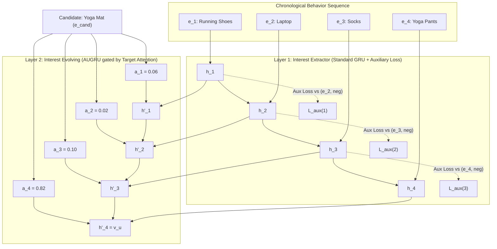

##### Layer 1: Interest Extractor + Auxiliary Loss
A standard GRU processes the raw behavior embeddings $`e_1, \dots, e_L`$ chronologically into hidden interest states $`h_1, \dots, h_L`$. However, backpropagating *only* the final click loss at step $`L+1`$ through a long GRU suffers from vanishing gradients and allows intermediate states $`h_t`$ to drift away from representing actual user interests.

DIEN fixes this by adding a **next-click Auxiliary Loss** at every time step $`t`$, pairing the true next click $`e_{t+1}`$ against a randomly sampled negative item $`\hat{e}_{t+1}`$:

```math
\mathcal{L}_{\text{aux}} = -\frac{1}{N} \sum_{i=1}^{N} \sum_{t=1}^{L-1} \left( \log \sigma\!\left(\langle h_t^i,\; e_{t+1}^i \rangle\right) + \log\!\left(1 - \sigma\!\left(\langle h_t^i,\; \hat{e}_{t+1}^i \rangle\right)\right) \right)
```

```math
\mathcal{L}_{\text{total}} = \mathcal{L}_{\text{CTR}} + \alpha \cdot \mathcal{L}_{\text{aux}}
```

This auxiliary supervision forces every intermediate state $`h_t`$ to be a faithful predictor of immediate next-click interest *before* target conditioning even happens.

##### Layer 2: Interest Evolving Layer (AUGRU Derivation)
For a candidate item $`e_{\text{cand}}`$, DIEN computes bilinear attention weights over the extracted interest states:

```math
a_t = \frac{\exp(h_t^T W e_{\text{cand}})}{\sum_{j=1}^{L} \exp(h_j^T W e_{\text{cand}})}
```

How should $`a_t`$ steer the second-layer GRU? DIEN compares three variants:
1.  **AIGRU** ($`\tilde{h}_t = a_t \cdot h_t`$): Scales the input. Even when $`a_t = 0`$, the GRU still updates its hidden state with a zero vector, causing decay/drift!
2.  **AGRU** (replaces vector update gate $`u_t`$ with scalar $`a_t`$): Destroys the dimensional nuance of the learned vector gate $`u_t \in \mathbb{R}^d`$.
3.  **AUGRU (Attention Update Gate GRU — Winner):** Multiplies the vector update gate $`u_t`$ by the scalar attention weight $`a_t`$:

```math
\tilde{u}_t = a_t \cdot u_t, \qquad h'_t = (1 - \tilde{u}_t) \odot h'_{t-1} + \tilde{u}_t \odot \tilde{h}'_t
```

Look closely at the beauty of $`\tilde{u}_t = a_t \cdot u_t`$:
*   When step $`t`$ is **irrelevant** ($`a_t \approx 0`$), $`\tilde{u}_t \approx 0`$, so $`h'_t \approx h'_{t-1}`$. The irrelevant click (e.g., `Laptop` or `Cookbook`) is **cleanly bypassed** without corrupting the evolving interest trajectory!
*   When step $`t`$ is **relevant** ($`a_t`$ large), the gate opens proportionally to *both* relevance $`a_t`$ and the dimension-wise learned update gate $`u_t`$, advancing the trajectory smoothly.

#### Concrete Worked Numerical Example (AUGRU Bypass)
Suppose a user's sequence is `[Shoes, Laptop, Socks, Tracker, Cookbook, Yoga Pants]` and the candidate is **`Yoga Mat`**, with softmax attention weights $`a = [0.04, 0.02, 0.06, 0.22, 0.02, 0.64]`$ (summing to $`1.00`$) and baseline GRU update gate $`u_t \approx 0.60`$:
*   Step 2 (`Laptop`, $`a_2 = 0.02`$): Effective update gate $`\tilde{u}_2 = 0.02 \times 0.60 = 0.012`$. Thus $`h'_2 = 0.988\, h'_1 + 0.012\, \tilde{h}'_2 \approx h'_1`$ (`98.8%` preserved!).
*   Step 4 (`Fitness Tracker`, $`a_4 = 0.22`$): $`\tilde{u}_4 = 0.22 \times 0.60 = 0.132`$, injecting moderate general-fitness trajectory.
*   Step 6 (`Yoga Pants`, $`a_6 = 0.64`$): $`\tilde{u}_6 = 0.64 \times 0.60 = 0.384`$, strongly pivoting $`h'_6`$ into specialized yoga intent—capturing the recency-ordered evolution `Fitness -> Yoga` that order-blind DIN misses.

#### Production Trade-offs & Failure Modes
*   **Sequential Latency Wall:** Layer 2 (AUGRU) depends on the *candidate* $`e_{\text{cand}}`$, meaning it **cannot be precomputed per user** and **cannot be parallelized across time steps $`t=1 \dots L`$**. Running $`L = 100`$ serial RNN steps across $`N = 500`$ candidates severely stresses GPU latency (often $`2\times\text{–}4\times`$ slower than DIN).
*   **Why Many Teams Skip DIEN:** In practice, Layer 1's GRU can be cached once per user, or replaced entirely by a parallelizable Transformer (BST / TransAct), which captures order *and* item-to-item transitions without serial RNN bottlenecks.

---

### 3.3 Alibaba BST (Behavior Sequence Transformer — DLP-KDD 2019)

**Why does BST exist?** DIN misses sequential item-to-item transitions; DIEN captures them via GRUs but suffers from non-parallelizable serial computation. **BST** (Chen et al., DLP-KDD 2019) plugs a compact **Transformer Encoder** directly into an L2 ranking model.

#### Architecture & Exact Mechanics
1.  **Appending the Target Item:** BST concatenates the user's chronological behavior sequence $`[e_1, \dots, e_L]`$ with the candidate item $`e_{\text{cand}}`$ at position $`L+1`$:
    `S = [e_1 + p_1, e_2 + p_2, ..., e_L + p_L, e_cand + p_{L+1}]`.
    Passing $`S`$ through Multi-Head Self-Attention computes **both** history-to-history transitions (like SASRec) **and** history-to-candidate relevance (like DIN) in a single parallel GPU matrix multiply!
2.  **Relative Timestamp Positional Encoding:** Instead of integer indices ($`1, 2, \dots, L`$), BST defines each token's position as the **elapsed time gap** relative to the current request timestamp $`t_{\text{req}}`$:

```math
\text{pos}(v_i) = t_{\text{req}} - t(v_i)
```

Bucketed into logarithmic time intervals (e.g., `< 1m`, `1–5m`, `5–30m`, `30m–2h`, `2–12h`, `1–3d`, `> 7d`) and mapped via a learned embedding table. Thus a click 3 minutes ago carries a completely different temporal representation than a click 3 weeks ago.
3.  **Strict Depth Limit ($`b = 1`$ Layer in Production):** Alibaba's ablation found that **1 Transformer layer** outperformed 2–3 layers in production CTR while staying within strict latency budgets—because behavior sequences have far lower syntactic hierarchy than natural language sentences, and deeper blocks overfit noisy click logs while blowing $`O(N \cdot L^2 d)`$ serving FLOPs.

#### Serving Latency Trade-off
Naively appending $`e_{\text{cand}}`$ and running full self-attention for $`N = 500`$ candidates costs $`O(N \cdot (L+1)^2 d)`$. For $`L = 50`$, this is fast on GPUs (~3–5ms). For $`L = 500`$, the quadratic term explodes—which is why modern production Action Transformers (Section 5) decouple history self-attention from candidate cross-attention using **Shared-Context Batching**!

---

### 3.4 Multi-Timescale Intent, Session Boundaries & Negative Feedback (DFN)

Real-world behavioral sequences are never just clean lists of positive clicks. Production L2 rankers incorporate three critical sequence-engineering refinements:

1.  **Multi-Timescale Decay & Explicit Session Boundaries:**
    *   Users exhibit two distinct clocks: **intra-session intent** (volatile, 5–30 minutes—e.g., "buying a birthday gift right now") and **long-term affinity** (stable, months—e.g., "prefers minimalist home decor").
    *   Production sequences insert explicit **`[SEP]` / session-boundary tokens** whenever $`t_{i} - t_{i-1} \gt 30\text{ min}`$ (or feed continuous sinusoidal/bucketed inter-event deltas $`\Delta t_i = \log(1 + t_i - t_{i-1})`$) and frequently maintain separate short-term ($`L \approx 50`$) and long-term ($`L \approx 10^4`$) pathways.
2.  **Dual-Feedback & Negative-Sequence Modeling (DFN — Xie et al., IJCAI 2020):**
    *   *Why positive-only sequences fail:* Suppose a user scrolls past 15 clickbait sports videos and explicitly taps "Hide / Not Interested" on 2 of them. A positive-only DIN/BST sees *zero* signal from those 17 events and keeps serving sports clickbait!
    *   **Deep Feedback Network (DFN)** splits user history into three distinct behavioral channels:
        1.  **Positive / Implicit Positive Sequence** ($`S^+`$): Clicks, likes, long-dwells, purchases.
        2.  **Explicit Negative Sequence** ($`S^-_{\text{exp}}`$): Dislikes, hides, reports, fast-scroll bounces (e.g., dwell $`\lt 2\text{s}`$).
        3.  **Implicit Negative Sequence** ($`S^-_{\text{imp}}`$): Impressed-but-unclicked items (noisy—could be genuine dislike *or* simply unexamined!).
    *   DFN runs Transformer target-attention over $`S^+`$ and $`S^-_{\text{exp}}`$ cleanly, and uses a **Feedback Interaction Component** (crossing $`S^+`$ and $`S^-_{\text{exp}}`$ against $`S^-_{\text{imp}}`$) to denoise unclicked impressions—separating *"ignored because the user dislikes this topic"* from *"ignored because it appeared at rank #12."*
    *   *Production rule of thumb:* Never mix hides and clicks into one unlabelled ID list! Either concatenate an **action-type embedding** (`click`, `long_dwell`, `skip`, `hide`, `purchase`) to every token (as in TransAct and Feed SR), or maintain dedicated positive/negative attention towers.

---

## 4. Scaling to Ultra-Long Lifelong Sequences (10,000+ Actions): SIM, TWIN, TWIN-V2 & SDIM

### 4.1 The Lifelong Compute Wall & Early Stepping Stones (MIMN, UBR4CTR)

A user active on a short-video or e-commerce platform for 2 years easily accumulates **$`L = 10,000`$ to $`100,000+`$** historical interactions. Those lifelong logs contain golden periodic signals (e.g., buying winter tires every November, re-ordering pet food every 3 weeks, favorite niche creators watched 8 months ago).

**Why can't we just run DIN or BST over $`L = 10,000`$?**
Let's check the math for $`N = 500`$ L2 candidates, $`L = 10,000`$ behaviors, embedding dimension $`d = 64`$:
*   **Network / Memory Bandwidth:** Fetching $`10,000 \times 64 \times 4\text{ bytes} = 2.56\text{ MB}`$ per user request across 100K QPS requires **256 GB/s** of feature-store network bandwidth!
*   **Compute MACs / FLOPs (DIN):** $`500 \text{ candidates} \times 10,000 \text{ items} \times (4 \times 64 \times 64) \approx 8.2 \times 10^{10}`$ MACs ($`\approx 1.6 \times 10^{11}`$ FLOPs) **per request**—over **100ms+** on a GPU, obliterating a 10ms sequential budget.

#### Early Stepping Stones
1.  **MIMN — Multi-channel User Interest Memory Network (Pi et al., KDD 2019):**
    Alibaba's first lifelong attempt co-designed a **Neural Turing Machine** (storing user history into $`K = 4\text{–}8`$ fixed memory slots) with an asynchronous **UIC (User Interest Center)** server that updates memory slots offline upon each real-time click—decoupling sequence length from online serving latency!
    *   *Why MIMN hit a wall:* Compressing 10,000+ diverse actions into $`K = 8`$ fixed memory vectors triggers severe **memory capacity saturation** beyond $`L \approx 1,000`$. Adding more slots linearly blows up write/read noise.
2.  **UBR4CTR — User Behavior Retrieval for CTR (Qin et al., SIGIR 2020):**
    Shifted from *model compression* to *data retrieval*: index each user's lifelong history in an **inverted index** (by category, brand, time) and train a reinforcement-learning query generator to fetch top-$`K`$ relevant historical items before ranking.
    *   *Why UBR4CTR was hard to deploy:* Non-differentiable RL query generation is unstable at industrial scale, and discrete attribute queries lack semantic flexibility.

---

### 4.2 Alibaba SIM (Search-based Interest Model — CIKM 2020)

**SIM** (Pi et al., CIKM 2020) solved the 10,000+ lifelong sequence problem by mirroring the macro two-stage funnel *inside* the user's own history: **Retrieve top-100 relevant historical actions first, then run exact target attention only on those 100!**

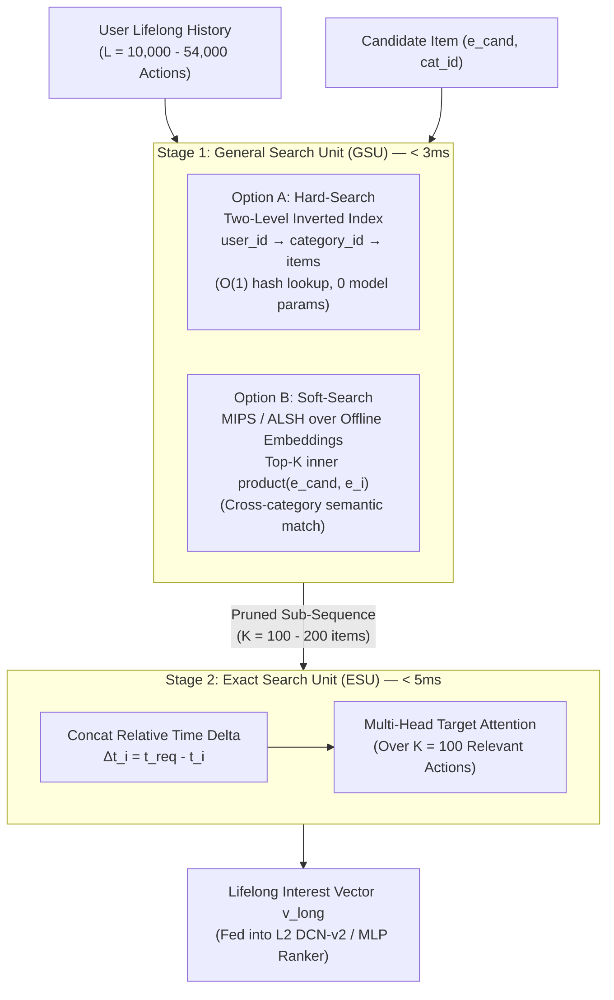

#### Two GSU Variants: Hard-Search vs. Soft-Search
1.  **SIM-Hard (Category Inverted Index):**
    Offline, each user's lifelong history is stored in a two-level hash map: `user_id -> category_id -> [recent 100 item_ids]`. Online, given a candidate's `category_id`, GSU executes an $`O(1)`$ lookup to retrieve only historical behaviors sharing that exact category.
    *   *Production surprise:* Alibaba discovered that **SIM-Hard achieved ~95% of SIM-Soft's offline AUC gain** at a fraction of the infrastructure cost and under 5ms latency—making Hard-Search the first deployed production version!
    *   *Limitation:* Blind to **cross-category intent** (clicking *espresso beans* will never retrieve a past *Italian espresso machine* purchase if they sit in different leaf categories).
2.  **SIM-Soft (Vector MIPS / ALSH):**
    Computes relevance via dot product $`r_i = (W_b e_i)^T (W_a e_{\text{cand}})`$ using pre-trained offline embeddings indexed with Maximum Inner Product Search (MIPS) / Asymmetric LSH. Captures cross-category semantics, at the cost of building and updating per-user vector indexes.

#### Stage 2: Exact Search Unit (ESU)
Over the $`K \approx 100`$ retrieved behaviors, ESU concatenates each item's embedding $`e_i`$ with its **time-interval embedding** $`\Delta t_i = t_{\text{req}} - t_i`$ (distinguishing an exact-category click from yesterday vs. 18 months ago) and runs standard Multi-Head Target Attention. In Alibaba's online deployment (scaling to **54,000+ actions**), SIM delivered **+7.1% CTR** and **+4.4% RPM** while keeping serving latency under 10ms.

#### The Fatal Flaw of SIM: The GSU–ESU Consistency Gap
Look closely at why SIM leaves massive accuracy on the table:
*   In **SIM-Hard**, GSU selects items strictly by `category_id`, completely ignoring fine-grained attributes (price tier, brand, creator, dwell duration).
*   In **SIM-Soft**, GSU uses **frozen offline embeddings** trained by an *auxiliary* model, while ESU uses **end-to-end target attention parameters** plus rich user-item cross features (e.g., *did the user watch > 80% of this historical video?*).
*   **Result (Inconsistency):** GSU routinely **drops** the exact historical items that ESU's attention weights would have ranked in the Top-10, while passing forward low-signal noise!

---

### 4.3 Kuaishou TWIN (KDD 2023) & TWIN-V2 (CIKM 2024)

#### TWIN: Solving the Consistency Gap with CP-GSU (Chang et al., KDD 2023)
Kuaishou's **TWIN (TWo-stage Interest Network)** asks a razor-sharp question: *How can we make GSU use the **exact same target-behavior relevance metric and shared parameters** as ESU, while still scanning $`10^4\text{–}10^5`$ behaviors in under 5ms?*

The bottleneck in ESU target attention is that each historical behavior $`i`$ has two types of features:
1.  **Inherent Item Features** $`K_h \in \mathbb{R}^{L \times d_h}`$ (video ID, author ID, topic tags, duration) — **shared across all candidates** and independent of user-candidate crosses.
2.  **Behavior-Specific / Cross Features** $`K_c \in \mathbb{R}^{L \times d_c}`$ (watch ratio, play time, timestamp delta, interaction type, category match).

In naive multi-head target attention, concatenating $`[K_h, K_c]`$ and multiplying by $`W^K`$ every request over $`L = 10,000`$ items is impossibly slow. **TWIN's Consistency-Preserving GSU (CP-GSU)** splits the linear key projection cleanly and **compresses every cross feature into a 1-dimensional scalar bias**!

```math
\text{AttentionScore}_{\text{CP-GSU}}(q, i) = \frac{\left(K_{h,i} W^h\right) \left(q W^q\right)^T}{\sqrt{d_k}} + K_{c,i} w^c
```

Look at why this equation is an engineering masterpiece:
1.  **Exact Metric Consistency:** The **exact same weights** $`W^h, W^q, w^c`$ are shared end-to-end between CP-GSU and ESU! Top-100 items selected by CP-GSU are mathematically guaranteed to be the Top-100 highest-attention items in ESU—eliminating the GSU–ESU consistency gap completely.
2.  **Precomputation & Caching of $`K_h W^h`$:** Because $`K_h`$ depends only on historical items, the projected matrix $`\tilde{K}_h = K_h W^h`$ (reduced to low dimension, e.g., $`d_k = 32`$) is **precomputed and cached** in the user history table! At serving time, scoring $`L = 10,000`$ items against $`N`$ candidates collapses to a single ultra-fast `FP16` matrix multiply $`\tilde{K}_h \tilde{Q}^T`$ plus a 1D dot product $`K_c w^c`$—cutting the **inherent-feature linear projection compute bottleneck** by **99.3%** compared to raw attention!

#### TWIN-V2: Scaling to 100,000+ Actions via Hierarchical Compression (Si et al., CIKM 2024)
Even with CP-GSU, scanning $`L = 10^5\text{–}10^6`$ raw lifelong actions per user breaks memory bandwidth and online storage budgets. **TWIN-V2** solves ultra-lifelong scale via **divide-and-conquer offline hierarchical clustering**:

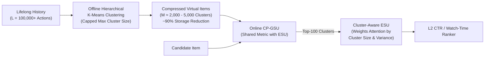

1.  **Offline Hierarchical K-Means:** Recursively partitions each user's $`10^5+`$ historical items by inherent item embeddings until every leaf cluster contains at most $`\gamma`$ items (e.g., $`\gamma = 20`$), keeping clusters semantically homogeneous.
2.  **Virtual Item Compression:** Each cluster $`c`$ is compressed into a single **Virtual Item** (mean inherent embedding + aggregated cross-feature distribution such as average watch ratio and cluster cardinality $`|c|`$), shrinking sequence length and storage by **up to 90%**.
3.  **Cluster-Aware Target Attention:** Online, CP-GSU searches over the compressed virtual items and ESU attends over the top-100 retrieved clusters—incorporating cluster size $`\log(|c|)`$ so a recurring 20-video obsession outweighs a one-off click!

---

### 4.4 Meituan SDIM (Sampling-based Deep Interest Modeling — CIKM 2022)

**Why does SDIM exist?** Two-stage GSU $`\to`$ ESU pipelines require maintaining search indexes or scanning $`10^4`$ projected vectors online. **SDIM** (Cao et al., CIKM 2022) asks: *Can we approximate target attention over lifelong sequences in **$`O(1)`$ online search complexity** via Locality-Sensitive Hashing?*

#### Mathematical Intuition: SimHash Collision = Soft Attention
SDIM projects both historical items $`e_i`$ and candidate $`e_{\text{cand}}`$ using $`m`$ independent **SimHash** functions, each generating a $`\tau`$-bit binary signature via random hyperplanes $`r_1, \dots, r_\tau \sim \mathcal{N}(0, I)`$:

```math
h_k(x) = \mathbb{I}(r_k^T x \ge 0) \in \lbrace 0, 1 \rbrace, \qquad \text{sig}(x) = \bigl[h_1(x), \dots, h_\tau(x)\bigr] \in \lbrace 0, 1 \rbrace^\tau
```

By the classic Goemans–Williamson / Charikar SimHash identity, the probability that historical item $`e_i`$ lands in the **exact same hash bucket** as candidate $`e_{\text{cand}}`$ is a monotonically decreasing function of the angle $`\theta(e_i, e_{\text{cand}})`$ between them:

```math
P\!\left[\text{sig}(e_i) = \text{sig}(e_{\text{cand}})\right] = \left(1 - \frac{\theta(e_i, e_{\text{cand}})}{\pi}\right)^\tau
```

Look what happens when we simply **sum/average all historical items that collide with the candidate's hash signature** across $`m`$ hash tables:
*   Items with small angle $`\theta \approx 0`$ collide with high probability $`\approx 1`$ (sharp attention weight!).
*   Orthogonal/irrelevant items ($`\theta = \pi/2`$) collide with probability $`(1/2)^\tau`$ (for $`\tau = 8`$, less than $`0.4\%`$!).
*   The expected unweighted pool of colliding items is mathematically equivalent to **target-attention pooling** weighted by $`(1 - \theta/\pi)^\tau`$, requiring **zero pairwise dot products online**—just $`m`$ hash-table lookups into pre-bucketed user history!
*   *Trade-off:* Collision probability depends purely on angular similarity of fixed embeddings (no fine-grained cross features like watch-ratio inside the hash), and hash collisions introduce sampling variance when $`m`$ is small.

#### Lifelong & Sequential Architecture Comparison Matrix

| Model | Venue & Year | Max Practical Length $`L`$ | Complexity (Online / Candidate) | Preserves Order? | Cross-Category? | Key Production Strength / Bottleneck |
| :--- | :--- | :---: | :---: | :---: | :---: | :--- |
| **DIN** | KDD 2018 | $`\sim 100`$ | $`O(L \cdot d)`$ | No | Yes | Gold-standard simple baseline; unnormalized intensity; blows latency for $`L \gt 500`$ |
| **DIEN** | AAAI 2019 | $`\sim 100`$ | $`O(L \cdot d)`$ serial | Yes (AUGRU) | Yes | Models interest evolution; serial RNN breaks GPU parallelism |
| **BST** | DLP-KDD 2019 | $`\sim 100`$ | $`O(L^2 d)`$ | Yes ($`\Delta t`$) | Yes | Parallelizable self + target attention; quadratic blowup at long $`L`$ |
| **MIMN** | KDD 2019 | $`\sim 1,000`$ | $`O(K \cdot d)`$ | Implicit | Yes | Decoupled UIC memory; fixed slots saturate past $`L \approx 1,000`$ |
| **SIM (Hard / Soft)** | CIKM 2020 | $`50,000+`$ | $`O(1)`$ or $`O(\log L)`$ + $`O(K d)`$ | Via $`\Delta t`$ in ESU | Soft only | Proven web-scale; suffers from **GSU–ESU metric inconsistency** |
| **SDIM** | CIKM 2022 | $`10,000+`$ | $`O(m \cdot d)`$ ($`O(1)`$ in $`L`$) | No | Yes | Zero dot-product search online via SimHash; no cross features in hash |
| **TWIN** | KDD 2023 | $`10,000\text{–}10^5`$ | $`O(L d_k)`$ cached + $`O(K d)`$ | Via cross-bias | Yes | **100% GSU–ESU consistency** via inherent/cross feature split |
| **TWIN-V2** | CIKM 2024 | $`100,000\text{–}10^6`$ | $`O(M d_k)`$ ($`M \ll L`$) | Via cluster stats | Yes | Offline hierarchical K-means virtual items (~90% compression) |

---

## 5. Industrial Real-Time Action Transformers & Low-Latency Serving (2023–2026)

### 5.1 Pinterest TransAct (KDD 2023), TransAct V2 (2025) & PinnerFormer (KDD 2022)

Pinterest's Homefeed ranking stack illustrates the modern industrial blueprint: **combine a batch long-term sequence encoder with a real-time candidate-aware Action Transformer.**

#### Long-Term Batch Backbone: PinnerFormer (Pancha et al., KDD 2022)
Computing a massive Transformer over months of user pins on every request is too expensive. **PinnerFormer** runs **offline in batch** (daily/nearline) over a user's long-term pin sequence to emit a single persistent user embedding $`u_{\text{long}}`$.
*   **Key Innovation — Dense All-Action Loss:** Standard SASRec trains only to predict the *single next click* ($`t+1`$), which overfits to immediate short-term whims and goes stale within minutes if served from a daily batch store! PinnerFormer instead predicts **all positive actions the user will take over the next 14 days** (repin, long-click, save) at every causally masked step, using sampled softmax with in-batch + random negatives and logQ bias correction. Result: a batch embedding that stays fresh and predictive across an entire 24-hour serving cycle.

#### Real-Time Sequence Module: TransAct (Xia et al., KDD 2023)
When a user saves 3 sourdough bread pins in the last 90 seconds, yesterday's PinnerFormer vector cannot react. **TransAct** encodes the user's **last $`L = 100`$ real-time actions** directly inside the L2 ranker (`Pinnability`):

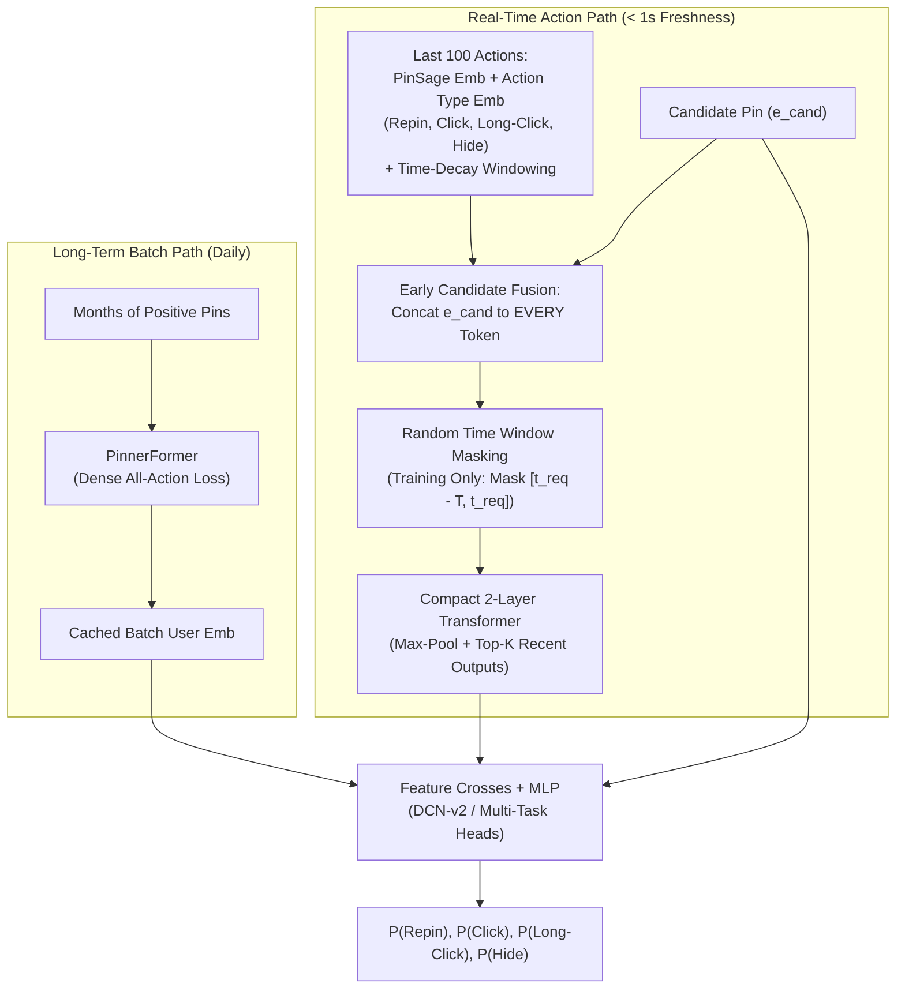

Three design decisions make TransAct work at production scale:
1.  **Early Candidate Fusion:** Instead of appending $`e_{\text{cand}}`$ as a single extra token (like BST), TransAct **concatenates $`e_{\text{cand}}`$ onto every sequence token** (`[e_pin_i ; e_action_i ; e_cand]`) before the 2-layer Transformer. Every self-attention head therefore sees candidate-conditioned representations at every step.
2.  **Action-Type Encoding Including Negatives:** Each token explicitly encodes *what* the user did (`repin`, `click`, `close-up`, `hide`). Seeing `hide` on a topic lets the Transformer suppress similar candidates within seconds.
3.  **Random Time Window Masking (Breaking the "Rabbit Hole"):**
    *   *Failure Mode:* If you train a real-time action model naively, it learns a lazy shortcut: *"just copy the user's last click from 10 seconds ago!"* Online, this creates a brutal **rabbit-hole feedback loop**—one accidental click on a wedding cake fills the entire Homefeed with wedding cakes, tanking diversity and session depth.
    *   *Fix:* During training, sample a random time window $`T \sim \text{Uniform}(0, 24\text{ hours})`$ and **mask out all actions inside $`[t_{\text{req}} - T, t_{\text{req}}]`$**. The model is forced to attend across both recent *and* older actions—protecting recommendation diversity while remaining responsive at serving time (where no mask is applied).

#### TransAct V2 (Xia et al., 2025): Scaling to 16,000+ Actions & Custom GPU Kernels
To unify lifelong history with real-time actions, **TransAct V2** ingests three streams—**Lifelong** ($`S_{\text{LL}}`$, up to $`16,000+`$ actions over 2 years, int8-quantized 32-d PinSage embeddings), **Real-Time** ($`S_{\text{RT}}`$, ~100 actions), and **Unengaged Impressions** ($`S_{\text{imp}}`$, ~100 shown-but-skipped pins):
*   **Candidate NN Pre-Filter:** Keeps the most recent $`r`$ real-time actions unconditionally, and retrieves top-$`K`$ candidate-similar items from $`S_{\text{LL}}`$, older $`S_{\text{RT}}`$, and $`S_{\text{imp}}`$—compressing $`16,000+ \to \sim 192`$ tokens before the Transformer!
*   **SKUT (Single Kernel Unified Transformer):** Because the Transformer is tiny (`2 layers, d_model=64, 1 head, FFN=32`), standard FlashAttention-2 cannot support TransAct V2's custom attention mask and remains HBM-bandwidth-bound on tiny 64-dim layers. SKUT keeps the entire weight set + tile footprint (~6 MB) resident inside an **A10G GPU's 8 MB on-chip SRAM**, executing QKV projections on-the-fly + tiled attention + LayerNorm + FFN in a **single fused Triton kernel launch**—delivering **6.6x faster latency than standard FlashAttention** and **85% lower latency** than PyTorch's memory-efficient attention!
*   **Next Action Loss (NAL):** Adds an auxiliary causal self-supervised sampled-softmax loss ($`\mathcal{L} = \mathcal{L}_{\text{CE}} + 0.01\,\mathcal{L}_{\text{NAL}}`$) predicting the next positive PinSage embedding while using the user's own **unengaged impressions ($`S_{\text{imp}}`$)** as hard negatives.

---

### 5.2 LinkedIn Feed SR (CIKM 2026), Meta HSTU & Single-Pass O(N) Session Training

Early sequential rankers (DIN, BST, TransAct V1) still inherited **pointwise training** from DLRM: if a user has $`N = 1,000`$ logged impressions, you construct $`1,000`$ separate training rows—row $`t`$ containing history prefix $`[1 \dots t-1]`$ plus candidate $`t`$—and execute $`1,000`$ independent forward passes!

```
NAIVE POINTWISE EXPANSION (DLRM / DIN / TransAct V1):
  Row 1: [Post_1]                                    → Predict Action_1
  Row 2: [Post_1, Action_1, Post_2]                  → Predict Action_2
  ...
  Row N: [Post_1, Action_1, ..., Post_N]             → Predict Action_N
  ► N separate forward passes over prefixes of avg length N/2 → O(N^3 d) training compute!

SINGLE-PASS CAUSAL SESSION TRAINING (Feed SR / HSTU):
  Single Row: [Post_1, Action_1, Post_2, Action_2, ..., Post_N, Action_N]
  ► ONE parallel causal-masked forward pass → Predict Actions 1..N simultaneously!
  ► Amortized encoder cost drops by factor of O(N): O(N^2 d) total!

SHARED-CONTEXT SERVING MASK (M-FALCON / SRMIS Flash Attention):
  Input: [Hist_1 .. Hist_L | Cand_1, Cand_2, ..., Cand_512]
          ◄─── Causal ────► ◄── Each Cand attends ONLY to Hist_1..L + itself ──►
                                (Candidates NEVER attend to each other!)
  ► O(L^2) user-history cost paid ONCE across all 512 candidates → 80x GPU speedup!
```

Inspired by Meta's **HSTU** (Zhai et al., ICML 2024—which reformulated ranking as generative sequential transduction), **LinkedIn Feed SR** (Hertel et al., CIKM 2026) proved that LLM-style single-pass sequential ranking scales cleanly at billion-user production scale, delivering **`+2.10%` overall time spent** and **`+3.52%` contributions** online. *(Note: An earlier 2025 LinkedIn preprint, `LiGR` [`arXiv:2502.03417`], was formally withdrawn by its authors and superseded by **Feed SR**.)*

#### Architecture & Single-Pass Training
1.  **Interleaved Post–Action Sequence ($`2T = 2,000`$ Tokens):**
    Constructs `[Post_1, Action_1, Post_2, Action_2, ..., Post_1000, Action_1000]` spanning up to 1 year. Each `Action_t` is a multi-hot binary vector over 6 engagements (`click`, `skip`, `long_dwell`, `like`, `comment`, `share`) linearly projected into $`\mathbb{R}^{d_{\text{seq}}}`$. After one causal-masked forward pass, outputs at odd action positions are discarded; even post positions predict all 6 multi-task probabilities via an **MMoE head**.
2.  **Late Fusion of Context Features:**
    Moving ~1/3 of features—candidate popularity, **bucketed dwell-time popularity** (`[0-5s, 5-15s, 15-30s, 30-60s, >60s]`, worth `+2.5%` absolute Long Dwell AUC), post age, and a cold-start `Qwen3-0.6B` member profile embedding—*outside* the Transformer to the MMoE head speeds up training by 12% with virtually zero AUC loss, because historical items' popularity carries weak signal for the current candidate.
3.  **Shared-Context Batching & Custom SRMIS Flash Attention:**
    At serving time, all $`N = 512`$ candidates are appended to the shared user prefix in **one forward pass** with a block-sparse mask (history is causal; each candidate attends to all history + itself, never to sibling candidates—matching Meta's **M-FALCON**). A custom CUDA Flash Attention kernel (**SRMIS**) accepts just two scalars `(context_length, candidate_length)` instead of materializing an $`O((L+N)^2)`$ mask—delivering an **80x forward-pass speedup** and **0.7x inference energy** compared to the legacy CPU DCN-v2 ranker!

#### HSTU Pointwise SiLU Attention vs. Standard Pre-LN Transformer (Feed SR 2026 Empirical Finding)
*   **Meta HSTU (ICML 2024):** Replaces Softmax attention with **Pointwise SiLU Attention**—$`\text{SiLU}(QK^T + \text{rab}^{p,t})\, V / N`$—explicitly preserving engagement intensity across variable-length histories (the same intensity insight as DIN, without Softmax saturation) while cutting peak activation memory by **~58%** via fused linear projections (deep-dived in [Part 5](./Part_5_Generative_RecSys_Streaming_MLOps_and_Experimentation.md)).
*   **LinkedIn Feed SR Finding (CIKM 2026):** In controlled billion-user ablations at matched $`10^{17}`$ training FLOPs, a **standard Pre-LN Transformer paired with `SRMIS` Flash Attention beat HSTU by `+0.21%` Long Dwell AUC** while unlocking off-the-shelf Flash Attention hardware efficiency. Furthermore, Feed SR followed clean neural scaling laws—gaining **`+0.0093` Long Dwell AUC per `10x` increase in training FLOPs**, with **sequence length $`T`$** emerging as the single highest-leverage scaling axis over width or depth.

#### Production Stability & Scaling Lessons
*   **Pre-LayerNorm + Scaled Residuals (`x + α · sublayer(x)`):** Without Pre-LN and learnable residual scalars $`\alpha`$, deep ranking Transformers intermittently collapse to `0.50` AUC mid-training.
*   **RoPE Over Learned Positional Embeddings:** Because user sequence-length distributions are heavily power-law skewed, learned embeddings for tail indices ($`t \gt 800`$) are severely under-trained and cause serving score instability. **RoPE** is deterministic, length-generalizable, Flash-Attention compatible, and assigns the **exact same RoPE position index** to paired `(Post_t, Action_t)` tokens.
*   **In-Session Leakage Fix:** Consecutive posts inside the same 30-minute session share correlated user mood/dwell states unavailable at serving time. **Randomizing item order inside each session** during training eliminates this subtle train-serve skew!
*   **Daily Incremental Training:** Feeds the full 1-year history as context, but computes loss **only on today's new interactions** (weighted by positional decay $`2^{-(T-t)/T}`$ and 60-day timestamp half-life $`2^{-\Delta t / 60\text{d}}`$)—preventing double-counting while still updating historical embeddings indirectly via attention gradients.

---

### 5.3 Real-Time Event Ingestion, Feature Serving & Sub-10ms Sequence Engineering

Even the cleanest model architecture misses its SLA if sequence feature engineering is sloppy. Production platforms stay under **10ms P99** for the entire sequential module using five concrete systems patterns:

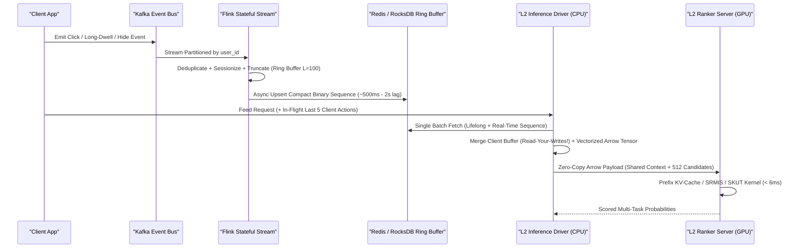

1.  **Sub-Second Read-Your-Writes Consistency:**
    Kafka $`\to`$ Flink $`\to`$ Redis pipelines typically exhibit **500ms–3s** end-to-end propagation lag. If a user clicks "Hide" on a video and immediately pulls to refresh 400ms later, the Redis store hasn't updated yet! **Fix:** The mobile/web client attaches its **local in-flight ring buffer** (last 5–10 timestamped actions) directly in the RPC request header; the L2 driver merges and deduplicates by `(item_id, timestamp)` before inference, guaranteeing **0ms read-your-writes consistency**.
2.  **Sequence Deduplication & Bounce Filtering:**
    Users frequently double-tap or reopen the same product 4 times in 2 minutes. Without deduplication, 4 slots of a 50-item window get wasted on identical tokens. Flink stateful operators collapse consecutive duplicate `(item_id, action_type)` pairs while upgrading the action bitmask (e.g., `click` $`\to`$ `click + long_dwell`).
3.  **Compact Storage & Quantized Embeddings:**
    Store historical sequences as fixed-capacity **ring buffers** of `int64 item_id + uint8 action_mask + uint32 timestamp` (13 bytes/event $`\implies 100\text{ events} = 1.3\text{ KB}`$), or `int8`-quantized 32-dim PinSage/item vectors (cutting lifelong 10K-item payload from 2.5 MB to 320 KB).
4.  **Disaggregated CPU/GPU + Vectorized Parsing:**
    Keep feature fetching and sequence parsing on horizontally scaled CPUs (using NumPy strided arrays / C++ vectorized decoders—cutting history parsing from 450ms to `< 2ms`), transfer tensors via zero-copy **Apache Arrow** buffers, and dedicate GPUs strictly to dense batched Transformer/attention math.
5.  **User-Side KV-Cache & Prefix Precomputation:**
    In target-aware architectures, every user-only projection (`K`, `V` matrices of historical tokens in Shared-Context Batching, Layer-1 GRU states in DIEN, or $`K_h W^h`$ in TWIN) is computed **once per request** (or cached across paginated scrolls for ~30 seconds) rather than repeated across $`N = 500`$ candidates.

---

## 6. Production Loss Debiasing — Part A: Position, Exposure & Popularity Bias

Having built models that capture *dynamic sequential intent*, we now confront the second silent killer of production ranking quality: **training data bias**. Every interaction log is generated by a *previous production policy*, creating three interlocking statistical distortions: **Position/Exposure Bias**, **Negative Downsampling Prior Shift**, and **Delayed Conversion Feedback**.

### 6.1 The Confounded Click Log & Examination Hypothesis

In an ideal counterfactual world, we observe true user-item relevance $`R \in \{0, 1\}`$ for every candidate. In reality, we only observe a **click** $`C \in \{0, 1\}`$ at displayed rank $`k`$. Under the classic **Examination Hypothesis** (Richardson et al., 2007; Craswell et al., 2008), a user clicks an item if and only if they *both* examine rank $`k`$ *and* find the item relevant:

```math
P(C = 1 \mid x, k) = \underbrace{P(E = 1 \mid k)}_{\text{Examination Propensity } p_k} \cdot \underbrace{P(R = 1 \mid x)}_{\text{True Intrinsic Relevance}}
```

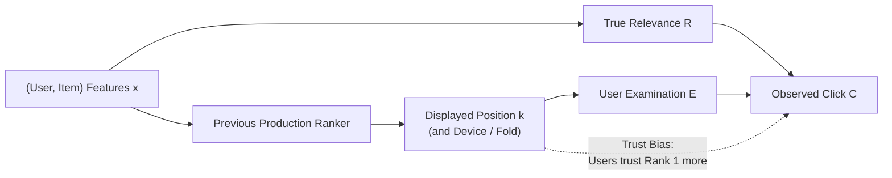

Notice the **double trap** in the causal DAG above:
1.  **Missing Not At Random (MNAR) Negatives:** An unclicked item at position $`k = 12`$ has $`C = 0`$ most likely because $`E = 0`$ (the user never scrolled past position 5), *not* because $`R = 0`$. Treating $`C = 0`$ as a clean negative systematically punishes great items that happened to be shown low.
2.  **Trust Bias & Mobile Fold Non-Monotonicity:** Examination doesn't even decay strictly monotonically! On mobile feeds where only the top 3 items appear above the fold, CTR often **spikes at position 4** due to self-selection of highly engaged users who chose to scroll. Meanwhile, **trust bias** causes users to click rank #1 even when its snippet looks slightly worse than rank #2.
3.  **Self-Reinforcing Feedback Loops & Offline Holdout Blindness:** If you train Model $`t+1`$ on raw clicks from Model $`t`$, items ranked #1 get inflated clicks $`\to`$ Model $`t+1`$ ranks them #1 even harder $`\to`$ catalog exploration dies. Crucially, standard **offline test splits inherit the exact same logging bias**, so offline AUC/NDCG rewards models that *mimic* the old biased policy—meaning echo chambers and debiasing wins often remain invisible until counterfactual evaluation or live online A/B tests!
4.  **Conformity & Positivity Bias (Why Modern Rankers Prefer Implicit Dwell):** Explicit ratings (stars, likes) suffer heavily from **conformity bias** (users anchor toward displayed average ratings or social-proof counts) and **positivity bias** (users mostly bother rating items they already loved, skewing explicit logs toward 4–5 stars). This is why modern feed rankers rely primarily on continuous implicit signals—dwell time, completion ratio, and explicit hides—rather than star ratings alone.

---

### 6.2 Model-Based Debiasing: Shallow Position Tower (YouTube) & PAL

The simplest, zero-traffic-cost production paradigm adds **position and presentation features** directly during training so a dedicated sub-network absorbs the bias, then neutralizes that sub-network at serving time.

#### 1. YouTube's Shallow Position Tower (Zhao et al., RecSys 2019)
Instead of concatenating `position` directly into the main deep MLP (where it can form tangled nonlinear crosses with user/item features that are impossible to cleanly remove), YouTube isolates bias features (`position`, `device_type`, `surface`) inside a separate **Shallow Side Tower** $`g_{\text{pos}}`$ whose scalar output is added strictly at the **final logit**:

```math
z_{\text{train}}(x, k) = f_{\text{rel}}(x) + g_{\text{pos}}(k, \text{device}, \text{surface}), \qquad \hat{p}_{\text{train}} = \sigma\!\left(z_{\text{train}}(x, k)\right)
```

At **serving time** (when display rank $`k`$ is unknown because we are *choosing* the rank), we either **drop $`g_{\text{pos}}`$** entirely ($`\hat{p}_{\text{serve}} = \sigma(f_{\text{rel}}(x))`$) or evaluate $`g_{\text{pos}}`$ at a fixed reference slot $`k = k_{\text{ref}}`$ (e.g., $`k=0`$ at DoorDash/Pinterest, or $`k=5`$ in LinkedIn Feed SR's $`60 \times 6`$ learned position-offset table to preserve empirical probability calibration!).

*   **Position Dropout (Critical Regularizer):** During training, randomly drop out the position input to $`g_{\text{pos}}`$ (e.g., with 10% probability, replacing $`k`$ with a `MISSING` token). Without position dropout, the shallow tower becomes overly dominant and steals explanatory power from $`f_{\text{rel}}(x)`$.

#### 2. PAL — Position-bias Aware Learning (Guo et al., RecSys 2019)
Notice that additive logits ($`\sigma(f + g)`$) only *approximate* the multiplicative Examination Hypothesis ($`P(C) = P(E) \cdot P(R)`$). Huawei's **PAL** enforces exact **multiplicative probability factorization** directly in the architecture:

```math
\hat{p}_{\text{CTR}}(x, k) = \underbrace{\sigma\!\left(g_{\text{pos}}(k)\right)}_{\hat{P}(E=1 \mid k)} \cdot \underbrace{\sigma\!\left(f_{\text{rel}}(x)\right)}_{\hat{P}(R=1 \mid x)}
```

Trained end-to-end via BCE on $`\hat{p}_{\text{CTR}}(x, k)`$; at serving time, only $`\sigma(f_{\text{rel}}(x))`$ is evaluated.

#### The Hidden Failure Mode: Feature–Position Collinearity (Confounding)
Why do Shallow Towers and PAL sometimes fail silently?
Because the logging ranker *already used $`x`$ to assign position $`k`$*! High-quality, popular items appear overwhelmingly at $`k = 1`$, while mediocre tail items appear at $`k = 20`$.
*   **Identifiability Problem:** Mathematically, if $`k`$ is a nearly deterministic function of $`x`$, the optimizer cannot uniquely distinguish whether a 25% CTR at rank #1 is caused by *rank #1's examination boost* ($`g_{\text{pos}}`$) or *item quality* ($`f_{\text{rel}}`$).
*   **Consequence:** The shallow tower frequently **over-absorbs true quality** (causing $`f_{\text{rel}}`$ to under-predict top items once $`g_{\text{pos}}`$ is removed), *or* $`f_{\text{rel}}`$ memorizes proxy features of the old ranker's score!
*   **Mitigation:** Combine Shallow Tower / PAL with small-scale **exploration / position randomization** (e.g., 1–2% randomized traffic or Thompson-sampled rankings) so the same items appear across varied positions—breaking collinearity!

---

### 6.3 Counterfactual Debiasing: IPS, SNIPS & Doubly Robust (DR) Estimators

When collinearity is severe—especially in web/e-commerce search and ads—production systems turn to **counterfactual causal estimators** that weight training losses directly using examination propensities.

#### 1. Inverse Propensity Scoring (IPS — Joachims et al., WSDM 2017)
Given true examination propensity $`p_k = P(E = 1 \mid k) \gt 0`$, weight each clicked example's loss by $`1 / p_k`$:

```math
\hat{\mathcal{L}}_{\text{IPS}}(\theta) = \frac{1}{N} \sum_{i=1}^{N} \frac{c_i}{p_{k_i}} \cdot \ell\!\left(\hat{y}_\theta(x_i), 1\right)
```

**Unbiasedness Proof:** Taking expectation over the examination random variable $`E_i \sim \text{Bernoulli}(p_{k_i})`$ (where $`c_i = E_i \cdot R_i`$):

```math
\mathbb{E}_{E}\!\left[\hat{\mathcal{L}}_{\text{IPS}}(\theta)\right] = \frac{1}{N} \sum_{i=1}^{N} \frac{\mathbb{E}[E_i] \cdot R_i}{p_{k_i}} \cdot \ell\!\left(\hat{y}_\theta(x_i), 1\right) = \frac{1}{N} \sum_{i=1}^{N} \frac{p_{k_i} \cdot R_i}{p_{k_i}} \cdot \ell\!\left(\hat{y}_\theta(x_i), 1\right) = \frac{1}{N} \sum_{i=1}^{N} R_i \cdot \ell\!\left(\hat{y}_\theta(x_i), 1\right)
```

The propensity $`p_{k_i}`$ cancels *exactly*, recovering the ideal unbiased risk over true relevance $`R_i`$! *(For full pointwise BCE including unclicked items, IPS is generalized via propensity-weighted click/non-click risk or paired with DR imputation below.)*

#### How Do We Estimate Propensities $`p_k`$ in Production?
1.  **Result Randomization (RandTopK / RandPair Swap Experiments):**
    On a small traffic slice (0.5%–1%), swap rank 1 with rank $`k`$ (RandPair) or uniformly shuffle the top-$`K`$ results (RandTopK). Because expected item relevance is now identical across positions, the relative examination propensity is simply the observed CTR ratio: $`p_k / p_1 = \text{CTR}(k) / \text{CTR}(1)`$.
    *   *Trade-off:* Statistically gold-standard, but degrades live user experience and revenue on the randomized slice.
2.  **Dual Learning Algorithm (DLA — Ai et al., SIGIR 2018) & EM Click Models:**
    Zero user-experience degradation! DLA notices the **duality** between ranking and propensity estimation: given fixed propensities, optimizing relevance is an unbiased LTR problem; given fixed relevance scores, estimating propensities is *also* a weighted classification problem. DLA trains two neural models simultaneously on organic logs (or EM alternates updating $`P(R=1 \mid x)`$ and $`P(E=1 \mid k)`$).
    *   *Trade-off:* Free of randomization UX cost, but relies on model-specification assumptions and weakens under extreme relevance-position collinearity.
3.  **Organic Skip-Above Pairs:**
    Under a top-down cascade scan, if a user skips ranks 1 and 2 and clicks rank 3, we have strong organic evidence that the user *examined* ranks 1, 2, and 3—yielding clean pairwise comparisons (`item_3 > item_1`, `item_3 > item_2`) with zero randomization!

#### 2. Variance Explosion, Propensity Clipping & SNIPS (Swaminathan & Joachims, NeurIPS 2015)
Raw IPS has a notorious production flaw: **catastrophic variance**. If rank #55 has examination propensity $`p_{55} = 0.005`$, a single click at rank #55 gets weight $`w = 1/0.005 = 200`$, overpowering 30 clicks at rank #1 ($`w = 1/0.15 = 6.7`$) and causing SGD gradients to explode!

Two standard production stabilizers tame IPS variance:
*   **Propensity Clipping (Clamping):** Cap weights at $`w_i = \min(1 / p_{k_i},\; M)`$ (e.g., $`M = 10\text{–}20`$). Introduces small bounded bias in exchange for massive variance reduction.
*   **Self-Normalized IPS (SNIPS / SNIPW):** Divide each weight by the batch sum of weights (equivalently, normalize weights to mean 1.0 per mini-batch):

```math
\hat{\mathcal{L}}_{\text{SNIPS}}(\theta) = \frac{\sum_{i=1}^{B} \frac{c_i}{p_{k_i}} \cdot \ell_i}{\sum_{i=1}^{B} \frac{c_i}{p_{k_i}}}, \qquad w_i^{\text{SNIPS}} = \frac{w_i}{\frac{1}{B}\sum_{j=1}^{B} w_j} \quad \text{where } w_i = \frac{c_i}{p_{k_i}}
```

#### Concrete Worked Numerical Example: Raw IPS vs. Clipped IPS vs. SNIPS
Consider a mini-batch of $`B = 4`$ clicked examples (`c_i = 1` for all 4 rows) from positions 1, 10, 20, and 55:

| Example | Position $`k`$ | Propensity $`p_k`$ | Raw IPS ($`1/p_k`$) | Clipped IPS ($`M=20`$) | SNIPS (Batch Mean = 1.0) | Clipped + SNIPS (Production Best Practice) |
| :--- | :---: | :---: | :---: | :---: | :---: | :---: |
| Ex 1 | Pos 1 | `0.150` | `6.67` | `6.67` | `0.107` | `0.471` |
| Ex 2 | Pos 10 | `0.100` | `10.00` | `10.00` | `0.160` | `0.706` |
| Ex 3 | Pos 20 | `0.030` | `33.33` | `20.00` | `0.533` | `1.412` |
| Ex 4 | Pos 55 | `0.005` | **`200.00`** (Explodes!) | `20.00` | `3.200` | **`1.412`** (Stable!) |
| **Batch Mean Weight** | — | — | `62.50` (**62x LR spike!**) | `14.17` (**14x LR spike!**) | **`1.000`** | **`1.000`** |

Notice why production rankers (such as LinkedIn Feed SR) combine **both** clipping *and* batch-mean normalization: clipping prevents a single deep-scroll outlier from dominating 80% of the batch, while SNIPS/batch normalization preserves the effective Adam/SGD learning rate!

**Complementary Division of Labor: Clipped SNIPS + Learned Position Offset Tables (Fixed Reference Slot $`k = 5`$):** Why do modern rankers like LinkedIn Feed SR deploy *both* Clipped SNIPS *and* a `60 × 6` Learned Position Offset Table (60 positions × 6 engagement tasks) simultaneously? Because they solve **orthogonal problems**:
*   **Clipped SNIPS fixes *gradient weighting***—preventing high-volume position-1 clicks from drowning out hard, informative position-20 clicks during backpropagation.
*   **The Learned Position Offset Table fixes *logit calibration***—absorbing position-specific click-rate shifts cleanly during training. At serving time, fixing the lookup at a single reference slot $`k = 5`$ adds a constant scalar across every candidate (producing **zero rank-order change**), while keeping predicted probabilities calibrated to empirical rates so existing downstream multi-task value-model weights can be reused completely untouched!

#### 3. Doubly Robust (DR) Estimator (Wang et al., ICML 2019)
Can we achieve unbiasedness *and* low variance even when our propensity estimates $`\hat{p}_{u,i}`$ are slightly mis-specified? The **Doubly Robust (DR)** estimator fuses a direct **Imputation Model** $`\hat{e}_{u,i}`$ (predicting the expected prediction error $`\ell(y_{u,i}, \hat{y}_{u,i})`$ for *every* user-item pair, observed or unobserved) with an IPS correction strictly on the **error residual** $`(e_{u,i} - \hat{e}_{u,i})`$:

```math
\mathcal{L}_{\text{DR}}(\theta) = \frac{1}{|D|} \sum_{(u,i) \in D} \left[ \hat{e}_{u,i} + \frac{o_{u,i}}{\hat{p}_{u,i}} \left( e_{u,i} - \hat{e}_{u,i} \right) \right]
```

Where $`o_{u,i} \in \{0, 1\}`$ indicates whether interaction $`(u, i)`$ was observed/examined, and $`e_{u,i}`$ is its true observed loss.

**Why "Doubly Robust" Is Magic:** Take the expectation over $`o_{u,i} \sim \text{Bernoulli}(p_{u,i})`$:

```math
\text{Bias}(\mathcal{L}_{\text{DR}}) = \mathbb{E}\!\left[\mathcal{L}_{\text{DR}}\right] - \mathcal{L}_{\text{true}} = \frac{1}{|D|} \sum_{(u,i) \in D} \left(\frac{p_{u,i} - \hat{p}_{u,i}}{\hat{p}_{u,i}}\right) \left(e_{u,i} - \hat{e}_{u,i}\right)
```

Look at that **product of two error terms**:
1.  If the **propensity model is exact** ($`\hat{p}_{u,i} = p_{u,i}`$), the first factor is $`0 \implies \text{Bias} = 0`$ (even if the imputation model is terrible!).
2.  If the **imputation model is exact** ($`\hat{e}_{u,i} = e_{u,i}`$), the second factor is $`0 \implies \text{Bias} = 0`$ (even if propensities are wrong!).
3.  **Dramatic Variance Reduction:** Even when both are imperfect, $`|e_{u,i} - \hat{e}_{u,i}| \ll |e_{u,i}|`$, so multiplying the small residual by $`1/\hat{p}_{u,i}`$ cuts estimator variance by an order of magnitude compared to raw IPS!

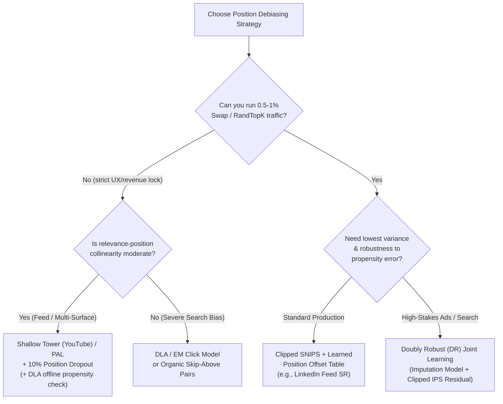

---

### 6.4 Bridging Popularity & Selection Bias (LogQ, ESMM & MACR)

Position bias is one slice of the broader **counterfactual debiasing** family across the recommendation funnel:
*   **Retrieval Sampling Bias (Part 1):** In-batch negatives over-penalize popular items proportional to their sampling frequency $`Q(i)`$. Fixed via **LogQ Correction** ($`s_{\text{train}} = s - \log Q(i)`$).
*   **Click-to-Conversion Selection Bias (Part 2):** Training CVR strictly on clicked samples breaks when scoring unclicked impressions. Fixed via **ESMM** ($`\hat{p}_{\text{CTCVR}} = \hat{p}_{\text{CTR}} \cdot \hat{p}_{\text{CVR}}`$) over the entire impression space.
*   **Popularity Bias in L2 Ranking:** Even inside L2, viral items dominate gradient volume and create popularity-echo chambers. Two production remedies dominate:
    1.  **Power-Law Inverse-Frequency Weighting:** Weight training examples by $`w_i \propto 1 / \text{freq}(i)^\alpha`$ with $`\alpha \in [0.5, 0.75]`$ (smoothing extreme head items without exploding tail noise).
    2.  **MACR — Model-Agnostic Counterfactual Reasoning (Wei et al., KDD 2021):** Formulates a causal graph where item popularity $`I \to Y`$ exerts a direct effect on clicks independent of user-item matching $`K \to Y`$. During training, MACR fits three branches ($`\hat{y}_{\text{train}} = \hat{y}_K \cdot \sigma(\hat{y}_U) \cdot \sigma(\hat{y}_I)`$); at inference, it subtracts the counterfactual natural direct effect of pure item popularity:

```math
\hat{y}_{\text{counterfactual}} = \hat{y}_K \cdot \sigma(\hat{y}_U) \cdot \sigma(\hat{y}_I) - c \cdot \sigma(\hat{y}_U) \cdot \sigma(\hat{y}_I)
```

Tuning $`c`$ lets teams dial back pure popularity bias cleanly without discarding legitimate high-quality popular items.

---

## 7. Production Loss Debiasing — Part B: Negative Downsampling & Prior-Shift Calibration

### 7.1 Why Production Pipelines Downsample Negatives

In industrial ads and feed ranking, positive engagement is deeply sparse:
*   Display Ads CTR: $`0.5\% - 2.0\%`$ (50–200 negatives per positive).
*   E-commerce / Ads CVR: $`0.05\% - 0.5\%`$ (200–2,000 negatives per positive).

Training a billion-parameter DLRM/Transformer over **100% of negative impressions** burns 90%+ of storage I/O, network bandwidth, and GPU FLOPs on redundant, easy-to-classify non-clicks that add negligible Fisher information to the decision boundary.

**The Standard Production Practice:** Keep **100% of positive examples** ($`y = 1`$) and randomly retain only a fraction $`s \in (0, 1]`$ (typically $`s = 0.05\text{–}0.20`$) of negative examples ($`y = 0`$). For $`s = 0.10`$, dataset size and training wall-clock time shrink by **$`\approx 10\times`$** while preserving almost 100% of AUC/GAUC!

**The Catch:** A model trained on downsampled logs learns the *distorted sampled posterior* $`q(x) = P_{\text{sub}}(y = 1 \mid x)`$—not the true physical probability $`p(x) = P(y = 1 \mid x)`$. Shipping $`q(x)`$ directly into an ads auction or multi-task serving value function catastrophically inflates predicted probabilities!

---

### 7.2 Exact Bayes' Theorem Log-Odds Calibration Derivation

Let $`S \in \{0, 1\}`$ denote the random indicator that an example is *kept* in the downsampled training set, where:
*   $`P(S = 1 \mid y = 1, x) = 1`$ (100% of positives kept)
*   $`P(S = 1 \mid y = 0, x) = s`$ (negatives kept at rate $`s \in (0, 1]`$)

Define the true probability $`p = P(y = 1 \mid x)`$ and the model's downsampled prediction $`q = P(y = 1 \mid S = 1, x)`$. Apply **Bayes' Theorem** directly to $`q`$:

```math
q = P(y = 1 \mid S = 1, x) = \frac{P(S = 1 \mid y = 1, x) \cdot P(y = 1 \mid x)}{P(S = 1 \mid y = 1, x) \cdot P(y = 1 \mid x) + P(S = 1 \mid y = 0, x) \cdot P(y = 0 \mid x)}
```

Substituting $`P(S = 1 \mid y = 1, x) = 1`$ and $`P(S = 1 \mid y = 0, x) = s`$:

```math
q = \frac{p}{p + s(1 - p)}
```

Now divide $`q`$ by $`(1 - q)`$ to obtain the **exact odds relationship**:

```math
1 - q = \frac{s(1 - p)}{p + s(1 - p)} \quad \Longrightarrow \quad \frac{q}{1 - q} = \frac{1}{s} \cdot \frac{p}{1 - p}
```

Solving algebraically for the **true calibrated probability $`p`$**:

```math
\frac{p}{1 - p} = s \cdot \frac{q}{1 - q} \quad \Longrightarrow \quad p = \frac{s \cdot q}{s \cdot q + (1 - q)} = \frac{q}{q + (1 - q)/s}
```

Taking the natural logarithm of both sides of the odds identity yields the extraordinarily clean **Exact Log-Odds Shift** in logit space ($`\text{logit}(p) = \log\!\frac{p}{1 - p}`$):

```math
\text{logit}(p) = \text{logit}(q) + \log s
```

Notice the sign sanity check: since $`0 \lt s \lt 1`$, we have $`\log s \lt 0`$, shifting the inflated downsampled logit **downward** by a single exact additive constant before passing through the sigmoid! *(Equivalently, if you train with `z_serve = z_raw + log(s)`, the correction is zero-latency, mathematically exact, and preserves rank order identically because $`\sigma(z + \log s)`$ is strictly monotonic!)*

---

### 7.3 Worked Numerical Example: Preventing a 5.5x Ads eCPM Bidding Disaster

Suppose an online advertising ranker runs a second-price/VCG auction ranked by $`\text{eCPM} = \text{Bid} \times \hat{p}_{\text{CTR}} \times 1,000`$.
*   **Training Pipeline:** Keeps 100% of clicks and downsamples non-clicks at keep-rate $`s = 0.10`$ (10%).
*   **Live Candidate Ad:** Advertiser bids $`\text{Bid} = \$2.00`$ CPC. The neural network trained on the downsampled dataset outputs raw logit $`z_{\text{raw}} = 0.00 \implies q = \sigma(0.00) = 0.50`$.

Let's compare serving **without** vs. **with** Bayes log-odds calibration:

1.  **Uncorrected (Broken Production Deployment):**
    *   Predicted CTR: $`q = 0.50`$.
    *   Predicted eCPM: $`\$2.00 \times 0.50 \times 1,000 = \$1,000.00`$.
    *   **Disaster:** The ad falsely wins the auction against truly superior ads, the advertiser is massively overcharged (or burns their entire daily budget in minutes on low-ROI clicks), and multi-task value weights ($`w_{\text{click}} \hat{p}_{\text{click}} + w_{\text{dwell}} \hat{p}_{\text{dwell}}`$) completely break!

2.  **Exact Log-Odds Calibration ($`s = 0.10`$):**
    Applying the Bayes probability recovery formula directly:

```math
p = \frac{s \cdot q}{s \cdot q + (1 - q)} = \frac{0.10 \times 0.50}{0.10 \times 0.50 + 0.50} = \frac{0.05}{0.55} \approx 0.0909
```

*   **Logit Form:** $`\text{logit}(p) = 0.00 + \log(0.10) = -2.3026 \implies p = \sigma(-2.3026) = \frac{1}{1 + 10} = 0.0909`$.
*   **True eCPM:** $`\$2.00 \times 0.0909 \times 1,000 = \$181.82`$.
*   The single constant shift $`+\log(0.10)`$ prevented a **$`5.5\times`$ eCPM over-bidding catastrophe**!

```
PRIOR-SHIFT DISTORTION UNDER NEGATIVE DOWNSAMPLING (Keep Rate s = 0.10):

  Raw Downsampled q   │  Raw Logit   │  + log(0.10)  │  True Calibrated p  │  Over-Prediction Factor (q / p)
  ────────────────────┼──────────────┼───────────────┼─────────────────────┼────────────────────────────────
        q = 0.05      │   -2.944     │    -5.247     │      p = 0.0052     │           9.55x  (Worst at low CTR!)
        q = 0.20      │   -1.386     │    -3.689     │      p = 0.0244     │           8.20x
        q = 0.50      │    0.000     │    -2.303     │      p = 0.0909     │           5.50x
        q = 0.90      │   +2.197     │    -0.105     │      p = 0.4737     │           1.90x

  KEY INSIGHT: Downsampling distortion is NON-LINEAR in probability space (9.55x at low CTR vs 1.90x
  at high CTR), so you CANNOT simply multiply q by s! Only the LOG-ODDS shift is exact everywhere.
```

---

### 7.4 Non-Uniform Sampling vs. BCE Sample Weighting (The Gradient Variance Trap)

A frequent ML design follow-up asks:
> *"Instead of training unweighted and shifting logits by $`+\log s`$ at serving time, why not just assign sample weight $`w_i = 1/s`$ to every downsampled negative inside the BCE loss so the model learns calibrated probabilities directly? And what if different negatives have different keep rates $`s_i`$ (e.g., keeping 50% of hard negatives vs. 5% of easy negatives)?"*

This is a **crucial theoretical and practical distinction**. Compare the two approaches:

#### Approach 1: Sample-Weighted BCE ($`w_{\text{pos}} = 1, \; w_{\text{neg}, i} = 1 / s_i`$)
```math
\mathcal{L}_{\text{weighted}} = -\frac{1}{N} \sum_{i} \left[ y_i \log \hat{p}_i + \frac{1 - y_i}{s_i} \log(1 - \hat{p}_i) \right]
```
*   **Expected Risk:** Unbiased—minimizing $`\mathbb{E}[\mathcal{L}_{\text{weighted}}]`$ recovers the true $`p(x)`$.
*   **Fatal Production Flaw — Gradient Variance Explosion:** Model retention explicitly with the Bernoulli indicator $`S_i \sim \text{Bernoulli}(s_i)`$, where each retained negative receives stochastic gradient $`\frac{S_i}{s_i} g_i`$. Its unconditional variance is:

```math
\text{Var}\!\left(\frac{S_i}{s_i} g_i\right) = \frac{1 - s_i}{s_i} \, g_i^2 = O\!\left(\frac{1}{s_i}\right)
```

On any individual kept easy negative at $`s_i = 0.05`$, its BCE loss is multiplied by **$`w_i = 20`$**, so its **squared gradient step norm jumps by $`w_i^2 = 400\times`$**! In deep neural networks with Adam/Adagrad and sparse embeddings, occasional $`20\times`$ gradient spikes destabilize embedding tables, degrade GAUC, and slow convergence!

#### Approach 2: Unweighted Training + Exact Logit Offset (Training-Time or Post-Hoc)
For **uniform** keep-rate $`s`$: train completely unweighted ($`w_i = 1`$) and add $`+\log s`$ to the logit at serving time.
For **non-uniform / feature-dependent** keep-rate $`s_i = s(x_i)`$ (e.g., importance-sampling hard negatives at $`s_{\text{hard}} = 0.50`$ and easy negatives at $`s_{\text{easy}} = 0.05`$): you *cannot* apply a single post-hoc constant at serving time because $`s(x_i)`$ depends on the sampling bucket! Instead, **inject $`-\log s_i`$ directly into the logit during training** (just like LogQ in Part 1):

```math
z_{\text{train}}(x_i) = f_\theta(x_i) - \log s_i, \qquad \mathcal{L}_{\text{unweighted}} = \text{BCE}\!\left(\sigma(z_{\text{train}}(x_i)),\; y_i\right)
```

Verify the Bayes optimum! At minimum BCE, $`\sigma(f_\theta^*(x_i) - \log s_i) = q(x_i)`$, which means:

```math
f_\theta^*(x_i) - \log s_i = \text{logit}(q(x_i)) = \text{logit}(p(x_i)) - \log s_i \quad \Longrightarrow \quad f_\theta^*(x_i) = \text{logit}(p(x_i))
```

At **serving time**, simply drop $`-\log s_i`$ and output $`\sigma(f_\theta(x))`$ directly!
*   **Result:** $`f_\theta(x)`$ converges to the **exact true calibrated log-odds $`\text{logit}(p(x))`$,** handles arbitrary per-example hard-negative sampling rates $`s_i`$, **and keeps all gradient weights bounded at $`1.0`$,** completely eliminating the $`O(1/s_i)`$ gradient-variance explosion of sample-weighted BCE!

---

## 8. Production Loss Debiasing — Part C: Delayed Feedback & Conversion Modeling (CVR)

### 8.1 The Freshness vs. Label-Correctness Dilemma

Unlike clicks (which occur within seconds of an impression), **conversions**—e-commerce purchases, SaaS subscriptions, app installs, mortgage inquiries—frequently occur **hours, days, or weeks after the ad click** (standard attribution windows span $`W = 1\text{ to }30\text{ days}`$).

This creates a fundamental dilemma for streaming/online CVR models:
1.  **Wait for the Full Attribution Window ($`W = 7\text{–}30\text{ days}`$):** Every label is settled and accurate, *but* the model trains on data that is 1–4 weeks stale—catastrophically missing new ad creatives, flash sales, inventory shifts, and weekend seasonality.
2.  **Train Immediately (Hourly / Streaming) on Unconverted Clicks as $`y = 0`$:** The model stays ultra-fresh, *but* recent clicks that *will* convert tomorrow are prematurely labeled as **False Negatives ("Fake Negatives")**. The model systematically **under-predicts pCVR**, causing bids to plunge and destroying advertiser volume and platform revenue!

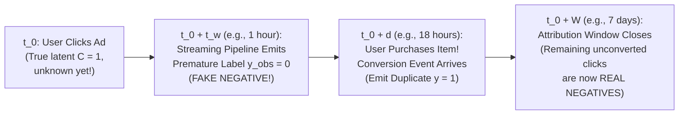

---

### 8.2 DFM (Delayed Feedback Model — Chapelle, KDD 2014)

Olivier Chapelle (Criteo, KDD 2014) formulated the first rigorous probabilistic model of delayed conversions by jointly modeling two latent quantities for every clicked example $`x`$:
1.  **True eventual conversion probability:** $`p(x) = P(C = 1 \mid x) = \sigma(w_c^T x)`$.
2.  **Conversion delay distribution** (modeled as an exponential survival process given conversion):

```math
P(D = d \mid C = 1, x) = \lambda(x) e^{-\lambda(x) d}, \qquad P(D \gt e \mid C = 1, x) = e^{-\lambda(x) e}
```

Where $`e = t_{\text{now}} - t_{\text{click}}`$ is the **elapsed time** since the click, and $`\lambda(x) = \exp(w_d^T x)`$ is a feature-conditioned hazard rate (e.g., fast impulse goods have high $`\lambda(x)`$, expensive electronics have low $`\lambda(x)`$).

Given an **unconverted click** ($`Y_{\text{obs}} = 0`$) after elapsed time $`e`$, what is the posterior probability that it is actually a **latent delayed converter** ($`C = 1`$) rather than a true non-converter ($`C = 0`$)? By Bayes' rule:

```math
P(C = 1 \mid Y_{\text{obs}} = 0, e, x) = \frac{p(x) \, e^{-\lambda(x) e}}{1 - p(x) + p(x) \, e^{-\lambda(x) e}}
```

*   When $`e \approx 0`$ (just clicked), $`e^{-\lambda e} \approx 1 \implies`$ uncertainty is high; the model does *not* harshly push $`p(x)`$ toward 0.
*   When $`e \gg 1/\lambda(x)`$ (days elapsed), $`e^{-\lambda e} \to 0 \implies`$ the click is treated as a high-confidence true negative.

Chapelle optimizes $`(w_c, w_d)`$ jointly via **Expectation-Maximization (EM)** or direct marginal log-likelihood maximization.
*   **Production Limitations of DFM:**
    1.  Real conversion delays are **heavily non-exponential** (sharp immediate spike within 5 minutes, diurnal 24-hour peaks, and heavy Pareto tails).
    2.  DFM assumes offline batch retraining over snapshots rather than continuous real-time streaming updates where late positives arrive asynchronously.

---

### 8.3 Importance Weighting for Delayed Feedback: FNW/FNC, FSIW & ES-DFM

Modern ad systems (Google, Meta, Alibaba, ByteDance) avoid DFM's rigid exponential delay assumption by applying **Importance Weighting** to correct the label-distribution shift caused by unobserved delayed conversions. Two distinct ingestion paradigms emerged—**duplicate-positive streaming** (**FNW/FNC**, **ES-DFM**) and **non-duplicate fixed-cutoff / batch elapsed-time weighting** (**FSIW**).

In the **Duplicate-Positive Streaming Paradigm**:
1.  Ingest every click into the training stream quickly (either immediately at $`t_w = 0`$, or after a short **waiting window** $`t_w \approx 15\text{–}60\text{ min}`$) labeled with its currently observed conversion status ($`y = 0`$ if unconverted).
2.  If a conversion arrives *later* within the attribution window $`(t_w, W]`$, **emit a duplicate training example** with label $`y = 1`$!

#### Why Naive Duplication Still Biases CVR
Every delayed converter appears **twice** in the training stream: once as a fake negative ($`y = 0`$) at time $`t_w`$, and once as a delayed positive ($`y = 1`$) at time $`d`$. Let $`p(x) = P(C=1 \mid x)`$ and let $`p_{\text{dp}}(x) = P(C=1, D \gt t_w \mid x)`$ be the probability of a delayed conversion past the waiting window. Under naive unweighted streaming, the observed data distribution $`b(x, y)`$ has inflated total mass $`1 + p_{\text{dp}}(x)`$, distorting the naive model's prediction to:

```math
q_{\text{obs}}(x) = \frac{p(x)}{1 + p_{\text{dp}}(x)}
```

Three landmark papers anchor delayed-feedback importance weighting:

#### 1. FNW & FNC (Ktena et al., RecSys 2019 — Twitter)
Assumes immediate ingestion ($`t_w = 0`$, so *every* positive is initially ingested as a fake negative, meaning $`p_{\text{dp}}(x) = p(x)`$):
*   **FNC (Fake Negative Calibration):** Simply trains unweighted on the duplicated stream ($`q_{\text{obs}}(x) = \frac{p(x)}{1 + p(x)}`$) and recovers exact CVR post-hoc at serving time:

```math
\hat{p}_{\text{FNC}}(x) = \frac{q_{\text{obs}}(x)}{1 - q_{\text{obs}}(x)}
```

*   **FNW (Fake Negative Weighted):** Applies exact **Importance Sampling (IS)** weights directly inside the streaming BCE loss to recover the unbiased risk over the true joint distribution $`P(x, y)`$:

```math
\mathcal{L}_{\text{IS}} = -\sum_{i} \left[ y_i \cdot w_{\text{pos}}(x_i) \log \hat{p}_i + (1 - y_i) \cdot w_{\text{neg}}(x_i) \log(1 - \hat{p}_i) \right]
```

To derive the exact importance ratio $`w(x, y) = \frac{P(x, y)}{b(x, y)}`$ for any waiting window $`t_w \ge 0`$, count how each true click $`x`$ enters the duplicated stream:
*   With probability $`p_{\text{imm}}(x) = P(C=1, D \le t_w \mid x)`$: emitted **once** as $`y = 1`$ (immediate positive).
*   With probability $`1 - p(x)`$: emitted **once** as $`y = 0`$ (true negative).
*   With probability $`p_{\text{dp}}(x) = P(C=1, D \gt t_w \mid x)`$: emitted **twice**—once as $`y = 0`$ (fake negative) and once as $`y = 1`$ (delayed positive).

Therefore, the unnormalized streaming densities per true click are $`b(y = 1, x) \propto p_{\text{imm}}(x) + p_{\text{dp}}(x) = p(x)`$ and $`b(y = 0, x) \propto \bigl(1 - p(x)\bigr) + p_{\text{dp}}(x)`$. Taking the exact density ratio $`P(x, y) / b(x, y)`$ (up to the global normalization constant $`Z = 1 + \mathbb{E}[p_{\text{dp}}]`$) yields:

```math
w_{\text{pos}}(x) = \frac{p(x)}{p(x)} = 1 \quad \bigl(\text{or } 1 + \hat{p}_{\text{dp}}(x) \text{ per-example}\bigr), \qquad w_{\text{neg}}(x) = \frac{1 - \hat{p}(x)}{1 - \hat{p}(x) + \hat{p}_{\text{dp}}(x)}
```

Look how crystal-clear and intuitive that exact ratio is:
*   Every positive ($`y = 1`$) appears **once** in the stream, matching the true positive count ($`w_{\text{pos}} = 1`$ in joint density form; when $`t_w = 0`$ in Ktena et al.'s conditional formulation, multiplying both weights by $`1 + \hat{p}(x)`$ gives $`w_{\text{pos}} = 1 + \hat{p}(x)`$ and $`w_{\text{neg}} = (1 - \hat{p}(x))(1 + \hat{p}(x))`$). Multiplying both weights by $`1 + \hat{p}(x)`$ switches from the **joint** density ratio $`P(x, y) / b(x, y)`$ to the **conditional** ratio $`P(y \mid x) / b(y \mid x)`$—yielding the exact same pointwise Bayes-optimal predictor $`f^*(x) = P(y = 1 \mid x)`$, while implicitly upweighting high-CVR features $`x`$ by $`1 + p(x)`$ under model misspecification (one key motivation for DeFER and DEFUSE below).
*   Every observed negative ($`y = 0`$) is a mixture of true negatives ($`1 - p`$) and fake negatives ($`p_{\text{dp}}`$), so its exact probability of being a **true negative** is $`w_{\text{neg}}(x) = \frac{1 - p(x)}{1 - p(x) + p_{\text{dp}}(x)} \le 1`$!

#### 2. FSIW — Feedback Shift Importance Weighting (Yasui et al., WWW 2020)
Unlike FNW and ES-DFM, **FSIW** is a **non-duplicate (fixed-cutoff / batch) elapsed-time importance weighting method**—NOT a duplicate-positive streaming method. On a training snapshot taken at elapsed time $`e`$ after each click (without re-injecting late positives afterward), an observed positive occurs only if the click both converts *and* converts before $`e`$, i.e., $`P(Y_{\text{obs}} = 1 \mid x, e) = p(x) \, P(D \le e \mid C = 1, x)`$. Instead of parametric exponential delays (DFM), FSIW trains a dedicated auxiliary neural delay CDF $`P(D \le e \mid C = 1, x)`$ on settled historical data and applies exact non-duplicate importance weights:

```math
w_{\text{pos}}(x, e) = \frac{1}{P(D \le e \mid C = 1, x)}, \qquad w_{\text{neg}}(x, e) = \frac{1 - p(x)}{1 - p(x) \, P(D \le e \mid C = 1, x)}
```

*   **Key Limitation:** Because FSIW does *not* duplicate late conversions back into an online stream, conversions arriving after the fixed cutoff are missed until later batch retrains (limiting freshness and positive recall), and very small $`e`$ inflates $`w_{\text{pos}}`$ variance. This exact limitation motivated **ES-DFM (AAAI 2021)** to combine a short elapsed-time waiting window $`t_w`$ with duplicate-positive streaming!

#### 3. ES-DFM — Elapsed-Time Sampling Delayed Feedback Model (Yang et al., AAAI 2021)
**Why does FNW ($`t_w = 0`$) still suffer high variance?** Because at $`t_w = 0`$, **100% of conversions** are first ingested as fake negatives!
**ES-DFM** introduces a tunable **short elapsed-time waiting window $`t_w`$** (typically $`15\text{–}60\text{ minutes}`$):
*   In real e-commerce and ads, **50%–70% of all conversions occur within the first 30–60 minutes** of the click!
*   By waiting just $`t_w = 30\text{ min}`$ before emitting unconverted clicks as $`y = 0`$, ES-DFM eliminates over half of all fake negatives immediately—slashing importance-weighting variance while sacrificing only 30 minutes of freshness!
*   For the remaining delayed conversions arriving in $`(t_w, W]`$, ES-DFM duplicates them as $`y = 1`$ and applies an auxiliary delay-classifier $`p_{\text{dp}}(x)`$ to compute exact elapsed-time importance weights $`w_{\text{neg}}(x) = \frac{1 - \hat{p}(x)}{1 - \hat{p}(x) + \hat{p}_{\text{dp}}(x)}`$.

#### Concrete Worked Numerical Example (ES-DFM Waiting Window vs. Uncorrected Streaming)
Suppose an ad campaign has **10,000 clicks** with true eventual CVR $`p = 0.05`$ (500 true conversions). Historically, **60%** of conversions occur within $`t_w = 1\text{ hour}`$ (300 immediate positives), and **40%** occur between 1 hour and 7 days (200 delayed positives, so $`p_{\text{dp}} = 0.02`$).

1.  **Naive Immediate Stream ($`t_w = 0`$, no duplication, no weighting):**
    *   At 1 hour, only 300 positives exist alongside 9,700 negatives $`\implies`$ model learns $`\hat{p} = 0.030`$ (**40% under-prediction!**).
2.  **Waiting Window $`t_w = 1\text{h}`$ + Duplicate Positives (NO Importance Weighting):**
    *   Emitted samples: 300 immediate positives + 9,700 negatives (9,500 true + 200 fake) + 200 duplicated late positives = **10,200 total rows** (500 positives, 9,700 negatives).
    *   Observed CVR: $`500 / 10,200 = 0.04902`$ (still biased downward by $`\frac{p}{1 + p_{\text{dp}}} = \frac{0.05}{1.02}`$, and much worse for high-CVR retargeting ads where $`p = 0.25, p_{\text{dp}} = 0.10 \implies q_{\text{obs}} = 0.227`$, a ~10% revenue hit!).
3.  **ES-DFM Importance Weighting:**
    Weight each of the 9,700 observed negatives by its true-negative probability:

```math
w_{\text{neg}} = \frac{1 - 0.05}{1 - 0.05 + 0.02} = \frac{0.95}{0.97} \approx 0.9794
```

This yields an effective negative count of $`9,700 \times 0.9794 = 9,500.0`$ (exact true negatives!) and recovers the exact calibrated CVR: $`\frac{500}{500 + 9,500} = 0.0500`$!

---

### 8.4 Real Negatives & Modern Streaming Pipelines: DeFER, DEFUSE & Kafka Late-Event Joins

Two follow-up breakthroughs closed the remaining theoretical gaps in streaming delayed feedback:

1.  **DeFER — Continuous Training with Real Negatives (Gu et al., KDD 2021 — Alibaba):**
    Observed that in FNW/ES-DFM, features of fake negatives are seen early, while true settled negatives never get re-ingested with certainty. **DeFER** ingests **Real Negatives** (clicks whose full attribution window $`W`$ has expired without conversion) back into the continuous training stream alongside duplicate delayed positives, and applies importance sampling over all three streams (immediate, delayed positive, real negative) to correct feature-distribution shift.
2.  **DEFUSE — Delayed Feedback Modeling with Unbiased Estimation (Chen et al., WWW 2022 — Alibaba):**
    Proved that prior importance estimators (FNW, ES-DFM) still contained a subtle bias because they lumped **fake negatives** and **real negatives** into one undifferentiated observed-negative bucket despite their different label-conditional feature distributions. **DEFUSE** explicitly separates the stream into **4 sample types**—Immediate Positives, Fake Negatives, Real Negatives, and Delayed Positives—and derives a strictly unbiased importance-weighted risk with lower variance, coupled with a bi-distribution estimator predicting immediate vs. delayed conversion probabilities separately.

#### Production Streaming Architecture (Kafka Late-Event Join + Multi-Window MTL)

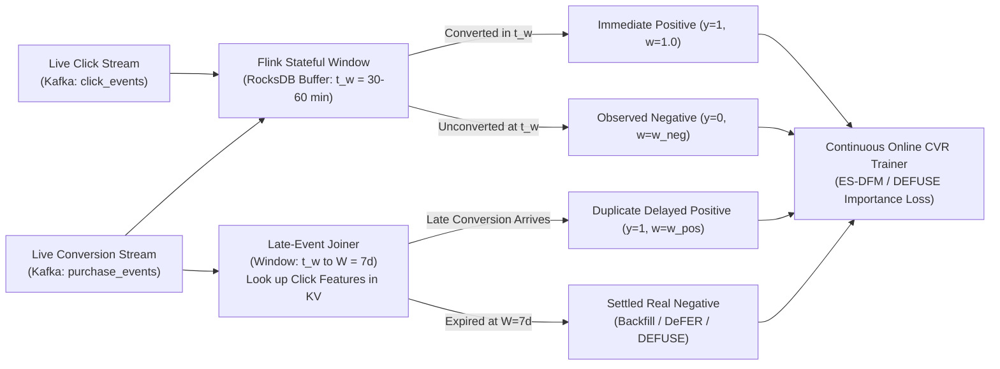

**Production Multi-Window Trick:** Alongside ES-DFM/DEFUSE, many ads and marketplace platforms (e.g., food delivery, e-commerce) train **Multi-Window CVR Heads** inside their MTL model—predicting *both* $`P(\text{Convert} \le 1\text{h})`$ (ultra-fresh, low delay bias, fast learning on new creatives) *and* $`P(\text{Convert} \le 7\text{d})`$ (accurate long-horizon attribution), using the 1-hour head as an auxiliary dense signal that stabilizes the shared trunk!

**Production Model-Freshness Cadences (Cross-Reference to [Part 5](./Part_5_Generative_RecSys_Streaming_MLOps_and_Experimentation.md)):** Depending on how aggressively a platform trades freshness against engineering complexity, delayed-feedback and sequential trainers operate on three canonical update cadences:
*   **Daily Incremental Training (e.g., LinkedIn Feed SR):** Warm-starts from yesterday's checkpoint and backpropagates loss strictly over today's new interactions while feeding the full 1-year history as context—simple, high-throughput, and immune to streaming parameter drift.
*   **Batch Base + Nearline Residual (e.g., LinkedIn Lambda Learner):** Keeps a heavy deep offline model updated daily while continuously updating lightweight online residual/linear weights every few minutes on fresh Kafka events—capturing flash trends without destabilizing deep trunks.
*   **Streaming Sparse / Batch Dense (e.g., ByteDance Monolith):** Synchronizes ultra-fresh sparse ID embeddings to serving every ~1 minute via collisionless hash tables while updating dense MLP/Transformer weights on a slower, stabilized cadence (deep-dived in [Part 5](./Part_5_Generative_RecSys_Streaming_MLOps_and_Experimentation.md)).

---

### 8.5 Auxiliary Loss Modifiers & The Unified Composite Production Loss

Beyond causal position, prior-shift, and delay debiasing, real-world multi-task ranking pipelines frequently layer three **auxiliary loss modifiers**—and must combine all sample weights without destabilizing optimization:

1.  **Focal Loss for Extreme-Rarity Heads (`0.1%–1%` Purchase / Report / Hide):**
    Standard BCE lets millions of easy negatives overwhelm gradients for ultra-sparse events. Focal Loss down-weights well-classified examples via $`\mathcal{L}_{\text{focal}} = -\alpha_t (1 - p_t)^\gamma \log(p_t)`$ (typically $`\gamma \in [1, 2]`$).
    *   *Critical Calibration Caveat:* Focal Loss **systematically distorts output probabilities**—compressing predictions away from `0` and `1` and breaking eCPM / multi-task calibration! Never feed raw focal-loss probabilities into an auction or linear value function without a dedicated post-hoc recalibration layer (e.g., Platt scaling / isotonic regression).
2.  **Label Smoothing for Noisy Implicit Labels (Accidental Clicks & Autoplay):**
    Replaces hard binary targets $`y \in \{0, 1\}`$ with $`\tilde{y} = (1 - \varepsilon) y + \varepsilon / 2`$ (typically $`\varepsilon \in [0.01, 0.05]`$). Prevents unbounded logit growth and overconfidence on ambiguous implicit clicks (e.g., mobile fat-finger taps or auto-playing short videos).
3.  **Example Age & Freshness Weighting:**
    Bridging [Part 1](./Part_1_Retrieval_and_Candidate_Generation.md)'s `example_age` feature directly into L2 ranking, production models counter non-stationary catalog drift in two complementary ways: injecting `example_age` as an explicit bias input during training (and setting it to `0` at serving to recover the freshest distribution), and multiplying training losses by an exponential sample-age decay $`w_{\text{time}} = 2^{-\Delta t / \tau_{\text{half}}}`$ (e.g., LinkedIn Feed SR's 60-day half-life $`2^{-\Delta t / 60\text{d}}`$ paired with within-sequence positional decay).

#### The Unified Composite Production Loss Weight
When a live L2 ranker simultaneously corrects for **exposure/position propensity** ($`w_{\text{IPW}}`$), **sequence-position decay** ($`w_{\text{pos}}`$), **recency/freshness decay** ($`w_{\text{time}}`$), and **delayed-feedback importance** ($`w_{\text{delay}}`$), multiplying raw unclipped factors creates extreme outlier weights that destabilize Adam/Adagrad. Production trainers therefore compose a single clamped, batch-mean-normalized composite weight:

```math
\tilde{w}_i = \text{clamp}\!\left(w_{\text{IPW}, i} \cdot w_{\text{pos}, i} \cdot w_{\text{time}, i} \cdot w_{\text{delay}, i},\; w_{\min},\; w_{\max}\right), \qquad w_{\text{final}, i} = \frac{\tilde{w}_i}{\frac{1}{B}\sum_{j=1}^{B} \tilde{w}_j}
```

*(Note: Keep **negative downsampling** out of $`w_{\text{final}, i}`$—handle downsampling exclusively via the exact logit offset $`-\log s_i`$ from Section 7.4 so you never reintroduce $`O(1/s_i)`$ gradient-variance explosion!)*

---

### 8.6 Unified Production Debiasing Comparison Matrix

| Bias Type | Root Cause in Logs | Primary Production Methods | Core Math / Mechanism | Key Failure Mode / Trade-Off |
| :--- | :--- | :--- | :--- | :--- |
| **Position Bias (Model-Based)** | Users examine rank 1 far more than rank 10 | **Shallow Tower (YouTube)**, **PAL**, **Learned Pos Offsets** | $`z = f_{\text{rel}}(x) + g_{\text{pos}}(k)`$ (+ pos dropout); drop or fix $`k = k_{\text{ref}}`$ at serving | **Feature–position collinearity:** $`g_{\text{pos}}`$ can steal true item quality without small exploration |
| **Position Bias (Counterfactual)** | MNAR unobserved clicks at lower ranks | **IPS**, **Clipped SNIPS**, **DLA**, **Doubly Robust (DR)** | $`\mathcal{L}_{\text{DR}} = \hat{e} + \frac{o}{\hat{p}}(e - \hat{e})`$ | Raw IPS explodes variance ($`1/p_k`$) $`\to`$ always clip + batch-normalize (SNIPS) or use DR |
| **Popularity / Selection Bias** | Head items dominate logs; CVR trained only on clicks | **LogQ** (Part 1), **ESMM** (Part 2), **Freq Weighting**, **MACR** | $`w_i \propto 1/\text{freq}(i)^\alpha`$ or subtract $`c \cdot \sigma(Y_U) \cdot \sigma(Y_I)`$ | Over-debiasing pushes noisy, low-quality tail items to the top of the feed |
| **Negative Downsampling** | Subsampling negatives at keep-rate $`s \lt 1`$ for speed | **Exact Bayes Log-Odds Shift** / Training Logit Offset | $`\text{logit}(p) = \text{logit}(q) + \log s`$ (or $`z_{\text{train}} = f_\theta - \log s_i`$) | Using BCE sample weight $`1/s_i`$ instead explodes gradient variance by $`O(1/s_i)`$ |
| **Delayed Feedback (CVR)** | Purchases arrive hours/days after clicks | **DFM**, **FNW/FNC**, **FSIW**, **ES-DFM**, **DeFER / DEFUSE** | Short waiting window $`t_w`$ + duplicate late positives + $`w_{\text{neg}} = \frac{1-\hat{p}}{1-\hat{p}+\hat{p}_{\text{dp}}}`$ | Auxiliary delay model $`\hat{p}_{\text{dp}}(x)`$ lags during sudden flash sales or holiday spikes |

---

## 9. Deep-Dive Interview Questions & Detailed Answers

### Question 1: Why does Alibaba's DIN intentionally omit Softmax normalization on its attention weights, and when should you upgrade from DIN to DIEN, BST, or TransAct?
**Candidate Answer:**
"DIN deliberately skips Softmax across historical activation weights $`a(e_i, e_{\text{cand}})`$ for two mathematical reasons:

1.  **Preserving Interest Intensity:** Softmax forces $`\sum_{i=1}^L w_i = 1`$, making a user with **10** historical sneaker clicks look identical in vector norm to a user with **1** sneaker click. Leaving weights unnormalized lets $`\lVert v_u(e_{\text{cand}}) \rVert_2`$ directly encode *how strongly* the user has engaged with this category.
2.  **Preventing Irrelevant-History Dilution:** If a user has 100 unrelated clicks and 1 relevant click, Softmax spreads probability mass across all 100 irrelevant exponentials ($`e^0 = 1`$), drowning out the single relevant match. Unnormalized MLP activations suppress unrelated clicks close to `0.0`, keeping the weighted sum razor-sharp.

**When to upgrade:**
*   Stay with **DIN** when sequence lengths are moderate ($`L \le 100`$), latency is ultra-tight, and set-level interest matching captures most lift.
*   Upgrade to **BST / TransAct** (preferred over DIEN in modern GPU stacks) when **item-to-item sequential order, negative action types (`hide`/`skip`), and real-time sub-second intent** matter. DIEN's AUGRU captures evolution cleanly via $`\tilde{u}_t = a_t \cdot u_t`$, but its candidate-dependent serial recurrence breaks GPU parallelism across time steps; a 1–2 layer Transformer with relative time-delta encoding + Random Time Window Masking (TransAct) achieves both parallelism and sequential awareness."

---

### Question 2: Explain the GSU–ESU Consistency Gap in Alibaba's SIM and how Kuaishou's TWIN and TWIN-V2 solve it to scale to 100,000+ actions.
**Candidate Answer:**
"Alibaba's **SIM** scales to $`50,000+`$ actions via a two-stage cascade: a fast **GSU** narrows $`10^4 \to 100`$ behaviors, and an **ESU** runs multi-head target attention on those 100. However, SIM suffers from a **GSU–ESU Consistency Gap**: SIM-Hard retrieves strictly by `category_id` (missing cross-category intent and engagement quality), while SIM-Soft searches over stale offline embeddings trained by an auxiliary model—completely disconnected from ESU's end-to-end target attention weights and cross-features. As a result, GSU routinely filters out the exact items ESU would have scored highest.

Kuaishou's **TWIN** eliminates this gap with a **Consistency-Preserving GSU (CP-GSU)** that shares the **exact same attention metric and parameters** as ESU:
*   It splits historical item features into **Inherent Features** $`K_h`$ (video ID, author, tags) and **Behavior/Cross Features** $`K_c`$ (watch ratio, timestamp delta).
*   Because $`K_h`$ is independent of the candidate, the low-dimensional linear projection $`K_h W^h`$ is **precomputed and cached**. Meanwhile, each cross feature is compressed into a **1D scalar bias** $`K_c w^c`$.
*   Online scoring becomes $`\frac{(K_h W^h)(q W^q)^T}{\sqrt{d_k}} + K_c w^c`$—fast enough to scan $`10^4\text{–}10^5`$ items in `< 5ms` while guaranteeing 100% Top-100 alignment with ESU.

To push past $`10^5\text{–}10^6`$ actions without blowing storage or memory bandwidth, **TWIN-V2** runs offline **Hierarchical K-Means Clustering** (with capped max cluster size) on each user's lifelong history, compressing homogeneous groups into **Virtual Items** (~90% compression) and running **Cluster-Aware Target Attention** online inside CP-GSU and ESU."

---

### Question 3: How do modern industrial Action Transformers (Feed SR / HSTU) achieve $`O(N)`$ single-pass training and avoid blowing L2 latency across 500 candidates?
**Candidate Answer:**
"Traditional pointwise rankers expand a user with $`N = 1,000`$ impressions into $`1,000`$ separate training rows, running $`1,000`$ separate forward passes over prefixes of average length $`N/2`$—costing $`O(N^3 d)`$ total Transformer compute.

Modern industrial Action Transformers (**Feed SR / HSTU**) solve training and serving with two complementary breakthroughs:

1.  **Single-Pass Causal $`O(N)`$ Session Training:** Interleave the user's entire history into one chronological sequence `[Post_1, Action_1, Post_2, Action_2, ..., Post_N, Action_N]` and execute **one parallel forward pass** with a causal mask (using Pre-LN, RoPE with shared index for paired post/action tokens, and scaled residuals for stability). Discard the odd action-position outputs, late-fuse candidate context features, and compute multi-task MMoE BCE losses at all $`N`$ post positions simultaneously—reducing amortized encoder cost by $`O(N)`$. *(Crucially, randomize item order within each 30-minute session during training to prevent same-session dwell leakage!)*
2.  **Shared-Context Batching at Serving (M-FALCON / SRMIS Flash Attention):** At inference time, all $`N = 512`$ candidates share the exact same user history prefix. Append all 512 candidates to the prefix in **one forward pass** with a block-sparse mask: history tokens attend causally to history; each candidate attends to all history tokens and itself only, **never to other candidates**. Using a custom Flash Attention kernel that takes `(context_length, candidate_length)` scalars without materializing the mask pays the $`O(L^2)`$ prefix cost **once** instead of 512 times—yielding up to an **80x forward-pass speedup**."

---

### Question 4: Compare YouTube's Shallow Position Tower against Inverse Propensity Scoring (SNIPS) and Doubly Robust (DR) estimation. What happens when relevance and position are heavily collinear?
**Candidate Answer:**
"All three methods try to separate true relevance $`P(R=1 \mid x)`$ from examination bias $`P(E=1 \mid k)`$, but they make very different bias–variance and operational trade-offs:

*   **Shallow Position Tower (YouTube) / PAL:** Adds an isolated position branch $`g_{\text{pos}}(k, \text{device})`$ to the final logit (or multiplies $`\sigma(f_{\text{rel}})\cdot\sigma(g_{\text{pos}})`$ in PAL) during training, then drops it or fixes $`k = k_{\text{ref}}`$ at serving. Zero online randomization cost and low variance—making it the default starting point in feeds.
    *   *Collinearity Failure Mode:* Because the logging ranker already placed the highest-relevance items at rank 1, `position` and `item_quality` are strongly collinear. Without **position dropout** (e.g., dropping $`k`$ 10% of the time) or small randomized exploration traffic, $`g_{\text{pos}}`$ **over-absorbs true quality**—causing $`f_{\text{rel}}(x)`$ to systematically under-score genuinely great items once the shallow tower is removed!
*   **IPS / Clipped SNIPS:** Weights clicks by $`1 / p_k`$ (where $`p_k`$ is estimated via 0.5–1% RandTopK/RandPair swap experiments or offline DLA). Mathematically unbiased even under strong relevance-position correlation, *provided* $`p_k`$ is accurate—but raw $`1 / p_k`$ explodes SGD variance on deep positions ($`p_{55} = 0.005 \implies w = 200`$). Production systems always apply **weight clipping** ($`M = 10\text{–}20`$) + **Self-Normalized IPS (SNIPS / batch-mean = 1.0)**—and often pair SNIPS with a learned position-offset table (as in LinkedIn Feed SR) so SNIPS debiases gradients while the offset table preserves serving calibration.
*   **Doubly Robust (DR):** Combines an imputation model $`\hat{e}_{u,i}`$ with IPS on the error residual: $`\hat{e}_{u,i} + \frac{o_{u,i}}{\hat{p}_{u,i}}(e_{u,i} - \hat{e}_{u,i})`$. It is unbiased if *either* the propensity model *or* the imputation model is exact, and dramatically cuts variance because residuals $`e - \hat{e}`$ are far smaller than raw losses—making it the gold standard for high-stakes search and ads auctions."

---

### Question 5: You downsample negative impressions to $`s = 10\%`$ to cut training cost by $`10\times`$. Derive the exact probability correction and explain why post-hoc log-odds shift beats weighting negative BCE losses by $`1/s = 10`$.
**Candidate Answer:**
"Let $`S = 1`$ denote that an example is retained, with $`P(S = 1 \mid y = 1, x) = 1`$ and $`P(S = 1 \mid y = 0, x) = s`$. By Bayes' Theorem, the model trained unweighted on downsampled data predicts:

```math
q = P(y = 1 \mid S = 1, x) = \frac{p}{p + s(1 - p)} \quad \Longrightarrow \quad \frac{q}{1 - q} = \frac{1}{s} \cdot \frac{p}{1 - p}
```

Solving for the true calibrated probability $`p`$ gives $`p = \frac{s \cdot q}{s \cdot q + (1 - q)}`$, or identically in logit space:

```math
\text{logit}(p) = \text{logit}(q) + \log s
```

For $`s = 0.10`$ and raw prediction $`q = 0.50`$, the true probability is $`p = \frac{0.05}{0.55} \approx 0.0909`$ (not $`0.50`$, and *not* $`0.10 \times 0.50 = 0.05`$!).

**Why Log-Odds Shift beats BCE Sample Weighting ($`w_{\text{neg}} = 1/s = 10`$):**
Weighting negative losses by $`1/s`$ is unbiased in expectation, *but* inflates stochastic gradient variance by **$`O(1/s)`$** (even worse under non-uniform hard-negative sampling where $`s_{\text{easy}} = 0.02 \implies w = 50`$). A single misclassified easy negative triggers a massive gradient spike that destabilizes sparse embeddings and degrades GAUC. By contrast, training completely **unweighted** and applying $`+\log s`$ at serving (or injecting $`-\log s_i`$ into the training logit for non-uniform per-example keep rates $`s_i`$, then dropping it at serving) achieves the **exact same Bayes-optimal calibrated probabilities with strictly bounded unit gradients**."

---

### Question 6: Your real-time Ads CVR model has a 7-day attribution window. When you switch from 7-day batch training to hourly streaming training, online eCPM collapses by 35%. Diagnose why and design a production fix.
**Candidate Answer:**
"**Root Cause Diagnosis:** Switching to hourly streaming without delayed-feedback correction floods the training pipeline with **Fake Negatives**. Every user who clicked an ad in the last hour and *will* convert 6 hours or 3 days later is prematurely ingested with label $`y = 0`$. Because observed positives drop sharply while negatives stay at 100%, the model systematically under-predicts $`\hat{p}_{\text{CVR}}`$ by 30–50%. Since $`\text{eCPM} = \text{Bid} \times \hat{p}_{\text{CTR}} \times \hat{p}_{\text{CVR}}`$, bidding volume collapses and advertisers lose conversions.

**Production Fix (ES-DFM / DEFUSE + Streaming Late-Event Architecture):**
1.  **Short Waiting Window ($`t_w = 30\text{–}60\text{ min}`$) in Flink:** Buffer clicks in a RocksDB stateful window for ~30–60 minutes before emitting unconverted clicks. In most ads verticals, 50%–65% of conversions happen within an hour—eliminating the majority of fake negatives immediately with minimal freshness loss.
2.  **Duplicate Delayed-Positive Stream:** Maintain a 7-day Kafka/KV late-event joiner keyed by `click_id`. Whenever a conversion arrives in $`(t_w, 7\text{d}]`$, fetch the original click's point-in-time feature snapshot and emit a duplicate positive sample ($`y = 1`$) into the online trainer.
3.  **Elapsed-Time Importance Weighting (ES-DFM / DEFUSE):** Train an auxiliary delay model $`\hat{p}_{\text{dp}}(x) = P(C=1, D \gt t_w \mid x)`$ on settled 7-day history (conditioning on vertical, price tier, device, and hour-of-day). Weight observed negatives emitted at $`t_w`$ by $`w_{\text{neg}}(x) = \frac{1 - \hat{p}(x)}{1 - \hat{p}(x) + \hat{p}_{\text{dp}}(x)}`$ (and optionally backfill settled **Real Negatives** at day 7 via DeFER/DEFUSE to prevent feature-distribution shift).
4.  **Guardrails & Multi-Window Head:** Add a dedicated $`P(\text{Convert} \le 1\text{h})`$ auxiliary MTL head for zero-delay freshness, and continuously monitor **slice E/O calibration** segmented by conversion-delay bucket (fast impulse vs. multi-day considered purchases)."

---

### Question 7: Design the end-to-end real-time sequence feature serving and inference path for a 10,000-action L2 ranker with a strict 10ms P99 budget for the sequential module.
**Candidate Answer:**
"Staying under **10ms P99** across 10,000 actions and 500 L2 candidates requires co-designing the **data pipeline, two-stage sequence architecture, and GPU kernel execution**:

1.  **Split Dual-Store Architecture (2–3ms fetch budget):**
    *   *Real-Time Store (Last 100 Actions):* Kafka $`\to`$ Flink deduplicated sliding-window ring buffer stored in Redis/RocksDB (`1.3 KB` compact binary per user). To guarantee **0ms read-your-writes consistency** (beating 1–2s Kafka lag when a user hits 'Hide' and refreshes), the mobile client attaches its last 5 in-flight actions in the RPC header and the CPU driver merges/deduplicates them on the fly.
    *   *Lifelong Store (10,000+ Actions):* Pre-projected low-dim inherent keys $`K_h W^h`$ (as in **TWIN**, `int8`-quantized 32-d vectors, or **TWIN-V2** hierarchical virtual-item clusters shrinking 100K $`\to`$ 2K items) cached in memory-mapped local/sharded KV storage.
2.  **Disaggregated CPU Feature Parsing + Zero-Copy Transfer (~1–2ms):**
    *   Parse and assemble history tensors on horizontally scaled CPUs using vectorized C++/NumPy strided decoders (never Python loops), and ship tensors to GPU workers via zero-copy **Apache Arrow** payloads.
3.  **Two-Stage Sequence Scoring + Fused GPU Kernels (~4–5ms):**
    *   *Lifelong Path:* Execute **TWIN CP-GSU** (batched `FP16`/`INT8` GEMM over cached $`K_h W^h`$ + 1D cross-feature biases) to prune $`10,000 \to 100`$ candidate-relevant behaviors with 100% ESU metric consistency.
    *   *Unified Sequence Transformer:* Concatenate the top-100 lifelong behaviors + most recent 50–100 real-time actions (including negative `hide`/`skip` tokens) into ~192 tokens. Run either a **Shared-Context Batching Flash Attention kernel** (SRMIS / M-FALCON, paying the user-prefix attention cost once across all 500 candidates) or an **SRAM-resident fused Triton kernel** (SKUT, eliminating HBM round-trips for compact 2-layer models).
    *   Total P99 sequential path: **~2.5ms fetch + ~1.5ms CPU vectorization + ~4.5ms GPU fused kernel = ~8.5ms**—comfortably inside the 10ms SLA with headroom for tail spikes."

---

## What's Next: Transitioning to Part 4

We have now built an L2 ranker that understands **real-time evolving user intent across 100,000+ lifelong actions** and produces **mathematically debiased, well-calibrated probabilities** immune to position bias, negative downsampling, and delayed conversions.

Yet even a perfectly calibrated L2 ranker scores every item **pointwise in isolation**—ignoring how items compete with, duplicate, or complement each other on the user's screen!

In **[Part 4](./Part_4_ReRanking_Diversity_and_Slate_Optimization.md)**, we move to the final frontier of the recommendation funnel—**Re-Ranking, Slate Optimization & Ecosystem Economics**:
*   **Diversity & Slate Modeling:** MMR, Determinantal Point Processes (DPP), and Neural Listwise Re-Rankers (**PRM**, **DLCM**, **SetRank**, **Seq2Slate**).
*   **Exploration vs. Exploitation:** Contextual Bandits (**LinUCB**, **Thompson Sampling**), Cold-Start Bootstrapping, and Multi-Horizon RL.
*   **Ads & Organic Blending:** Auction mechanics (GSP, VCG, Reserve Pricing), Budget Pacing (PID controllers), and Multi-Stakeholder Marketplace Fairness.
