# Part 4: Re-Ranking, Diversity, Freshness, Business Logic & Slate Optimization

> An in-depth, production-focused guide to **Stage 4 (Re-Ranking & Slate Optimization)**—the final 10–15ms layer where independently scored candidates are transformed into a cohesive, diverse, well-calibrated, revenue-aware user experience. Covers why pointwise optimality fails at the slate level, classical diversity optimization (Hard Rules, MMR, Submodular Maximization, and Fast Greedy Cholesky DPP), listwise neural slate optimization (PRM, SetRank, Seq2Slate, PIER, NAR4Rec, and 2D Whole-Page Layouts), Steck's Calibration, freshness & contextual bandits, multi-stakeholder fairness, Ads-Organic blending & VCG/GSP auctions, real-time PID budget pacing, Primal-Dual Lagrangian optimization, and cross-channel orchestration (LinkedIn ATC).

---

## Table of Contents

1. [Why Pointwise Optimal Is Not Slate Optimal: The Stage 4 Mandate](#1-why-pointwise-optimal-is-not-slate-optimal-the-stage-4-mandate)
   - [1.1 The Redundancy & Cannibalization Trap (Worked Example)](#11-the-redundancy--cannibalization-trap-worked-example)
   - [1.2 Externality, Context & Comparison Effects](#12-externality-context--comparison-effects)
   - [1.3 Stage 4 Serving Budget & The Three-Layer Re-Ranking Stack](#13-stage-4-serving-budget--the-three-layer-re-ranking-stack)
2. [Classical & Mathematical Diversity Optimization: Rules, MMR, Submodularity & DPP](#2-classical--mathematical-diversity-optimization-rules-mmr-submodularity--dpp)
   - [2.1 Hard Deduplication & Sliding-Window Business Rules](#21-hard-deduplication--sliding-window-business-rules)
   - [2.2 Maximal Marginal Relevance (MMR — Carbonell & Goldstein, 1998)](#22-maximal-marginal-relevance-mmr--carbonell--goldstein-1998)
   - [2.3 Submodular Maximization & The (1 - 1/e) Guarantee](#23-submodular-maximization--the-1---1e-guarantee)
   - [2.4 Determinantal Point Processes (DPP — Chen et al., NeurIPS 2018)](#24-determinantal-point-processes-dpp--chen-et-al-neurips-2018)
3. [Listwise Neural Slate Optimization & Whole-Page Layouts](#3-listwise-neural-slate-optimization--whole-page-layouts)
   - [3.1 Why Greedy Heuristics Miss Cross-Item Synergy](#31-why-greedy-heuristics-miss-cross-item-synergy)
   - [3.2 PRM (Alibaba, RecSys 2019) & SetRank (SIGIR 2020)](#32-prm-alibaba-recsys-2019--setrank-sigir-2020)
   - [3.3 Autoregressive, Generator-Evaluator & Non-Autoregressive Slate Models](#33-autoregressive-generator-evaluator--non-autoregressive-slate-models)
   - [3.4 2D Whole-Page Optimization (WPO) & Multi-Carousel Layouts](#34-2d-whole-page-optimization-wpo--multi-carousel-layouts)
4. [Calibrated Recommendations, Freshness, Exploration & Multi-Stakeholder Fairness](#4-calibrated-recommendations-freshness-exploration--multi-stakeholder-fairness)
   - [4.1 Steck's Calibrated Recommendations (RecSys 2018)](#41-stecks-calibrated-recommendations-recsys-2018)
   - [4.2 Freshness, Cold-Start Incubation & Contextual Bandits at Stage 4](#42-freshness-cold-start-incubation--contextual-bandits-at-stage-4)
   - [4.3 Multi-Stakeholder & Two-Sided Marketplace Balancing](#43-multi-stakeholder--two-sided-marketplace-balancing)
5. [Ads-Organic Blending, Auctions & Real-Time Budget Pacing](#5-ads-organic-blending-auctions--real-time-budget-pacing)
   - [5.1 Unified Ad Auctions: eCPM, Reserve Pricing, GSP vs. VCG](#51-unified-ad-auctions-ecpm-reserve-pricing-gsp-vs-vcg)
   - [5.2 Ads-Organic Blending: Fixed Slots vs. Dynamic Unified Allocation](#52-ads-organic-blending-fixed-slots-vs-dynamic-unified-allocation)
   - [5.3 Real-Time Budget Pacing: Probabilistic Throttling vs. Bid Shading & PID Control](#53-real-time-budget-pacing-probabilistic-throttling-vs-bid-shading--pid-control)
6. [Global Constrained Optimization & Cross-Channel Orchestration](#6-global-constrained-optimization--cross-channel-orchestration)
   - [6.1 Primal-Dual Optimization & Lagrangian Relaxation at Web Scale](#61-primal-dual-optimization--lagrangian-relaxation-at-web-scale)
   - [6.2 LinkedIn Air Traffic Controller (ATC) & Cross-Channel Orchestration](#62-linkedin-air-traffic-controller-atc--cross-channel-orchestration)
   - [6.3 Hard Guardrails vs. Soft Lagrangian Multipliers](#63-hard-guardrails-vs-soft-lagrangian-multipliers)
7. [Stage 4 Slate Evaluation Metrics & Online Guardrails](#7-stage-4-slate-evaluation-metrics--online-guardrails)
   - [7.1 Offline Slate Metrics: Diversity, Coverage, Calibration & Intent](#71-offline-slate-metrics-diversity-coverage-calibration--intent)
   - [7.2 Online Slate Guardrails & The Short-Term CTR vs. Long-Term Retention Paradox](#72-online-slate-guardrails--the-short-term-ctr-vs-long-term-retention-paradox)
8. [Deep-Dive Interview Questions & Detailed Answers](#8-deep-dive-interview-questions--detailed-answers)

---

## 1. Why Pointwise Optimal Is Not Slate Optimal: The Stage 4 Mandate

Across the earlier stages of the recommendation cascade—**Retrieval** (Part 1), **L1 Pre-Ranking & L2 Heavy Ranking** (Part 2), and **Sequential Behavior & Debiasing** (Part 3)—the system reduces hundreds of millions of items down to the top $`50 - 100`$ scored candidates. Every item $`i`$ arrives at Stage 4 equipped with calibrated pointwise predictions ($`\hat{p}_{\text{click}}`$, $`\hat{p}_{\text{dwell}}`$, $`\hat{p}_{\text{purchase}}`$, $`\hat{p}_{\text{hide}}`$) combined into a scalar utility $`r_i`$.

If you naively sort those $`50 - 100`$ candidates in descending order of $`r_i`$ and display the top $`10 - 20`$ items to the user, **your recommendation system will systematically underperform—and often actively drive users away.**

The root mathematical reason is simple: **L2 Heavy Ranking scores each candidate in isolation**, assuming the probability that a user engages with item $`i`$ is independent of every other item shown on the screen:

```math
\text{L2 Assumption (Pointwise Independence):} \quad U(S) = \sum_{i \in S} r_i
```

In reality, users experience a **slate** (a ranked list, grid, or 2D carousel page) as a *joint object*. The marginal utility of adding item $`i`$ to slot $`k`$ depends heavily on the items occupying slots $`1, \dots, k-1`$ (and even adjacent items visible in the same viewport):

```math
\text{Stage 4 Reality (Set / Sequence Utility):} \quad U(\pi) = \sum_{k=1}^{K} u\big(\pi_k \mid \pi_{1}, \dots, \pi_{k-1}, \pi_{k+1}, \dots, \pi_{K}, c\big)
```

### 1.1 The Redundancy & Cannibalization Trap (Worked Example)

Why does picking the top-$`K`$ pointwise scores fail? Consider an e-commerce homepage recommender serving a user who recently browsed athletic gear. Suppose the user has three latent session intents (unknown to the system at request time):

*   Intent **A (Sneakers):** probability $`0.40`$; if the user wants sneakers today, any relevant sneaker has a conditional click probability of $`0.30`$.
*   Intent **B (Running Jacket):** probability $`0.35`$; conditional click probability $`0.28`$.
*   Intent **C (Gym Backpack):** probability $`0.25`$; conditional click probability $`0.32`$.

Now compute each item's **marginal (pointwise) expected CTR** predicted accurately by a perfectly calibrated L2 ranker:

*   Sneakers 1, 2, 3 (three near-identical blue running shoes from different brands): $`\text{pCTR} = 0.40 \times 0.30 = 0.120`$ each.
*   Running Jacket 1: $`\text{pCTR} = 0.35 \times 0.28 = 0.098`$.
*   Gym Backpack 1: $`\text{pCTR} = 0.25 \times 0.32 = 0.080`$.

Now compare two 3-item slates on **Slate Click Probability** $`P(\text{at least one click on slate})`$:

1.  **Pointwise Top-3 Slate $`S_{\text{greedy}} = [\text{Sneaker}_1, \text{Sneaker}_2, \text{Sneaker}_3]`$:**
    *   Sum of pointwise scores: $`0.120 + 0.120 + 0.120 = 0.360`$ (looks unbeatable under pointwise evaluation!).
    *   **True slate click probability:** Notice that if the user is *not* shopping for sneakers today (probability $`0.60`$), **all three sneakers fail simultaneously**! Even when the user *does* want sneakers (probability $`0.40`$), assume the 3 near-identical shoes have correlated satisfaction so seeing a 2nd and 3rd near-duplicate adds diminishing lift—say conditional click probability across 3 near-duplicates rises only from $`0.30`$ to $`0.42`$ (not $`1 - 0.7^3 = 0.657`$ because the user's interest in blue running shoes is strongly shared across duplicates):

```math
P(\text{Click} \mid S_{\text{greedy}}) = 0.40 \times 0.42 + 0.60 \times 0 = \mathbf{0.168}
```

2.  **Diversified Slate $`S_{\text{diverse}} = [\text{Sneaker}_1, \text{Jacket}_1, \text{Backpack}_1]`$:**
    *   Sum of pointwise scores: $`0.120 + 0.098 + 0.080 = 0.298`$ (looks **17.2% worse** to a pointwise L2 evaluator!).
    *   **True slate click probability:** Each item hedges a mutually exclusive latent intent!

```math
P(\text{Click} \mid S_{\text{diverse}}) = 0.40 \times 0.30 + 0.35 \times 0.28 + 0.25 \times 0.32 = 0.120 + 0.098 + 0.080 = \mathbf{0.298}
```

**The Result:** Despite scoring **17.2% lower** on raw pointwise L2 sum, the diversified slate delivers **+77.4% higher actual slate click probability** ($`0.298`$ vs. $`0.168`$)! Even if the user's intents were *independent* rather than mutually exclusive, three correlated sneakers cannibalize each other while three distinct categories unlock additive marginal utility.

### 1.2 Externality, Context & Comparison Effects

Beyond simple redundancy, items placed on the same slate exert strong **contextual externalities** on one another:

*   **Substitution / Cannibalization (Negative Externality):** Showing two near-identical restaurants or two news articles covering the exact same headline splits clicks between them without expanding total demand, wasting a precious viewport slot.
*   **Comparison / Anchor Pricing Effect (Asymmetric Externality):** In e-commerce, placing a $`\$120`$ jacket next to a $`\$350`$ luxury jacket makes the $`\$120`$ jacket look like a bargain (boosting its conversion rate). Placing that same $`\$120`$ jacket next to three $`\$35`$ budget jackets suppresses its conversion rate.
*   **Complementarity (Positive Externality):** Showing a DSLR camera at slot 1 increases the user's marginal utility for a camera tripod or SD card at slot 2—a cross-item synergy that pure diversity penalties (like MMR) cannot capture!
*   **Visual Fatigue & Session Abandonment:** Showing 4 dense text-heavy posts or 3 back-to-back sponsored ads triggers user annoyance, sharply increasing the probability that the user closes the app—destroying utility for *every* downstream slot $`k+1, \dots, K`$.

### 1.3 Stage 4 Serving Budget & The Three-Layer Re-Ranking Stack

In a typical $`100\text{ms}`$ P99 end-to-end serving SLA (Retrieval $`25\text{ms}`$ + L1 $`15\text{ms}`$ + L2 $`45\text{ms}`$), **Stage 4 owns a strict $`10 - 15\text{ms}`$ P99 budget** to transform $`50 - 100`$ scored candidates (plus parallel ad candidates) into the final $`10 - 20`$ item slate.

Modern industrial Stage 4 systems organize this work into a **Three-Layer Re-Ranking Stack** preceded by deterministic hard filtering:

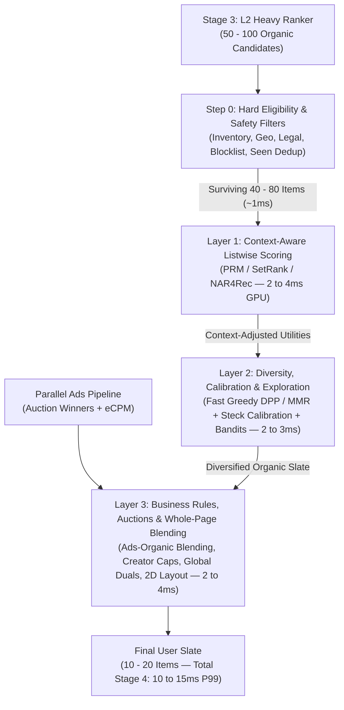

```
STAGE 4 LATENCY & EXECUTION ORDER DISCIPLINE (10–15ms P99 BUDGET):
┌────────────────────────────────────────────────────────────────────────────┐
│ 1. Hard Filters & Seen Dedup (1–2ms)   → Run FIRST! Never waste DPP or    │
│    Inventory, geo, T&S, Redis seen-set   GPU FLOPs on ineligible items.   │
│                                                                            │
│ 2. Listwise Neural Re-Scorer (2–4ms)   → Captures cross-item comparisons, │
│    PRM / SetRank / Generator-Evaluator   complements, and visual flow.    │
│                                                                            │
│ 3. Diversity & Calibration (2–3ms)     → Fast Greedy DPP / MMR / Steck KL │
│    + Exploration / Freshness Injection   + Bandit/Incubation slot reserve.│
│                                                                            │
│ 4. Business Rules & Blending (2–4ms)   → Ads-Organic merge, dual-variable │
│    + Final Guardrail Audit               penalties, spacing & hard caps.  │
└────────────────────────────────────────────────────────────────────────────┘
Production Rule of Thumb:
  Monitor "Position Displacement Rate" — the fraction of top-K slots whose
  order changes between L2 and Stage 4. If Stage 4 overrides >30% of top-K
  positions strictly via ad-hoc rules, upstream L2 features or calibration
  are misaligned and should absorb those signals natively.
```

> **Critical Architectural Boundary:** Stage 4 can only **reorder, filter, or blend** candidates delivered by upstream stages (or dedicated side-pools like Ads and Fresh Content). If a great niche item was dropped during Stage 1 Retrieval, no Stage 4 algorithm can recover it.
>
> **CPU Fallback Circuit Breaker:** Production Stage 4 services wrap the Layer-1 GPU neural re-ranker behind a tight timeout budget (e.g., `5ms`). If GPU RPC latency spikes or a model host degrades, a circuit breaker immediately bypasses Layer 1 and degrades gracefully to upstream L2 scores fed directly into Layer-2 fast CPU MMR/DPP and Layer-3 hard business rules—preserving latency SLAs and slate diversity without blank feeds.

---

## 2. Classical & Mathematical Diversity Optimization: Rules, MMR, Submodularity & DPP

Before reaching for deep listwise transformers, every production recommendation system relies on a bedrock of deterministic deduplication, business spacing constraints, and mathematically principled diversity algorithms. Understanding where each method shines—and where it breaks—is essential for low-latency system design.

### 2.1 Hard Deduplication & Sliding-Window Business Rules

Every industrial feed begins Stage 4 with fast, deterministic suppression and spacing filters:

1.  **Impression-Fatigue & Seen-Item Suppression:**
    *   Users should not see the exact same item twice in a session or be repeatedly shown items they scrolled past without clicking.
    *   **Redis Ring Buffers (Circular Buffers):** Store each user's last $`M`$ (e.g., $`500 - 2,000`$) seen item IDs in a fixed-memory per-user ring buffer ($`O(1)`$ append, zero unbounded list growth, `< 1ms` lookup).
    *   **Bloom Filters (or Cuckoo Filters):** When deduplicating across *months* of history (e.g., $`50,000+`$ seen short videos per user), storing exact 64-bit IDs costs $`400\text{KB}`$ per user ($`40\text{TB}`$ for 100M users). A Bloom filter with 1% false-positive rate needs only $`\approx 9.6\text{ bits}`$ per item ($`60\text{KB}`$ per user—a $`6.7\times`$ memory reduction!). A 1% false positive merely hides an occasional unseen candidate out of 100, which is harmless in feeds; *zero false negatives* guarantees a seen item is never repeated. *(Note: standard Bloom filters do not support deletion, so systems rotate time-bucketed filters—e.g., 7 daily Bloom filters—or use Cuckoo filters when un-hiding is needed.)*
2.  **Near-Duplicate Visual & Semantic Clustering:**
    *   In multimedia and e-commerce feeds, 15 sellers may upload slightly cropped or watermarked copies of the same photo.
    *   Production deduplication runs three fast layers: **(a) Canonical URL / SKU ID matching**, **(b) Perceptual Hashing (`pHash` / `dHash`)** using Hamming distance $`\le 4`$ in $`O(1)`$ time for near-exact visual copies, and **(c) Semantic/Visual Embedding Clustering** grouping candidates with cosine similarity $`\ge 0.95`$ and retaining only the **canonical best version** (highest L2 score, image resolution, or seller authority).
    *   *Crucial distinction:* **Deduplication** removes near-identical copies of the *same* item (cosine $`\ge 0.95`$), whereas **diversification** balances *distinct* items across topics/categories (cosine $`0.40 - 0.85`$).
3.  **Sliding-Window Category & Creator Caps:**
    *   Examples: *"At most 1 item from the same creator in any window of 5 slots,"* or *"At most 2 items from the same category in the top 10."*
    *   Implemented via a single greedy pass over sorted candidates: if the next candidate violates a window rule, defer it to a holding queue and advance to the next eligible candidate.

**Trade-Offs: Brittle Hard Rules vs. Soft Optimization:**
*   **Why teams love hard rules:** Completely deterministic, explainable to product and legal stakeholders (*"Why did Item X drop from slot 2 to slot 6? Author cap triggered."*), and sub-millisecond ($`\lt 0.5\text{ms}`$).
*   **Where hard rules fail:** Hard rules are **blind to score magnitude**. A hard *"max 1 item per creator in top 5"* rule treats a situation where Creator A's second post scores $`0.95`$ (vs. next best $`0.12`$) identically to a situation where Creator A's second post scores $`0.51`$ (vs. next best $`0.50`$). Worse, stacking 15 overlapping hard rules (creator cap + category cap + price tier + ad spacing + freshness) often creates **infeasible deadlocks**, forcing the system to either drop below $`K`$ items or silently relax constraints in unpredictable order.

### 2.2 Maximal Marginal Relevance (MMR — Carbonell & Goldstein, 1998)

To replace brittle binary cutoffs with a smooth trade-off between relevance and novelty, **Maximal Marginal Relevance (MMR)** greedily builds the slate $`S`$ one item at a time by maximizing relevance minus redundancy against the *most similar* item already selected:

```math
i^* = \arg\max_{i \in R \setminus S} \left[ \lambda \cdot \text{Rel}(i) - (1 - \lambda) \cdot \max_{j \in S} \text{Sim}(i, j) \right]
```

Where $`R`$ is the candidate pool of size $`N`$, $`S`$ is the already-selected slate, $`\text{Rel}(i) \in [0, 1]`$ is the normalized L2 relevance score, $`\text{Sim}(i, j) \in [0, 1]`$ is item-item similarity (typically cosine similarity of content/multimodal embeddings or taxonomy overlap), and $`\lambda \in [0, 1]`$ controls the relevance-diversity trade-off:
*   $`\lambda = 1.0`$ yields pure pointwise relevance ranking.
*   $`\lambda = 0.0`$ yields pure greedy farthest-point diversity (ignoring relevance).
*   **Surface-Specific Tuning:** Casual browsing homepages typically use $`\lambda \approx 0.5 - 0.6`$; explicit search results use $`\lambda \approx 0.75 - 0.85`$; single-shot push notifications use $`\lambda \approx 0.90+`$.

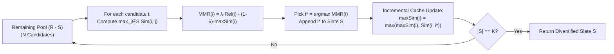

#### Worked 3-Step Numerical Walkthrough (MMR with $`\lambda = 0.6`$)

Suppose a streaming platform has $`N = 5`$ top-ranked movies and must construct a slate of $`K = 3`$ items with $`\lambda = 0.6`$ ($`1 - \lambda = 0.4`$):

| Candidate | Relevance $`\text{Rel}(i)`$ | Sim w/ Dark Knight | Sim w/ Inception | Sim w/ Interstellar | Sim w/ Notebook |
| :--- | :---: | :---: | :---: | :---: | :---: |
| **The Dark Knight** (Action) | `0.95` | `1.00` | `0.30` | `0.40` | `0.10` |
| **Batman Begins** (Action) | `0.90` | `0.85` | `0.50` | `0.45` | `0.10` |
| **Inception** (Sci-Fi) | `0.85` | `0.30` | `1.00` | `0.70` | `0.15` |
| **Interstellar** (Sci-Fi) | `0.80` | `0.40` | `0.70` | `1.00` | `0.20` |
| **The Notebook** (Romance) | `0.60` | `0.10` | `0.15` | `0.20` | `1.00` |

*   **Step 1 ($`S = \emptyset`$):** No items selected yet, so pick highest relevance: **The Dark Knight** ($`0.95`$). Now $`S = [\text{The Dark Knight}]`$.
*   **Step 2 (Score remaining 4 candidates against $`S`$):**
    *   *Batman Begins:* $`0.6(0.90) - 0.4(0.85) = 0.54 - 0.34 = 0.20`$ (heavily penalized for Batman overlap!)
    *   *Inception:* $`0.6(0.85) - 0.4(0.30) = 0.51 - 0.12 = \mathbf{0.39}`$ $`\leftarrow`$ **Winner!**
    *   *Interstellar:* $`0.6(0.80) - 0.4(0.40) = 0.48 - 0.16 = 0.32`$
    *   *The Notebook:* $`0.6(0.60) - 0.4(0.10) = 0.36 - 0.04 = 0.32`$
    *   Now $`S = [\text{The Dark Knight}, \text{Inception}]`$.
*   **Step 3 (Score remaining 3 candidates against $`\max_{j \in S} \text{Sim}(i, j)`$):**
    *   *Batman Begins:* $`0.6(0.90) - 0.4 \max(0.85, 0.50) = 0.54 - 0.34 = 0.20`$
    *   *Interstellar:* $`0.6(0.80) - 0.4 \max(0.40, 0.70) = 0.48 - 0.28 = 0.20`$ (now penalized by *Inception*!)
    *   *The Notebook:* $`0.6(0.60) - 0.4 \max(0.10, 0.15) = 0.36 - 0.06 = \mathbf{0.30}`$ $`\leftarrow`$ **Winner!**
    *   **Final Slate:** `["The Dark Knight", "Inception", "The Notebook"]` — Action $`\to`$ Sci-Fi $`\to`$ Romance!

#### Complexity & Fundamental Limitations of MMR
*   **Computational Complexity:** A naive implementation that recomputes $`\max_{j \in S} \text{Sim}(i, j)`$ from scratch at every step costs $`O(K^2 N)`$. However, by caching `max_sim[i]` per candidate and updating it via `max_sim[i] = max(max_sim[i], Sim(i, i*))` after each selection, MMR runs in **$`O(K N)`$** similarity evaluations (plus embedding dot-product cost $`O(K N d)`$)—taking $`\lt 0.5\text{ms}`$ for $`N = 100, K = 20`$.
*   **Limitation 1 (Scale Sensitivity):** MMR subtracts a cosine similarity (`[0, 1]`) directly from a relevance score (`Rel(i)`). If L2 outputs unnormalized logits or tightly clustered probabilities (`0.021` vs. `0.018`), the similarity penalty completely overwhelms relevance! Always normalize relevance scores (e.g., min-max, z-score, or quantile scaling) before applying MMR.
*   **Limitation 2 (Myopic Nearest-Neighbor Penalty):** Because MMR only checks $`\max_{j \in S} \text{Sim}(i, j)`$ (the *single* worst neighbor), it cannot distinguish between an item that is moderately similar ($`0.5`$) to *one* item in $`S`$ vs. an item that is moderately similar ($`0.5`$) to *all ten* items in $`S`$. It ignores global geometric coverage of the slate!

### 2.3 Submodular Maximization & The (1 - 1/e) Guarantee

Why do greedy algorithms work so well for slate construction? The deep mathematical foundation is **Submodularity**—the formalization of **diminishing marginal returns**.

A set function $`f: 2^V \to \mathbb{R}`$ over ground set $`V`$ (our $`N`$ candidates) is **submodular** if for every pair of subsets $`S \subseteq T \subseteq V`$ and every item $`i \in V \setminus T`$:

```math
f(S \cup \{i\}) - f(S) \ge f(T \cup \{i\}) - f(T)
```

In plain English: *adding a sci-fi movie to a slate of 2 items yields at least as much marginal value as adding that same sci-fi movie to a larger slate of 10 items that already contains those 2 items.* A function is also **monotone** if adding an item never decreases total value ($`f(S \cup \{i\}) \ge f(S)`$).

#### Classic Submodular Objectives in RecSys
1.  **Facility Location (Exemplar Coverage):** Measures how well the selected slate $`S`$ "covers" every candidate $`v \in V`$ (weighted by candidate relevance $`r_v`$):

```math
f_{\text{FL}}(S) = \sum_{v \in V} r_v \cdot \max_{j \in S} \text{Sim}(v, j)
```

2.  **Probabilistic Intent Coverage:** Suppose a user has latent topics/subtopics $`g \in \mathcal{G}`$ with weights $`w_g`$, and item $`i`$ satisfies topic $`g`$ with probability $`p_{i,g}`$. The probability that *at least one* item in $`S`$ satisfies topic $`g`$ is strictly monotone submodular:

```math
f_{\text{cov}}(S) = \sum_{g \in \mathcal{G}} w_g \left[ 1 - \prod_{i \in S} (1 - p_{i,g}) \right]
```

#### The Nemhauser–Wolsey–Fisher (1978) Theorem
Finding the exact globally optimal slate $`S^* = \arg\max_{|S| \le K} f(S)`$ is **NP-hard** (exponential $`\binom{N}{K}`$ combinations). However, Nemhauser, Wolsey, and Fisher (1978) proved a landmark result: for any non-negative, monotone submodular function $`f`$, the simple greedy algorithm (repeatedly picking $`i^* = \arg\max_i [f(S \cup \{i\}) - f(S)]`$) is **mathematically guaranteed** to achieve:

```math
f(S_{\text{greedy}}) \ge \left(1 - \frac{1}{e}\right) f(S^*) \approx 0.632 \cdot f(S^*)
```

In practice, greedy submodular selection routinely achieves **$`95\% - 99\%`$ of the true global optimum**—and no polynomial-time algorithm can beat $`1 - 1/e`$ in the worst case unless $`\text{P} = \text{NP}`$.

#### Minoux's Lazy Greedy (CELF) Acceleration
Standard greedy evaluates the marginal gain $`\Delta(i \mid S) = f(S \cup \{i\}) - f(S)`$ for all $`N`$ candidates at every step ($`O(K N)`$ function evaluations). **Lazy Greedy** (Minoux, 1978; popularized as CELF) exploits the submodular diminishing-returns inequality directly:

*   Maintain a max-heap of all candidates keyed by their *last computed* marginal gain $`\tilde{\Delta}(i)`$. Because $`S`$ only grows, submodularity guarantees $`\tilde{\Delta}(i)`$ is a **valid upper bound** on item $`i`$'s true current marginal gain!
*   At step $`k`$, pop the top item $`i_{\text{top}}`$ from the heap and recompute *only* its true gain $`\Delta(i_{\text{top}} \mid S)`$.
*   If $`\Delta(i_{\text{top}} \mid S)`$ is still $`\ge`$ the stale upper bound of the *second* item in the heap, $`i_{\text{top}}`$ is **provably the exact greedy winner**—select it immediately without recomputing the other $`N - 1`$ items!
*   Otherwise, push $`i_{\text{top}}`$ back with its updated smaller gain and repeat. This produces the **exact same slate** as standard greedy while cutting function evaluations by **$`10\times - 100\times`$** in production.

### 2.4 Determinantal Point Processes (DPP — Chen et al., NeurIPS 2018)

While MMR inspects only pairwise similarity to the single closest neighbor, **Determinantal Point Processes (DPPs)** provide a unified probabilistic and geometric framework that captures **global set-wide diversity and relevance simultaneously**.

#### Kernel Matrix Construction ($`L`$-Ensemble)
For a candidate pool of $`N`$ items, let $`r_i \gt 0`$ denote item $`i`$'s relevance/quality score (often exponentiated as $`r_i = \exp(\alpha \cdot \text{score}_i)`$ to tune the relevance-vs-diversity trade-off) and let $`\phi_i \in \mathbb{R}^d`$ be its $`\ell_2`$-normalized feature embedding ($`\|\phi_i\|_2 = 1`$). We construct the symmetric positive semi-definite (PSD) kernel matrix $`L \in \mathbb{R}^{N \times N}`$:

```math
L = \text{Diag}(r) \cdot S \cdot \text{Diag}(r), \qquad L_{ij} = r_i \cdot \langle \phi_i, \phi_j \rangle \cdot r_j = \langle r_i \phi_i, r_j \phi_j \rangle
```

Where $`S_{ij} = \langle \phi_i, \phi_j \rangle \in [-1, 1]`$ is the cosine similarity matrix. A DPP assigns every subset (slate) $`S \subseteq \{1, \dots, N\}`$ a probability proportional to the **determinant** of its indexed submatrix $`L_S`$:

```math
P(S) = \frac{\det(L_S)}{\det(L + I)} \quad \implies \quad S_{\text{MAP}} = \arg\max_{|S| = K} \log \det(L_S)
```

#### Geometric Intuition: Parallelepiped Volume
Define each item's **quality-scaled vector** $`v_i = r_i \phi_i \in \mathbb{R}^d`$. By elementary linear algebra, the matrix $`L_S = V_S^T V_S`$ is a Gram matrix, so its determinant equals the **squared volume of the parallelepiped spanned by $`\{v_i : i \in S\}`$**:

```math
\det(L_S) = \left( \text{Vol}\big(\{r_i \phi_i\}_{i \in S}\big) \right)^2
```

```
GEOMETRIC INTUITION OF DPP DETERMINANT (VOLUME = RELEVANCE × ORTHOGONALITY):

  Case A: Two High-Scoring Near-Duplicates        Case B: Two Slightly Lower, Orthogonal Items
     (r1 = 1.0, r2 = 0.95, cos θ = 0.95)              (r1 = 1.0, r3 = 0.80, cos θ = 0.0)

           v2 ──►                                          v3 ▲ (length 0.80)
          /   (tiny angle θ ≈ 18°)                            │
         / ░░░░░  Tiny Area!                                  │█████████████████│
        /░░░░░░░                                              │██ HUGE AREA!  ██│
       ───────────► v1 (length 1.0)                           │█████████████████│
                                                              └─────────────────► v1 (length 1.0)
   det(L) = Area² = (1.0 × 0.95 × sin 18°)²                det(L) = Area² = (1.0 × 0.80 × sin 90°)²
          = 0.9025 × (1 - 0.95²) = 0.088                          = 0.6400 × (1 - 0²) = 0.640  (7.3× LARGER!)
```

Notice three magical consequences of this geometry:
1.  **Longer vectors (higher relevance $`r_i`$)** stretch the parallelepiped along its axes, expanding volume.
2.  **More orthogonal vectors (higher diversity)** open the angles between edges, expanding volume.
3.  **Exact or linear-combination duplicates collapse volume to ZERO!** Even if item 3 is not identical to item 1 or item 2 individually, if $`\phi_3`$ lies in the *subspace* spanned by $`\{\phi_1, \phi_2\}`$ (e.g., an item that is 50% Action + 50% Sci-Fi when pure Action and pure Sci-Fi are already in the slate), $`\det(L_S) \to 0`$. MMR completely misses subspace redundancy; DPP penalizes it naturally—and $`\log\det(L_S)`$ is **submodular**! *(Note: $`\log\det(L_S)`$ is submodular but **not guaranteed monotone** when residual norms satisfy $`d_i^2 \lt 1`$—as seen in our $`3 \times 3`$ example below when adding $`r_4 = 0.70`$ reduces the determinant from $`0.6400`$ to $`0.3136`$—which is why greedy DPP always runs to fixed cardinality $`|S| = K`$ or scales relevance scores via $`r_i = \exp(\alpha s_i) \ge 1`$.)*

#### Worked $`2 \times 2`$ and $`3 \times 3`$ Numerical Example
Suppose we have 4 candidates with unit embeddings in $`\mathbb{R}^3`$ and quality scores $`r_i`$:
*   **Item 1 (Running Shoe A):** $`r_1 = 1.00`$, $`\phi_1 = [1, 0, 0]`$
*   **Item 2 (Running Shoe B — near-duplicate):** $`r_2 = 0.95`$, $`\phi_2 = [0.95, 0.312, 0]`$ (so $`\langle \phi_1, \phi_2 \rangle = 0.95`$)
*   **Item 3 (Rain Jacket — orthogonal):** $`r_3 = 0.80`$, $`\phi_3 = [0, 1, 0]`$ (so $`\langle \phi_1, \phi_3 \rangle = 0`$)
*   **Item 4 (Gym Backpack — orthogonal to both):** $`r_4 = 0.70`$, $`\phi_4 = [0, 0, 1]`$

1.  **Step 1 ($`|S| = 1`$):** $`\det(L_{\{i\}}) = r_i^2`$. Pick **Item 1** ($`1.00^2 = 1.00`$).
2.  **Step 2 ($`|S| = 2`$, compare $`\{1, 2\}`$ vs. $`\{1, 3\}`$):**

```math
L_{\{1,2\}} = \begin{pmatrix} 1.00 & 0.9025 \\ 0.9025 & 0.9025 \end{pmatrix} \implies \det(L_{\{1,2\}}) = 1.00(0.9025) - (0.9025)^2 = \mathbf{0.0880}
```

```math
L_{\{1,3\}} = \begin{pmatrix} 1.00 & 0 \\ 0 & 0.64 \end{pmatrix} \implies \det(L_{\{1,3\}}) = 1.00(0.64) - 0 = \mathbf{0.6400}
```

Even though Item 2 has a much higher L2 relevance ($`0.95`$ vs. $`0.80`$), **Item 3 wins by a $`7.3\times`$ determinant margin** ($`0.6400`$ vs. $`0.0880`$).
3.  **Step 3 ($`|S| = 3`$, compare $`\{1, 3, 2\}`$ vs. $`\{1, 3, 4\}`$):**
    *   Notice $`\phi_2 = [0.95, 0.312, 0]`$ lies *entirely inside the 2D plane spanned by $`\phi_1 = [1, 0, 0]`$ and $`\phi_3 = [0, 1, 0]`$!* Therefore the 3D parallelepiped of $`\{1, 3, 2\}`$ is completely flat:

```math
\det(L_{\{1,3,2\}}) = \mathbf{0.0000} \quad (\text{linearly dependent subspace!})
```

```math
L_{\{1,3,4\}} = \begin{pmatrix} 1.00 & 0 & 0 \\ 0 & 0.64 & 0 \\ 0 & 0 & 0.49 \end{pmatrix} \implies \det(L_{\{1,3,4\}}) = 1.00 \times 0.64 \times 0.49 = \mathbf{0.3136}
```

**Item 4 (Gym Backpack)** wins cleanly, constructing the globally diverse slate $`[\text{Shoe A}, \text{Jacket}, \text{Backpack}]`$.

#### Fast Greedy Cholesky Update (Chen et al., Hulu, NeurIPS 2018)
Why wasn't DPP used in production before 2018? Computing the determinant of a $`k \times k`$ matrix directly costs $`O(k^3)`$. Evaluating all $`N`$ remaining candidates at every step $`k = 1, \dots, K`$ naively takes **$`O(K^4 N)`$** (or $`O(N^4)`$ when $`K \approx N`$)—completely unusable inside a $`10\text{ms}`$ SLA!

**Chen, Zhang, and Zhou (Hulu, NeurIPS 2018)** solved this by maintaining an **incremental Cholesky decomposition** $`L_S = V V^T`$. When candidate $`i`$ is considered for addition to $`S`$, its extended Cholesky factor is:

```math
L_{S \cup \{i\}} = \begin{pmatrix} V & 0 \\ c_i^T & d_i \end{pmatrix} \begin{pmatrix} V^T & c_i \\ 0 & d_i \end{pmatrix} \implies \det(L_{S \cup \{i\}}) = \det(L_S) \cdot d_i^2
```

Therefore, **maximizing $`\log\det(L_{S \cup \{i\}})`$ reduces to simply picking $`j = \arg\max_{i \notin S} d_i^2`$**—the candidate with the largest squared residual norm orthogonal to the subspace already spanned by $`S`$!

Once winner $`j`$ is selected at step $`k`$, we only append **one single scalar** $`e_i`$ to each remaining candidate's Cholesky vector $`c_i`$ and subtract $`e_i^2`$ from $`d_i^2`$:

```math
e_i = \frac{L_{ji} - \langle c_j, c_i \rangle}{d_j}, \qquad c_i \leftarrow [c_i, \; e_i], \qquad d_i^2 \leftarrow d_i^2 - e_i^2
```

Initialize $`d_i^2 = L_{ii} = r_i^2`$ and $`c_i = []`$ before step 1. Look at the computational magic:
*   Each iteration computes one dot product $`\langle c_j, c_i \rangle`$ of length $`k`$ across $`N`$ candidates: cost $`O(k N)`$.
*   Summing over $`k = 1, \dots, K`$ gives total complexity **$`O(K^2 N)`$** (and if the kernel $`L_{ji}`$ is computed on the fly from $`d`$-dim embeddings, only $`O(K N (K + d))`$).
*   For typical Stage 4 dimensions ($`N = 100, K = 20, d = 64`$), Fast Greedy DPP executes $`\approx 290,000`$ floating-point ops—taking **$`\mathbf{0.8 - 1.8\text{ms}}`$** on a single CPU thread including JVM/Python and feature-fetch overhead (pure C++/SIMD executes in $`\lt 0.2\text{ms}`$)!

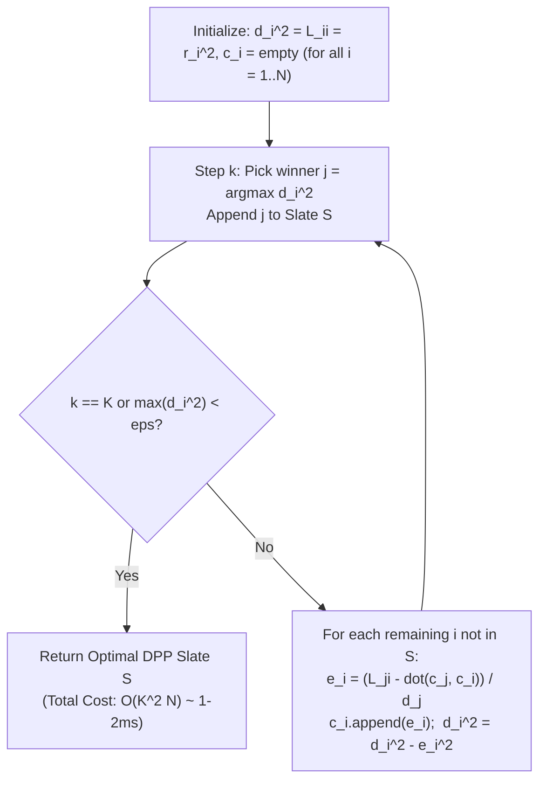

#### Sliding-Window DPP & Personalized DPP (`pDPP`)
*   **Sliding-Window DPP for Infinite-Scrolling Feeds:** In infinite-scrolling feeds (e.g., $`K = 100+`$), penalizing slot 80 for being similar to slot 2 (which the user scrolled past 10 minutes ago) makes no sense—and once $`K \gt d`$ (embedding dimension), the rank of $`L`$ is exhausted and $`d_i^2`$ drops to zero! **Sliding-Window DPP** (also introduced by Chen et al., 2018) enforces repulsion *only* within the last $`w`$ displayed items (e.g., window $`w = 6`$ or $`w = 10`$ visible on screen). Once $`|S| \ge w`$, the oldest item is downdated from the Cholesky factor via rank-1 orthogonal Givens/Householder updates, reducing complexity to **$`O(w K N)`$** (precisely $`O(K(w^2 + wN))`$ from $`O(w^2)`$ Cholesky downdate + $`O(wN)`$ candidate update per step, which simplifies to $`O(w K N)`$ since $`w \ll N`$) while ensuring smooth local diversity over arbitrarily long feeds.
*   **Personalized DPP (`pDPP`):** Different users—and different sessions—have wildly different diversity appetites. Rather than applying a single global relevance temperature $`\alpha_0`$ in $`r_i = \exp(\alpha \cdot \text{score}_i)`$, **Personalized DPP** scales the temperature per user as $`\alpha_u = f_u \cdot \alpha_0`$, where $`f_u`$ is predicted from the user's historical category entropy and current session intent (high $`\alpha_u`$ yields focused, high-relevance slates for narrow spec-comparison sessions; lower $`\alpha_u`$ opens wider geometric diversity for exploratory browsers).

#### Comparison of Classical Stage 4 Diversity Methods

| Method | Core Mechanism | Online Complexity | Subspace Diversity? | Production Trade-Offs |
| :--- | :--- | :--- | :---: | :--- |
| **Hard Rules & Caps** | Binary spacing/author/category windows | $`O(K N)`$ ($`\lt 0.5\text{ms}`$) | No | Explainable & deterministic, but ignores score magnitude and can deadlock when rules stack. |
| **MMR (1998)** | $`\lambda \text{Rel}(i) - (1-\lambda)\max_{j \in S}\text{Sim}(i,j)`$ | $`O(K N)`$ cached ($`\lt 0.5\text{ms}`$) | No | Simple, battle-tested, tunable $`\lambda`$ per surface; sensitive to score scaling and blind to multi-neighbor overlap. |
| **Submodular Facility Location** | Greedy / Lazy Greedy (CELF) on coverage $`f(S)`$ | $`O(K N)`$ worst, $`10\times`$ faster lazy | Partial (cluster cover) | Provable $`(1 - 1/e)`$ optimality guarantee; requires defining an explicit coverage graph/subtopic matrix. |
| **Fast Greedy DPP (2018)** | Incremental Cholesky on $`\log\det(L_S)`$ | $`O(K^2 N)`$ ($`1 - 2\text{ms}`$) | **Yes (exact volume)** | Gold-standard mathematical diversity; requires well-scaled $`r_i = \exp(\alpha s_i)`$ and sliding window when $`K \gt d`$. |

---

## 3. Listwise Neural Slate Optimization & Whole-Page Layouts

### 3.1 Why Greedy Heuristics Miss Cross-Item Synergy

MMR, Submodular Coverage, and DPP all share a structural assumption: **similarity is always bad (repulsion-only)**. That assumption works wonderfully for avoiding duplicate sneakers or homogeneous news feeds, but breaks down whenever items interact in richer ways:

1.  **Positive Synergy / Complementarity:** Showing a Nintendo Switch at slot 1 *increases* the click/purchase probability of *Zelda* or a Pro Controller at slot 2—even though their behavioral embeddings have high similarity! DPP penalizes them for being similar; a neural listwise model learns they belong *together*.
2.  **Visual Aesthetics & Color/Price Contrast:** On visual feeds (e.g., Pinterest, Instagram, fashion e-commerce), placing a warm-toned minimalist item next to a cluttered neon banner can hurt engagement due to visual jarring, whereas price anchoring ($`\$49`$ next to $`\$129`$) boosts conversion.
3.  **User-Dependent Diversity Appetite:** A bargain hunter comparing 6 laptops *wants* high similarity (low diversity) to compare specs side-by-side, whereas a casual evening browser wants wide topic exploration. A static global $`\lambda`$ or DPP temperature $`\alpha`$ misses user-context-dependent cross-item effects.

To model arbitrary, learned mutual influences across items, production systems introduce **Listwise Neural Re-Rankers** at Layer 1 of Stage 4.

### 3.2 PRM (Alibaba, RecSys 2019) & SetRank (SIGIR 2020)

#### PRM: Personalized Re-ranking Model (Pei et al., Alibaba, RecSys 2019)
**PRM** pioneered plug-and-play Transformer re-ranking at industrial scale (Taobao). Instead of scoring each candidate independently, PRM feeds the entire top-$`N`$ candidate list ($`N = 30 - 50`$) from L2 into a multi-head **Transformer Encoder** so every candidate attends to every other candidate on the page:

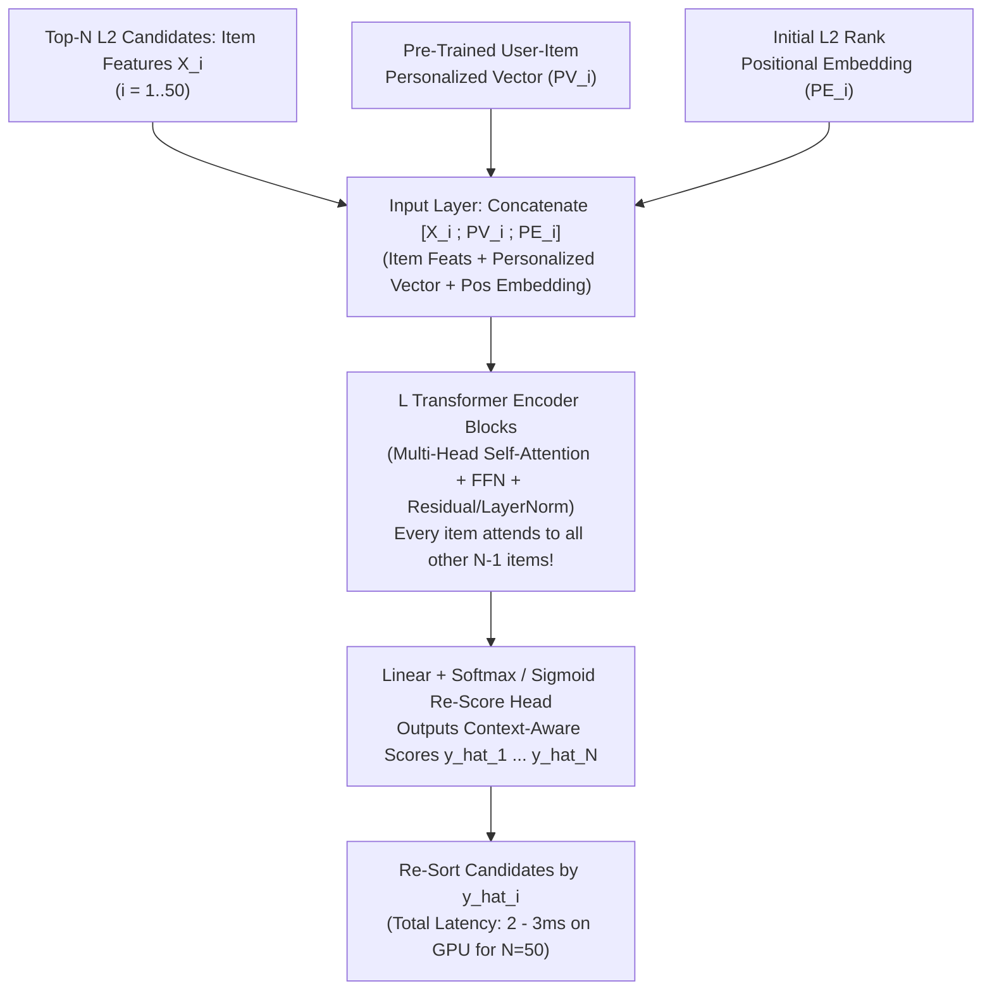

Three architectural innovations make PRM practical in production:
1.  **Personalized Vector (`PV`) Injection:** Pure item-item self-attention learns generic cross-item interactions (e.g., "item A competes with item B"), which fails because mutual influence depends on *which user* is viewing the list. PRM extracts a compact **Personalized Vector** $`\text{PV}_i`$ from a pre-trained upstream user-item interaction model (e.g., hidden representation from L2) and concatenates it to every item token: $`E_i = [X_i; \text{PV}_i] W^E + \text{PE}_i`$.
2.  **Self-Attention Across the Candidate List:** Multi-head self-attention computes $`\text{Attn}(Q, K, V) = \text{Softmax}(QK^T / \sqrt{d_k}) V`$ across all $`N`$ candidates in parallel. Every candidate's updated representation encodes not just its own features, but its relative price, category redundancy, and complementarity against all $`N - 1`$ peers!
3.  **Latency Profile:** Because $`N`$ is small ($`N \approx 50`$) and PRM uses only $`1 - 2`$ lightweight Transformer layers ($`d_{\text{model}} = 64 - 128`$), the $`O(N^2 d)`$ self-attention matrix is just $`50 \times 50`$ ($`2,500`$ entries)—executing in **$`2 - 3\text{ms}`$ on a GPU** (batched across requests).

#### SetRank (Pang et al., SIGIR 2020)
While PRM feeds L2's initial rank as a **Positional Embedding (`PE`)**, injecting fixed positional encodings can cause the model to over-rely on L2's order (anchoring bias). **SetRank** models the candidates as a *set* using **Multi-Head / Induced Self-Attention Blocks (MSAB / IMSAB)** so the core encoder is strictly **permutation-equivariant**: permuting the input candidates permutes the output scores identically. At the *input* layer, SetRank optionally injects **ordinal embeddings** to retain upstream rank information without breaking set equivariance under shuffling; at the *output* layer, it optimizes **Attention Rank**—a listwise cross-entropy loss comparing softmax-normalized predicted scores against attention-allocated relevance labels—preventing the model from degenerating into memorizing upstream rank order.

#### The Fundamental Limit of One-Stage Re-Rankers (PRM / SetRank): The "Context Shift" Paradox
Look closely at PRM's subtle mathematical flaw:
*   PRM computes context-aware scores assuming the items appear in the *input* arrangement $`[x_1, x_2, \dots, x_N]`$, and then **re-sorts** them into a *new* arrangement $`\pi'`$!
*   Once you move Item 17 to Slot 2 and demote Item 2 to Slot 14, **the surrounding context that PRM conditioned on no longer exists!** This discrepancy between the evaluated context and the displayed permutation is known as the **Evaluation-Before-Reranking (Context Shift) Problem**.

### 3.3 Autoregressive, Generator-Evaluator & Non-Autoregressive Slate Models

To eliminate the Context Shift problem, modern neural re-ranking evolved across three distinct paradigms:

#### 1. Seq2Slate & Pointer Networks (Bello et al., Google, 2018)
**Seq2Slate** models slate construction explicitly as an **autoregressive sequence-to-sequence** problem using a Pointer Network. An encoder embeds all $`N`$ candidates; then a decoder generates the slate one slot at a time, conditioning slot $`k`$ on the exact prefix $`\pi_{1}, \dots, \pi_{k-1}`$ already committed:

```math
P(\pi \mid X) = \prod_{k=1}^{K} P(\pi_k \mid \pi_{1}, \dots, \pi_{k-1}, X)
```

At step $`k`$, the decoder's hidden state $`h_k`$ attends over all unselected candidates $`j \in R \setminus \{\pi_{\lt k}\}`$ to pick the next item (masking already-chosen items so no duplicates occur). Seq2Slate can be trained via:
*   **Supervised Weak Click Loss:** Maximizing log-likelihood of clicked items in logged slates (fast, low-variance, but biased toward the logging policy).
*   **Reinforcement Learning (REINFORCE / Policy Gradient):** Directly optimizing arbitrary non-differentiable slate rewards $`R(\pi)`$ (e.g., total session clicks, revenue, or diversity-weighted NDCG):

```math
\nabla_\theta J(\theta) = \mathbb{E}_{\pi \sim P_\theta(\cdot \mid X)} \left[ \big(R(\pi) - b(X)\big) \sum_{k=1}^{K} \nabla_\theta \log P_\theta(\pi_k \mid \pi_{<k}, X) \right]
```

*   **Production Failure Modes:** (1) **$`K`$ sequential decoder steps** cannot be parallelized on GPUs, pushing P99 latency above $`10 - 15\text{ms}`$ when $`K \ge 20`$; (2) **Exposure bias & error compounding** (one poor early choice corrupts all subsequent slots); (3) **Blind to succeeding context** (slot 2 cannot see what will be placed at slot 3!).

#### 2. Two-Stage Generator-Evaluator Paradigm (PRS, GRN, PIER — Meituan 2023, EdgeRec)
To get full **bidirectional** permutation awareness without evaluating all $`N! / (N-K)!`$ possible slates, industrial systems decouple slate optimization into two stages:
1.  **Fast Generator:** Proposes $`M`$ promising candidate permutations (e.g., $`M = 20 - 50`$ full slates) via beam search, swapping heuristics, or fast hash retrieval.
2.  **Bidirectional Listwise Evaluator:** Evaluates each of the $`M`$ *actual* candidate slates in parallel (a single batched GPU forward pass!) using bidirectional attention (so slot 2 sees both slot 1 *and* slot 3!) and predicts the expected total slate utility $`\hat{U}(\pi^{(m)}) = \sum_{k=1}^K \hat{p}(\text{engage}_k \mid \pi^{(m)}) \cdot v_k`$. Pick $`\pi^* = \arg\max_m \hat{U}(\pi^{(m)})`$!

**Industrial Highlights:**
*   **PRS (Permutation-wise Ranking System, Feng et al., Alibaba, 2021):** Uses **FPSA** beam search (Permutation-Matching) to generate top-$`M`$ feasible slates and a **DPWN (Deep Permutation-Wise Network, Bi-LSTM-based)** Evaluator (Permutation-Ranking) to pick the highest-value slate.
*   **PIER (Permutation-Level Interest-Based End-to-End Re-ranking, Shi et al., Meituan, KDD 2023):** Replaces heuristic beam search with **`FPSM` (Fine-grained Permutation Selection Module)** using **SimHash** to retrieve top-$`M`$ permutations matching the user's permutation-level interest, followed by **`OCPM` (Omnidirectional Context-aware Prediction Module)** trained end-to-end with contrastive loss.
*   **EdgeRec (Alibaba, CIKM 2020):** Moves lightweight re-ranking directly onto the **user's mobile device (edge)** so the slate dynamically re-ranks *mid-scroll* in response to real-time swipe speed and micro-interactions (without a server round-trip!).

#### 3. Non-Autoregressive Generative Re-Ranking (NAR4Rec — Ren et al., Kuaishou, KDD 2024)
Autoregressive generators (Seq2Slate / beam search) remain latency-bound by sequential step-by-step decoding. **NAR4Rec** (deployed at Kuaishou serving 300M+ DAUs) generates **all $`K`$ slate slots simultaneously in parallel**—yielding a **$`5\times`$ inference speedup** over autoregressive generators—while solving the two classic weaknesses of non-autoregressive generation (duplicate tokens and missed inter-slot dependencies):
*   **Sequence-Level Unlikelihood Training:** Explicitly penalizes the generator whenever it assigns probability mass to invalid or duplicate-item permutations.
*   **Contrastive Decoding:** Pairs the parallel generator with a lightweight evaluator/matching score during decoding to re-inject cross-slot dependency awareness without sacrificing parallel GPU execution.

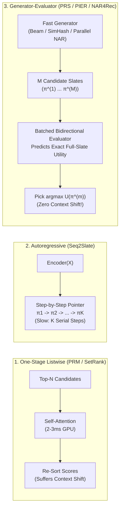

#### Comparison of Listwise Neural Re-Ranking Architectures

| Model | Paradigm | Context Shift? | Bidirectional? | Online Latency | Key Production Trade-Offs |
| :--- | :--- | :---: | :---: | :--- | :--- |
| **PRM** (Alibaba, 2019) | One-stage Transformer + `PV` | Yes | Input-only | `2–3ms` (GPU) | Easiest drop-in upgrade over L2; captures pairwise synergy fast, but re-sorting breaks evaluated context. |
| **SetRank** (2020) | Permutation-equivariant MSAB/IMSAB | Yes | Input-only | `2–3ms` (GPU) | Eliminates positional anchoring bias via set attention + Attention Rank loss; still one-stage re-sort. |
| **Seq2Slate** (Google, 2018) | Autoregressive Pointer Network | **No** (prefix) | No (causal) | `10–20ms+` (serial) | Optimizes arbitrary slate rewards via RL; $`K`$ serial steps hurt P99 latency and miss succeeding context. |
| **PRS** (Alibaba, 2021) | Generator-Evaluator (`FPSA` + `DPWN`) | **No** | **Yes** (Bi-LSTM) | `4–8ms` (GPU) | Eliminates context shift with bidirectional evaluation; beam search limits generator recall to local swaps. |
| **PIER** (Meituan, 2023) | End-to-End Gen-Eval (`FPSM` + `OCPM`) | **No** | **Yes** (Omnidir.) | `3–6ms` (GPU) | SimHash `FPSM` retrieves diverse user-matched slates cleanly; higher serving & index complexity. |
| **NAR4Rec** (Kuaishou, 2024) | Parallel Non-Autoregressive Gen-Eval | **No** | **Yes** | `2–4ms` (GPU) | $`5\times`$ faster than autoregressive decoders via parallel slot generation + unlikelihood & contrastive decoding. |

> **Frontier (2024–2026) — Discrete Diffusion & Distilled LLM Listwise Rerankers:**
> *   **Discrete Diffusion Re-Ranking (e.g., DCDR):** Formulates slate generation as iterative **parallel swap/mask denoising** over permutations—refining all $`K`$ slots simultaneously in a handful of denoising steps to capture rich global cross-item interactions without autoregressive bottlenecks.
> *   **RL-Tuned / Distilled LLM Listwise Rerankers:** Large language models excel at zero-shot cross-item reasoning (spotting subtle redundancy, thematic coherence, and comparative value judgments across titles/descriptions), but are $`100\times`$ too slow for real-time Stage 4. Production pipelines increasingly use **offline RL-tuned LLM listwise judges** to score synthetic slates and **distill** their permutation-level preferences into lightweight `2ms` Stage 4 neural evaluators.

### 3.4 2D Whole-Page Optimization (WPO) & Multi-Carousel Layouts

Most modern homepages (Netflix, DoorDash, Amazon, Spotify, YouTube) are **not 1D lists**—they are **2D grids of heterogeneous modules and carousels** (e.g., *"Trending Now"*, *"Because You Watched X"*, *"Top Picks Under 30 Min"*, hero banners, and sponsored product shelves).

Ranking a 2D page introduces three unique challenges:
1.  **Comparing Apples and Oranges (Heterogeneous Entities):** How do you compare a single hero banner against a 12-item horizontal carousel or a 2-column grid card? **DoorDash's Universal Ranker (UR)** solves this by representing every entity type (store, item, themed carousel) as a unified padded/clipped sequence of constituent items fed through a sequence encoder (LSTM/Transformer) into a shared scoring head.
2.  **Viewport Fold & 2D Visual Salience:** Users scan 2D pages in an **F-shaped / Z-shaped visual pattern**—Row 1 Col 1–3 ("above the fold") captures $`60\%+`$ of attention, while Row 4 Col 5 captures $`\lt 1\%`$. Simply putting the single highest-scoring carousel at Row 1 is suboptimal if its items heavily overlap with Row 2 (cross-carousel duplication!).
3.  **Decoupled Intra-Carousel + Cross-Carousel DAG Architecture:** Historically, each carousel had its own tightly coupled retrieval+ranking pipeline, making whole-page optimization impossible. Modern architectures (e.g., Netflix Page Construction, DoorDash Feed DAG) **decouple** the problem into three crisp stages:

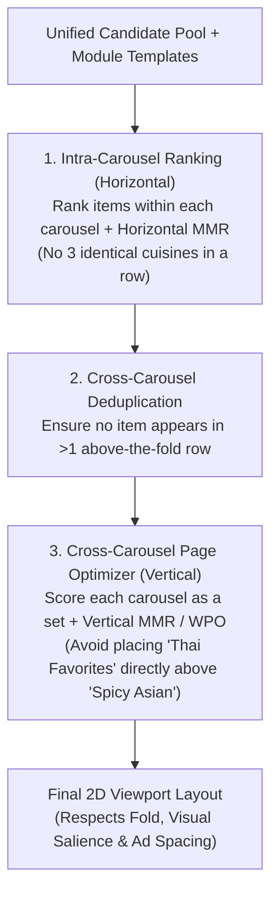

*   **Two-Level MMR in 2D Pages:** Apply **Horizontal (Intra-Collection) MMR** inside each row so users see variety within a shelf, and **Vertical (Inter-Collection) MMR** across rows so adjacent carousels do not share the same theme or visual style.
*   **Netflix's Submodular Page Construction:** Models the entire 2D grid utility using a **2D examination model** (probability that a user scrolls down to row $`r`$ *and* swipes right to column $`c`$), maximizing expected play probability across the grid while explicitly penalizing item and genre overlap across visible rows.
*   **GenAI Offline Personalized Carousels (e.g., DoorDash, 2024):** Static marketplaces traditionally maintained 300+ hand-curated carousel templates (*"Fast Lunch"*, *"Comfort Food"*). Modern 2D WPO pipelines replace brittle static shelves with **offline batch LLM-generated user-specific carousel themes** (e.g., *"Crispy Late-Night Korean Comfort"*), passed through automated policy/brand moderation and semantic embedding retrieval to populate carousel items before feeding them into the standard Cross-Carousel Page Optimizer.

---

## 4. Calibrated Recommendations, Freshness, Exploration & Multi-Stakeholder Fairness

Even a perfectly diversified neural slate can still fail over weeks and months if it suffers from **interest collapse**, **freshness starvation**, or **provider ecosystem collapse**. Stage 4 owns the platform's long-term ecosystem health.

### 4.1 Steck's Calibrated Recommendations (RecSys 2018)

> **Terminology Disambiguation:** Do not confuse **Preference / Distribution Calibration** (this section—matching a user's *genre or topic proportions* in the slate to their historical taste profile via Steck KL) with **Probability Calibration** (matching predicted probabilities $`\hat{p}`$ to true empirical CTR/CVR so $`E/O \approx 1.0`$, covered in Part 2 and Section 5.1).

#### Why Pure Accuracy Causes "Interest Collapse"
Suppose a user historically watches **80% Comedy** and **20% Sci-Fi**. An accuracy-maximizing L2 ranker assigns Comedy items predicted engagement scores around $`0.82`$ and Sci-Fi items around $`0.74`$. If you pick the top-10 items by score, the slate becomes **100% Comedy and 0% Sci-Fi**!
*   Even worse: when the user clicks those Comedies (because zero Sci-Fi was shown!), their logged history shifts from 80/20 to 90/10, then 98/2—a self-reinforcing **filter bubble** that erases their minority interests.
*   Notice that *general diversity* (like MMR) is not the same as *calibration*: MMR might force Horror or Romance into the slate even though this user strictly wants 80% Comedy and 20% Sci-Fi.

#### Mathematical Formulation (Harald Steck, Netflix, RecSys 2018)
Let $`g \in \mathcal{G}`$ denote item categories/genres (where item $`i`$ has normalized category membership weights $`p(g \mid i)`$ summing to $`1`$).
1.  **User's Historical Target Distribution $`p(g \mid u)`$:** Weighted average of categories across user $`u`$'s historical interactions $`\mathcal{H}_u`$ (optionally time-decayed by $`w_{u,i}`$):

```math
p(g \mid u) = \frac{\sum_{i \in \mathcal{H}_u} w_{u,i} \cdot p(g \mid i)}{\sum_{i \in \mathcal{H}_u} w_{u,i}}
```

2.  **Recommended Slate Distribution $`q(g \mid S)`$:** Category distribution of the candidate slate $`S`$ (optionally rank-weighted by position discount $`w_{r(i)} = 1 / \log_2(r(i)+1)`$ so top slots matter more):

```math
q(g \mid S) = \frac{\sum_{i \in S} w_{r(i)} \cdot p(g \mid i)}{\sum_{i \in S} w_{r(i)}}
```

3.  **The Zero-Division Problem & $`\alpha`$-Smoothing:** We measure miscalibration via **Kullback-Leibler (KL) Divergence** $`C_{\text{KL}}(p, q) = \sum_{g} p(g \mid u) \log \frac{p(g \mid u)}{q(g \mid S)}`$. However, whenever a user's preferred genre has $`q(g \mid S) = 0`$ in the partial slate (for instance, at step 1 when only 1 item has been selected!), $`\log(p / 0) = +\infty`$, exploding the objective! Steck fixes this by smoothing $`q`$ slightly toward $`p`$ with a tiny constant $`\alpha \in (0, 1)`$ (typically $`\alpha = 0.01`$):

```math
\tilde{q}(g \mid S) = (1 - \alpha) \cdot q(g \mid S) + \alpha \cdot p(g \mid u)
```

```math
C_{\text{KL}}(p, \tilde{q}) = \sum_{g \in \mathcal{G}} p(g \mid u) \log \frac{p(g \mid u)}{\tilde{q}(g \mid S)}
```

Now $`\tilde{q}(g \mid S) \ge \alpha p(g \mid u) \gt 0`$ whenever $`p(g \mid u) \gt 0`$, guaranteeing finite, smooth gradients while still applying a steep penalty ($`\log(1/\alpha) = \log(100) \approx 4.605`$ nats!) whenever a user interest is completely omitted!

4.  **Greedy Submodular Re-Ranking Objective (Fixed-$`K`$ Shifted Surrogate):** Steck maximizes a linear trade-off between average slate relevance $`s(S) = \frac{1}{K}\sum_{i \in S} r_i`$ and negative miscalibration:

```math
S^* = \arg\max_{|S| = K} \left[ (1 - \lambda) \cdot s(S) - \lambda \cdot C_{\text{KL}}\big(p(\cdot \mid u), \tilde{q}(\cdot \mid S)\big) \right]
```

> **Submodularity Precision Note:** Under variable-$`|S|`$ normalization ($`q(g \mid S) = \frac{\sum_{i \in S} w_{r(i)} p(g \mid i)}{\sum_{i \in S} w_{r(i)}}`$), $`-C_{\text{KL}}`$ is **neither monotone nor submodular** (and is non-positive). In the RecSys 2018 Appendix, Steck proved the $`(1 - 1/e)`$ greedy guarantee on the **fixed-$`K`$ shifted surrogate**: replace the variable denominator with fixed total slate weight—e.g., $`q_{\text{surr}}(g \mid S) = \frac{1}{K}\sum_{i \in S} p(g \mid i)`$ (or normalized by $`\sum_{k=1}^K w_k`$)—and shift the objective by $`+\lambda \ln(1/\alpha)`$ for non-negativity. Under this fixed-$`K`$ surrogate, adding items monotonically increases $`\tilde{q}_{\text{surr}}`$ with concave diminishing gains (making the shifted objective non-negative, monotone, and submodular), and $`q_{\text{surr}}(g \mid S)`$ equals exact $`q(g \mid S)`$ once $`|S| = K`$!

#### Worked Numerical Example (80% Comedy / 20% Sci-Fi User, $`K = 10`$)
Suppose $`p(\text{Comedy}) = 0.80`$, $`p(\text{Sci-Fi}) = 0.20`$, smoothing $`\alpha = 0.01`$, and trade-off $`\lambda = 0.5`$. Every available Comedy item has relevance $`r_C = 0.82`$; every Sci-Fi item has relevance $`r_S = 0.74`$. Compare two 10-item slates:

**Slate A (Pure Relevance: 10 Comedy, 0 Sci-Fi):**
*   Raw slate distribution: $`q_A = (1.00, 0.00)`$.
*   Smoothed distribution ($`\alpha = 0.01`$): $`\tilde{q}_A(\text{Comedy}) = 0.99(1.0) + 0.01(0.8) = 0.998`$; $`\tilde{q}_A(\text{Sci-Fi}) = 0.99(0.0) + 0.01(0.2) = 0.002`$.
*   Miscalibration penalty:

```math
C_{\text{KL}}(p, \tilde{q}_A) = 0.80 \ln\left(\frac{0.80}{0.998}\right) + 0.20 \ln\left(\frac{0.20}{0.002}\right) = -0.177 + 0.20 \ln(100) = -0.177 + 0.921 = \mathbf{0.744\text{ nats}}
```

*   Average per-item relevance $`s(S_A) = \frac{1}{10}\sum_{i \in S_A} r_i = 0.820`$: Objective $`J_A = 0.5(0.820) - 0.5(0.744) = 0.410 - 0.372 = \mathbf{0.038}`$.

**Slate B (Calibrated: 8 Comedy, 2 Sci-Fi):**
*   Raw slate distribution: $`q_B = (0.80, 0.20) = p`$ $`\implies`$ $`\tilde{q}_B = (0.80, 0.20)`$.
*   Miscalibration penalty: $`C_{\text{KL}}(p, \tilde{q}_B) = \mathbf{0.000\text{ nats}}`$.
*   Average per-item relevance $`s(S_B) = \frac{8(0.82) + 2(0.74)}{10} = 0.804`$.
*   Objective $`J_B = 0.5(0.804) - 0.5(0.000) = \mathbf{0.402}`$!

**Takeaway:** By trading away just **$`0.016`$** (2.0% of `0.820`) of raw pointwise score, Calibration cuts miscalibration from $`0.744`$ nats down to $`0.000`$, boosting the combined slate objective more than **$`10\times`$** and permanently protecting the user's Sci-Fi interest from collapsing!

*   **Production Caveat:** Calibration strictly mirrors *past* user proportions—it preserves minority tastes, but it **does not discover brand-new tastes** (a user with $`p(\text{Documentary}) = 0`$ gets zero calibration credit for Documentaries). To discover new interests, you must pair Calibration with explicit **Exploration**.

### 4.2 Freshness, Cold-Start Incubation & Contextual Bandits at Stage 4

#### Why Pure Exploitation Starves Fresh Content
A newly uploaded video, news article, or restaurant has zero historical clicks, zero collaborative filtering co-occurrences, and high prediction uncertainty. A purely exploitative ranker gives fresh items pessimistic scores $`\hat{p}_{\text{CTR}}`$, locking them out of top slots forever (**Exposure Bias & Popularity Lock-In**). Without traffic, they never accumulate training labels—starving both users (stale feeds) and creators (who churn to rival platforms).

#### The Three-Layer Production Freshness Stack
1.  **Item Age as an L2 Feature:** Lets the heavy ranker learn category-specific decay (breaking news decays in 2 hours; classic tutorials stay evergreen for years).
2.  **Stage 4 Recency Multiplier with Quality Floor:** Apply a tunable time-decay multiplier $`\text{score}' = \text{score} \times \big(1 + \beta \cdot e^{-\gamma \cdot \text{age}}\big)`$, **strictly gated by a minimum quality/authority floor** so spam or clickbait uploaded 5 minutes ago cannot hijack slot 1.
3.  **Dedicated Fresh-Pool Slot Injection (Traffic Incubation):** Reserve $`5\% - 15\%`$ of feed slots (e.g., 1 slot in positions 4–8) fed from a dedicated fresh-content candidate pool. New items receive a **minimum guaranteed impression quota** (e.g., $`200 - 500`$ impressions—often called **traffic incubation** or cold-start exploration pools) with **early stopping**: if an incubated item's early CTR/completion rate clears the cohort threshold after 200 impressions, it graduates to the main ranking pool; if it underperforms, incubation halts immediately to protect UX.
4.  **Dynamic Breaking-News Freshness (Live-Event Spike Detection):** Static time-decay curves fail during sudden breaking events (elections, natural disasters, sports finals). Search and news feeds run real-time **query-spike and publish-velocity detectors** that dynamically crank up the Stage 4 recency multiplier $`\beta`$ *while simultaneously raising trusted-source authority floors*—ensuring breaking updates displace stale evergreen pages without amplifying unverified rumors.

#### Contextual Bandits at Stage 4 (Principled Explore-Exploit)
Rather than injecting random items ($`\varepsilon`$-greedy, which wastes slots on low-probability guesses), Stage 4 uses **Contextual Bandits** to direct exploration toward items with **high epistemic uncertainty** *and* plausible user match:

#### 1. Thompson Sampling (Beta-Bernoulli, Dynamic Prior & Neural-Linear TS)
*   *Intuition:* Maintain a posterior probability distribution over each item's true reward rate. At serving time, **draw one random sample** $`\tilde{p}_i`$ from each item's posterior and rank by the sampled values!
*   *Beta-Bernoulli Worked Example:*
    *   **Established Item A:** 500 clicks out of 10,000 impressions $`\to \text{Beta}(501, 9501)`$. Mean $`= 0.050`$, standard deviation $`\sigma = 0.0022`$ (razor-sharp peak around `0.050`).
    *   **Fresh Item B:** 1 click out of 10 impressions $`\to \text{Beta}(2, 10)`$ (using weak prior $`\text{Beta}(1, 1)`$, or better, an informative content-based prior $`\text{Beta}(\alpha_0, \beta_0)`$ predicted by L2!). Mean $`= 0.167`$, standard deviation $`\sigma = 0.103`$ (wide uncertainty). Even if Item B had 0 clicks in 15 impressions ($`\text{Beta}(1, 16)`$, mean `0.059`), its wide tail frequently samples $`\tilde{p}_B = 0.09 \gt 0.050`$, earning exploration impressions organically until its posterior narrows!
*   *Dynamic Prior Thompson Sampling (Preventing Cold-Start Over-Exploration):* Under realistic **delayed or batched feedback** (e.g., hourly counter updates), a naive uniform prior $`\text{Beta}(1, 1)`$ has mean `0.50`—causing a brand-new item to beat a strong `0.05` CTR incumbent on **95% of draws** and flood millions of impressions before its first update arrives! Production systems calibrate a **dynamic prior** $`\text{Beta}(\alpha_0, \beta_0)`$ anchored to the incumbent cohort mean so the initial win probability is strictly bounded—e.g., tuning $`(\alpha_0, \beta_0)`$ so $`P(\tilde{p}_{\text{new}} \gt p_{\text{incumbent}}) = \varepsilon`$ (such as $`\varepsilon = 0.05`$), throttling exploration cleanly during batch update lag.
*   *Neural-Linear Thompson Sampling:* To scale TS to rich user-item context $`x_{u,i}`$ without intractable full-network Bayesian inference, freeze the penultimate hidden representation $`Z(x_{u,i}) \in \mathbb{R}^d`$ from the L2 deep ranker and run **Bayesian linear regression solely on the last layer** $`y = W \cdot Z(x_{u,i}) + \epsilon`$ (maintaining a Gaussian posterior $`W \sim \mathcal{N}(\hat{W}, v^2 A^{-1})`$ updated incrementally via Sherman-Morrison). At serving time, sample $`\tilde{W}`$ once per request and score $`\tilde{r}_i = \tilde{W}^T Z(x_{u,i})`$. Because sampling is randomized per request, Thompson Sampling naturally handles **delayed batched feedback** far better than deterministic UCB (which repeatedly recommends the exact same uncertain item to 10,000 concurrent users until counters refresh!).

#### 2. LinUCB (Linear Upper Confidence Bound — Li et al., WWW 2010)
*   *Intuition:* **Optimism in the face of uncertainty.** Score each candidate by its predicted mean reward *plus* an uncertainty bonus proportional to the standard deviation of the estimate along context direction $`x_a`$:

```math
\text{Score}_{\text{LinUCB}}(a \mid x_a) = \underbrace{\hat{\theta}_a^T x_a}_{\text{Exploitation (Mean)}} + \underbrace{\alpha \sqrt{x_a^T A_a^{-1} x_a}}_{\text{Exploration (Uncertainty Bonus)}}
```

Where $`A_a = D_a^T D_a + I_d`$ is the regularized feature covariance matrix accumulated from past observations of arm $`a`$, $`b_a = D_a^T c_a`$ is the reward-weighted feature sum, and $`\hat{\theta}_a = A_a^{-1} b_a`$ is the Ridge regression estimate.

*   **Simplified Production Count-Based UCB (e.g., DoorDash Homepage Exploration):** When maintaining $`d \times d`$ inverse matrices per item is too expensive across millions of merchants, platforms combine their L2 neural prediction $`\hat{p}_i`$ with a lightweight UCB exploration bonus:

```math
\text{Score}_{\text{UCB}}(i) = \hat{p}_i + C \sqrt{\frac{\ln(N_{\text{total}})}{n_i + 1}}
```

Here $`n_i`$ is item/merchant $`i`$'s recent impression count and $`N_{\text{total}}`$ is total platform impressions. Notice the self-healing dynamics: as $`N_{\text{total}}`$ grows, an under-exposed merchant's uncertainty bonus creeps up logarithmically until it wins a slot; once shown, $`n_i`$ rises and the bonus shrinks back down!

*   **Adaptive Feedback-Loop Control:** Monitor each user's rolling **engagement entropy**. If a user's entropy drops below a threshold (narrowing into 1–2 categories), dynamically raise their exploration budget $`\alpha`$ or $`C`$; if the user hides exploration items, dial it back down.

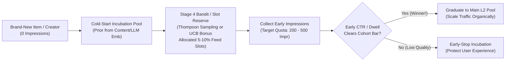

### 4.3 Multi-Stakeholder & Two-Sided Marketplace Balancing

Recommendations rarely serve a single party. In content platforms (YouTube, TikTok, Spotify) and two-sided marketplaces (DoorDash, Airbnb, LinkedIn), Stage 4 mediates a three-way tension:

```
THE THREE-STAKEHOLDER TUG-OF-WAR AT STAGE 4:

                   ┌──────────────────────────┐
                   │   CONSUMERS (Users)      │
                   │ • Relevance & Diversity  │
                   │ • Low Ad Load / Fatigue  │
                   │ • Long-Term Retention    │
                   └────────────┬─────────────┘
                                │
             ┌──────────────────┴──────────────────┐
             ▼                                     ▼
┌─────────────────────────┐          ┌──────────────────────────┐
│  PROVIDERS (Creators /  │◄────────►│  PLATFORM (Business &    │
│  Merchants / Sellers)   │          │  Trust / Safety)         │
│ • Fair Exposure Floors  │          │ • Sustainable Ad Revenue │
│ • Cold-Start Incubation │          │ • Borderline Demotion    │
│ • Low Exposure Gini     │          │ • Legal & Policy Safety  │
└─────────────────────────┘          └──────────────────────────┘
```

*   **Formal Fairness Taxonomy (Consumer vs. Provider Fairness):** Production fairness audits separate **Consumer-Side Fairness** (ensuring different user demographics receive comparable recommendation quality, job opportunities, and pricing) from **Provider-Side Fairness** (ensuring creators, merchants, and sellers receive fair exposure), operationalized across five standard definitions:
    1.  **Demographic Parity (Statistical Parity):** Exposure or positive recommendation rates are equal across protected groups regardless of base rates.
    2.  **Equal Opportunity:** True-positive exposure rate is equal across groups—equally qualified providers/candidates receive equal visibility regardless of group membership.
    3.  **Individual Fairness:** Similar items or users (in a task-relevant metric space) receive similar ranking outcomes (*"treat like cases alike"*).
    4.  **Calibrated Fairness:** Exposure or category distribution matches a group's empirical relevance or merit share (e.g., exposure proportional to average item quality).
    5.  **Counterfactual Fairness:** A ranking decision would remain invariant had a sensitive attribute (e.g., gender or ZIP code proxy) been counterfactually changed while holding causal non-sensitive factors fixed.
*   **Provider-Side Exposure Fairness:** Pure relevance creates a severe **Matthew Effect** (winner-take-all concentration where the top 1% of creators capture 80%+ of impressions, measured by an **Exposure Gini Index** $`G \to 1`$). If mid-tail and new creators get zero audience, they stop publishing, shrinking catalog freshness and hurting consumers months later.
    *   **Post-Processing Fairness Re-Ranking (e.g., Spotify ILP / Calibrated Contextual Bandits):** Enforce either **Minimum Exposure Floors** (e.g., emerging creators receive at least $`5\%`$ of impressions) or **Relative Exposure Proportionality** via Integer Linear Programming (ILP) or Lagrangian dual multipliers (detailed in Section 6.1).
    *   **Anti-Power-User / Hub Demotion:** In social networks and graph-based feeds, mega-accounts and hyper-active "hub" nodes dominate co-occurrence graphs and crowd out ordinary creators. Stage 4 applies sub-linear degree/exposure damping (e.g., penalizing items whose creator's rolling 24h impression share exceeds a soft cap) to keep social graphs vibrant for everyday users.
    *   **Multi-Sided Marketplace Saturation:** On food-delivery or ride/lodging marketplaces, sending 100% of users to the top-1 restaurant creates kitchen delays and cancellations—moderate provider diversification *improves* consumer satisfaction too!
*   **Cross-Session Temporal Diversity:** Single-slate diversity (MMR/DPP within 10 items) still permits **multi-session echo chambers** where a user sees the exact same 5 topics across 20 consecutive sessions. Stage 4 tracks each user's **cross-session rolling topic exposure histogram** (e.g., 7-day decayed counts in Redis) and applies gentle cross-session repetition penalties so diversity compounds across days, not just within one viewport.
*   **Platform Health & Borderline Content Demotion:** Content that sits just below the hard policy-removal threshold (sensational clickbait, outrage bait, low-quality engagement farming) often achieves *artificially high* L2 $`\hat{p}_{\text{click}}`$. Production re-rankers apply **continuous demotion multipliers** (e.g., $`\text{score} \times (1 - \beta \cdot \hat{p}_{\text{borderline}})`$) rather than binary bans, sharply reducing viral distribution of borderline content while avoiding censorship false positives.
*   **System-Level Fairness Warning (ICML 2025):** Auditing or fixing Stage 4 alone cannot guarantee end-to-end fairness if Stage 1 Retrieval systematically omits underrepresented providers from the top-100 pool. True marketplace fairness requires coordinated recall floors in Stage 1 paired with exposure calibration in Stage 4.

---

## 5. Ads-Organic Blending, Auctions & Real-Time Budget Pacing

For monetized platforms (Google, Meta, TikTok, Pinterest, DoorDash, Amazon, LinkedIn), Stage 4 is also where **the organic recommendation pipeline meets the ads auction pipeline**. Both funnels run in parallel to protect end-to-end latency, converging at Stage 4 to construct a single monetized slate.

### 5.1 Unified Ad Auctions: eCPM, Reserve Pricing, GSP vs. VCG

#### Translating Bids into Expected Revenue (eCPM)
Advertisers bid on different funnel events—**CPM** (per 1,000 impressions), **CPC** (per click), or **CPA / oCPM** (per downstream conversion/order). To compare heterogeneous bids on a single apples-to-apples scale per impression, the auction converts every bid into **effective Cost Per Mille (eCPM)**:

```math
\text{eCPM}_{\text{CPC}} = \text{Bid}_{\text{CPC}} \times \hat{p}_{\text{CTR}} \times 1000, \qquad \text{eCPM}_{\text{CPA}} = \text{Bid}_{\text{CPA}} \times \hat{p}_{\text{CTR}} \times \hat{p}_{\text{CVR}} \times 1000
```

In production, ads are ranked by a **Total Ad Value** (or Rank Score) combining expected revenue with ad quality/user experience and filtered by a **Reserve Price** $`r_{\min}`$ (the minimum eCPM required to justify consuming an ad slot):

```math
\text{RankScore}_i = \text{eCPM}_i + \alpha \cdot \text{AdQuality}_i, \qquad \text{Eligible iff } \text{RankScore}_i \ge r_{\min}
```

> **Why Calibration Is Existential Here:** Notice that $`\hat{p}_{\text{CTR}}`$ and $`\hat{p}_{\text{CVR}}`$ are multiplied directly by real dollars! As established in Part 2, a $`2\times`$ over-prediction on an ad inflates its eCPM $`2\times`$, letting low-relevance ads beat high-relevance ads, overcharging advertisers, and eroding platform trust.

#### GSP (Generalized Second Price) vs. VCG (Vickrey-Clarke-Groves)
Suppose we have $`K`$ ad slots on a page with strictly decreasing position examination rates (click-through multipliers) $`\alpha_1 \gt \alpha_2 \gt \dots \gt \alpha_K \gt 0`$ (estimated via position-conditional calibration heads, e.g., multi-head calibration). Every advertiser $`i`$ has a true value per click $`v_i`$ (or per conversion) and submits a bid $`b_i`$. For simplicity, assume equal base relevance $`q_i = 1`$ so expected value at slot $`k`$ is $`\alpha_k b_i`$.

1.  **GSP (Generalized Second Price):**
    *   Sort advertisers by $`b_1 \ge b_2 \ge \dots \ge b_n`$ and assign advertiser $`k`$ to slot $`k`$.
    *   Advertiser $`k`$ pays the **next bidder's bid per click**: $`p_k^{\text{GSP}} = b_{k+1}`$ (so expected total payment per impression is $`\alpha_k b_{k+1}`$).
    *   *Flaw:* **GSP is NOT Dominant-Strategy Incentive-Compatible (DSIC / truthful)!** A top bidder can sometimes lower their bid, drop to slot 2, pay a much cheaper per-click price, and earn *higher* net profit. This forces advertisers into noisy bid-shading games and destabilizes auction revenue.

2.  **VCG (Vickrey-Clarke-Groves — Externality Pricing):**
    *   Allocation is identical (maximize total social welfare: assign highest $`v_i`$ to highest $`\alpha_k`$).
    *   **Payment Rule:** Each winning advertiser $`i`$ pays the **exact negative externality (harm) their presence imposes on all *other* advertisers**:

```math
P_i^{\text{VCG}} = \underbrace{\sum_{j \neq i} \alpha_{\pi_{-i}(j)} b_j}_{\text{Others' welfare WITHOUT } i} - \underbrace{\sum_{j \neq i} \alpha_{\pi(j)} b_j}_{\text{Others' welfare WITH } i}
```

Because bidder $`i`$'s own bid $`b_i`$ never appears in their payment formula (it only determines *whether* they win and which slot they get), **bidding truthfully ($`b_i = v_i`$) is a mathematically dominant strategy!**

#### Worked 3-Bidder, 2-Slot Numerical Comparison (GSP vs. VCG)
Suppose 2 ad slots have click rates $`\alpha_1 = 0.10`$ (Slot 1) and $`\alpha_2 = 0.06`$ (Slot 2), with $`\alpha_3 = 0`$ (unshown). Three advertisers have true click values:
*   **Advertiser A:** $`v_A = \$10`$, **Advertiser B:** $`v_B = \$6`$, **Advertiser C:** $`v_C = \$2`$.

Suppose all three bid truthfully ($`b_A = \$10, b_B = \$6, b_C = \$2`$):
*   Allocation: **A gets Slot 1** ($`\alpha_1 = 0.10`$), **B gets Slot 2** ($`\alpha_2 = 0.06`$), **C gets nothing**.

| Metric | Under GSP | Under VCG |
| :--- | :--- | :--- |
| **A's Expected Payment** | $`\alpha_1 b_B = 0.10 \times \$6 = \mathbf{\$0.60}`$ ($`\$6.00/\text{click}`$) | $`(\alpha_1 - \alpha_2) b_B + (\alpha_2 - 0) b_C = (0.04)(\$6) + (0.06)(\$2) = \$0.24 + \$0.12 = \mathbf{\$0.36}`$ ($`\$3.60/\text{click}`$) |
| **A's Net Surplus ($`\alpha_1 v_A - P_A`$)** | $`0.10(\$10) - \$0.60 = \mathbf{\$0.40}`$ | $`0.10(\$10) - \$0.36 = \mathbf{\$0.64}`$ |
| **B's Expected Payment** | $`\alpha_2 b_C = 0.06 \times \$2 = \mathbf{\$0.12}`$ ($`\$2.00/\text{click}`$) | $`(\alpha_2 - 0) b_C = 0.06 \times \$2 = \mathbf{\$0.12}`$ ($`\$2.00/\text{click}`$) |
| **B's Net Surplus ($`\alpha_2 v_B - P_B`$)** | $`0.06(\$6) - \$0.12 = \mathbf{\$0.24}`$ | $`0.06(\$6) - \$0.12 = \mathbf{\$0.24}`$ |

**Now watch Advertiser A try to game the auction by shading their bid down to $`b_A' = \$5`$ (dropping to Slot 2):**
*   **Under GSP:** B moves to Slot 1, A takes Slot 2 and pays $`b_C = \$2/\text{click}`$ ($`P_A' = 0.06 \times \$2 = \$0.12`$). A's new surplus is $`0.06(\$10) - \$0.12 = \mathbf{\$0.48} \gt \$0.40`$! **A profitably cheated GSP!**
*   **Under VCG:** A takes Slot 2 and pays $`\$0.12`$, earning surplus $`0.06(\$10) - \$0.12 = \mathbf{\$0.48} \lt \$0.64`$! **Cheating strictly hurt A under VCG!**

**Production Trade-Off:** Meta (Facebook/Instagram) famously adopted **VCG** for feed auctions specifically because truthful bidding simplifies automated advertiser bidding and cleanly generalizes to heterogeneous ad formats (e.g., a large video ad displacing two small organic/ad slots!). Google Search historically used **GSP** (with reserve prices and quality squashing) because GSP is simpler to explain to SMB advertisers ("you pay the bid below you") and yields equal or slightly higher revenue at the symmetric Nash equilibrium—though modern auto-bidding platforms increasingly blend VCG-like externality pricing across slots.

*   **The Modern Shift — Auto-Bidding Equilibrium (Target-CPA / Target-ROAS):** Most major ad spend today is no longer manual per-click bidding; advertisers specify a **Target-CPA** or **Target-ROAS** constraint and hand bidding control to the platform's **auto-bidder**. Under value-maximizing auto-bidding (maximizing conversions subject to a return-on-spend constraint rather than quasi-linear profit), classical single-shot GSP/VCG truthfulness theorems no longer hold automatically—pushing modern auction research toward **coupled auto-bidding equilibria** and joint mechanism design across ad auctions and dynamic organic-ad allocation.

### 5.2 Ads-Organic Blending: Fixed Slots vs. Dynamic Unified Allocation

How should winning ads be interleaved into the organic feed?

#### 1. Fixed-Slot Insertion (Legacy Baseline)
Hardcode ad slots at positions `[3, 8, 15, 23]`. Organic items fill all remaining slots.
*   *Why it is suboptimal:* Suppose a user opens a high-commercial-intent search (*"best running shoes under \$150"*) where 3 ultra-relevant sponsored products have high utility—fixed slots leave revenue on the table. Conversely, suppose a user opens a breaking-news crisis feed where the best eligible ad is completely irrelevant—a fixed slot forces a jarring, low-quality ad into position 3, damaging user trust!

#### 2. Dynamic Unified Blending (Modern Production Standard)
Score both organic items and ads in the **same currency** (dollar-equivalent total platform value) at every candidate slot $`k`$:

```math
\text{Score}_{\text{ad}}(i, k) = \text{eCPM}_i + \alpha \cdot \text{Quality}_{\text{ad}}(i) - \beta(u) \cdot \text{AdLoadPenalty}(k)
```

```math
\text{Score}_{\text{organic}}(j, k) = \gamma \cdot \text{Value}_{\text{organic}}(j)
```

*   **Pricing Organic Engagement in Dollars (Shadow Price $`\gamma`$):** What is one organic long-dwell or save worth in dollars? Teams estimate $`\gamma`$ (the **marginal exchange rate between organic utility and ad revenue**) in two complementary ways:
    1.  **Long-Term Value (LTV) Derivation:** Estimate the causal retention lift of an extra organic engagement (e.g., $`\Delta\text{Sessions}_{30\text{d}}`$) multiplied by average ad revenue per session ($`\text{ARPS}`$).
    2.  **Empirical Pareto Frontier Calibration:** Sweep $`\gamma`$ across randomized A/B buckets to trace the **Ad Revenue vs. Organic Engagement/Retention Pareto Curve**, then pick $`\gamma`$ where the marginal slope $`\Delta\text{Revenue} / \Delta\text{Retention}`$ matches executive platform strategy (or equivalently, treat $`\gamma`$ as the **Lagrangian dual variable** of a global platform ad-load or organic-retention constraint!).
*   **Mandatory Blending Guardrails:** Even under dynamic blending, enforce hard UX, safety, and regulatory rules:
    *   **Minimum Ad Spacing:** Never show two ads back-to-back (e.g., at least $`m = 3`$ organic items between ads) and never place an ad at Slot 1 on pure discovery feeds.
    *   **Organic-Ad Deduplication:** If Store X already won organic Slot 1, suppress Store X's sponsored ad in Slots 2–5 so the user doesn't see duplicate cards (and the advertiser isn't charged for an organic conversion!).
    *   **Minimum Relevance Floor:** Suppress any ad with $`\hat{p}_{\text{CTR}} \lt \tau_{\min}`$ or high predicted hide probability $`\hat{p}_{\text{hide}}`$ regardless of how high the advertiser bids.
    *   **Brand Safety & Contextual Adjacency:** Enforce real-time semantic adjacency exclusions so sponsored ads are never placed directly above or below crisis news, tragedy coverage, or sensitive/borderline organic posts (protecting brand advertisers from toxic context).
    *   **Regulated Delivery Fairness (Housing / Employment / Credit — HEC):** For legally protected verticals (HEC), delivery optimization cannot allow learned CTR biases to skew ad reach across protected demographic groups; Stage 4 applies variance-reduction / demographic-parity variance constraints (e.g., Meta's Variance Reduction System) on top of auction outcomes.
    *   **Advertiser Cold-Start Priors & Real-Time Hide-Rate Circuit Breaker:** New ad creatives use hierarchical Bayesian/content priors (from advertiser historical quality and multimodal creative embeddings) to avoid cold-start starvation, backed by a **real-time negative-feedback circuit breaker** that immediately pauses or throttles any creative whose rolling hide/report rate spikes above cohort bounds.

#### 3. Personalized Ad-Load / Fatigue Control via Uplift Modeling
Not all users tolerate ads equally! A casual new user on day 2 may churn permanently if shown 15% ad load, whereas a high-commercial-intent shopper browsing product categories happily engages with 20% native shopping ads. By personalizing the ad-load penalty $`\beta(u)`$ via **causal uplift modeling** (estimating each user cohort's retention elasticity to an extra ad impression), platforms shift ad load *away* from churn-sensitive users and *toward* ad-tolerant / commercial-intent sessions—achieving a **win-win** (higher total revenue *and* higher platform retention!).

*   **Beyond Ads — Promotion/Discount Knapsack Allocation & The Discount Dependency Trap:** The exact same Stage 4 uplift + constrained optimization machinery governs **personalized coupons and free-delivery promotions** on marketplaces (e.g., DoorDash, Uber Eats, Booking). Solving a fractional knapsack over estimated incremental order uplift per promo dollar allocates finite subsidy budgets strictly to **persuadable** users rather than "sure things" (who would order anyway)—avoiding the **Discount Dependency Trap** where over-subsidized cohorts learn to never purchase at full price.

#### 4. Measuring True Ad Incrementality (Ghost Ads)
Blended ads frequently cannibalize clicks that would have happened organically. **Ghost Ads** solve attribution dilution: in a control bucket, the auction runs normally, the winning ad is *replaced* by the next organic item, and the system logs a **"ghost impression"** (*"Ad X would have won slot 2 here"*). Comparing conversion rates strictly on users who triggered actual vs. ghost impressions yields unbiased **Incremental ROAS (iROAS)** with up to **90%+ lower variance** than naive Intent-to-Treat A/B tests.

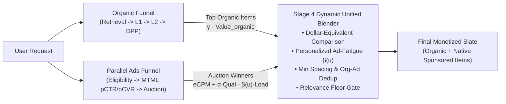

### 5.3 Real-Time Budget Pacing: Probabilistic Throttling vs. Bid Shading & PID Control

Advertisers specify finite daily or lifetime campaign budgets (e.g., $`\$100/\text{day}`$). Without pacing, an aggressive campaign wins every early morning auction, **exhausts its entire budget by 1:00 PM**, and vanishes completely before the high-intent 5:00–8:00 PM peak—hurting both advertiser ROI and platform auction liquidity (fewer competing bidders at dinner peak means lower second-price clearing prices!).

#### Approach 1: Probabilistic Throttling (Random Participation)
*   Assign each campaign $`c`$ a participation probability (**Pass-Through Rate, `PTR`**) $`p_c(t) \in [0, 1]`$, calibrated against each request's **position-adjusted expected charge per impression** so expected spend matches the target spend curve. For each eligible request, flip a biased coin: with probability $`p_c(t)`$, enter the auction at full bid; otherwise skip.
*   *Pros:* Trivial to implement and preserves truthful full-bid signaling in GSP/VCG auctions.
*   *Cons:* **Economically wasteful!** Flipping a random coin drops high-value evening auctions ($`\text{pCVR} = 0.25`$) with the exact same probability as low-value afternoon auctions ($`\text{pCVR} = 0.02`$).

#### Approach 2: Multiplicative Bid Shading (Optimal Dual Pacing)
*   Instead of skipping requests randomly, **scale the campaign's bid continuously** via a pacing multiplier $`\mu_c(t) \in (0, 1]`$ (or $`\mu_c(t) \in [0.2, 1.5]`$ when optimizing for target spend across peak hours, as in DoorDash's **Smart Fast Finish**):

```math
\text{bid}_{\text{eff}, c}(t) = \mu_c(t) \cdot \text{bid}_c
```

*   *Why Bid Shading Beats Throttling:* From convex optimization, the exact optimal solution to maximizing advertiser surplus subject to a daily spend cap $`\sum_t c_t x_t \le B`$ is $`\text{bid}_{\text{eff}} = \frac{1}{1 + \lambda_c} \text{bid}_c`$ for a **quasi-linear profit-maximizing** advertiser (whereas a pure **value-maximizing auto-bidder**—such as Target-CPA or Target-ROAS—bids $`\text{bid}_{\text{eff}} = \frac{1}{\lambda_c} \text{bid}_c`$), where $`\lambda_c \ge 0`$ is the campaign's Lagrangian dual multiplier! Shading automatically **wins the cheapest, highest-ROI auctions first** and naturally drops out of overpriced auctions.

#### Real-Time PID Controller for Smooth Pacing
Because live ad traffic is non-stationary (lunch spikes, live sports events, delayed conversion attribution), static multipliers drift rapidly. Production pacing engines compute a **traffic-weighted target spend curve** $`S_c^*(t)`$ (allocating more budget to forecasted peak hours) and run a closed-loop **Positional Log-Space PID (Proportional–Integral–Derivative) Controller** every $`1 - 5\text{ minutes}`$ per active campaign:

```math
e_c(t) = \frac{S_c^*(t) - S_c(t)}{B_c} \qquad (\text{normalized spend error: positive = underspending})
```

```math
u_c(t) = K_p \cdot e_c(t) + K_i \sum_{\tau=1}^{t} e_c(\tau) + K_d \big(e_c(t) - e_c(t-1)\big)
```

```math
\mu_c(t+1) = \text{clip}\!\Big(\mu_0 \cdot \exp\big(u_c(t)\big), \; \mu_{\min}, \; \mu_{\max}\Big)
```

*   **Why Positional Log-Space (Avoiding a Double Integrator):** Notice that $`\mu_c(t+1)`$ multiplies the **fixed baseline** $`\mu_0`$ (typically $`\mu_0 = 1.0`$) by $`\exp(u_c(t))`$, *not* $`\mu_c(t) \cdot \exp(u_c(t))`$. Because $`u_c(t)`$ already contains the integral term $`K_i \sum_\tau e_c(\tau)`$, multiplying by $`\mu_c(t)`$ would integrate the error a *second* time (creating an unstable double integrator prone to severe ringing!). If an implementation instead prefers an incremental/velocity update $`\mu_c(t+1) = \text{clip}(\mu_c(t) \cdot \exp(\Delta u_c(t)))`$, it must differentiate the PID terms: $`\Delta u_c(t) = K_p (e_c(t) - e_c(t-1)) + K_i e_c(t) + K_d (e_c(t) - 2 e_c(t-1) + e_c(t-2))`$.
*   **Proportional ($`K_p`$):** Reacts immediately to current over/under-spend.
*   **Integral ($`K_i`$):** Eliminates persistent steady-state offset (e.g., if auction clearing prices are structurally higher today than forecasted). Always apply **anti-windup clamping** to the integral sum so a paused campaign doesn't accumulate huge integral debt!
*   **Derivative ($`K_d`$):** Dampens overshoot and oscillation when spend accelerates suddenly.
*   **Delayed Conversion Attribution Buffer (CPA Pacing):** In CPA campaigns, a user may click at 2:00 PM and convert at 7:00 PM. If the PID controller only counts *confirmed* spend $`S_c(t)`$, it thinks the campaign is underspending at 3:00 PM, cranks up $`\mu_c`$, and massively overspends the budget! Production CPA pacers compute **expected accrued spend** $`\tilde{S}_c(t) = S_{\text{confirmed}}(t) + \sum_{\text{pending clicks}} \text{Bid}_c \cdot \hat{p}_{\text{CVR} \mid \text{click}}`$.

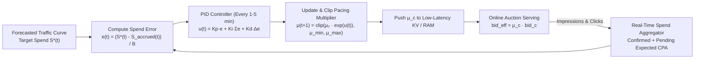

---

## 6. Global Constrained Optimization & Cross-Channel Orchestration

Up to this point, every algorithm we designed operates **within a single user request**. Yet the hardest production problems in recommendation systems involve **global, cross-request constraints** spanning millions of users over an entire day or week:

*   *"Guarantee that cold-start creators collectively receive at least $`8\%`$ of daily feed impressions."*
*   *"Keep total daily platform push notifications below $`50\text{M}`$ (or member opt-out rate below $`0.15\%`$)."*
*   *"Maintain a minimum platform ad revenue floor while maximizing long-term user retention."*
*   *"Never exceed a regional restaurant's kitchen capacity of 40 orders per 15-minute window."*

You **cannot** solve a billion-variable linear program inside a $`10\text{ms}`$ real-time RPC! So how do billion-user platforms enforce global constraints across 100,000 QPS independently? The answer is one of the most powerful mathematical tools in industrial ML: **Lagrangian Relaxation & Primal-Dual Optimization**.

### 6.1 Primal-Dual Optimization & Lagrangian Relaxation at Web Scale

#### Formulating the Global Constrained Program
Consider all user-item serving opportunities $`(u, i)`$ across a day (say $`10^9`$ decisions $`x_{ui} \in [0, 1]`$, where $`x_{ui} = 1`$ means showing item $`i`$ to user $`u`$). Suppose we want to maximize total primary utility $`u_{ui}`$ subject to $`M`$ global platform constraints (e.g., upper bounds like notification/ad-load caps, or lower bounds like creator exposure floors written as negative costs):

```math
\max_{x \in \mathcal{X}} \sum_{u, i} u_{ui} \, x_{ui} \qquad \text{subject to} \qquad \sum_{u, i} c_{j, ui} \, x_{ui} \le B_j \quad \forall j \in \{1, \dots, M\}
```

#### The Lagrangian Magic: Turning Global Constraints into Per-Request Scores
Introduce a non-negative **dual variable (shadow price)** $`\lambda_j \ge 0`$ for each global constraint $`j = 1, \dots, M`$ and form the Lagrangian:

```math
\mathcal{L}(x, \lambda) = \sum_{u, i} u_{ui} \, x_{ui} - \sum_{j=1}^{M} \lambda_j \left( \sum_{u, i} c_{j, ui} \, x_{ui} - B_j \right) = \sum_{u, i} \left( u_{ui} - \sum_{j=1}^{M} \lambda_j \, c_{j, ui} \right) x_{ui} + \sum_{j=1}^{M} \lambda_j B_j
```

Pause and admire that algebraic rearrangement! **Once the scalar vector $`\lambda = (\lambda_1, \dots, \lambda_M)`$ is fixed, the billion-variable coupled problem completely decouples across individual user requests!**

At online serving time, each independent request for user $`u`$ simply scores every candidate $`i`$ using its **Dual-Adjusted Serving Score** in **$`O(M)`$ microseconds**:

```math
\text{ServingScore}(u, i; \lambda) = u_{ui} - \sum_{j=1}^{M} \lambda_j \, c_{j, ui}
```

*   For an **upper-bound cap** (e.g., max notifications, $`c_{j,ui} = +1`$): $`\lambda_j \ge 0`$ acts as an **additive penalty** (raising the bar to send).
*   For a **lower-bound exposure floor** (e.g., min exposure for emerging creators, written $`\sum (-1)\cdot x_{ui} \le -B_{\text{floor}}`$, so $`c_{j,ui} = -1`$): $`-\lambda_j (-1) = +\lambda_j`$ acts as an **additive boost** for emerging creators!

#### Worked Numerical Example: Solving Cold-Start Creator Exposure Smoothly
Suppose our platform wants emerging creators (Group $`E`$) to receive a floor of $`B_E = 10\%`$ of daily impressions, with minimum loss in relevance.
*   Every request has 2 top candidates: Established Creator ($`u = 0.60`$) and Emerging Creator ($`u = 0.52`$, gap $`= 0.08`$), while on another user's request the Emerging Creator is far weaker ($`u = 0.15`$ vs. $`0.60`$, gap $`= 0.45`$).
*   If the nearline dual solver finds shadow price $`\lambda_E = 0.10`$:
    *   **User 1 (small relevance gap $`0.08`$):** Emerging adjusted score $`= 0.52 + 0.10 = \mathbf{0.62} \gt 0.60`$ $`\implies`$ **Emerging Creator wins!** (Platform pays only $`0.08`$ relevance cost.)
    *   **User 2 (huge relevance gap $`0.45`$):** Emerging adjusted score $`= 0.15 + 0.10 = 0.25 \lt 0.60`$ $`\implies`$ **Established Creator wins!** (Platform avoids showing an irrelevant item.)
*   Compare that to a brittle hard rule ("force 1 emerging creator into every 10th request regardless of user match"): **the Lagrangian dual automatically buys the $`10\%`$ creator exposure from the exact users where emerging creators are *already* nearly as relevant as established creators**, achieving the **mathematically provable minimum possible relevance loss**!

#### Offline / Nearline Dual Update Loop
How do we compute $`\lambda_j`$? Either solve the dual offline on yesterday's sampled traffic via L-BFGS / Mirror Descent (e.g., LinkedIn's large-scale primal-dual LP solver **`DuaLip`**—*Dual Decomposition based Linear Program Solver*, Ramanath et al., LinkedIn, originally Spark/Scala and now PyTorch/GPU-accelerated), or update $`\lambda_j`$ continuously nearline every $`5 - 15\text{ minutes}`$ via projected dual subgradient ascent:

```math
\lambda_j^{(t+1)} = \max\!\Big(0, \; \lambda_j^{(t)} + \eta_t \big(\text{ActualUsage}_j^{(t)} - B_j^{(t)}\big)\Big)
```

If actual exposure/volume exceeds target $`B_j`$, $`\lambda_j`$ increases (tightening the penalty); if it falls below target, $`\lambda_j`$ decreases (relaxing the penalty). Only $`M`$ tiny floating-point numbers ($`M \sim 10 - 10,000`$) are pushed to serving RAM!

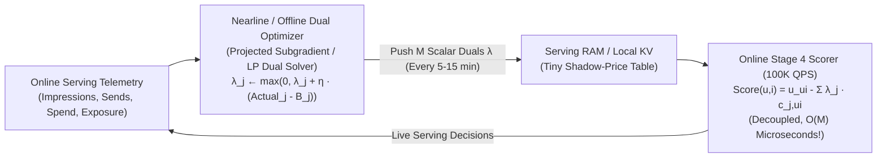

### 6.2 LinkedIn Air Traffic Controller (ATC) & Cross-Channel Orchestration

Notifications (mobile push, email, in-app badges) represent a uniquely high-stakes Stage 4 problem: unlike a feed item the user can passively scroll past, **a bad push notification actively interrupts the user's day** and risks triggering a permanent **channel opt-out (disable)**—destroying years of future re-engagement value!

**LinkedIn's Air Traffic Controller (ATC)** is the canonical industrial blueprint for cross-channel orchestration, framed around the **"5 Rights"**: *Right Message, Right Member, Right Channel, Right Time, Right Frequency*.

#### Architecture of Cross-Channel Orchestration
Unlike pull-based feeds (user opens app $`\to`$ retrieve items), notifications are **event-driven push funnels**:
1.  **Near-Real-Time Fanout & Pre-Filtering (`Concourse`):** When an event fires (a connection posts, a job matches), fan out to eligible recipients using **recipient-based partitioning** where each scorer host keeps its member-ID range's features in **local KV RAM** (zero cross-network feature fetches during million-follower celebrity fanouts; apply aggressive relevance gating and digest batching for celebrity posts).
2.  **Per-Notification Relevance & Annoyance Scoring:** A lightweight multi-task ranker predicts both $`\hat{p}(\text{act})`$ (open/visit) and $`\hat{p}(\text{disable})`$ (opt-out/dismiss). Net immediate utility explicitly prices long-term channel risk:

```math
\text{Utility}(n, u, \text{ch}) = \hat{p}(\text{act} \mid \text{ch}) \cdot V_{\text{act}} - \hat{p}(\text{disable} \mid \text{ch}) \cdot \text{LTV}(\text{ch}) - \lambda_{\text{vol}}(u) \cdot \text{Cost}(\text{ch})
```

Notice the **channel cost asymmetry**: in-app badges are low-intrusion (low $`\text{Cost}`$); email is medium-intrusion and digest-friendly; mobile push is high-intrusion and demands the steepest utility bar.

3.  **Stateful Streaming Portfolio Optimization (Offline RL $`\to`$ Decision Transformer):**
    *   *The Core Paradox:* Notifications arrive **one event at a time as an unpredictable stream**, yet ATC must optimize a **multi-day portfolio** across all of a member's notifications!
    *   *The Solution:* Track each member's running **fatigue & budget state** (notifications sent in last 1h/24h/7d, recent dismiss streaks, channels used) in a real-time stream processor (Apache Samza / Flink). Every incoming decision (`drop`, `in-app`, `in-app + push`, `email`, or `defer`) is conditioned on that state—so even a high-relevance notification is downgraded or deferred if the member is already near their personalized fatigue threshold.
    *   *Evolution from CQL to Decision Transformers (DT):*
        *   **Phase 1 (Offline RL — Conservative Q-Learning / CQL):** Trained an offline RL agent on logged notification trajectories to maximize multi-objective long-term return $`R = w_{\text{sess}}\text{Sessions} - w_{\text{vol}}\text{Volume} - w_{\text{dis}}\text{Disables}`$ while CQL penalized out-of-distribution actions to prevent unsafe online exploration. *Limitation:* Bellman backups were unstable at scale and required retraining a separate policy whenever business preference weights $`w`$ changed!
        *   **Phase 2 (Decision Transformer with Return-to-Go Prompts):** Reframed sequential volume control as **return-conditioned supervised sequence modeling**! At inference, a fixed-size per-member **Circular (Ring) Buffer** feeds the member's last $`N`$ `(state, action, outcome)` tokens in $`O(1)`$ memory, prompted with **learned quantile-regression Return-to-Go (RTG)** targets (e.g., *"high sessions, low volume"*). One trained model can be steered across the sessions-vs-volume frontier at serving time without retraining—delivering **$`+0.72\%`$ sitewide sessions while *reducing* total notification volume!**
4.  **Decoupled Send-Time Optimization (STO) & Digest Deferral:**
    *   Urgent events (direct messages, live events) bypass STO and fire immediately.
    *   Non-urgent high-relevance notifications are held by a scheduler with `(deliver_at = best_hour_local, ttl)` using a cheap precomputed 24-hour per-member open-propensity lookup table, **re-checking pacing/opt-out eligibility right before release**—or rolled into a daily/weekly email digest when the member's push budget is full.

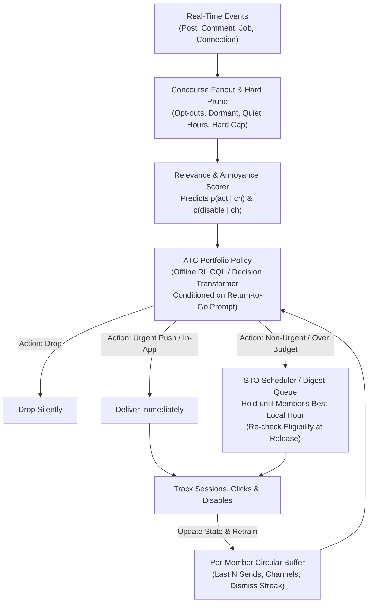

### 6.3 Hard Guardrails vs. Soft Lagrangian Multipliers

A hallmark of clean Stage 4 design is knowing **which constraints belong in deterministic hard rules vs. soft dual multipliers**:

```
HARD GUARDRAILS VS. SOFT LAGRANGIAN MULTIPLIERS:

  USE HARD DETERMINISTIC FILTERS WHEN:             USE SOFT DUAL MULTIPLIERS (λ_j) WHEN:
  ┌─────────────────────────────────────────┐      ┌─────────────────────────────────────────┐
  │ ✗ Violation is illegal, unsafe, or      │      │ ✓ Trade-offs are continuous & economic  │
  │   catastrophic (even 1 error is fatal)  │      │   (relevance vs. diversity / revenue)   │
  │ • Trust & Safety / Policy / Age-gating  │      │ • Ads-Organic shadow price (γ)          │
  │ • Out-of-stock inventory / Closed store │      │ • Creator/Provider exposure floors      │
  │ • Legal geo-licensing / User blocklists │      │ • Daily ad budget pacing (bid shading)  │
  │ • Exact seen-item deduplication         │      │ • Exploration / Freshness trade-off     │
  │ • Absolute safety ceiling (e.g., max    │      │ • Cross-channel notification pacing     │
  │   10 pushes/day hard backstop)          │      │   (soft fatigue shadow price)           │
  └─────────────────────────────────────────┘      └─────────────────────────────────────────┘
```

**Best Practice (Defense-in-Depth):** Combine soft Lagrangian multipliers for day-to-day smooth economic allocation *with* a loose hard guardrail ceiling as an emergency circuit breaker (e.g., Decision Transformer optimizes per-member push pacing softly, backed by an unbreakable hard ceiling of max $`N_{\max}`$ pushes/day in case of a model bug or traffic anomaly).

*   **Bayesian Optimization for Multi-Objective Stage 4 Weights:** Beyond dual variables tied to explicit volume caps, production Stage 4 pipelines typically carry 5–15 continuous hyper-parameters—diversity weight $`\lambda`$, DPP relevance temperature $`\alpha`$, Steck calibration strength, freshness decay rate, creator fairness floors, and multi-objective utility weights. Manual coordinate-descent A/B grids miss cross-parameter interactions and waste months of experiment capacity. Modern teams use **constrained Gaussian Process Bayesian Optimization** (e.g., Meta's Ax / BoTorch) over online multi-arm experiments—modeling both the primary objective and guardrail metrics jointly to locate the Pareto-optimal Stage 4 operating point in a fraction of the traffic budget.

---

## 7. Stage 4 Slate Evaluation Metrics & Online Guardrails

Pointwise L2 metrics (**GAUC**, **Normalized Entropy**, **LogLoss**) are **completely blind** to redundancy, calibration, diversity, and cross-item externalities! A slate of 10 duplicate sneakers scores *maximally* on pointwise NDCG if every duplicate is labeled relevant. Evaluating Stage 4 demands dedicated **slate-level offline metrics** and **long-horizon online guardrails**.

### 7.1 Offline Slate Metrics: Diversity, Coverage, Calibration & Intent

#### 1. Intra-List Diversity (ILD)
Measures the average pairwise dissimilarity (distance $`d(i, j) = 1 - \text{Sim}(i, j)`$) across all item pairs in the top-$`K`$ slate $`S`$:

```math
\text{ILD@}K = \frac{2}{K(K - 1)} \sum_{i \in S} \sum_{\substack{j \in S \\ j > i}} \big(1 - \text{Sim}(i, j)\big)
```

*   *Trade-off:* Pure ILD ignores relevance completely—you can game ILD to `1.0` by inserting completely random garbage items! Always evaluate ILD jointly with relevance (e.g., plotting the **NDCG@K vs. ILD@K Pareto curve**).

#### 2. $`\alpha`$-NDCG@K (Clarke et al., SIGIR 2008 — Redundancy-Penalized Intent Coverage)
Directly fixes standard NDCG's blindness to duplicate items! Assume each query/user has a set of latent intents/subtopics $`s \in \{1, \dots, M\}`$, and binary indicator $`J(d_k, s) \in \{0, 1\}`$ denotes whether item $`d_k`$ at rank $`k`$ covers subtopic $`s`$. Let $`c_{s, k-1}`$ be the number of items ranked *above* position $`k`$ that already covered subtopic $`s`$. The redundancy-penalized gain at rank $`k`$ decays geometrically by $`(1 - \alpha)`$ (typically $`\alpha = 0.5`$):

```math
G[k] = \sum_{s=1}^{M} J(d_k, s) \cdot (1 - \alpha)^{c_{s, k-1}}, \qquad \alpha\text{-DCG@}K = \sum_{k=1}^{K} \frac{G[k]}{\log_2(k + 1)}, \qquad \alpha\text{-NDCG@}K = \frac{\alpha\text{-DCG@}K}{\alpha\text{-IDCG@}K}
```

*   *Intuition:* With $`\alpha = 0.5`$, the **1st** sneaker covering subtopic "Sneakers" earns gain $`1.0`$; the **2nd** sneaker earns only $`0.5`$; the **3rd** earns $`0.25`$. Meanwhile, the 1st Jacket earns a full $`1.0`$—naturally rewarding diversified slates! *(Note: exact $`\alpha`$-IDCG is NP-hard, so offline pipelines approximate it via greedy submodular ordering.)*

#### 3. ERR-IA@K (Intent-Aware Expected Reciprocal Rank — Chapelle et al. / Agrawal et al., 2009)
Extends cascade user modeling across weighted user intents $`P(s \mid u)`$. Under the cascade model, a user scanning for intent $`s`$ stops at slot $`k`$ with probability $`R(d_k, s) \in [0, 1]`$ if satisfied, and continues to slot $`k+1`$ only if unsatisfied by all previous slots $`1, \dots, k-1`$:

```math
\text{ERR-IA@}K = \sum_{s=1}^{M} P(s \mid u) \sum_{k=1}^{K} \frac{1}{k} \, R(d_k, s) \prod_{j=1}^{k-1} \big(1 - R(d_j, s)\big)
```

Unlike $`\alpha`$-NDCG (which weights all intents equally), **ERR-IA explicitly weights intents by $`P(s \mid u)`$** and rewards placing at least one strong hit for every high-probability intent near the top of the slate.

#### 4. Miscalibration ($`C_{\text{KL}}`$), Coverage, Gini Index, Novelty & Serendipity
*   **Mean Calibration Error:** Average Steck's smoothed $`C_{\text{KL}}(p(\cdot \mid u), \tilde{q}(\cdot \mid S_u))`$ across all users (lower is better; `0.0` = perfectly calibrated to user's historical taste proportions).
*   **Catalog & Creator Coverage:** Fraction of active items or creators receiving $`\ge 1`$ impression across the evaluation window (healthy feeds target $`\gt 50\%`$ active catalog coverage; $`\lt 20\%`$ signals severe popularity collapse).
*   **Exposure Gini Index:** Measures provider/item exposure inequality across $`M`$ items with impression counts $`e_1, \dots, e_M`$ (`0` = perfectly equal exposure, `1` = single item monopolizes 100% of traffic):

```math
\text{Gini} = \frac{\sum_{i=1}^{M} \sum_{j=1}^{M} |e_i - e_j|}{2 M \sum_{i=1}^{M} e_i}
```

*   **Novelty (Mean Self-Information):** Rewards surfacing long-tail items over ubiquitous blockbusters:

```math
\text{Novelty@}K = \frac{1}{K} \sum_{i \in S} -\log_2 P_{\text{pop}}(i)
```

*   **Serendipity:** Combines *unexpectedness* (distance from a naive popularity/baseline recommender $`S_{\text{base}}`$) multiplied by *actual user relevance* $`\text{rel}(u, i)`$: an item is serendipitous only if it was both **surprising AND genuinely enjoyed** (distinguishing true delight from noisy random exploration!).

### 7.2 Online Slate Guardrails & The Short-Term CTR vs. Long-Term Retention Paradox

The single biggest trap in Stage 4 experimentation is **killing a healthy diversity, calibration, or exploration launch after a 3-day A/B test because short-term CTR dipped!**

Why does this happen systematically?
*   On **Day 1–3**, replacing a user's 3rd near-duplicate high-pCTR item with a diverse or exploratory item lowers immediate raw click probability on slot 3 by **$`-1\% \text{ to } -3\%`$**.
*   Over **Days 7–30**, however, the control group suffers from feed monotony, filter-bubble fatigue, and declining session depth, while the diversified/exploratory treatment group discovers new creators/categories—producing a **$`+1\% \text{ to } +4\%`$ lift in 14-day/30-day retention, session length, and total active days!**

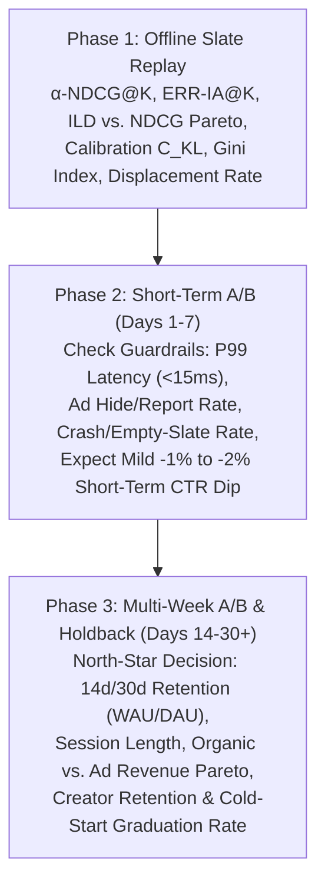

**Essential Stage 4 Online Guardrails Dashboard:**
1.  **User Satisfaction & Fatigue Guardrails:** Session length / depth, 14-day & 30-day retention (WAU/MAU), **Ad Hide / "Not Interested" / Report Rate**, Notification opt-out rate.
2.  **Monetization & Marketplace Guardrails:** **Organic Engagement vs. Ad Revenue Pareto Frontier**, Incremental ROAS (via Ghost Ads), budget utilization rate (fraction of campaigns finishing within 95–100% of daily budget without early-day exhaustion), and **New-Creator 7-Day Graduation Rate**.
3.  **Pipeline Health Guardrail (Re-Ranking Displacement Rate):** Track what percentage of top-$`K`$ slots are reordered or filtered out by Stage 4. Sudden spikes indicate upstream L2 calibration drift, broken feature freshness, or overly aggressive Stage 4 rules fighting the ranker.
4.  **Long-Term Holdback Groups:** Keep a persistent $`1\% - 2\%`$ control holdback over 4–8 weeks for major Stage 4 policy shifts (ad-load changes, notification throttling, diversity weight increases) because fatigue and habit formation manifest far slower than click rates.
5.  **Advertiser-Level Holdouts & Marketplace Equilibrium Shift:** In monetized auctions, standard user-split A/B tests suffer from **cross-arm budget leakage**—if Treatment raises an advertiser's win rate, that campaign burns through its shared daily budget faster in Treatment and starves Control, inflating apparent Treatment revenue! Evaluate auction, reserve-price, and pacing changes using **Advertiser-Level (or Budget-Split) Holdouts**, and monitor **Marketplace Equilibrium Shift** (CPC, CPM, and realized ROAS) for **4+ weeks post-launch** as advertisers and auto-bidders adapt their bids to the new auction dynamics.

---

## 8. Deep-Dive Interview Questions & Detailed Answers

### Question 1: Compare MMR, Fast Greedy DPP, and PRM for Stage 4 re-ranking. When do you choose each in production, and how does Fast Greedy DPP run in 1–2ms?

**Candidate Answer:**
"These three methods sit on a clear spectrum from lightweight pairwise repulsion to global geometric volume to learned cross-item synergy:

1.  **MMR ($`\lt 0.5\text{ms}`$):** Greedily picks $`\arg\max_i [\lambda \text{Rel}(i) - (1-\lambda)\max_{j \in S}\text{Sim}(i,j)]`$. With incremental caching of `max_sim[i]`, it runs in $`O(K N)`$. Choose MMR as your **V1 baseline** or for ultra-tight CPU budgets and 2D carousel horizontal/vertical spacing—it is simple, interpretable, and easy to tune per surface. Its weakness is that it is scale-sensitive and only looks at the *single* worst neighbor, missing multi-item subspace overlap.
2.  **Fast Greedy DPP ($`1 - 2\text{ms}`$ CPU):** Models slate probability via $`\det(L_S)`$, the squared parallelepiped volume spanned by quality-scaled vectors $`r_i \phi_i`$. Unlike MMR, DPP naturally penalizes *subspace* redundancy (if item 3 is a blend of items 1 and 2, its orthogonal residual collapses to zero!). Naively computing determinants costs $`O(K^4 N)`$, which is unusable online. **Chen et al. (Hulu, NeurIPS 2018)** reduced this to **$`O(K^2 N)`$** by maintaining an incremental Cholesky decomposition: at each step we simply pick $`j = \arg\max_i d_i^2`$, compute one scalar projection $`e_i = (L_{ji} - \langle c_j, c_i \rangle) / d_j`$ per candidate, and update $`d_i^2 \leftarrow d_i^2 - e_i^2`$. For $`N = 100, K = 20`$, that runs in ~1.5ms on CPU—making DPP the **gold standard for pure diversity optimization** (with Sliding-Window DPP for long infinite feeds where $`K \gt d`$).
3.  **PRM / Generator-Evaluator ($`2 - 4\text{ms}`$ GPU):** Both MMR and DPP assume *similarity is always bad*, so they penalize complementary pairs (like a camera + lens or a matching outfit). Choose **PRM** (Transformer self-attention with Personalized Vector injection over top-$`50`$ candidates) or a **Two-Stage Generator-Evaluator / NAR4Rec** when cross-item complementarity, visual aesthetics, or anchor pricing matter and you have GPU inference budget. In mature production feeds, teams frequently **stack them**: run PRM/NAR4Rec at Layer 1 to capture learned cross-item synergy, followed by lightweight DPP or business caps at Layer 2 to enforce strict redundancy floors."

---

### Question 2: Design a Dynamic Ads-Organic Blending system for a social or marketplace feed without tanking long-term user retention. How do you compare organic engagement against ad dollars?

**Candidate Answer:**
"Fixed ad slots (e.g., always placing an ad at positions 3, 8, and 15) are suboptimal because they under-monetize high-commercial-intent sessions and force jarring, low-relevance ads into organic discovery or breaking-news sessions.

I would build a **Dynamic Unified Blending** engine inside Stage 4 with four core components:

1.  **Parallel Pipelines with Shared Currency:** Run the Organic funnel and Ads funnel in parallel (so latency equals $`\max(T_{\text{org}}, T_{\text{ads}})`$, not the sum). At Stage 4, score every ad and organic candidate in **dollar-equivalent platform value**:

```math
\text{Score}_{\text{ad}}(i, k) = \text{eCPM}_i + \alpha \cdot \text{Quality}_{\text{ad}}(i) - \beta(u) \cdot \text{AdLoadPenalty}(k), \qquad \text{Score}_{\text{organic}}(j, k) = \gamma \cdot \text{Value}_{\text{organic}}(j)
```

2.  **Calibrating the Organic-to-Dollar Shadow Price ($`\gamma`$):** You cannot guess $`\gamma`$ arbitrarily. Start by estimating the **LTV exchange rate** (causal 30-day retention lift of an organic engagement $`\times`$ average ad revenue per session), then run a multi-bucket online sweep of $`\gamma`$ to map the **Ad Revenue vs. Retention Pareto Frontier**. Pick the operating point—or compute $`\gamma`$ dynamically via Lagrangian duality subject to a hard platform retention/ad-load guardrail.
3.  **Personalized Ad-Fatigue Control ($`\beta(u)`$):** Use **uplift modeling** to estimate each user cohort's churn sensitivity to incremental ad impressions. Increase $`\beta(u)`$ for new or churn-risk users (showing fewer, ultra-native ads) and decrease $`\beta(u)`$ for high-commercial-intent browsing sessions—raising both total revenue and average retention simultaneously.
4.  **Hard UX Guardrails & Incrementality Verification:** Enforce non-negotiable rules: minimum spacing (e.g., at least 3 organic slots between ads), organic-ad entity deduplication, and a hard minimum relevance / maximum hide-rate floor regardless of bid. Finally, evaluate true ad lift using **Ghost Ads** (measuring incremental ROAS rather than cannibalized organic clicks) and a 4-week **long-term holdback group** to catch delayed ad-fatigue churn."

---

### Question 3: Explain Steck's Calibrated Recommendations (RecSys 2018). Why does pure relevance fail a multi-interest user, why is $`\alpha`$-smoothing required, and when can calibration *hurt* a product?

**Candidate Answer:**
"Pure relevance optimization causes **interest collapse**: if a user historically watches 80% Comedy and 20% Sci-Fi, an L2 model with slightly higher confidence on Comedy will score Comedies at `0.82` and Sci-Fi at `0.74`. Sorting strictly by score outputs **100% Comedy and 0% Sci-Fi**—erasing the user's minority interest and reinforcing a filter bubble over future retraining cycles.

**Steck (RecSys 2018)** solves this in Stage 4 by greedily maximizing a submodular objective balancing slate relevance against the **KL-divergence** between the user's historical genre distribution $`p(g \mid u)`$ and the slate's genre distribution $`q(g \mid S)`$:

```math
S^* = \arg\max_{|S|=K} \left[ (1 - \lambda) s(S) - \lambda \, D_{\text{KL}}\big(p(\cdot \mid u) \parallel \tilde{q}(\cdot \mid S)\big) \right]
```

**Why $`\alpha`$-Smoothing & the Fixed-$`K`$ Surrogate Are Mandatory:** During greedy construction (and whenever a user's genre is missing from a candidate slate), $`q(g \mid S) = 0`$ while $`p(g \mid u) \gt 0`$. Standard KL divergence divides by zero ($`\log(p / 0) = +\infty`$), making it impossible to rank any partial slate until every single historical genre appears! Replacing $`q`$ with $`\tilde{q}(g \mid S) = (1-\alpha)q(g \mid S) + \alpha p(g \mid u)`$ (e.g., $`\alpha = 0.01`$) guarantees $`\tilde{q} \ge \alpha p \gt 0`$, keeping the penalty finite ($`\approx 4.6`$ nats for an omitted genre). One critical mathematical subtlety: under variable-$`|S|`$ normalization, $`-D_{\text{KL}}`$ is *neither* monotone nor submodular (and is non-positive); Steck (RecSys 2018, Appendix) proved the $`(1 - 1/e)`$ greedy guarantee on the **fixed-$`K`$ shifted surrogate** $`q_{\text{surr}}(g \mid S) = \frac{1}{K}\sum_{i \in S} p(g \mid i)`$ shifted by $`+\lambda \ln(1/\alpha)`$ for non-negativity, which matches exact $`q(g \mid S)`$ once $`|S| = K`$.

**When Calibration Hurts:**
1.  **No Discovery / Cold-Interest Lock-In:** Calibration strictly mirrors *past* behavior; it gives zero credit to brand-new genres ($`p(g \mid u) = 0`$), so it must be paired with bandit exploration.
2.  **Strong In-Session Intent Shift:** If a user who normally watches 80% Comedy opens the app on Friday night and explicitly searches for or watches 2 Sci-Fi trailers, forcing 80% Comedy back onto the screen fights their immediate intent! Production systems fix this by computing $`p(g \mid u)`$ with **exponential time decay** or using a contextual bandit (like Spotify's calibrated contextual bandits) to adjust target category proportions by time-of-day and session context."

---

### Question 4: New creators on your platform are getting starved of impressions by established stars. Why do hard per-request quotas break, and how do Primal-Dual Lagrangian multipliers solve this cleanly at 100,000 QPS?

**Candidate Answer:**
"Hard per-request rules like *'force 1 cold-start creator into slot 5 of every feed request'* are brittle and destroy relevance: they force an irrelevant new creator onto a picky user whose top established match scores `0.90` vs. the new creator's `0.10` (a `0.80` utility loss), while failing to give extra impressions on a casual user whose new-creator match scores `0.58` vs. `0.60` (only a `0.02` loss).

Instead, formulate creator incubation as a **Global Constrained Optimization** problem across the entire platform's daily traffic: maximize total user utility $`\sum_{u,i} u_{ui} x_{ui}`$ subject to the global exposure floor $`\sum_{u, i \in E} x_{ui} \ge B_E`$ (e.g., emerging creators receive at least $`8\%`$ of daily impressions).

By forming the **Lagrangian** with dual variable (shadow price) $`\lambda_E \ge 0`$, the billion-variable global constraint **completely decouples across individual user requests**:

```math
\text{ServingScore}(u, i) = u_{ui} + \lambda_E \cdot \mathbb{I}(i \in E)
```

*   **Why This Is Optimal:** A single scalar boost $`\lambda_E`$ automatically sources the $`8\%`$ emerging-creator impressions from the *exact user requests where an emerging creator is already within $`\lambda_E`$ of the top established item*—provably minimizing global relevance loss!
*   **Serving at 100,000 QPS:** An asynchronous nearline control loop (Flink/Spark every 5–10 minutes) compares actual emerging-creator impression share against the target curve $`B_E(t)`$ and updates $`\lambda_E \leftarrow \max(0, \lambda_E + \eta (B_E - \text{Actual}_E))`$, pushing a single float to serving RAM. Online Stage 4 simply adds $`\lambda_E`$ in nanoseconds.
*   **Essential Companion Guardrails:** Pair the dual boost with (1) a **minimum quality/safety floor** (so spam creators cannot abuse $`\lambda_E`$), (2) an **early-stopping incubation gate** (halt boosting once a new creator collects 300 impressions and fails to clear cohort dwell/CTR bars), and (3) a **Stage 1 Retrieval recall channel** for fresh creators (because Stage 4 cannot boost a creator that Retrieval never surfaced!)."

---

### Question 5: Prove intuitively why VCG is incentive-compatible while GSP encourages bid shading in multi-slot ad auctions, and explain what happens to both if your L2 $`\hat{p}_{\text{CTR}}`$ model drifts by +20%.

**Candidate Answer:**
"Consider 2 ad slots with position click rates $`\alpha_1 = 0.10`$ and $`\alpha_2 = 0.06`$, and three advertisers with true click values $`v_A = \$10`$, $`v_B = \$6`$, $`v_C = \$2`$.

*   **Under GSP**, Slot 1 pays Bidder 2's bid ($`\$6`$) on *all* $`0.10`$ clicks ($`\$0.60`$), leaving A with surplus $`\$1.00 - \$0.60 = \$0.40`$. If A shades their bid down to $`\$5`$, A drops to Slot 2, pays Bidder 3's bid ($`\$2`$) on $`0.06`$ clicks ($`\$0.12`$), and increases surplus to $`\$0.60 - \$0.12 = \$0.48 \gt \$0.40`$! Because GSP charges the higher price $`b_2`$ even on the $`0.06`$ clicks A *would have gotten in Slot 2 anyway*, GSP penalizes truthfulness and induces bid shading.
*   **Under VCG**, A pays only the **exact externality** imposed on others: bumping B from Slot 1 to Slot 2 costs B $`(0.10 - 0.06) \times \$6 = \$0.24`$, and bumping C out of Slot 2 costs C $`0.06 \times \$2 = \$0.12`$, for a total payment of $`\$0.36`$ (surplus $`\$0.64`$). Notice A's bid never enters A's payment formula—it only secures Slot 1 whenever A's true value exceeds the externality. Shading to $`\$5`$ drops A's surplus from $`\$0.64`$ to $`\$0.48`$, so **bidding truthfully ($`b_i = v_i`$) is strictly dominant**.

**Impact of +20% Calibration Drift ($`\hat{p}_{\text{CTR}} = 1.2 \times p_{\text{CTR}}^{\text{true}}`$):**
1.  **Breaks Truthfulness & Advertiser ROI:** If a slice of advertisers (e.g., new video ads) is over-predicted by +20%, their eCPM is inflated by +20%. In both GSP and VCG, they win slots they should lose *and* pay inflated clearing prices (on CPM/oCPM billing, they are literally overcharged 20% for clicks/conversions that never materialize), causing advertisers to slash bids or leave the platform.
2.  **Breaks Ads-Organic Blending:** Inflated eCPMs unfairly beat organic items (whose value isn't inflated), causing silent **ad-load inflation** across the feed and hurting user retention!
3.  **Mitigation:** Enforce slice-level E/O monitoring (`Target: 1.00 ± 0.02`), deploy joint feature-conditioned isotonic calibration layers (like LiRank) plus multi-head position-conditional calibration for accurate counterfactual $`\alpha_k`$, and decouple advertiser auto-bidding pacing from sudden calibration shifts."

---

### Question 6: Design a Cross-Channel Notification Orchestrator (like LinkedIn's Air Traffic Controller). How do you optimize a multi-day "portfolio" when notifications arrive as a real-time event stream?

**Candidate Answer:**
"Notifications differ fundamentally from feeds: they are **event-driven pushes** with an asymmetric downside—one annoying push notification can cause a user to permanently disable OS notifications, destroying long-term LTV. Optimizing per-notification CTR is a classic myopic trap.

Here is the end-to-end architecture:
1.  **Event-Driven Fanout & Pre-Filtering (`Concourse` pattern):** Partition scoring hosts by recipient ID with slow member features and edge-strength tables pre-loaded in local KV RAM (eliminating remote network fetches during celebrity post fanouts). Immediately prune opted-out, dormant, quiet-hour, and hard-capped recipients.
2.  **Multi-Task Relevance & Annoyance Scoring:** Score each `(notification, member, channel)` with a lightweight DNN predicting $`\hat{p}(\text{act} \mid \text{ch})`$ and $`\hat{p}(\text{disable} \mid \text{ch})`$, pricing annoyance directly via $`\hat{p}(\text{disable}) \cdot \text{LTV}(\text{channel})`$.
3.  **Solving the Streaming Portfolio Paradox via Stateful Sequential RL / Decision Transformers:** You don't wait to collect all week's notifications in a batch (which ruins timeliness for messages or viral posts). Instead, maintain a **real-time per-member running state** in a streaming engine (Apache Samza / Flink) backed by a fixed-memory **Circular (Ring) Buffer** storing the user's last $`N`$ notifications, channels, and outcomes (opens, ignores, dismiss streaks).
    *   Train an offline **Decision Transformer** (superseding unstable value-based offline RL like CQL) conditioned on multi-objective **Return-to-Go (RTG)** prompts (Sessions, Volume, Disables).
    *   When an event arrives, the policy reads the member's circular buffer and outputs a joint action $`\in \{\text{drop}, \text{in-app}, \text{in-app+push}, \text{email}, \text{defer}\}`$. Because the policy is conditioned on recent fatigue state and trained for multi-day session return, it automatically drops or downgrades a mediocre notification today to preserve budget for a higher-value event tomorrow—optimizing the portfolio *online, one event at a time*.
4.  **Decoupled Send-Time Optimization (STO) & Digest Fallback:** Urgent events fire immediately. Non-urgent high-relevance events are queued to the member's precomputed **best local active hour** (re-checking pacing/opt-out eligibility right before release) or rolled into a batch email digest when push budget is exhausted. Evaluate via **multi-week member-split A/B tests + long-term holdbacks** tracking notification-driven sessions against volume and opt-out guardrails."

---

### Question 7: You launched a new DPP diversity re-ranker in Stage 4, and after 4 days of A/B testing, overall CTR dropped by 1.8%. Leadership asks whether to kill the experiment. How do you diagnose and decide?

**Candidate Answer:**
"I would **not** kill the experiment on Day 4 based on a `-1.8%` raw CTR dip—nor would I blindly ship it! Short-term CTR drops are a well-known mathematical consequence of replacing high-pCTR duplicates with diverse items. I would run a structured four-step diagnosis before deciding:

1.  **Check for Implementation / Scaling Bugs First (Hours 1–24):**
    *   Verify **Sample Ratio Mismatch (SRM)** and P99 latency (did DPP add latency timeouts that dropped candidates?).
    *   Inspect the **Position Displacement Rate** and **DPP relevance temperature $`\alpha`$ in $`r_i = \exp(\alpha s_i)`$**: if $`\alpha`$ is too small, DPP ignores relevance and injects genuinely bad items into Slots 1–3! Check **Slot-1 CTR** specifically: Slot 1 should *never* degrade under greedy DPP because step 1 always picks $`\arg\max_i r_i`$! If Slot 1 dropped, there is a bug in score normalization or candidate filtering.
2.  **Decompose CTR by Intent & Depth (Session-Level vs. Item-Level):**
    *   Distinguish **per-impression CTR** from **Session Conversion Rate / Slate Click Probability** (fraction of sessions with $`\ge 1`$ meaningful click or long dwell). A healthy diversity model often reduces redundant *duplicate* clicks while *increasing* unique-session satisfaction, scroll depth, and total watch time!
    *   Slice by surface and user segment: did search/high-intent sessions hurt (needing higher relevance weight $`\alpha`$) while homepage browsing sessions improved?
3.  **Check Negative Feedback & Ecosystem Guardrails:**
    *   Monitor **Hide / "Not Interested" rate** and **Bounce rate** (immediate app closes). If hides spiked alongside the CTR drop, the diversity embedding space is poorly aligned (surfacing off-taste topics rather than *calibrated* sub-interests—consider adding Steck Calibration or a relevance floor).
    *   Check **ILD, Catalog Coverage, and Creator Exposure Gini** to confirm diversity actually moved as intended.
4.  **Run to Multi-Week Horizon & Tune the Operating Point:**
    *   If Slot-1 quality and Hide rates are clean and session dwell/depth are flat-to-positive, **extend the test to 14–28 days** to measure **7d/14d Retention (WAU/DAU)** and **Return Rate**—where diversity gains materialize as filter-bubble fatigue hits the control arm.
    *   Simultaneously sweep 2–3 milder DPP temperature values $`\alpha`$ (e.g., cutting the Day-4 CTR dip from `-1.8%` to `-0.4%`) to find the optimal point on the **Short-Term CTR vs. Long-Term Retention Pareto Frontier**."

---

## What's Next: Transitioning to Part 5

Now that our four-stage recommendation funnel—from billion-scale **Retrieval (Part 1)** through **L1/L2 Ranking (Part 2)**, **Sequential Behavior & Debiasing (Part 3)**, and **Stage 4 Re-Ranking & Slate Optimization (Part 4)**—is architecturally complete, we must address how these models survive in the real world of streaming data, rapid distribution shifts, and rigorous causal measurement.

In **Part 5**, we explore:
*   **Online Learning & Real-Time Feature Infrastructure**: Batch vs. nearline (Flink/Kafka) vs. online feature stores, TikTok's **Monolith** split-cadence parameter servers, and LinkedIn's **Lambda Learner** residual online updates.
*   **Experimentation, Causal Inference & Variance Reduction**: Team-Draft Interleaving, **CUPED / CUPAC**, Switchback testing for two-sided marketplace network effects, and Counterfactual Off-Policy Evaluation (**IPS, SNIPS, Doubly Robust**).
*   **Production Debugging & RecSysOps**: Systematically closing the Online-Offline AUC gap, detecting feature staleness and silent calibration drift, and running resilient multi-stage serving cascades at $`100\text{K}+`$ QPS.
