# Part 5: Generative RecSys (HSTU & Foundation Models), Streaming ML Ops & Causal Experimentation

> An in-depth, production-focused guide to the frontier of modern industrial recommendation systems. Covers the 2024–2026 paradigm shift from fragmented DLRMs to trillion-parameter Generative Recommendation Foundation Models (**Meta HSTU**, **Netflix Foundation Model**, **Kuaishou OneRec**), real-time streaming ML operations (**ByteDance Monolith** collisionless parameter servers, 1-minute delta sync, point-in-time feature joins, and drift monitoring), and rigorous online causal experimentation (**SRM**, **CUPED/CUPAC**, **Team-Draft Interleaving**, **Switchback/Ego-Cluster/Budget-Split** interference designs, and the offline-to-online debugging playbook).

---

## 1. Beyond Static Funnels: The Frontier of Modern RecSys

Parts 1 through 4 established the canonical four-stage recommendation funnel: **Retrieval** (Two-Tower, ANN, and TIGER/PLUM Generative Retrieval in [Part 1](./Part_1_Retrieval_and_Candidate_Generation.md)), **Pre-Ranking & Heavy Ranking** (L1/L2 DLRM, DCN-v2, MMoE/PLE in [Part 2](./Part_2_Ranking_PreRanking_and_Feature_Engineering.md)), **Sequential Modeling & Loss Debiasing** (DIN/DIEN/SIM/TransAct and position/selection debiasing in [Part 3](./Part_3_Sequential_Behavior_and_Loss_Debiasing.md)), and **Slate Re-Ranking** (DPP, MMR, and multi-stakeholder optimization in [Part 4](./Part_4_ReRanking_Diversity_and_Slate_Optimization.md)).

Yet building a world-class static model is only half the battle. At billion-user scale, three systemic frontiers govern whether a recommendation platform compounds quality over years or stalls in local optima:

```mermaid
flowchart LR
    subgraph FrontierA ["Frontier A: Generative Foundation Models"]
        HSTU["HSTU & Transducers<br/>(Compute Power-Law Scaling)"]
        FM["Cross-Surface Foundation Models<br/>(Netflix FM / OneRec DPO)"]
    end

    subgraph FrontierB ["Frontier B: Streaming ML Ops"]
        Stream["Kafka & Flink Streaming<br/>(Sub-Minute Concept Drift)"]
        PS["Monolith Collisionless PS<br/>(Cuckoo Hash + 1-Min Delta Sync)"]
        PIT["Point-in-Time Feature Stores<br/>(Zero Leakage & PSI Drift)"]
    end

    subgraph FrontierC ["Frontier C: Causal Experimentation"]
        VarRed["Variance Reduction<br/>(CUPED / Cross-Fitted CUPAC)"]
        Inter["Interference-Aware Designs<br/>(Interleaving / Switchback / Budget-Split)"]
        Debug["Long-Term Holdbacks &<br/>Offline-to-Online Debugging"]
    end

    FrontierA -->|"Trained & Served Live"| FrontierB
    FrontierB -->|"Validated Causally"| FrontierC
    FrontierC -->|"Verified Signal Feeds Back"| FrontierA
```

1. **Generative Recommendation Foundation Models:** Breaking through the DLRM memory-bandwidth scaling wall by reformulating recommendation as sequential transduction and preference-aligned generation.
2. **Real-Time Streaming ML Ops:** Closing the feedback loop from 24 hours to 60 seconds without hash-collision gradient corruption, point-in-time feature leakage, or catastrophic forgetting.
3. **Online Causal Experimentation:** Measuring true incremental causal lift with high statistical power—even when users interact over social graphs, couriers share marketplace supply, or advertisers compete in shared-budget auctions.

---

## Table of Contents

1. [Beyond Static Funnels: The Frontier of Modern RecSys](#1-beyond-static-funnels-the-frontier-of-modern-recsys)
2. [The Paradigm Shift: Generative RecSys & Foundation Models](#2-the-paradigm-shift-generative-recsys--foundation-models)
   - [2.1 Why Traditional DLRMs Hit a Scaling Wall](#21-why-traditional-dlrms-hit-a-scaling-wall)
   - [2.2 Meta HSTU (Hierarchical Sequential Transduction Units — ICML 2024)](#22-meta-hstu-hierarchical-sequential-transduction-units--icml-2024)
   - [2.3 Foundation Models for Personalization: Netflix FM, LinkedIn 360Brew & Cross-Surface Unification](#23-foundation-models-for-personalization-netflix-fm-linkedin-360brew--cross-surface-unification)
   - [2.4 End-to-End Generative Funnels: Kuaishou OneRec, OneRec-V2 & Preference Alignment](#24-end-to-end-generative-funnels-kuaishou-onerec-onerec-v2--preference-alignment)
3. [Real-Time Streaming ML Ops & Collisionless Parameter Servers](#3-real-time-streaming-ml-ops--collisionless-parameter-servers)
   - [3.1 Concept Drift Half-Life: Why Batch-Daily Retraining Fails on Live Feeds](#31-concept-drift-half-life-why-batch-daily-retraining-fails-on-live-feeds)
   - [3.2 ByteDance Monolith (ORSUM@RecSys 2022): Collisionless Parameter Servers & Online Training](#32-bytedance-monolith-orsumrecsys-2022-collisionless-parameter-servers--online-training)
   - [3.3 Streaming Feature Stores, Point-in-Time Joins & Skew Prevention](#33-streaming-feature-stores-point-in-time-joins--skew-prevention)
   - [3.4 Model Freshness vs. Stability: Catastrophic Forgetting & Anchoring](#34-model-freshness-vs-stability-catastrophic-forgetting--anchoring)
4. [Online Causal Experimentation & Statistical Rigor at Scale](#4-online-causal-experimentation--statistical-rigor-at-scale)
   - [4.1 A/B Testing Foundations, Experiment Velocity & Classic RecSys Pitfalls](#41-ab-testing-foundations-experiment-velocity--classic-recsys-pitfalls)
   - [4.2 Variance Reduction: CUPED, CUPAC & MLRATE (ML Covariate Adjustment)](#42-variance-reduction-cuped-cupac--mlrate-ml-covariate-adjustment)
   - [4.3 Interleaving: Team-Draft & Balanced Interleaving Math](#43-interleaving-team-draft--balanced-interleaving-math)
   - [4.4 Network Effects, Marketplace Interference & SUTVA Violations](#44-network-effects-marketplace-interference--sutva-violations)
     - [4.4.4 Quasi-Experimental & Observational Causal Inference](#444-quasi-experimental--observational-causal-inference-when-randomization-is-impossible)
   - [4.5 Long-Term Effects, Holdbacks & The Offline-to-Online Debugging Playbook](#45-long-term-effects-holdbacks--the-offline-to-online-debugging-playbook)
5. [Deep-Dive Interview Questions & Detailed Answers](#5-deep-dive-interview-questions--detailed-answers)

---

## 2. The Paradigm Shift: Generative RecSys & Foundation Models

### 2.1 Why Traditional DLRMs Hit a Scaling Wall

Before diving into generative architectures, it is critical to distinguish **"LLM-assisted RecSys"** (bolting text/multimodal LLMs onto existing pipelines) from **Native Generative Recommenders** (rebuilding the core ranking/retrieval engine as a sequential foundation model). Modern production systems deploy LLMs and foundation models across **five distinct architectural roles**:

| Role | Execution Path & Latency | Representative Use Cases | Production Bottleneck / Trade-Off |
| :--- | :--- | :--- | :--- |
| **1. Offline Feature Enrichment** | Async batch (`0ms` serving overhead) | Structured item tagging, taxonomy normalization, VLM/BLIP captions, query rewriting | Offline token cost; stale for minute-old viral uploads |
| **2. Offline Semantic Embeddings** | Async batch / nearline -> ANN & Feature Store | Cold-start content vectors, RQ-VAE Semantic ID quantization, cross-modal retrieval | Must align semantic space with collaborative user behavior |
| **3. Nearline User Profiling** | Async streaming (minutes–hours) | Summarizing long-term user histories into natural-language interest profiles or intent tags | Lossy text compression; laggy for sub-minute session pivots |
| **4. Online Conversational RecSys** | Online LLM decoding (`1–3s` latency) | Multi-turn shopping assistants, natural-language trip/media discovery | Low QPS & high per-query GPU cost; unsuitable for main feeds |
| **5. Native Generative Recommenders** | Online tensor-core inference (`10–50ms` P99 SLA) | **Meta HSTU**, **Netflix FM**, **Kuaishou OneRec** over domain-native interaction/Semantic-ID streams | Requires massive interaction logs, custom attention/KV-cache serving kernels |

The remainder of Section 2 focuses on **Role 5 (Native Generative Recommenders)**—and why traditional Deep Learning Recommendation Models hit a hard scaling ceiling that forced this shift.

For a decade, industrial ranking was synonymous with **Deep Learning Recommendation Models (DLRMs)**: thousands of hand-crafted sparse ID features and numerical aggregates fed into terabyte-scale embedding tables, followed by DCN-v2 cross layers and MMoE/PLE towers. Between 2023 and 2026, large-scale empirical studies at Meta, Netflix, LinkedIn, and Kuaishou exposed a structural ceiling in this paradigm.

#### 1. The Hardware Utilization Crisis (Memory-Bandwidth Bound vs. Compute Bound)
Modern GPU accelerators (H100 / B200) deliver massive dense matrix-multiplication throughput (hundreds to thousands of TFLOPS in `bf16`/`fp8`), but have comparatively scarce HBM memory bandwidth and cross-node interconnect bandwidth.
*   **In Large Language Models (LLMs):** Computation is dominated by large, dense GEMMs (projections, attention, FFNs). Arithmetic intensity (FLOPs per byte moved from HBM) is high, achieving **40%–60% Model FLOPs Utilization (MFU)**.
*   **In Traditional DLRMs:** Over 99% of parameters sit inside giant sparse embedding tables. Every training step performs scattered random memory lookups and expensive cross-node **All-to-All** embedding shuffles, followed by tiny MLP/DCN layers. As a result, DLRMs are overwhelmingly **memory-bandwidth and communication bound**, languishing at **5%–15% GPU MFU**.

#### 2. The Feature-Engineering Saturation Plateau
Empirical scaling curves published by Meta (Zhai et al., ICML 2024) demonstrated that adding parameters to DLRM interaction layers (deeper DCN-v2, DHEN, wider MoEs) **saturates around ~200B parameters**. Why? Because the model's input is a *fixed, lossy snapshot* of hand-engineered summary statistics (`user_7d_click_count`, `item_30d_ctr`). No matter how many dense FLOPs you throw at pre-aggregated counters, the network cannot recover fine-grained temporal trajectories that were discarded upstream during feature aggregation.

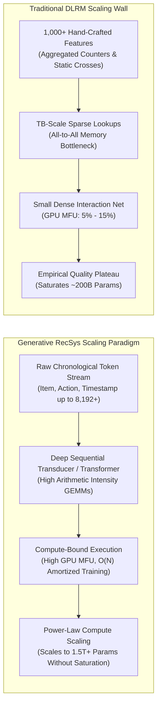

| Dimension | Traditional DLRM (DCN-v2 / PLE) | Generative Recommender (HSTU / FM) |
| :--- | :--- | :--- |
| **Input Representation** | Flat bag of 500–3,000 hand-engineered sparse & dense features | Unified chronological sequence of interleaved `(item, action, timestamp)` tokens |
| **Primary Hardware Bottleneck** | Memory bandwidth & All-to-All network shuffles (5%–15% MFU) | Dense tensor-core compute (high MFU, scales cleanly with next-gen GPUs) |
| **Training Cost per User ($`N`$ Impressions)** | $`O(N^3 d)`$ total ($`O(N^2 d)`$ per impression) if scoring each of $`N`$ impressions with its own history | $`O(N^2 d)`$ total ($`O(N d)`$ amortized per impression via single causal pass over $`N`$ events) |
| **Scaling Behavior** | Saturates around ~200B parameters on fixed feature sets | Power-law log-linear improvement across 3 orders of magnitude of compute |
| **Low-Compute / Small-Data Regime** | **Often wins** (hand-crafted counters inject strong inductive bias) | Needs massive interaction volume and long sequences to outperform |

---

### 2.2 Meta HSTU (Hierarchical Sequential Transduction Units — ICML 2024)

In *"Actions Speak Louder than Words: Trillion-Parameter Sequential Transducers for Generative Recommendations"* (Zhai et al., ICML 2024), Meta demonstrated the first industrial recommendation architecture that matches LLM power-law scaling up to **1.5 trillion parameters**, yielding a **+12.4% online engagement lift** across billion-user production surfaces.

#### 1. Reformulating Recommendation as Unified Sequential Transduction
Instead of building separate pipelines with thousands of heterogeneous numerical counters, HSTU collapses heterogeneous features into a **single chronological token stream**:
*   **Main Time Series:** The high-frequency stream of engaged/impressed items $`\Phi_0, \Phi_1, \dots, \Phi_{n-1}`$ interleaved with multi-hot action tokens $`a_0, a_1, \dots, a_{n-1}`$ (e.g., click, like, share, comment, video completion, hide, skip).
*   **Compressing Slowly-Changing Categoricals:** Demographics, language, location, and followed creators change infrequently. Rather than repeating them at every step, HSTU records only the *earliest entry per consecutive unchanged segment* and merges those state-change tokens chronologically into the main stream.
*   **Eliminating Hand-Crafted Numerical Aggregates:** At Meta's billion-DAU scale with sequences up to $`8,192`$ tokens, explicit counters like `user_7d_sports_CTR` are dropped entirely—the sequential transducer learns count and rate statistics implicitly from raw interleaved item-action patterns. *(Crucial caveat: LinkedIn's 2026 Feed SR paper confirmed that at smaller data volume, retaining key numerical aggregates via late fusion still outperforms pure sequence-only inputs!)*

Notice the exact structural difference between HSTU's **Ranking** and **Retrieval** formulations (deployed as two separate HSTU models in production):
*   **Ranking (Interleaved Target-Aware Transduction):** Input is $`[\Phi_0, a_0, \Phi_1, a_1, \dots, \Phi_{n-1}, a_{n-1}]`$. Predictions $`P(a_i \mid \Phi_0, a_0, \dots, \Phi_i)`$ are emitted *at post positions $`\Phi_i`$* (before seeing $`a_i`$) via causal masking, while action-position outputs are discarded ($`\emptyset`$). Placing the candidate $`\Phi_i`$ inside the sequence enables full target-aware cross-attention between the candidate and every historical interaction.
*   **Retrieval (Paired Next-Item Transduction):** Input pairs each item and action into one token $`[(\Phi_0, a_0), (\Phi_1, a_1), \dots]`$. At each position $`i`$, the hidden state $`u_i`$ predicts the next *positively engaged* item $`\Phi_{i+1}`$ via sampled softmax with LogQ correction, and serves via Maximum Inner Product Search (MIPS).

#### 2. Why Standard Softmax Attention Fails in RecSys
Why couldn't Meta simply deploy a standard GPT/LLaMA Transformer? Two reasons emerged empirically:
1.  **Softmax Erases Engagement Intensity (Count Invariance):** Standard attention forces every row of attention weights to sum to $`1.0`$. Suppose User A watched **100** cooking videos, while User B watched **5** cooking videos, and both are evaluating a new cooking candidate. Softmax gives each relevant historical token weight $`\approx 1/100`$ for User A and $`\approx 1/5`$ for User B—so the weighted average $`\sum_j \alpha_{ij} v_j`$ has **identical norm $`\approx 1.0`$** for both users! Softmax destroys the magnitude signal that distinguishes an obsessive fan from a casual browser.
2.  **Streaming Non-Stationarity Divergence:** In industrial streaming training over constantly churning billion-item vocabularies, standard Post-LN Softmax Transformers diverged to `NaN` on ranking tasks even at $`10\times`$ lower learning rates.

#### 3. Mathematical Formulation of the HSTU Block
Each HSTU layer replaces the standard 6-linear-layer Transformer block (`Wq, Wk, Wv, Wo, FFN_up, FFN_down`, requiring `33d` activation memory per layer in `bf16`) with **3 streamlined sub-layers and only 2 linear projections** (`14d` activation memory per layer—a **`~58%` peak memory reduction**, cutting `33d` to `14d` (`57.6%`) and enabling $`\gt 2\times`$ deeper stacks):

1. **Pointwise Projection (Single Fused GEMM + Split):**

```math
U(X),\, V(X),\, Q(X),\, K(X) = \text{Split}\!\left(\phi_1\!\left(f_1(X)\right)\right)
```

where $`f_1(X) = W_1 X + b_1`$ projects $`X \in \mathbb{R}^{N \times d}`$ into four tensors in one fused kernel, and $`\phi_1`$ is the **SiLU** (Swish) activation $`\text{SiLU}(z) = z \cdot \sigma(z)`$.

2. **Spatial Aggregation (Pointwise Aggregated Attention + Relative Bias):**

```math
A(X)V(X) = \phi_2\!\left(Q(X)K(X)^T + \text{rab}^{p,t}\right) V(X)
```

where $`\phi_2 = \text{SiLU}`$ is applied **element-wise** (no row-wise softmax denominator!), optionally scaled by $`1/N`$, and $`\text{rab}^{p,t} = \text{rab}^p + \text{rab}^t \in \mathbb{R}^{1 \times N \times N}`$ is a head-shared **Relative Attention Bias** summing two log-bucketized learned tables:
*   $`\text{rab}^p[i, j]`$: T5-style **positional distance bias** over $`\Delta_{\text{pos}} = j - i`$ (exact buckets for nearby offsets, logarithmically widening buckets for distant history).
*   $`\text{rab}^t[i, j]`$: **wall-clock temporal interval bias** over $`\Delta_{\text{time}} = t_j - t_i`$ (e.g., `<1m`, `1–5m`, `5–30m`, `2–12h`, `1–3d`, `1–4w`, `>6m`). Unlike RoPE (which only knows ordinal indices), $`\text{rab}^t`$ directly informs attention whether adjacent tokens happened 30 seconds apart in the same binge session or 3 weeks apart.

3. **Pointwise Transformation & Gating (Replacing the FFN):**

```math
Y(X) = f_2\!\left(\text{LayerNorm}\!\left(A(X)V(X)\right) \odot U(X)\right)
```

Because SiLU attention is unbounded, `LayerNorm` is mathematically mandatory to prevent activation explosion (ablations show divergence without it). Multiplying $`\text{LayerNorm}(AV)`$ element-wise by the nonlinear gate $`U(X)`$ performs SwiGLU-style conditional routing and explicit multiplicative feature crossing—replacing both the Transformer FFN and DLRM's DCN-v2 cross layers in a single operation.

#### Worked Numerical Example: Softmax vs. SiLU Intensity Preservation & $`\text{rab}^{p,t}`$
Suppose a candidate cooking video $`q_c`$ has raw dot-product $`q_c \cdot k_{\text{cook}} = +1.5`$ with past cooking videos and $`q_c \cdot k_{\text{sports}} = -6.0`$ with irrelevant sports videos, with orthogonal value vectors $`v_{\text{cook}} = [1.0, 0.0]`$ and $`v_{\text{sports}} = [0.0, 1.0]`$ (ignoring $`\text{rab}`$ first for clarity):
*   **User A (50 past cooking videos, 50 sports videos) vs. User B (2 past cooking videos, 98 sports videos):**
    *   **Under Softmax:** $`e^{1.5} \approx 4.4817`$ and $`e^{-6.0} \approx 0.00248`$.
        *   **User A:** Cooking weight is $`\frac{50 \times 4.4817}{50 \times 4.4817 + 50 \times 0.00248} \approx \mathbf{0.9994}`$, yielding output $`\approx [0.999, 0.001]`$.
        *   **User B:** Cooking weight is $`\frac{2 \times 4.4817}{2 \times 4.4817 + 98 \times 0.00248} = \frac{8.963}{9.206} \approx \mathbf{0.974}`$, yielding output $`\approx [0.974, 0.026]`$—Softmax makes a 2-video casual viewer look nearly identical to a 50-video fanatic!
    *   **Under HSTU SiLU Attention:** $`\text{SiLU}(1.5) = 1.5 \times \sigma(1.5) \approx \mathbf{1.2264}`$, while $`\text{SiLU}(-6.0) = -6.0 \times \sigma(-6.0) \approx \mathbf{-0.0148} \approx 0`$.
        *   **User A unnormalized sum:** $`50 \times 1.2264 \cdot v_{\text{cook}} + 50 \times (-0.0148) \cdot v_{\text{sports}} = \mathbf{[61.3,\; -0.74]}`$.
        *   **User B unnormalized sum:** $`2 \times 1.2264 \cdot v_{\text{cook}} + 98 \times (-0.0148) \cdot v_{\text{sports}} = \mathbf{[2.45,\; -1.45]}`$.
        *   User A registers a **`25x` stronger raw intensity signal** on the cooking channel (`61.3` vs. `2.45`). Crucially, applying `LayerNorm` + elementwise gating (`⊙ U`) across the full hidden dimension preserves these topic-intensity ratios across feature channels rather than collapsing them like row-wise Softmax.
*   **Adding $`\text{rab}^{p,t}`$:** If User B's 2 cooking videos happened **2 minutes ago** ($`\text{rab}^t(2\text{m}) = +1.1`$), their pre-activation score jumps from $`1.5 \to 2.6`$ ($`\text{SiLU}(2.6) = 2.42`$), whereas a cooking video from **5 days ago** ($`\text{rab}^t(5\text{d}) = -0.3`$) drops to $`1.2`$ ($`\text{SiLU}(1.2) = 0.92`$). The same-session action receives $`2.6\times`$ higher attention weight purely from wall-clock recency.

#### 4. Training Acceleration: $`O(N)`$ Amortization & Stochastic Length (SL)
1.  **Generative $`O(N)`$ Amortization:** In traditional DLRM/TransAct training, a user with $`n_i`$ impressions generates $`n_i`$ independent rows, each scanning the user's history: total cost $`O(N^3 d)`$. In generative training, emitting one sequence example per session (sampling rate $`s_u(n_i) \propto 1/n_i`$) supervises all $`n_i`$ positions in **one causal forward pass**, slashing complexity by a full factor of $`O(N)`$ to $`O(N^2 d)`$.
2.  **Stochastic Length (SL) Subsampling:** Even $`O(N^2 d)`$ is expensive at $`N_c = 8,192`$. Exploiting the **temporal repetitiveness** of user behavior, SL introduces a sparsity exponent $`\alpha \in (1, 2]`$ and threshold $`L_{\text{th}} = N_c^{\alpha/2}`$:
    *   If user length $`n_{c,j} \le N_c^{\alpha/2}`$: keep the full sequence.
    *   If $`n_{c,j} \gt N_c^{\alpha/2}`$: with high probability $`1 - \frac{N_c^\alpha}{n_{c,j}^2}`$, randomly subsample $`N_c^{\alpha/2}`$ chronological tokens; with low probability $`\frac{N_c^\alpha}{n_{c,j}^2}`$, keep the full sequence so rare life-event signals are never permanently lost.
    *   **Worked Numerical Example ($`N_c = 4,096`$, $`\alpha = 1.6`$):** Threshold $`L_{\text{th}} = 4096^{0.8} \approx \mathbf{776}`$ tokens. For a power user with $`n_{c,j} = 4,096 = 2^{12}`$, keep-full probability is $`4096^{1.6}/4096^2 = 4096^{-0.4} = 2^{-4.8} \approx \mathbf{3.6\%}`$, so the subsampling probability is $`1 - 0.0359 = \mathbf{96.4\%}`$. For this $`n = 4,096`$ power user, expected quadratic attention cost drops by **`~14.2x`** ($`0.9641 \times 776^2 + 0.0359 \times 4096^2 \approx 1.18\text{M}`$ vs. $`16.78\text{M}`$), yielding **`~5x` batch-wide attention speedup** across mixed sequence lengths with $`\lt 0.2\%`$ **Normalized Entropy (NE)** regression (`NE = LogLoss / background CTR entropy`; at Meta scale, a `0.001` NE gain typically translates to `~0.5%` topline engagement lift). SL is applied *only during training*; serving uses the full history amortized via M-FALCON.

#### 5. Serving Amortization: M-FALCON Micro-Batching
At ranking inference time, we must score $`m = 1,000\text{–}16,384`$ retrieved candidates against one user's shared history of length $`n = 4,096`$. Naive scoring runs $`m`$ independent forward passes at cost $`O(m \cdot n^2 d)`$—completely violating a `50ms` SLA.

**M-FALCON (Microbatched-Fast Attention Leveraging Cacheable OperatioNs)** appends a micro-batch of $`b_m`$ candidates to the user history in a single pass using a **custom block-diagonal causal mask** and **shared candidate position/timestamp indices** in $`\text{rab}^{p,t}`$:

```
M-FALCON BLOCK-DIAGONAL ATTENTION MASK (History n = 4, Micro-Batch b_m = 3):

                 History Tokens (KV Cached)     Candidate Micro-Batch
                  h1    h2    h3    h4           c1    c2    c3
              ┌─────────────────────────────┬─────────────────────┐
          h1  │   1     0     0     0       │    0     0     0    │  ← Standard causal mask
          h2  │   1     1     0     0       │    0     0     0    │    over user history
History   h3  │   1     1     1     0       │    0     0     0    │    (computed ONCE and
          h4  │   1     1     1     1       │    0     0     0    │     KV-cached across
              ├─────────────────────────────┼─────────────────────┤     all micro-batches!)
          c1  │   1     1     1     1       │    1     0     0    │  ← Candidates attend to
Candi-    c2  │   1     1     1     1       │    0     1     0    │    ALL history + self,
dates     c3  │   1     1     1     1       │    0     0     1    │    NEVER to each other!
              └─────────────────────────────┴─────────────────────┘
  * All candidates c1, c2, c3 share identical (pos = n+1, time = t_now) in rab^{p,t}
    so scores are mathematically identical to scoring each candidate in isolation!
```

```math
\text{Naive Cost} = O\!\left(m \cdot n^2 d\right) \quad \xrightarrow{\text{M-FALCON}} \quad \text{Encoder Prefill } O(n^2 d) + \left\lceil \frac{m}{b_m} \right\rceil \cdot O\!\left((n \cdot b_m + b_m^2) d\right)
```

Because the history's Key and Value tensors are computed **once** and reused via encoder-level KV caching across all $`\lceil m/b_m \rceil`$ micro-batches, M-FALCON makes a **$`285\times`$ more compute-intensive** Generative Recommender achieve **$`1.5\times`$ higher QPS** at $`m = 1,024`$ candidates and **$`2.99\times`$ higher QPS** at $`m = 16,384`$ candidates than production DLRM on the same inference hardware budget!

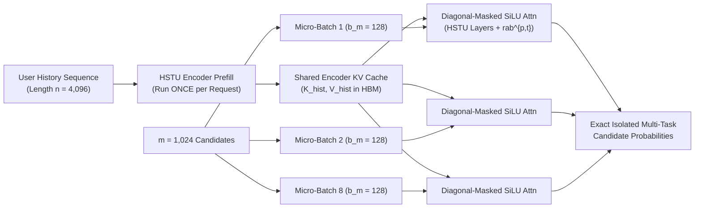

#### 6. Trillion-Parameter Scaling Laws & Production Trade-Offs (HSTU vs. Feed SR vs. DLRM)
Meta demonstrated log-linear power-law gains in Retrieval (`HR@100`, `HR@500`) and Ranking (`Normalized Entropy`) across **3 orders of magnitude of training compute** up to 1.5T parameters (24 layers, $`d=1,024`$, $`N=8,192`$, approaching GPT-3/LLaMA-2 compute budgets over 365 days of streaming data). Crucially, **sequence length scales better than depth or width alone** because user taste evolves across months.

However, honest production engineering requires knowing when **not** to adopt HSTU blindly:
*   **Kernel Ecosystem & FlashAttention:** Open-source FlashAttention-2/3 does not natively support HSTU's custom `SiLU + rab^{p,t}` attention; Meta relies on custom raggified Triton/CUDA kernels (5.3x–15.2x faster than padded FlashAttention-2 on jagged sequences). By contrast, LinkedIn's **Feed SR (2026)** used standard **Pre-LN Softmax Attention + RoPE + Scaled Residuals**, keeping full FlashAttention compatibility (`SRMIS` custom kernel) and outperforming HSTU by `+0.21%` Long Dwell AUC at matched compute (`10^17` FLOPs) on LinkedIn's data scale!
*   **Cold-Start & Sparse Data:** Pure interaction-ID HSTU degrades sharply for brand-new users/items (`11.6%` vs. `36.9%` `HR@100` in content-only ablations) unless augmented with late-fused content/profile embeddings (e.g., Qwen/CLIP vectors) or compositional multi-hash tables.
*   **Production Pipeline Reality:** Even at Meta (GEM / HSTU), **Retrieval (Andromeda) and Ranking (HSTU/GEM) remain separate stages**—full-catalog attention over billions of items is still impossible inside `<50ms`, so HSTU replaces DLRM at Ranking and emits embeddings for MIPS at Retrieval.

---

### 2.3 Foundation Models for Personalization: Netflix FM, LinkedIn 360Brew & Cross-Surface Unification

While Meta focused on trillion-parameter sequential transducers for high-frequency feeds and ads, **Netflix (March 2025)** and **LinkedIn (2025)** attacked a complementary organizational bottleneck: **model fragmentation**.

#### 1. Netflix's Foundation Model for Personalized Recommendation (Hsiao, Feng & Lamkhede, 2025)
Historically, large platforms operated dozens to hundreds of siloed models—one for *"Continue Watching"*, another for *"Today's Top Picks"*, another for *"Because You Watched"*, and another for *"Search"*. Each had separate pipelines, short lookback windows, and zero cross-surface knowledge transfer. Netflix replaced this fragmentation with a centralized causal Transformer foundation model trained on billions of cross-surface interactions:

1.  **Interaction Tokenization (The BPE Analogy):** Active members generate thousands of granular micro-events (`browse -> hover -> play -> pause -> resume -> watch 35m`). Feeding raw events blows past context limits. Netflix merges adjacent actions on the same title into composite **interaction tokens** (analogous to Byte Pair Encoding in NLP), packing heterogeneous attributes (title ID, metadata, watch duration, engagement types, device, locale, timestamp) into a single mixed embedding vector.
2.  **Request-Time vs. Post-Action Feature Split (Zero Leakage):** To predict interaction $`t+1`$ without leaking post-hoc outcomes (like future watch duration), Netflix constructs the step input strictly from what is known at prediction time:

```math
x_{t+1} = \text{Mix}\!\left(\text{RequestTimeFeatures}(t+1),\; \text{PostActionFeatures}(t)\right)
```

For example, when predicting the next show on Saturday night on a Smart TV, the model combines `device=SmartTV, time=Sat_Night` (known *now*) with `last_title=Wednesday_S1, duration=8min, action=early_abandon` (known from step $`t`$), and predicts only the **next `title_id`** (plus auxiliary metadata like `genre`).
3.  **Multi-Token Prediction & Weighted Interactions:** Standard next-token cross-entropy treats a 30-second trailer hover identically to a 2-hour movie completion and encourages myopic predictions. Netflix weights training tokens by engagement quality and uses a **multi-token prediction objective**—simultaneously predicting the next $`n`$ tokens $`(a_{t+1}, a_{t+2}, \dots, a_{t+n})`$ plus auxiliary genre targets—forcing hidden states to capture multi-step decision funnels (`browse -> evaluate -> commit -> binge`) aligned with long-term retention.
4.  **Long-Context Efficiency:** Uses **sparse attention** (low-rank / local+global compression) to handle hundreds of tokens under sub-50ms SLAs, **overlapping sliding-window sampling** during offline training, and **KV caching** at inference.
5.  **Catalog Evolution & Age-Based Cold-Start Mixing:** Unlike an LLM's static 50K word vocabulary, streaming catalogs add brand-new titles daily. Netflix solves this with two tightly coupled mechanisms:
    *   **Warm-Start Incremental Training:** Expand the embedding table for new titles, initialize new rows via weighted averages of metadata-similar titles, and warm-start daily incremental fine-tuning from the previous checkpoint (with periodic monthly full pre-training resets).
    *   **Age-Based Attention Mixing + ID Masking:** Every title has both a learned `id_emb` and a `metadata_emb` (genres, tone, storyline, cast, country). An attention mixing layer dynamically blends them conditioned on `entity_age`: pre-launch (`age=0`) relies ~95% on `metadata_emb`, transitioning smoothly to ~90% `id_emb` once mature—with **no manual cold/warm switching logic**. Crucially, during training Netflix **randomly masks or adds noise to `id_emb`** (ID Dropout), preventing the backbone from ignoring metadata on warm items!
6.  **Three Downstream Serving Topologies + Orthogonal Embedding Stabilization:** Rather than forcing every surface to run full Transformer decoding, Netflix exposes the foundation model via:
    *   **Batch Embeddings (Most Common):** Member and title embeddings served via feature/ANN stores. Because retraining rotates arbitrary latent axes and breaks downstream models, Netflix applies an **orthogonal low-rank transformation** to stabilize embedding coordinates across model refreshes.
    *   **Frozen Sub-Graph + Lightweight Task Head:** Fast per-surface adaptation.
    *   **Full End-to-End Fine-Tuning:** Lower learning-rate adaptation for flagship surfaces.
7.  **2025–2026 Evolution (Direct Surface Integration & FM-Intent):** Building on the initial foundation platform, Netflix integrated the FM directly into live **homepage and search ranking** surfaces rather than relying solely on offline batch embeddings, and introduced **FM-Intent**—explicitly modeling **latent user intent trajectories** (e.g., active discovery vs. comfort rewatching vs. mood/co-viewing shifts) jointly alongside next-title prediction to capture *why* a member is browsing before committing to a single title.

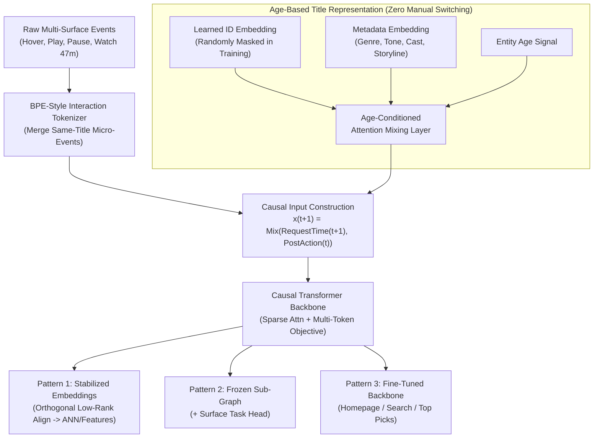

#### 2. Cross-Industry Foundation Model Comparison (2024–2026)

| System | Organization | Core Paradigm | Scale & Tokenization | Production Status & Key Trade-Off |
| :--- | :--- | :--- | :--- | :--- |
| **HSTU / GEM** | Meta (2024–2025) | Pointwise SiLU sequential transducer | 1.5T params; raw interleaved ID+action stream (up to 8,192 tokens) | **Production** (FB/IG Ranking & Ads; +12.4% engagement, +3–5% ad conv); requires custom CUDA/Triton kernels & massive data |
| **Foundation Model** | Netflix (2025) | Causal Transformer + Multi-Token Prediction | O(1B) params; BPE-merged composite interaction tokens + age-mixed metadata | **Production** (unified preference platform); serves via stabilized embeddings, sub-graphs, and fine-tuning |
| **360Brew V1.0** | LinkedIn (2025) | 150B MoE decoder-only LLM (Mixtral-class) over **natural-language prompts** | 150B params (8x22B MoE); verbalized profiles, posts, jobs across 30+ tasks | **Research / Pre-production exploration** (arXiv withdrawn; proved strong zero-shot/in-context generalization, too heavy for full QPS without distillation) |
| **OmniSearchSage / PinRec** | Pinterest (2024–2025) | Multi-entity search embeddings + Outcome-conditioned generative retrieval | 300K RPS; GenAI BLIP captions + multi-task compatibility encoders | **Production** (+8% relevance, +7% engagement); practical gradual migration via frozen compatibility heads |
| **OneRec** | Kuaishou (2025) | Unified Encoder-Decoder + Sparse MoE + Iterative DPO | Session-wise Semantic ID generation replacing entire 4-stage cascade | **Production** (main short-video feed; +1.6%+ watch time); highest architectural ambition, complex business-rule injection |

---

### 2.4 End-to-End Generative Funnels: Kuaishou OneRec, OneRec-V2 & Preference Alignment

Even Meta HSTU and Netflix's Foundation Model largely operate *within* a multi-stage retrieval-to-ranking topology. Why does the traditional 4-stage cascade (`Retrieval -> L1 -> L2 -> Re-Ranking`) remain fundamentally suboptimal? **Objective mismatch and compounding error:** Retrieval optimizes approximate cosine similarity over single items, L1 distills L2 under missing features, L2 predicts pointwise clicks independently, and Re-Ranking applies greedy diversity heuristics. A great item dropped by Retrieval is gone forever, and L2 cannot see the joint slate coherence of what it ranks.

#### Kuaishou OneRec (2025): Unifying Retrieve and Rank
In *"OneRec: Unifying Retrieve and Rank with Generative Recommender and Iterative Preference Alignment"* (Deng et al., Kuaishou 2025), Kuaishou deployed a single end-to-end generative model on live short-video traffic (+1.6%+ total user watch time) built on three architectural pillars:
1.  **Encoder-Decoder + Sparse MoE Backbone:** The Encoder ingests long-term user interaction sequences, while the Decoder autoregressively generates hierarchical **Semantic IDs** (RQ-VAE tokens, covered in Part 1). Integrating **Sparse Mixture-of-Experts (MoE)** layers scales total capacity to billions of parameters while keeping per-token serving FLOPs bounded.
2.  **Session-Wise Slate Generation:** Rather than generating one myopic next item at a time, the decoder generates a **complete, coherent multi-item session slate** $`S = (i_1, i_2, \dots, i_K)`$ jointly—natively modeling intra-session diversity, pacing, and transitions without hand-crafted MMR rules.
3.  **Iterative Preference Alignment (IPA) via Direct Preference Optimization (DPO):**
    *   *The RecSys Alignment Paradox:* In LLM RLHF/DPO, you can sample two answers $`(y_w, y_l)`$ for the exact same prompt and ask a human which is better. In a live feed, a user only ever sees **one** rendered session slate per request—you can never simultaneously observe the counterfactual reward of an unshown candidate slate!
    *   *OneRec's Solution:* First, train a multi-objective **Reward Model $`R_\psi(u, S)`$** (combining watch time, likes, shares, and negative skips) on massive historical interaction logs. Second, run **Beam Search** with the current generative policy $`\pi_\theta`$ to produce $`B`$ candidate session slates $`\{S_1, \dots, S_B\}`$ for user context $`x`$. Third, score all $`B`$ slates with $`R_\psi`$, selecting the highest-reward slate as the **winner ($`S_w`$)** and low-reward beam outputs as **self-hard negatives ($`S_l`$)**. Finally, optimize the standard DPO objective iteratively against a reference policy $`\pi_{\text{ref}}`$:

```math
\mathcal{L}_{\text{DPO}}(\theta) = -\mathbb{E}_{(x, S_w, S_l)} \left[ \log \sigma\!\left( \beta \log \frac{\pi_\theta(S_w \mid x)}{\pi_{\text{ref}}(S_w \mid x)} - \beta \log \frac{\pi_\theta(S_l \mid x)}{\pi_{\text{ref}}(S_l \mid x)} \right) \right]
```

Applying IPA iteratively on a controlled fraction of training samples continuously sharpens the decoder toward multi-objective business utility while the KL-anchoring parameter $`\beta`$ prevents policy collapse and diversity loss.

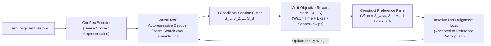

#### Kuaishou OneRec-V2 (Late 2025): Lazy Decoder-Only & Real-User RL Alignment
Production profiling of OneRec-V1 exposed a severe architectural imbalance: **97.66% of training compute** was consumed inside the **Encoder** processing long historical user sequences, leaving barely 2.3% for the autoregressive Decoder that actually generates recommendations. **OneRec-V2** resolved both this scaling bottleneck and synthetic reward-model drift with two major breakthroughs:
1.  **Lazy Decoder-Only Architecture (94% Compute Cut -> 8B Scale):** OneRec-V2 eliminates the heavy multi-layer Encoder entirely. Instead, user context is encoded once into **layer-shared context Key-Value (KV) pairs** attended across decoder layers—slashing total compute by **94%** while scaling cleanly up to **8B parameters** under strict live serving SLAs.
2.  **Real-User RL Alignment (Duration-Aware Reward Shaping & GBPO):** Rather than relying exclusively on synthetic preference pairs scored by an offline reward model (which risks Goodhart overfitting), OneRec-V2 aligns directly on real live user feedback using:
    *   **Duration-Aware Reward Shaping:** Normalizes watch-time reward against video duration distributions so long-form videos do not trivially dominate short clips during policy optimization.
    *   **Gradient-Bounded Policy Optimization (GBPO):** Bounds off-policy importance-weighted policy gradients smoothly, preventing entropy collapse and instability under continuous non-stationary live traffic.

#### Honest 2026 Production Trade-Offs of Unified Generative Funnels
Despite OneRec's landmark result, replacing the entire 4-stage cascade is **not** a free lunch for most platforms:
*   **Autoregressive Decoding Latency:** Generating $`K = 10`$ items with 3 Semantic ID tokens each requires **30 sequential decode steps** under beam search—far harder to bound under a strict `<50ms` P99 SLA than parallel L2 scoring.
*   **Hard Business Rules, Inventory & Ads Injection:** E-commerce and ads require hard real-time filtering (out-of-stock SKUs, geo-licensing, advertiser budget pacing, GSP/VCG auctions using calibrated `eCPM = Bid × pCTR`). Enforcing arbitrary dynamic filters during beam search requires constrained prefix-trie decoding that degrades generation coherence or forces a hybrid post-filter/re-ranking layer anyway.
*   **Explainability & Debugging Opacity:** When a specific advertiser or creator complains about an impression drop, a 4-stage funnel lets engineers pinpoint whether Retrieval, L1, L2 calibration, or Re-Ranking dropped the item. An end-to-end generative decoder makes root-cause attribution significantly harder.
*   **Pragmatic 2026 Verdict:** Short-video feeds with fluid inventories (Kuaishou, Douyin) can benefit from OneRec-style session generation; e-commerce, job marketplaces, and auction-driven ads still overwhelmingly favor **hybrid cascades** (combining generative retrieval / HSTU ranking with explicit calibrated auctions and hard constraint solvers).

---

## 3. Real-Time Streaming ML Ops & Collisionless Parameter Servers

### 3.1 Concept Drift Half-Life: Why Batch-Daily Retraining Fails on Live Feeds

In computer vision or NLP, the semantic meaning of a "golden retriever" or a Python syntax rule does not change between 2:00 PM and 2:15 PM. In recommendation systems, **data distributions are violently non-stationary**:
*   A short video uploaded 10 minutes ago can jump from 0 to 500,000 views within an hour.
*   Breaking news, flash sales, live sports upsets, or sudden rainstorms (spiking food delivery demand and ETA congestion) shift optimal rankings in **minutes, not days**.
*   A brand-new user opening a short-video app gives 15 rich micro-signals (swipes, completions, rewatches) in their first 3 minutes; waiting for tonight's batch Spark + GPU job means the user has already uninstalled the app.

The right retraining architecture is governed directly by your domain's **concept drift half-life**:

| Retraining Strategy | Update Cadence | Industry Archetype | Primary Strength | Primary Risk / Failure Mode |
| :--- | :--- | :--- | :--- | :--- |
| **Nightly Full Batch (Warm-Start)** | Every 24 hours (weekly cold reset) | **Netflix**, Catalog E-Commerce | Maximum stability, exact reproducibility, simple rollback | Misses intraday trends; slow new-item ramp |
| **Hybrid: Nearline Residual + Batch** | Seconds–minutes (residual) + Daily (base) | **LinkedIn Lambda Learner** | Safe real-time adaptation without destabilizing base model | Two-model serving coordination; limited capacity in residual |
| **Hybrid: Incremental + Daily Full** | 15–60 min incremental + Daily full retrain | **Meta** (IG/FB Feed & Ads) | Keeps AUC within ~0.5% of fresh optimal while capping drift | Complex checkpoint orchestration & feature parity |
| **Continuous Streaming PS (Split Cadence)** | **1-min sparse embeddings** + daily (or multi-hour) dense MLP | **ByteDance Monolith** (TikTok), **Google Ads** | Sub-minute viral & cold-start adaptation | Custom collisionless PS infra; runaway feedback-loop risk |

---

### 3.2 ByteDance Monolith (ORSUM@RecSys 2022): Collisionless Parameter Servers & Online Training

In *"Monolith: Real Time Recommendation System With Collisionless Embedding Table"* (Liu et al., ByteDance, **ORSUM@RecSys 2022**), ByteDance detailed how TikTok updates billion-parameter recommendation models **every minute** in live production without destroying accuracy through hash collisions or saturating datacenter networks.

#### 1. Why Standard Modulo Hashing Corrupts Gradients
In frameworks like native TensorFlow or PyTorch, sparse embedding tables are allocated as fixed-size dense matrices of $`M`$ rows, mapping raw 64-bit IDs via modulo hashing: $`\text{idx} = \text{hash}(\text{id}) \bmod M`$.
By the **Birthday Paradox**, collisions are virtually guaranteed long before a table is full; with $`K`$ distinct IDs hashed into $`M`$ buckets, the expected number of colliding pairs is $`\binom{K}{2} / M`$.
*   **Why Collisions Are Catastrophic in RecSys:** If a viral teen dance video (`item_A`, 10M views/hour) hashes to the exact same row as a niche woodworking tutorial (`item_B`, 50 views/day), gradients from `item_A` completely overwrite `item_B`'s representation—and worse, corrupt both items' predictions! Even multi-hash compositional embeddings only dilute collisions; they never eliminate them completely for dynamically growing ID spaces.

#### 2. Collisionless Cuckoo Hash Tables
Monolith replaces fixed-size dense embedding arrays with a dynamic key-value store backed by **Cuckoo Hashing** (Pagh & Rodler, 2004).
*   **How Cuckoo Hashing Works:** Maintain two (or $`d`$) hash tables $`T_0, T_1`$ with independent hash functions $`h_0(k), h_1(k)`$.
    *   **Lookup / Delete:** Check **at most 2 slots**—$`T_0[h_0(k)]`$ and $`T_1[h_1(k)]`$—guaranteeing **$`O(1)`$ worst-case lookup latency** (zero linked-list pointer chasing like chaining, zero unpredictable probe lengths like linear probing).
    *   **Dynamic Insertion (The "Cuckoo Kick-Out"):** To insert a new ID $`k_{\text{new}}`$, place it in $`T_0[h_0(k_{\text{new}})]`$. If slot $`h_0(k_{\text{new}})`$ is already occupied by an existing key $`k_{\text{old}}`$, evict ("cuckoo") $`k_{\text{old}}`$ to its alternate home $`T_1[h_1(k_{\text{old}})]`$. Repeat until an empty slot is found (or rehash/grow the table if a cycle exceeds max kick-out depth).

```
CUCKOO HASH TABLE INSERTION (Zero Collisions, O(1) Worst-Case Lookup):

  Table T0 (Hash h0)                          Table T1 (Hash h1)
  ┌─────────────────────┐                     ┌─────────────────────┐
  │ 0: [Empty]          │ ◄──(2) evict 77───┐ │ 0: [item_91, vec91] │
  │ 1: [item_42, vec42] │                   └─┤ 1: [item_77, vec77] │
  │                     │ ───(1) evict 42────►│   (42 lands here!)  │
  │ 2: [item_18, vec18] │    to h1(42) = 1    │ 2: [Empty]          │
  └─────────────────────┘                     └─────────────────────┘

  Insert new key item_99 where h0(99) = 1:
   Step 1: Place item_99 at T0[1], kicking out item_42.
   Step 2: Move item_42 to T1[h1(42) = 1], kicking out item_77.
   Step 3: Move item_77 to its alternate table T0[h0(77) = 0] -> Empty! Done.
  Lookup(k): Simply inspect T0[h0(k)] and T1[h1(k)] -> Exact match, ZERO hash collisions!
```

#### 3. Dynamic Memory Bounding: Occurrence Thresholds & TTL/LFU Expiration
A collisionless table that inserts every seen ID forever will exhaust cluster RAM within hours because internet traffic follows an extreme power law (over 50% of sparse IDs appear only once—bots, typos, abandoned accounts, dead videos). Monolith caps memory growth using two lightweight filters:
1.  **Frequency / Occurrence Admission Filter:** A new sparse ID is **not** allocated an embedding row on its first impression. A compact probabilistic sketch (e.g., Count-Min Sketch or Bloom/frequency counter) tracks occurrences; the ID is admitted into the Cuckoo table only after crossing a threshold (e.g., $`k \ge 10`$ occurrences), eliminating massive single-visit noise while saving `>50%` RAM.
2.  **Expirable Embeddings (TTL + LFU Eviction):** Every Cuckoo table entry stores a `last_updated_timestamp`. If an item or user goes inactive beyond its configurable **Time-to-Live (TTL)** (e.g., 7 days for short videos, 30 days for users), a background sweep evicts it cleanly, freeing RAM for fresh viral content.

#### 4. The Real-Time Online Training Loop & 1-Minute Delta Sync
Monolith decouples online learning from online serving across **two separate Parameter Server (PS) clusters** (Training PS and Serving PS) so gradient writes never lock or stall inference reads:

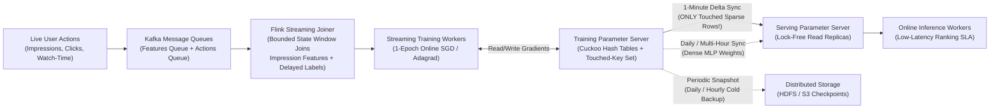

**Why Monolith Splits Sparse vs. Dense Sync Cadence:**
*   **Sparse Embeddings (Synced Every ~1 Minute):** Updating one viral video's vector is *local*—it helps that video immediately without destabilizing predictions for unrelated videos. Monolith maintains a lightweight hash set of **"touched keys"** (IDs updated since the last sync) and pushes **only the dirty delta rows** to the Serving PS every minute.
*   **Dense MLP Weights (Synced Daily — or Every Few Hours in Production Variants):** The Monolith paper specifies **day-level (daily) dense parameter sync** (with some production variants syncing dense parameters every few hours to daily). Because dense weights are *global*—every prediction passes through them—syncing dense weights every minute amplifies noisy mini-batch fluctuations and can destabilize global calibration; updating them on a slower cadence averages out transient variance.

#### Worked Bandwidth Calculation: Full Checkpoint vs. 1-Minute Delta Sync
Suppose a production ranker has **512 GB** of sparse embedding tables (`2 billion` active entries $`\times`$ `64 dims` $`\times`$ `4 bytes = 512 GB`), and **2 million** distinct IDs receive interactions in any given 60-second window:
*   **Naive Full Push (every 60s):** $`\frac{512\text{ GB}}{60\text{ s}} \approx \mathbf{8.53\text{ GB/s}}`$ per serving replica! Across 20 serving PS replicas, this demands **`170.7 GB/s` (`1.37 Tbps`)** of sustained network bandwidth—completely saturating cluster NICs and causing severe serving GC/memory spikes.
*   **Monolith 1-Minute Touched-Keys Delta Push:** $`2\times 10^6 \text{ touched IDs} \times 64 \times 4\text{ bytes} = \mathbf{512\text{ MB}}`$ per minute $`\approx \mathbf{8.53\text{ MB/s}}`$ per replica—an exact **`1,000x` bandwidth reduction**! Sparse freshness drops from 24 hours to 60 seconds at negligible network cost.

#### 5. Failure Recovery & Snapshot Consistency Trade-Off
In classical distributed databases, crashing a node cannot lose a single committed transaction (requiring expensive write-ahead logs and Paxos/Raft consensus). Monolith makes a brilliant **ML-specific systems trade-off**:
*   Writing synchronous multi-TB checkpoints every minute would destroy training throughput. Instead, Monolith saves **full snapshots asynchronously once per day** (or every few hours).
*   Suppose a Training PS cluster has 1,000 shards and **1 shard crashes** 6 hours after the last snapshot. That single shard restores its 6-hour-old snapshot—losing 6 hours of updates for only **`0.1%`** of sparse IDs! Because user traffic continuously streams in, hot IDs on that shard rapidly re-converge within minutes, causing an almost imperceptible (`<0.01%`) temporary AUC dip while avoiding massive continuous checkpoint I/O.

> **Bridging Parameter Servers to GPU-Native Serving & Distributed Training:** Monolith's CPU-backed collisionless Parameter Server excels at asynchronous sparse streaming, while modern GPU-heavy rankers and generative transducers (detailed in [Part 2](./Part_2_Ranking_PreRanking_and_Feature_Engineering.md)) complement it with **GPU Hybrid Parallelism** (combining `All-to-All` model-parallel sharding for terabyte sparse tables with `AllReduce` data-parallel replication for dense Transformer/MLP layers), **tiered HBM / host DRAM / NVMe SSD embedding caches** (keeping the hot 1%–5% Zipfian head in GPU HBM while spilling cold tails to DRAM/SSD), and **Triton Dynamic Batching** (accumulating concurrent RPC requests over 1–3ms windows to keep GPU tensor cores saturated under strict P99 latency SLAs).

---

### 3.3 Streaming Feature Stores, Point-in-Time Joins & Skew Prevention

Even the fastest parameter server fails if your training data leaks future outcomes or computes features differently offline than online.

#### 1. Temporal Point-in-Time (ASOF) Joins: Preventing Future Feature Leakage
Consider training a ranking model on Tuesday's impression logs using a feature `user_7d_click_count`. A common bug is joining the impression log with a daily user feature snapshot table strictly on `user_id` (and `date`):

```
TEMPORAL LEAKAGE TIMELINE (Why Naive JOIN ON (user_id, date) Destroys Production Models):

  09:00 AM                10:00 AM (Impression)         10:02 AM (Click!)        11:59 PM (Daily Snapshot)
     │                           │                             │                          │
     ├───────────────────────────┼─────────────────────────────┼──────────────────────────┤
  clicks=4                TRUE serving value:           Label y = 1 logged         Daily batch table:
                          user_7d_clicks = 4                                       user_7d_clicks = 5!

  * NAIVE JOIN: Attaches 11:59 PM snapshot (clicks = 5) to the 10:00 AM impression.
    The feature now INCLUDES the very click we are trying to predict!
    Offline AUC jumps +3.0% (hallucinated leakage); Online A/B crashes!

  * POINT-IN-TIME (ASOF) JOIN: Strictly requires feature_ts <= event_ts (10:00 AM)
    AND enforces simulated ingestion lag (e.g., feature_ts <= event_ts - 60s),
    returning exact historical state (clicks = 4).
```

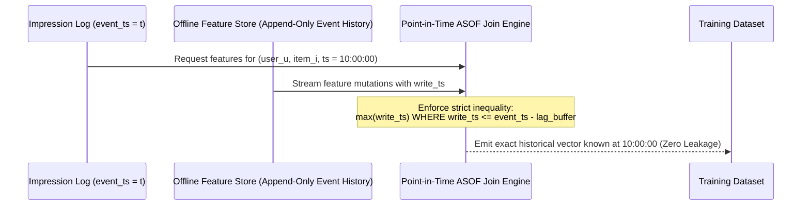

#### 2. Feature Computation Tiers & Online-Offline Parity Patterns

In production, no single engine computes all features. Mature RecSys feature platforms partition computation across **three latency–freshness tiers**:

| Computation Tier | Typical Engine & Cadence | Example RecSys Features | Strengths & Trade-Offs |
| :--- | :--- | :--- | :--- |
| **Batch (Offline)** | Spark / Airflow / BigQuery (Hours–Daily) | `user_30d_genre_affinity`, `item_90d_return_rate`, graph/GNN & LLM content embeddings | Lowest cost per row and highest historical depth; blind to intraday surges |
| **Nearline (Streaming)** | Kafka + Flink (Seconds–Minutes) | `item_5m_ctr`, `user_10m_session_clicks`, rolling video completion velocity, local courier supply | Captures breaking trends & session intent without bloating request-time RPCs |
| **Online (Request-Time)** | Serving C++/Go / Feature Service (`<5ms`) | `geo_distance(user, store)`, `time_since_last_action`, live cart items, real-time inventory & bid | Zero staleness for strictly contextual crosses; bounded by strict P99 CPU budget |

Across these tiers, teams enforce online-offline parity using one of **three production patterns**:

| Pattern | How It Works | Training-Serving Skew | Storage / Infra Cost | Best Fit |
| :--- | :--- | :--- | :--- | :--- |
| **Dual-Write (Separate Batch + Online Code)** | Spark/SQL computes offline features; Java/C++ service recomputes online | **High risk** (subtle window, null-handling, or rounding mismatches) | Low | Legacy / early-stage prototypes (avoid at scale!) |
| **Log-and-Wait (Feature Logging at Inference)** | Online server logs the exact feature vector fetched at serving time; streaming joiner attaches delayed labels later | **Zero skew** (training literally replays serving bytes!) | **High** (multi-PB feature logs; cannot backfill brand-new features historically) | Latency-critical L2 rankers & Ads (Meta, Google, DoorDash) |
| **Unified Kappa / Flink Feature Store** | Single declarative transform spec (Feast / Tecton / Flink SQL) runs identically over live Kafka streams and historical Kafka/Iceberg replays | **Near-zero** (shared engine + exact temporal ASOF backfills) | Medium-High (Flink state + Redis/CockroachDB serving) | Fast-iterating RecSys teams needing both zero skew and historical backfills |

> **Pragmatic Production Architecture (Tiered Feature Store):** Because online feature stores are read-heavy (`~99.9%` reads vs. `0.1%` writes), platforms like DoorDash layer three storage tiers: (1) an **in-process client cache** inside the prediction service (`~70%+` hit rate for hot items/stores), (2) **Redis clusters** storing co-located entity features as Redis Hashes (`HMGET` instead of $`N`$ individual `GET`s, `xxHash32` 4-byte feature keys, Protobuf binary encoding for embeddings, Snappy compression for integer lists), and (3) **CockroachDB / DynamoDB** for cold or bulk batch features (`~75%` cheaper than RAM-only Redis).

#### 3. Feature Freshness, Staleness-Aware Serving & Drift Detection
A streaming pipeline can report "green / zero errors" while silently lagging 4 hours behind upstream Kafka partitions—feeding stale counters into live inference. Mature RecSys ML Ops enforces **five monitoring pillars**:
1.  **Feature Freshness & Staleness-Aware Serving:** Track per-feature age (`p50/p95/p99`) and default/null fallback rates hourly. Apply **Soft TTL** (pass `feature_age` into the model so it learns to downweight stale signals) and **Hard TTL** (drop expired counters to safe population defaults rather than serving 6-hour-old surge signals), supplemented by synthetic **canary probes** every minute.
2.  **Statistical Feature & Prediction Drift (PSI & KL Divergence):** Partition feature or predicted-score values into $`B`$ quantile bins, comparing live serving proportions $`p_b`$ against training reference proportions $`q_b`$:

```math
D_{\text{KL}}(P \parallel Q) = \sum_{b=1}^B p_b \ln\!\left(\frac{p_b}{q_b}\right), \qquad \text{PSI} = \sum_{b=1}^B (p_b - q_b) \ln\!\left(\frac{p_b}{q_b}\right) = D_{\text{KL}}(P \parallel Q) + D_{\text{KL}}(Q \parallel P)
```

Notice that **Population Stability Index (PSI)** is simply the *symmetric KL divergence* (Jeffreys divergence)!
*   **Worked Numerical Example:** Suppose a score distribution has 3 quantile bins with training reference $`Q = [0.50, 0.30, 0.20]`$, and after an upstream feature bug, live serving shifts to $`P = [0.25, 0.35, 0.40]`$:
    *   Bin 1: $`(0.25 - 0.50)\ln(0.25 / 0.50) = (-0.25)(-0.693) = 0.173`$
    *   Bin 2: $`(0.35 - 0.30)\ln(0.35 / 0.30) = (0.05)(0.154) = 0.008`$
    *   Bin 3: $`(0.40 - 0.20)\ln(0.40 / 0.20) = (0.20)(0.693) = 0.139`$
    *   **Total $`\text{PSI} = 0.173 + 0.008 + 0.139 = \mathbf{0.320}`$**.
*   **Production Thresholds:** $`\text{PSI} \lt 0.10`$ (stable), $`0.10 \le \text{PSI} \lt 0.25`$ (moderate shift — investigate), $`\text{PSI} \ge 0.25`$ (**critical drift** — trigger pager & halt auto-retrain).
3.  **Five-Stage Safe Rollout & Automated Rollback:** Never push a newly retrained streaming or batch checkpoint straight to 100% traffic:
    *   **Offline Gate** (GAUC / NE / Slice E/O calibration check) $`\to`$ **Shadow Scoring** (score live traffic asynchronously for 1–3 days; verify zero PSI/latency anomalies) $`\to`$ **Canary (1–5%)** $`\to`$ **Gradual Rollout (5% -> 25% -> 50% -> 100%)** $`\to`$ **Bake Period (1–2 weeks)**.
    *   **Automated Rollback Triggers:** Instant revert if P99 latency $`\gt 2\times`$ baseline for 5m, error rate $`\gt 0.1\%`$ for 2m, prediction mean shifts $`\gt 3\sigma`$, or any guardrail metric drops $`\gt 1\%`$ for 30m.

---

### 3.4 Model Freshness vs. Stability: Catastrophic Forgetting & Anchoring

Continuous streaming training introduces subtle optimization failure modes that never appear in offline batch experiments:

1.  **The One-Epoch Phenomenon (Zhang et al., 2022):** Unlike vision/NLP models trained for 10–100 epochs, industrial sparse DLRM/embedding models suffer severe **overfitting immediately at the start of Epoch 2** (training loss collapses while validation LogLoss spikes). Why? High-cardinality ID embeddings memorize sparse training rows in a single pass. Therefore, online streaming training MUST run **strictly 1-epoch** (each logged event updates the model once, in strict chronological order) using adaptive per-parameter optimizers (**Adagrad / FTRL** for sparse tables so rare IDs receive larger steps while frequent IDs cool down, paired with conservative **AdamW** on dense layers).
2.  **Catastrophic Forgetting & Feedback-Loop Runaway:** Suppose a major sporting event dominates traffic for 4 hours on Sunday night. An aggressive online learner updates dense MLP weights to favor sports heavily—forgetting weekday morning news/work preferences by Monday 8 AM! Worse, if a calibration bug temporarily over-scores a narrow cluster of clickbait items, those items get more impressions, generating more training rows that further reinforce the bias (**rich-get-richer runaway feedback loop**).

> **Viral Item Embedding Instability:** Even with collisionless tables, an item's embedding can drift violently when it transitions from a small niche community (e.g., 500 indie-music fans) to viral mainstream traffic (5M general-feed users). Millions of new mainstream gradients abruptly yank the item's vector across latent space—temporarily degrading relevance for *both* its original niche core and incoming mainstream viewers. Production stacks counter this by decoupling **(1) stable content/multimodal anchor embeddings** (frozen or slow-moving), **(2) explicit freshness & velocity features** (`views_last_5m`, `completion_velocity`), and **(3) dedicated trending/viral retrieval channels** so viral surges do not corrupt collaborative ID geometry.
3.  **Three Production Stabilization Patterns:**
    *   **Periodic Cold-Start Anchoring:** Warm-start incremental/streaming updates every minute/hour/day for speed, but run a **clean cold-start retrain from scratch** every 1–4 weeks over a balanced historical window (e.g., 14–28 days) to flush accumulated bias and stale optimizer states.
    *   **Dual-Reference / KL Anchor Regularization:** Regularize live online weights $`\theta_{\text{online}}`$ against a frozen stable daily anchor model $`\theta_{\text{anchor}}`$ via output KL-distillation $`\mathcal{L}_{\text{stream}} + \lambda D_{\text{KL}}(p_{\text{anchor}} \parallel p_{\text{online}})`$, bounding how fast global score distributions can drift during traffic spikes.
    *   **Lambda Learner Residual Decoupling (LinkedIn):** Keep the heavy multi-task neural backbone frozen on daily batch updates, and let only a lightweight **nearline linear/shallow residual** adapt continuously on streaming Kafka events—isolating real-time volatility from core model stability.

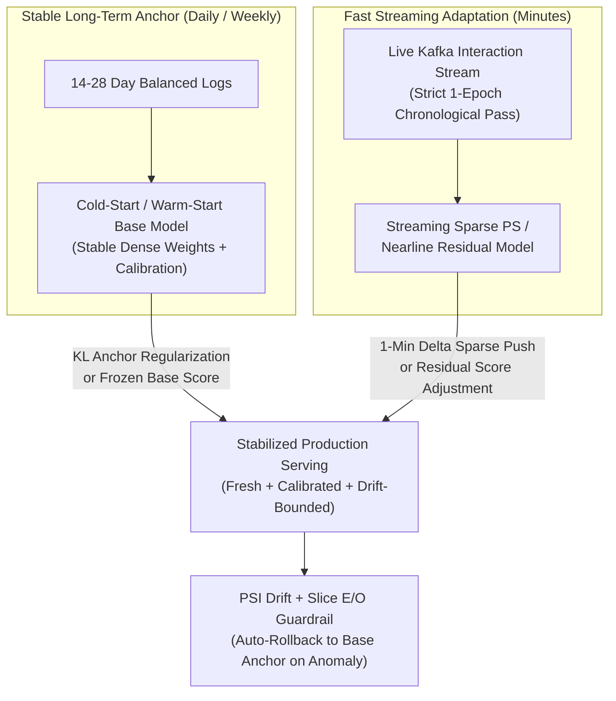

---

## 4. Online Causal Experimentation & Statistical Rigor at Scale

Offline metrics (GAUC, NDCG, NE) are cheap filters—not ground truth. Because recommendation systems are **interventional** (changing rankings changes what users see, which changes future behavior), **online causal experimentation** is the ultimate arbiter of launch decisions. Yet naive A/B testing breaks down systematically in modern RecSys.

### 4.1 A/B Testing Foundations, Experiment Velocity & Classic RecSys Pitfalls

#### 1. Sample Ratio Mismatch (SRM) — The Ultimate Experiment Killer
Suppose you configure a 50/50 split between Control ($`C`$) and Treatment ($`T`$), and after 1 week you observe **`495,000` users in Control** and **`505,000` users in Treatment** (`49.5%` vs. `50.5%`). Many practitioners wave this off as "close enough to 50/50."

**This is a catastrophic statistical mistake.** Test the observed counts against expected counts ($`E_C = E_T = 500,000`$) using **Pearson's Chi-Squared Goodness-of-Fit Test**:

```math
\chi^2 = \sum_{g \in \{C, T\}} \frac{(O_g - E_g)^2}{E_g} = \frac{(495{,}000 - 500{,}000)^2}{500{,}000} + \frac{(505{,}000 - 500{,}000)^2}{500{,}000} = 50 + 50 = 100.0
```

For $`\text{df} = 1`$, the critical threshold at $`\alpha = 0.001`$ is $`\chi^2 = 10.83`$; a value of $`100.0`$ corresponds to **$`p \lt 10^{-22}`$**! A 49.5/50.5 split on 1M users is *never* random chance—it guarantees a systematic assignment or logging bug.
*   **Why SRM Invalidates *Every* Metric Immediately:** Suppose Treatment causes a subtle crash on older Android devices, dropping 1% of low-engagement Android users from the Treatment telemetry log (or employee dogfooding injects 1% hyper-active internal users into Treatment). The surviving Treatment cohort now has an artificially higher mean engagement—creating a fake "+2% revenue mirage"! Empirical audits at Microsoft and DoorDash showed experiments with SRM produce **$`2\times`$ more false statistically significant metrics**.
*   **Automated SRM Diagnosis:** Run continuous Flink/Pinot SRM checks (`p < 0.001` halts analysis) plus a **flicker test** (checking whether any user flipped variants mid-test). To pinpoint the root cause fast, fit a logistic regression `is_treatment ~ country + platform + app_version + user_tenure` with **Wald tests** to isolate the exact orthogonal slice driving the imbalance (e.g., `iOS v14.2` crash or bot-filter mismatch).

#### 2. Peeking (Optional Stopping) & Multiple Testing Corrections
*   **The Peeking Problem:** If you run a fixed-horizon t-test ($`\alpha = 0.05`$) every day for 14 days and stop the moment $`p \lt 0.05`$, your true false positive rate inflates from **5% to ~25%–30%+** because a random walk under the null hypothesis frequently crosses $`\pm 1.96\sigma`$ temporarily.
    *   **Solution — Always-Valid p-values (mSPRT):** Use a **mixture Sequential Probability Ratio Test** (Johari et al., 2017), which integrates likelihood ratios over a Gaussian mixing prior $`\tau^2`$ on the effect size to compute an **always-valid p-value** $`p_t^{\text{av}}`$ satisfying $`P_{H_0}(\exists\, t \ge 1 : p_t^{\text{av}} \le \alpha) \le \alpha`$. Teams can peek continuously and stop early for huge wins or guardrail disasters with zero Type I error inflation (at the trade-off of slightly wider confidence intervals—roughly 15%–25% longer runtime if the true effect is tiny).
*   **Multiple Testing Across $`m`$ Metrics/Variants:** Testing 20 dashboard metrics at $`\alpha = 0.05`$ yields $`1 - (1 - 0.05)^{20} = \mathbf{64.2\%}`$ chance of at least one false positive!
    *   **Bonferroni Correction:** Test each metric at $`\alpha / m`$ (controls **Family-Wise Error Rate / FWER**; strict, but slashes statistical power when $`m`$ is large).
    *   **Benjamini-Hochberg (BH) Procedure:** Sort $`m`$ p-values $`p_{(1)} \le \dots \le p_{(m)}`$ and find the largest $`k`$ such that $`p_{(k)} \le \frac{k}{m} q`$ (controls **False Discovery Rate / FDR** at level $`q`$; standard when screening dozens of secondary/slice metrics).
    *   **Metric Hierarchy Governance:** Pre-register **1–2 Primary Goal Metrics** (no over-correction), **3–5 Non-Negotiable Guardrails** (latency, crash rate, revenue, unsubscribe rate), and **Diagnostic Metrics** (for debugging only, never ship-decision cherry-picking).

#### 3. Novelty Effect vs. Primacy Effect
*   **Novelty Effect (Temporary Inflation):** Users click a shiny new UI module or freshly diversified carousel out of curiosity on Days 1–3 (`+8% CTR`), then revert to baseline by Day 14 (`+0.5% CTR`). Stopping on Day 3 ships a dud.
*   **Primacy Effect (Temporary Depression):** Power users have muscle memory for the old layout (e.g., always tapping row 2). A genuinely superior model initially *drops* engagement on Days 1–4 until habits adapt (`-1% -> +2%`).
*   **Mitigation:** Always run A/B tests for at least **14 full days (2 complete weekly cycles)** to capture weekday/weekend seasonality, and plot the **daily rolling treatment effect** separately for **new users** (no primacy habit) vs. **tenured users**.

#### 4. Scaling Experiment Velocity: A/A Testing, Overlapping Layers & Fractional Factorial Designs
Running one isolated A/B test at a time stalls an engineering organization. High-velocity experimentation platforms combine three design patterns:
*   **A/A Testing (Calibration & Trust Verification):** Before launching a new experimentation framework, metric pipeline, or switchback design, assign two identical Control arms (`A1` vs. `A2`). A/A tests verify that the empirical False Positive Rate truly sits at `5%` (under $`\alpha = 0.05`$), validate end-to-end SRM telemetry, and empirically calibrate switchback window durations and cluster-robust standard errors on historical logs.
*   **Orthogonal Overlapping Experiment Layers (Tang et al., Google KDD 2010):** Instead of mutually exclusive traffic splits (which cap concurrent launches to a handful of teams), partition the recommendation stack into orthogonal **layers** (e.g., Retrieval Layer, L2 Ranking Layer, Re-Ranking Layer, UI Layer). Each layer independently hashes `hash(user_id + layer_salt)`, allowing every user to participate simultaneously in one test per layer and safely scaling to **1,000+ concurrent experiments** (reserving explicit cross-layer interaction checks only for layers that modify tightly coupled parameters).
*   **Fractional Factorial Designs:** When tuning multiple levers jointly (e.g., `4` value-model weights $`\times 3`$ diversity settings $`\times 2`$ freshness boosts = `24` full-factorial combinations), splitting traffic across all 24 arms starves every cell of power. A **fractional factorial design** (e.g., testing `8` orthogonal main-effect variants plus `1` combined interaction-check variant) isolates primary effects and flags major two-way interactions at a fraction of the traffic budget.

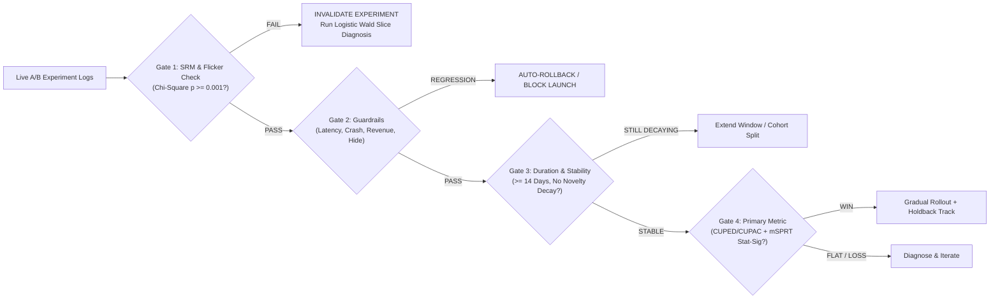

---

### 4.2 Variance Reduction: CUPED, CUPAC & MLRATE (ML Covariate Adjustment)

In mature RecSys platforms, true ranking improvements are often **`+0.2%` to `+0.5%`**, yet user-level engagement metrics have enormous variance (a power user clicks 200 times while a casual user clicks 1 time). Before planning sample size, fix four statistical parameters:
*   **Type I Error Rate ($`\alpha`$):** False positive threshold (probability of shipping a neutral change; typically $`\alpha = 0.05`$, critical value $`z_{1-\alpha/2} = 1.96`$).
*   **Type II Error Rate ($`\beta`$) & Statistical Power ($`1 - \beta`$):** False negative rate (typically $`\beta = 0.20`$), yielding **80% statistical power** ($`z_{1-\beta} = 0.84`$) to detect a true win.
*   **Minimum Detectable Effect (MDE, $`\delta`$)** and **Metric Variance ($`\sigma^2`$):** The smallest business lift worth detecting and the per-unit noise of the metric.

Under these parameters, a standard two-sample t-test requires a sample size per arm of:

```math
n \approx \frac{2 \left(z_{1-\alpha/2} + z_{1-\beta}\right)^2 \sigma^2}{\delta^2}
```

Notice the **$`1/\delta^2`$ Quadratic Sample-Size Law**: halving your MDE (detecting a `+0.25%` lift instead of `+0.50%`) requires **$`4\times`$** as much traffic (or **$`4\times`$** longer runtime)! Conversely, cutting metric variance $`\sigma^2`$ in half directly **cuts required sample size (or experiment runtime) in half**—doubling an organization's experimentation velocity for free.

> **Common p-Value & Confidence Interval Traps:** (1) A p-value is **not** $`P(H_0\text{ is true} \mid \text{data})`$—it is $`P(\text{data at least this extreme} \mid H_0)`$; (2) a non-significant result ($`p = 0.18`$) is **not** proof of zero effect—always inspect the **95% Confidence Interval** against your business MDE to separate *"precisely neutral"* (`[-0.05%, +0.08%]`) from *"underpowered / inconclusive"* (`[-1.2%, +2.1%]`).

#### 1. Complete Mathematical Derivation of CUPED (Deng et al., WSDM 2013)
**CUPED (Controlled-experiment Using Pre-Experiment Data)** leverages a pre-experiment covariate $`X`$ (e.g., the user's engagement during the 14 days *before* the experiment started) that is correlated with the in-experiment outcome $`Y`$ but strictly **independent of treatment assignment $`Z \in \{0, 1\}`$**.

Define the variance-reduced adjusted metric for each user $`i`$:

```math
Y_{i,\text{cuped}} = Y_i - \theta \left(X_i - \mathbb{E}[X]\right)
```

**Step 1 — Proof of Exact Unbiasedness:**
Take the expectation of the difference-in-means between Treatment ($`T`$) and Control ($`C`$):

```math
\mathbb{E}\!\left[\bar{Y}_{\text{cuped}}^{(T)} - \bar{Y}_{\text{cuped}}^{(C)}\right] = \mathbb{E}\!\left[\bar{Y}^{(T)} - \bar{Y}^{(C)}\right] - \theta \left(\mathbb{E}\!\left[\bar{X}^{(T)}\right] - \mathbb{E}\!\left[\bar{X}^{(C)}\right]\right) = \mathbb{E}\!\left[\bar{Y}^{(T)} - \bar{Y}^{(C)}\right]
```

Because $`X`$ is measured strictly **before** randomization, $`\mathbb{E}[\bar{X}^{(T)}] = \mathbb{E}[\bar{X}^{(C)}] = \mathbb{E}[X]`$—so the second term cancels identically to zero for **any** fixed scalar $`\theta`$! The estimator remains **100% unbiased** for the Average Treatment Effect (ATE). *(In practice, pool $`T`$ and $`C`$ together to estimate a single shared $`\hat{\theta}`$ and $`\bar{X}`$ so no per-arm leakage occurs.)*

**Step 2 — Deriving the Optimal $`\theta^*`$:**
Expand the variance of $`Y_{\text{cuped}}`$:

```math
\text{Var}(Y_{\text{cuped}}) = \text{Var}(Y - \theta X) = \text{Var}(Y) + \theta^2 \text{Var}(X) - 2\theta\,\text{Cov}(Y, X)
```

Differentiate with respect to $`\theta`$ and set equal to zero:

```math
\frac{\partial}{\partial \theta}\text{Var}(Y_{\text{cuped}}) = 2\theta\,\text{Var}(X) - 2\,\text{Cov}(Y, X) = 0 \quad \Longrightarrow \quad \theta^* = \frac{\text{Cov}(Y, X)}{\text{Var}(X)}
```

Notice $`\theta^*`$ is literally the **Ordinary Least Squares (OLS) regression slope** of $`Y`$ on $`X`$!

**Step 3 — Exact Variance Reduction Factor:**
Substitute $`\theta^* = \frac{\text{Cov}(Y, X)}{\text{Var}(X)}`$ back into the variance equation, and use $`\rho = \frac{\text{Cov}(Y, X)}{\sqrt{\text{Var}(Y)\text{Var}(X)}}`$:

```math
\text{Var}(Y_{\text{cuped}}) = \text{Var}(Y) - \frac{\text{Cov}(Y, X)^2}{\text{Var}(X)} = \text{Var}(Y)\!\left(1 - \rho^2\right)
```

#### Worked Numerical Example: CUPED Power & Runtime Savings
Suppose a streaming platform tests a new L2 ranker targeting weekly watch time $`Y`$ with baseline standard deviation $`\sigma_Y = 100\text{ min}`$ ($`\text{Var}(Y) = 10{,}000`$), MDE $`\delta = 1.0\text{ min}`$, $`\alpha = 0.05`$ ($`z_{0.975} = 1.96`$), and 80% power ($`z_{0.80} = 0.84`$):
1.  **Standard A/B Sample Size per Arm:**
    $`n_{\text{raw}} = \frac{2(1.96 + 0.84)^2 \times 10{,}000}{1.0^2} = 2 \times 7.84 \times 10{,}000 = \mathbf{156{,}800\text{ users per arm}}`$ (`313,600` total).
2.  **With CUPED ($`\rho = 0.70`$ correlation between prior-2-week and current watch time):**
    *   Variance reduction factor: $`1 - \rho^2 = 1 - 0.70^2 = 1 - 0.49 = \mathbf{0.51}`$ (**49% variance reduction**!).
    *   Adjusted variance: $`\text{Var}(Y_{\text{cuped}}) = 5{,}100`$.
    *   New sample size per arm: $`n_{\text{cuped}} = 0.51 \times 156{,}800 = \mathbf{79{,}968\text{ users per arm}}`$ (`159,936` total).
    *   **Business Impact:** Cuts required traffic or test runtime nearly **in half** without changing a single line of model code!

#### 2. CUPAC (DoorDash, 2020) vs. MLRATE (Meta, NeurIPS 2021) & Cross-Fitting
Standard CUPED hits two walls: (1) it uses a single linear pre-experiment metric $`X`$, leaving non-linear predictive signal on the table, and (2) for transactional/delivery metrics (e.g., delivery ASAP time), a brand-new order has *no* prior-week delivery time! Two flagship industrial frameworks extend CUPED with nonlinear ML predictors $`\hat{Y}_i = f(X_{\text{pre}, i})`$ (e.g., LightGBM / Neural Nets trained on rich pre-experiment and strictly exogenous covariates like merchant prep history, distance, weather, user tenure, and multi-window activity):

1.  **CUPAC — Control Using Predictions As Covariates (Tang et al., DoorDash 2020):** Trains $`f(\cdot)`$ strictly on **historical pre-experiment data** (completely frozen before the experiment begins) and plugs the resulting prediction $`\hat{Y}_i = f(X_{\text{pre}, i})`$ directly into the scalar CUPED formula:

```math
Y_{i,\text{cupac}} = Y_i - \theta \left(\hat{Y}_i - \mathbb{E}[\hat{Y}]\right)
```

At DoorDash, CUPAC pushed variance reduction high enough to **cut switchback experiment duration by ~40%**.
2.  **MLRATE — Machine Learning Regression-Adjusted Treatment Effect Estimator (Guo et al., Meta, NeurIPS 2021):** Goes two steps further when historical relationships drift or traffic splits are unequal (e.g., 90/10 canaries). First, it trains $`f(\cdot)`$ **in-experiment via $`K`$-fold cross-fitting** (adapting automatically to current-week seasonality without leakage). Second, it replaces simple CUPED subtraction with **Lin's (2013) regression estimator**, adding a centered treatment-covariate interaction term:

```math
Y_i \sim \alpha + \tau Z_i + \gamma \hat{Y}_i + \eta Z_i \left(\hat{Y}_i - \bar{\hat{Y}}\right)
```

where the OLS coefficient $`\hat{\tau}`$ is the ATE estimator. Including $`\eta Z_i(\hat{Y}_i - \bar{\hat{Y}})`$ guarantees **asymptotic unbiasedness and guaranteed variance reduction** (never performing worse than an unadjusted t-test!) even under **unequal treatment/control splits** or a **poorly specified / miscalibrated ML model**.

**CRITICAL STATISTICAL TRAP — Overfitting & Treatment Leakage (Why Cross-Fitting Is Mandatory):**
If you train $`f(\cdot)`$ on the *same* in-experiment rows $`(X_i, Y_i)`$ that you then evaluate, the flexible GBDT memorizes in-experiment residuals $`Y_i`$, artificially deflating estimated variance $`\widehat{\text{Var}}(Y_{\text{adj}})`$ and inflating false positive rates! Two rigorous protocols eliminate this bias:
1.  **Strictly Pre-Experiment Historical Training (CUPAC):** Train $`f(\cdot)`$ entirely on historical pre-experiment data (never touching in-experiment $`Y`$), then score experiment units once frozen.
2.  **$`K`$-Fold Cross-Fitting (MLRATE / Double ML Standard):** Partition experiment users into $`K = 5`$ folds (ignoring treatment label $`Z`$!). For each fold $`k`$, train $`f^{(-k)}`$ on the other $`K-1`$ folds using *only* pre-experiment covariates $`X_{\text{pre}}`$ (never $`Z`$), and generate strictly **out-of-fold** predictions $`\hat{Y}_i = f^{(-k)}(X_{\text{pre}, i})`$ for fold $`k`$. Because $`f^{(-k)}`$ never sees fold $`k`$'s noise realization—and never sees treatment indicator $`Z`$—the resulting estimator is provably consistent, asymptotically unbiased, and valid for confidence intervals.

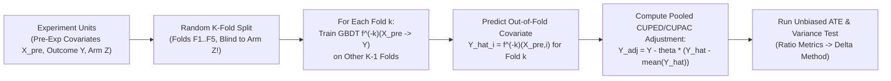

> **Ratio Metrics & Subgroup CATE Note:** Many RecSys metrics are **ratios of random variables**, such as $`\text{CTR} = \frac{\sum_u C_u}{\sum_u I_u}`$ (clicks per impression, randomized by *user* $`u`$, not by impression!). Because impressions $`I_u`$ vary wildly across users, naive binomial variance formulas understate standard errors massively. Always use the **Delta Method** (Taylor-expanding $`\text{Var}(\bar{C}/\bar{I}) \approx \frac{1}{\mu_I^2}\text{Var}(\bar{C}) - \frac{2\mu_C}{\mu_I^3}\text{Cov}(\bar{C}, \bar{I}) + \frac{\mu_C^2}{\mu_I^4}\text{Var}(\bar{I})`$) or **cluster bootstrap**. When inspecting **subgroup CATEs** across dozens of markets/categories, small noisy subgroups dominate the extremes—apply **James-Stein / Empirical Bayes shrinkage** to pull noisy subgroup lifts toward the global mean proportional to their sampling variance.

| Metric & Experimental Structure | Wrong (Naive) Estimator | Correct Production Estimator | Why It Matters |
| :--- | :--- | :--- | :--- |
| **User-Level Mean** (e.g., watch time / user) | Raw two-sample t-test | **CUPED / Cross-Fitted CUPAC** + Welch t-test | Slashes variance by $`1 - \rho^2`$ (often 40%–50% shorter tests) |
| **Ratio Metric** (e.g., CTR = Total Clicks / Total Impressions, randomized by user) | Binomial $`p(1-p)/N_{\text{imp}}`$ | **Delta Method** (linearized variance) or User Cluster Bootstrap | Impressions per user are correlated; naive binomial severely underestimates SE |
| **Cluster / Switchback Metric** (deliveries inside `(city, 30m)` block) | Delivery-level OLS t-test (up to 62% FPR!) | **CRSE (Sandwich Estimator)** or **Multilevel Model (MLM)** + CUPAC | Accounts for within-block correlation & heteroskedasticity |
| **Subgroup CATEs** (e.g., lift across 50 geo markets or categories) | Unregularized per-slice difference | **James-Stein / Empirical Bayes Shrinkage** | Prevents tiny high-variance markets from dominating extreme winners/losers |
| **Continuous Monitoring / Early Stopping** | Daily fixed-horizon $`p \lt 0.05`$ peeking | **Always-Valid p-values (mSPRT)** | Preserves exact Type I error $`\le \alpha`$ at every stopping time |

---

### 4.3 Interleaving: Team-Draft & Balanced Interleaving Math

Even with CUPED, user-split A/B tests suffer from **inter-user variance** (User 1 clicks 50x/day; User 2 clicks 0x/day). **Interleaving** eliminates inter-user variance completely by comparing Ranker A and Ranker B **within the exact same user request**, achieving **$`50\times\text{–}100\times`$ higher statistical sensitivity** (requiring ~6% of A/B traffic and ~1/3 the duration at Netflix and Airbnb).

#### Team-Draft Interleaving Algorithm (Radlinski, Kurup & Joachims, CIKM 2008)
Like two schoolyard captains picking players alternately after a fair coin toss, Team-Draft constructs one blended slate $`I`$ of length $`K`$ from Ranker A's list $`L_A`$ and Ranker B's list $`L_B`$, while tracking which team drafted each item:
1.  Initialize empty interleaved list $`I = []`$, team sets $`\text{Team}_A = \emptyset, \text{Team}_B = \emptyset`$.
2.  In each round $`r = 1, 2, \dots`$:
    *   Flip a fair coin ($`p = 0.5`$) to decide which ranker picks **first** in this round (canceling position bias!).
    *   The first captain picks its highest-ranked item not yet in $`I`$, appends it to $`I`$, and assigns it to its Team.
    *   The second captain picks its highest-ranked item not yet in $`I`$, appends it to $`I`$, and assigns it to its Team.
3.  Show $`I`$ to the user. Count clicks credited to $`\text{Team}_A`$ ($`c_A`$) vs. $`\text{Team}_B`$ ($`c_B`$):
    *   If $`c_A \gt c_B`$, Ranker A wins the session ($`\text{win}_A = 1`$).
    *   If $`c_B \gt c_A`$, Ranker B wins ($`\text{win}_B = 1`$).
    *   Ties ($`c_A = c_B`$, including zero-click sessions) are dropped, and the win rate $`\hat{p}_A = \frac{\text{wins}_A}{\text{wins}_A + \text{wins}_B}`$ is tested against $`H_0: p_A = 0.5`$ via a binomial / sign test.

#### Worked Example: Team-Draft Interleaving & Position-Bias Cancellation
Suppose $`L_A = [x_1, x_2, x_3, x_4]`$ and $`L_B = [x_2, x_5, x_1, x_6]`$:
*   **Round 1:** Coin flip picks **B first**. B picks $`x_2`$ (`Team_B`). A's top unpicked item is $`x_1`$ (`Team_A`). $`I = [x_2^{(B)}, x_1^{(A)}]`$.
*   **Round 2:** Coin flip picks **A first**. A's top unpicked item is $`x_3`$ (since $`x_1, x_2`$ are already in $`I`$) -> `Team_A`. B's top unpicked item is $`x_5`$ -> `Team_B`. $`I = [x_2^{(B)}, x_1^{(A)}, x_3^{(A)}, x_5^{(B)}]`$.
*   **Why It Cancels Position Bias:** Across requests, each ranker receives Slot 1 exactly 50% of the time and Slot 2 exactly 50% of the time. Under a purely random user who clicks Slot 1 regardless of relevance, $`\mathbb{E}[\text{wins}_A] = \mathbb{E}[\text{wins}_B]`$ (exact unbiasedness!). *(Note: Older **Balanced Interleaving** (Joachims, 2003) flips a single coin once to pick Slot 1 and then deterministically alternates prefixes—leaving it vulnerable to systematic bias whenever two rankers share shifted prefixes; **Probabilistic Interleaving** further generalizes Team-Draft by sampling items via softmax probabilities for unbiased offline reuse.)*
*   **Worked Significance Check:** Suppose over 2 days on 6% of traffic, we observe `10,000` non-tied sessions with `wins_B = 5,180` and `wins_A = 4,820` ($`\hat{p}_B = 0.518`$). Under $`H_0: p_B = 0.50`$, the standard error is $`\text{SE} = \sqrt{\frac{0.5 \times 0.5}{10{,}000}} = 0.005`$, giving:

```math
z = \frac{0.518 - 0.500}{0.005} = 3.60 \qquad \left(p \approx 0.00032\right)
```

In just 48 hours on tiny traffic, Team-Draft conclusively confirms Ranker B outperforms Ranker A—graduating Ranker B to Phase 3 (full A/B validation) while discarding weak candidates cheaply.

#### Exact Limitations of Interleaving & The Three-Phase Validation Funnel
Interleaving is a laser-focused **ranking relevance discriminator**, NOT a replacement for A/B testing. It **cannot** measure:
1.  **Long-Term Retention & Session Abandonment:** Both rankers share the same user, so you cannot attribute 7-day return rate or churn to A vs. B.
2.  **Slate-Level / Cross-Item Synergy:** Blending two rankers destroys each ranker's cohesive diversity or pacing strategy (e.g., if both rankers have similar top-1 items, blending alters repetition spacing).
3.  **Revenue, Auctions, or UI Layout Changes:** Cannot test new page designs, ad-load density, or marketplace pricing.

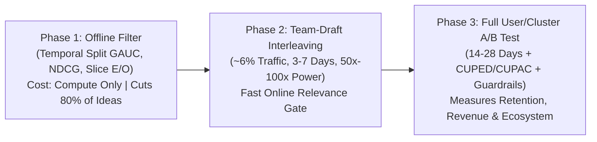

---

### 4.4 Network Effects, Marketplace Interference & SUTVA Violations

Standard user-level A/B tests rely on the **Stable Unit Treatment Value Assumption (SUTVA)**: unit $`i`$'s potential outcome $`Y_i(Z_i)`$ depends *only* on unit $`i`$'s own treatment assignment $`Z_i`$, never on the assignments $`Z_{-i}`$ of other units.

In modern RecSys platforms, **SUTVA breaks catastrophically** in three ubiquitous settings:

| Setting | Interference Mechanism (How SUTVA Breaks) | Direction of Naive User-Split Bias | Production Solution |
| :--- | :--- | :--- | :--- |
| **Social Networks** (LinkedIn, Meta, X) | Treatment user shares/likes/comments more -> Control friends see more viral posts and engage more (**positive spillover**) | **Underestimates** true full-launch lift (Control gets lifted too!) | **Graph Cluster / Ego-Cluster Randomization** |
| **Two-Sided Marketplaces** (DoorDash, Uber, Airbnb) | Shared physical supply (couriers, drivers, listings): Treatment captures the best couriers/listings, starving Control (**cannibalization**) | **Overestimates** lift (often $`2\times`$ fake gain stolen from Control!) | **Switchback Experiments** or **Geo / Market Randomization** |
| **Online Ads Auctions** (Google Ads, Meta Ads) | Shared advertiser budgets & auction clearing prices: Treatment wins more auctions, driving up CPCs and draining Control's budget (**auction cannibalization**) | **Severe overestimation** of Treatment ROI | **Budget-Split / Cookie-Day Randomization** |

#### 4.4.1 Graph Cluster & Ego-Cluster Randomization (LinkedIn — Saint-Jacques et al., 2019)
In a social graph $`G = (V, E)`$, naive random assignment puts ~50% of every user's friends in the opposite arm.
*   **Full Graph Partitioning:** Partition $`G`$ into $`C`$ balanced clusters minimizing cross-cluster edges, then randomize entire clusters into $`T`$ or $`C`$.
    *   *Cost — Variance Inflation (Design Effect):* Users inside a tightly connected cluster behave similarly (positive **Intraclass Correlation Coefficient**, $`\text{ICC} = \rho_{\text{intra}}`$). With average cluster size $`m`$, variance inflates by the **Design Effect**:

```math
\text{DEFF} = 1 + (m - 1) \cdot \text{ICC}
```

Even a tiny $`\text{ICC} = 0.01`$ with cluster size $`m = 1{,}000`$ inflates variance by **$`10.99\times`$**—requiring $`11\times`$ more users!
*   **LinkedIn's Ego-Cluster Design:** Rather than cutting the entire billion-node graph into massive noisy communities, sample sparse focal **"egos"** plus their immediate 1-hop **"alters"** (forming small, non-overlapping ego-clusters) and randomize at the cluster level. Because an ego's immediate neighborhood shares the same treatment status, ego-clusters cleanly isolate the **"one-out" peer network effect** at vastly lower variance inflation and engineering cost than global graph partitioning.

#### 4.4.2 Switchback Experiments & Washout Buffers (DoorDash / Uber — Bojinov et al., 2023)
When testing dispatch, ETA, or ranking algorithms on a city with a shared fleet of couriers/drivers, you cannot split users in the same city at the same time—they fight over the exact same couriers.
*   **Switchback Design:** Partition traffic into `(region, time-window)` blocks (e.g., `San Francisco × 30-minute slots`) and randomly alternate the **entire city** between Control and Treatment across time blocks.
*   **Window Size Bias–Variance Trade-Off:** Short windows (e.g., 15–30m) yield more randomization units and lower variance, but suffer higher boundary carryover bias; long windows (e.g., 2–4h) reduce carryover bias at the cost of fewer blocks and higher variance—calibrate the optimal window length and washout duration via historical A/A switchback simulations.
*   **Temporal Carryover Bias & Washout Buffers:** An order dispatched at minute 29 under Treatment still occupies a courier at minute 33 when the city switches to Control! To eliminate boundary spillover, discard a **washout (burn-in) buffer** (e.g., first 5–10 minutes of each block) from metric computation:

```
SWITCHBACK TIMELINE WITH WASHOUT / BURN-IN BUFFERS (Region: Metro A, 30-Min Blocks):

  00:00      00:05                  00:30      00:35                  01:00      01:05                  01:30
    │          │                      │          │                      │          │                      │
    ├──[WASH]──┼────── CONTROL ───────┼──[WASH]──┼───── TREATMENT ──────┼──[WASH]──┼────── CONTROL ───────┤
    (drop 5m)    (25m clean eval)      (drop 5m)    (25m clean eval)     (drop 5m)    (25m clean eval)
```

*   **CRITICAL ANALYSIS TRAP (62% False Positive Rate!):** DoorDash documented that running a naive delivery-level t-test on switchback data yields a **62% false positive rate** (instead of 5%), because deliveries inside the same `(city, 30m)` block are heavily correlated by weather and lunch surges!
    *   **Correct Inference:** Either aggregate to block-level averages (valid `0.05` FPR, lower power), fit a **Multilevel Model (MLM)** with random effects (DoorDash: `0.03` FPR, `0.93` power, ~30% shorter runtime), or compute **Cluster-Robust Standard Errors (CRSE / Sandwich Estimator)** which are model-free and resilient to random-effect misspecification—paired with **CUPAC** covariates to recover statistical power.

#### 4.4.3 Two-Sided & Budget-Split Experiments in Ads Auctions (Liu et al., KDD 2021)
Suppose an ad campaign has a `$1,000/day` budget and you test a better pCTR model via standard user-split (50% Control users, 50% Treatment users):
*   The Treatment ranker finds higher-converting users and bids more aggressively, spending `$650` of the advertiser's `$1,000` budget in Treatment and leaving only `$350` for Control!
*   Control's revenue drops by 30% solely because Treatment **stole its shared budget**, making Treatment appear `+85%` better when total advertiser spend didn't increase by a single dollar!
*   **Budget-Split Solution:** Split *both* traffic (50% users to T, 50% to C) **and** every advertiser's budget (each campaign gets two completely isolated `$500` sub-wallets and independent pacing controllers—one for the Treatment auction, one for the Control auction). Because Treatment and Control now run in **parallel, isolated micro-economies**, budget cannibalization and clearing-price leakage drop to zero!

#### 4.4.4 Quasi-Experimental & Observational Causal Inference (When Randomization Is Impossible)
Sometimes randomization is legally, commercially, or operationally impossible—such as regulatory compliance launches (e.g., EU DMA), single-city pricing rollouts, Super Bowl TV campaigns, opt-in creator tools, or emergency outage mitigations. In these regimes, RecSys teams rely on **three quasi-experimental causal estimators**:
1.  **Difference-in-Differences (DiD):** Compare the pre-to-post change of a treated cohort/region ($`T`$) against an untreated control cohort/region ($`C`$):

```math
\hat{\tau}_{\text{DiD}} = \left(\bar{Y}_{T,\text{post}} - \bar{Y}_{T,\text{pre}}\right) - \left(\bar{Y}_{C,\text{post}} - \bar{Y}_{C,\text{pre}}\right)
```

DiD hinges critically on the **Parallel Trends Assumption** (absent treatment, $`T`$ and $`C`$ would have evolved along identical trajectories—always audit pre-period placebo trends!) and requires **Cluster-Robust Standard Errors (CRSE)** at the market/unit level to account for serial correlation across days.
2.  **Synthetic Control (Abadie et al., 2010):** When no single control region satisfies parallel trends—or only **one** region/market is treated (e.g., launching a new feed algorithm exclusively in Tokyo)—construct a convex weighted combination of untreated **donor-pool markets** ($`\sum_j w_j = 1,\; w_j \ge 0`$) whose pre-treatment trajectory closely replicates the treated market's pre-period outcomes and covariates. Causal lift is the post-launch gap between the treated market and its synthetic twin, validated via **placebo permutation tests** across untreated donors.
3.  **Back-Door Adjustment (Pearl's Causal Framework):** For urgent production rollouts, incident fixes, or observational opt-in features where panel controls are unavailable, block all confounding **back-door paths** between treatment $`Z`$ and outcome $`Y`$ by conditioning on a sufficient set of **unaffected pre-treatment covariates $`X`$** (via regression adjustment, Inverse Probability of Treatment Weighting / propensity scores, or Doubly Robust estimators):

```math
P\!\left(Y \mid \text{do}(Z = z)\right) = \sum_{x} P(Y \mid Z = z, X = x)\, P(X = x)
```

*Critical caveat:* Only condition on pre-treatment confounders—conditioning on **post-treatment mediators or colliders** introduces severe selection bias rather than removing confounding.

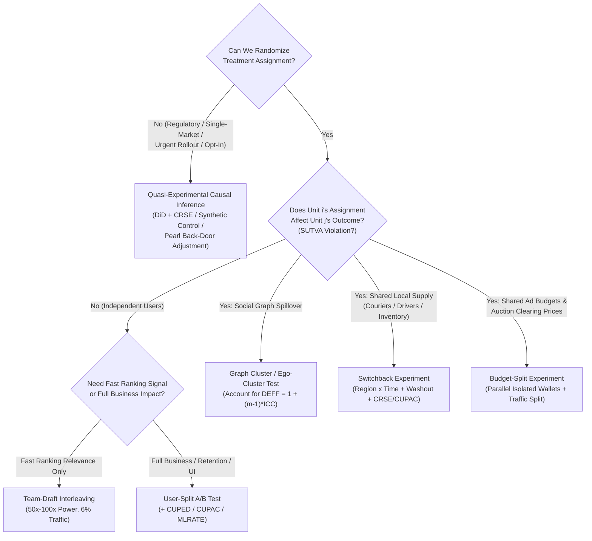

---

### 4.5 Long-Term Effects, Holdbacks & The Offline-to-Online Debugging Playbook

#### 1. Long-Term Holdbacks, Symbiosis Bias & Surrogate Metrics
*   **Long-Term Holdbacks (Persistent 1%–5% Holdout):** Over a quarter, a team might ship 15 separate launches each showing `+0.3%` in 14-day A/B tests—expecting `+4.5%` cumulative gain. Yet a persistent 2% holdback pinned to the Q1 model often reveals only `+1.8%` true cumulative gain! Why? Novelty decay, overlapping cannibalization across launches, and **ad-load / notification fatigue** that takes 60–90 days to surface as churn.
*   **Symbiosis Bias in Continuously Trained RecSys:** When Control and Treatment models both train daily on the *shared* production interaction log (90% generated by Control, 10% by Treatment), Treatment benefits from Control's exploration data—and once scaled to 100%, Treatment's own data distribution shifts! Detect symbiosis bias by running **data-diverted (split-training) experiments** where Treatment trains strictly on Treatment's own logged interactions for major architecture launches.
*   **The Surrogate Index (Athey, Chetty, Imbens & Kang, 2019; Netflix 14-Day -> 63-Day):** Waiting 90 days to measure subscription retention stalls iteration. Instead, learn a **Surrogate Index** model $`\hat{S}_i = \mathbb{E}[Y_{\text{long}} \mid S_{\text{short}, i}]`$ on historical data that predicts 63-day/90-day retention from a rich vector of 7–14 day behavioral fingerprints (days active, distinct genres consumed, completion rate, search abandonment). Under the **Prentice Surrogacy Condition** (treatment affects $`Y_{\text{long}}`$ *only through* $`S_{\text{short}}`$):

```math
\tau_{\text{long}} = \mathbb{E}\!\left[\hat{S}_i \mid Z_i = 1\right] - \mathbb{E}\!\left[\hat{S}_i \mid Z_i = 0\right]
```

At Netflix, a 14-day surrogate index aligns with direct 63-day long-term measurements ~95% of the time. *Crucial caveat:* Never blindly optimize models directly against a fixed surrogate without quarterly holdback recalibration—**Goodhart's Law** ensures models will learn to game short-term proxies without lifting true retention.

#### 2. The Offline-to-Online Mismatch Debugging Playbook
Every RecSys team eventually hits the dreaded launch blocker: **Offline GAUC improved `+1.5%`, yet Online A/B CTR / Watch-Time is flat or `-0.5%`!** Rather than guessing randomly, traverse this structured 6-branch diagnostic tree in order of fastest falsifiability:

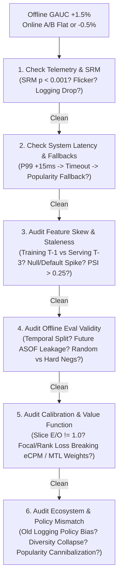

1.  **SRM & Telemetry Integrity:** First verify zero SRM, zero client crash spikes, and identical trigger-point logging (only count users who actually *triggered* the changed ranking path—diluting triggered users with 90% unexposed traffic destroys power!).
2.  **Latency Regression & Silent Fallbacks:** A heavier neural model that adds `+18ms` to P99 latency can push 3% of requests past the orchestrator's hard timeout, silently falling back to a crude popularity cache—erasing the entire `+1.5%` model quality gain! Always check **timeout rate** and **score-depth truncation** alongside latency.
3.  **Online-Offline Feature Skew & Staleness:** Compare logged online serving feature values against offline training values on the *exact same* request IDs (replay audit). For example, DoorDash documented reducing an online-offline gap from **`4.3%` down to `0.76%`** after discovering training assumed `T-1` feature freshness while production had `T-3` lag (deep neural nets are far more sensitive to continuous offset shifts than bucketized GBDTs!).
4.  **Offline Leakage & Evaluation Bias:** Did offline evaluation use a random split instead of a strict temporal split? Did a missing ASOF timestamp leak post-click aggregates? Did offline eval score against easy random negatives instead of post-retrieval hard negatives?
5.  **Calibration Shift Disrupting Downstream Value Functions / Auctions:** Adding a pairwise ranking loss, Focal Loss, or changing negative downsampling shifts predicted probability scales without hurting GAUC! If `pClick` shifts from `0.05` to `0.08` while `pDwell` stays unchanged, the downstream value function $`w_1 \hat{p}_{\text{click}} + w_2 \hat{p}_{\text{dwell}}`$ suddenly over-weights clickbait—or in Ads, breaks `eCPM = Bid × pCTR`. Check **Slice E/O** and **ECE** immediately!
6.  **Logging Policy Bias & Diversity/Cannibalization Collapse:** Offline logs only contain items shown by the *old* ranker. A new model can win offline GAUC by slightly reordering old impressions while online it promotes hyper-narrow, redundant head items (rising Gini coefficient, falling intra-list diversity, higher scroll-past fatigue)—validate with **popularity-stratified GAUC**, **Offline Policy Evaluation (OPE)**, and **intra-list diversity telemetry**.

> **Offline Policy Evaluation (IPS & SNIPS) & The Support-Overlap Limit:** Given logged interactions $`(x_i, a_i, r_i)`$ collected under logging policy $`\pi_{\text{old}}`$ and target policy $`\pi_{\text{new}}`$ with importance weight $`w_i = \frac{\pi_{\text{new}}(a_i \mid x_i)}{\pi_{\text{old}}(a_i \mid x_i)}`$, counterfactual policy value is estimated via **Inverse Propensity Scoring (IPS)** or lower-variance **Self-Normalized IPS (SNIPS)**:

```math
\hat{V}_{\text{IPS}} = \frac{1}{n} \sum_{i=1}^n w_i r_i, \qquad \hat{V}_{\text{SNIPS}} = \frac{\sum_{i=1}^n w_i r_i}{\sum_{i=1}^n w_i}
```

> **Critical Support-Overlap Limitation:** OPE fails completely whenever $`\pi_{\text{new}}(a \mid x) \gt 0`$ on items where $`\pi_{\text{old}}(a \mid x) = 0`$ (zero logging propensity)—you cannot counterfactually evaluate newly surfaced or unshown catalog items without randomized exploration (e.g., $`\epsilon`$-greedy exploration logging or small randomized exposure buckets).

---

## 5. Deep-Dive Interview Questions & Detailed Answers

### Question 1: Why did Meta's HSTU replace Softmax attention with Pointwise SiLU attention, and how does M-FALCON make scoring thousands of candidates feasible within a strict latency SLA?
**Candidate Answer:**
"HSTU replaces standard Softmax attention for two fundamental recommendation-specific reasons:

1.  **Preserving Engagement Intensity (Count Information):** Softmax forces attention weights across every row to sum to $`1.0`$. If User A watched 100 cooking videos and User B watched 2 cooking videos, Softmax averages both histories to a vector of norm $`\approx 1.0`$, erasing *how intensely* User A engages with cooking. HSTU applies **SiLU element-wise** without row-wise normalization:

```math
A(X)V(X) = \text{SiLU}\!\left(Q(X)K(X)^T + \text{rab}^{p,t}\right) V(X)
```

Because each relevant historical event independently contributes $`\text{SiLU}(\text{score}) \cdot v_j`$, User A's aggregated representation naturally carries a vastly larger magnitude than User B's—directly encoding engagement frequency and intensity—while `LayerNorm` + element-wise gating (`⊙ U(X)`) stabilizes training and replaces the entire Transformer FFN (cutting activation memory from `33d` to `14d` per layer).
2.  **Explicit Wall-Clock Time via $`\text{rab}^{p,t}`$:** Adding log-bucketized positional *and* wall-clock temporal biases lets the attention mechanism distinguish an action 2 minutes ago in the same session from one 5 days ago.

To serve this at ranking scale (scoring $`m = 1{,}000+`$ candidates against a shared history of length $`n = 4{,}096`$ without paying $`O(m \cdot n^2 d)`$), **M-FALCON** computes the user history's Key-Value cache **once**, then scores candidates in micro-batches of size $`b_m`$ using a **block-diagonal attention mask**: every candidate attends to all $`n`$ cached history tokens and itself, but **never to other candidates**, and all candidates share the same position/timestamp in $`\text{rab}^{p,t}`$. This guarantees mathematically exact isolated candidate scores while amortizing the quadratic history cost across the entire candidate set."

---

### Question 2: Explain how ByteDance's Monolith achieves 1-minute real-time parameter updates without hash collisions or saturating cluster network bandwidth. What fault-tolerance trade-off does it make?
**Candidate Answer:**
"Monolith solves three coupled bottlenecks of live streaming RecSys:

1.  **Zero Hash Collisions via Cuckoo Hash Tables:** Fixed modulo-hashed arrays corrupt gradients whenever a viral video collides with a niche video. Monolith uses dynamic **Cuckoo Hash Tables** ($`T_0, T_1`$ with hashes $`h_0, h_1`$), guaranteeing $`O(1)`$ worst-case lookup (checking at most 2 slots) and dynamic collisionless insertion via cuckoo eviction. To stop power-law tail noise and bots from exhausting RAM, IDs are only admitted after crossing an **occurrence frequency threshold** (tracked via a compact sketch) and inactive entries expire automatically via **TTL / LFU eviction**.
2.  **Split-Cadence 1-Minute Delta Sync:** Monolith separates Training PS from Serving PS so gradient writes never block inference. Because updating a sparse item embedding is *local* while updating dense MLP weights is *global*, Monolith tracks a **touched-keys hash set** of sparse IDs modified in the last 60 seconds and pushes **only those dirty rows** every minute (slashing network bandwidth by $`1{,}000\times`$, e.g., from `8.53 GB/s` for a full `512 GB` dump to `8.53 MB/s`), while syncing dense MLP weights daily (as specified in the Monolith paper, or every few hours in production variants) for stability.
3.  **ML-Aware Fault Tolerance Trade-Off:** Writing synchronous multi-TB checkpoints every minute would kill throughput. Instead, Monolith saves full snapshots asynchronously once per day. If 1 out of 1,000 PS shards crashes, restoring a slightly stale snapshot loses recent updates for only `0.1%` of IDs—which self-heal within minutes from live traffic—trading strict database durability for massive streaming throughput."

---

### Question 3: How does temporal feature leakage happen in RecSys training pipelines, and how do you architect a streaming feature store to guarantee online-offline parity?
**Candidate Answer:**
"Temporal leakage occurs whenever a training row for an impression at timestamp $`t`$ joins a feature value computed *after* $`t`$. A classic bug is joining Tuesday's impression logs with Tuesday's end-of-day aggregated user table (`JOIN ON user_id, date`): if the user clicked at 10:02 AM, the 11:59 PM snapshot of `user_7d_clicks` already includes that click! Offline AUC jumps artificially, while live serving collapses because the future counter does not exist at 10:00 AM.

To guarantee zero leakage and parity, I combine three architectural controls:
1.  **Strict Point-in-Time (ASOF) Joins:** Every offline feature backfill must enforce `max(feature_write_ts) <= event_ts - ingestion_lag_buffer`, faithfully simulating real-world Flink/Kafka propagation lag.
2.  **Log-and-Wait or Unified Kappa Transforms:** For latency-critical L2 rankers, use **Log-and-Wait**—log the exact serialized feature snapshot read by the online server at inference time, then join delayed labels downstream in Flink/Spark (zero training-serving skew by construction). Pair this with a **Unified Kappa Feature Store** (single Flink/Feast/Tecton transform definition for both live streaming and historical replay) so new features can still be backfilled cleanly without duplicating logic.
3.  **Continuous Skew & Freshness Telemetry:** Monitor per-feature age percentiles (`p95/p99`), null/default rates, and **PSI** (`>= 0.25` critical alert) comparing online logged vectors against offline batch recomputations, with Soft/Hard TTL fallbacks when upstream pipelines lag."

---

### Question 4: Your 50/50 A/B test shows +1.8% revenue lift with p = 0.0001 after 4 days, but Control has 495,000 users and Treatment has 505,000 users. Do you ship?
**Candidate Answer:**
"**No—stop immediately and invalidate the experiment.** Two independent red flags disqualify this result:

1.  **Severe Sample Ratio Mismatch (SRM):** Testing `495,000` vs. `505,000` against an expected `500,000` / `500,000` split gives Pearson's Chi-Squared:

```math
\chi^2 = \frac{(-5{,}000)^2}{500{,}000} + \frac{(+5{,}000)^2}{500{,}000} = 100.0 \quad \left(p \lt 10^{-22}\right)
```

An SRM of this magnitude guarantees non-random selection bias—for example, Treatment crashing on low-end Android devices (dropping low-spending users from telemetry), inconsistent bot filtering, or employee dogfooding injected into Treatment. Because the two arms no longer represent identical populations, *every* metric including the `+1.8%` revenue lift is untrustworthy. I would run a **flicker check** and fit a diagnostic logistic regression `is_treatment ~ country + os_version + device + tenure` with **Wald tests** to isolate the broken slice, fix the instrumentation bug, and restart cleanly.
2.  **Peeking & Novelty Risk (4-Day Window):** Even after fixing SRM, 4 days violates fixed-horizon testing (peeking inflates Type I error to ~25%–30% unless using always-valid **mSPRT**) and misses weekly seasonality and **novelty decay**. Once restarted cleanly, the test must run for at least **14 full days** while tracking daily rolling lift curves."

---

### Question 5: Derive CUPED's variance reduction factor from first principles. How does CUPAC extend CUPED, and what critical leakage trap must you avoid when using ML covariates?
**Candidate Answer:**
"In CUPED (Deng et al., WSDM 2013), we adjust each user's post-experiment metric $`Y`$ using a pre-experiment covariate $`X`$ that is independent of treatment assignment:

```math
Y_{\text{cuped}} = Y - \theta \left(X - \mathbb{E}[X]\right)
```

Because randomization guarantees $`\mathbb{E}[X^{(T)}] = \mathbb{E}[X^{(C)}] = \mathbb{E}[X]`$, the adjustment has zero effect on the expected Treatment-Control difference—preserving **exact unbiasedness**. Expanding the variance:

```math
\text{Var}(Y_{\text{cuped}}) = \text{Var}(Y) + \theta^2 \text{Var}(X) - 2\theta\,\text{Cov}(Y, X)
```

Setting the derivative with respect to $`\theta`$ to zero yields the optimal OLS slope $`\theta^* = \frac{\text{Cov}(Y, X)}{\text{Var}(X)}`$. Substituting $`\theta^*`$ back gives:

```math
\text{Var}(Y_{\text{cuped}}) = \text{Var}(Y)\!\left(1 - \rho^2\right)
```

where $`\rho = \text{Corr}(Y, X)`$. If $`\rho = 0.70`$, variance drops by **49%**, cutting required sample size nearly in half!

**Extending to CUPAC (DoorDash 2020):** Instead of a single linear pre-experiment metric, CUPAC trains a nonlinear ML model (e.g., GBDT) on rich pre-experiment and exogenous features to predict $`\hat{Y} = f(X_{\text{pre}})`$, using $`\hat{Y}`$ as the control variate (achieving higher $`\rho^2`$ and handling entities with no prior history, like new delivery orders).

**The Critical Trap — Overfitting & Treatment Leakage:** Never include treatment assignment $`Z`$ as a feature, and never train $`f(\cdot)`$ on the same in-experiment rows you evaluate—doing so overfits in-experiment residuals, underestimates variance, and inflates false positives. Always train $`f(\cdot)`$ either on strictly **historical pre-experiment data** or via **$`K`$-Fold Cross-Fitting** (predicting fold $`k`$ strictly from a model trained on the other $`K-1`$ folds, blind to $`Z`$)."

---

### Question 6: How do you choose between User-Split A/B, Team-Draft Interleaving, Ego-Cluster, Switchback, and Budget-Split experiments?
**Candidate Answer:**
"The choice is dictated by two axes: **(1) whether SUTVA holds or is violated by interference**, and **(2) whether you need fast ranking sensitivity vs. full ecosystem causality**:

1.  **Team-Draft Interleaving (No SUTVA Violation, Fast Ranking Signal Only):** Use as a Phase-2 filter when comparing two rankers on click/engagement relevance. Blending Ranker A and Ranker B inside the same request via coin-flip team drafting eliminates inter-user variance and cancels position bias, yielding **$`50\times\text{–}100\times`$ higher power** (~6% traffic). *Never* use it for UI changes, slate diversity, retention, or revenue.
2.  **Standard User-Split A/B + CUPED/CUPAC (SUTVA Holds, Full Business Impact):** The default final launch gate for independent consumer surfaces (e.g., single-player video/movie feeds) to validate 14–28 day retention, dwell time, and guardrails.
3.  **Graph Cluster / Ego-Cluster Randomization (Social Network Spillover):** When treatment changes sharing, messaging, or commenting on a social graph (LinkedIn/Meta), naive user-split underestimates lift because treated users lift control friends. Randomize ego-clusters (ego + immediate alters) and adjust variance for the Design Effect $`\text{DEFF} = 1 + (m-1)\cdot \text{ICC}`$.
4.  **Switchback Experiments (Shared Local Supply Cannibalization):** In two-sided marketplaces (DoorDash/Uber), user-split overestimates lift because Treatment steals shared couriers/drivers from Control. Alternate `(region, time-window)` blocks with **washout buffers** to remove temporal carryover, and analyze with **CRSE (Sandwich Estimator) or MLM + CUPAC** (avoiding the ~62% false positive rate of naive delivery-level t-tests!).
5.  **Budget-Split Experiments (Ads Auction Interference):** When advertisers have finite budgets and shared clearing prices, user-split lets Treatment cannibalize Control's wallet. Split both user traffic *and* every advertiser's budget 50/50 into isolated parallel auctions and pacing controllers."

---

### Question 7: Your new L2 ranking model improved Offline GAUC by +1.5%, yet in Online A/B testing CTR dropped -0.5% and watch time is flat. Walk through your exact debugging playbook.
**Candidate Answer:**
"I debug offline-to-online reversals systematically from cheapest infrastructure checks to deepest modeling/ecosystem causes—never guessing blindly:

1.  **Gate 1 — Experiment Integrity & Telemetry:** Check SRM (`p < 0.001`), flicker rate, client crash logs, and triggered-traffic dilution. Confirm we are evaluating the exact triggered cohort.
2.  **Gate 2 — Latency & Silent Timeout Fallbacks:** Compare P50/P99 inference latency and orchestrator timeout rates between Treatment and Control. Even a `+15ms` P99 jump on a heavier model can push 3% of requests into a crude popularity fallback, instantly erasing a `+1.5%` model gain.
3.  **Gate 3 — Online-Offline Feature Skew & Staleness Replay:** Take 100K identical served request IDs and diff the online logged feature vectors against the offline training pipeline's values. Check feature age (`T-1` offline vs. `T-3` online), null/default-value spikes, and **PSI** (`>= 0.25`). Continuous DNNs degrade dramatically under small feature-offset shifts that trees ignore.
4.  **Gate 4 — Offline Leakage & Eval Hygiene:** Verify strict temporal splits (no random split peeking into the future), point-in-time ASOF boundaries (no post-click aggregate leakage), and confirm offline eval used post-retrieval hard negatives rather than easy random negatives.
5.  **Gate 5 — Calibration Drift Breaking Downstream Value Functions:** GAUC is purely rank-order invariant—it is blind to calibration! If the new model changed loss functions (e.g., added pairwise/Focal loss or altered negative downsampling without exact calibration correction $`\text{logit}(p) = \text{logit}(q) + \log s`$, where $`s \in (0, 1)`$ is the **negative retention (keep) rate**), `pClick` calibration (Slice E/O, ECE) may have shifted, skewing the downstream multi-task value formula $`w_1 \hat{p}_{\text{click}} + w_2 \hat{p}_{\text{dwell}}`$ or ad auctions (`eCPM = Bid × pCTR`).
6.  **Gate 6 — Logging Policy Bias & Diversity Collapse:** Offline data only evaluates items shown by the *old* ranker. Inspect online **popularity Gini**, **catalog coverage**, and **intra-list diversity**: if the new model over-exploited narrow head items or clickbait, offline GAUC rises on old logs while live users experience rapid feed fatigue. Retune serving value weights via Bayesian Optimization or add exploration/diversity guardrails."

---

### Question 8: How does Netflix's Foundation Model handle daily catalog cold-start without separate cold/warm models, and when would you choose a unified generative funnel (like OneRec) over a hybrid multi-stage cascade?
**Candidate Answer:**
"Unlike LLMs with static word vocabularies, a recommendation foundation model faces daily catalog churn—brand-new titles launch with zero viewing history and must be recommended on Day 0.

1.  **Netflix's Two-Part Cold-Start Architecture (Zero Manual Switching):**
    *   **Age-Based Attention Mixing + ID Masking:** Every title combines a learned behavioral `id_emb` with a rich `metadata_emb` (genre, tone, cast, storyline) via an attention mixing layer conditioned on `entity_age`. At pre-launch (`age=0`), the layer weights `metadata_emb` at ~95%; as views accumulate over days and weeks, it smoothly shifts weight toward `id_emb` (~90%). To prevent the Transformer from ignoring metadata during training on warm titles, Netflix **randomly masks or adds noise to `id_emb`** (ID Dropout), forcing the backbone to build strong metadata generalization.
    *   **Warm-Start Incremental Expansion + Orthogonal Stabilization:** When a new title launches, the embedding table expands by one row initialized from metadata-similar titles and warm-starts daily fine-tuning from the prior checkpoint. Because downstream models consume foundation embeddings as features, Netflix applies an **orthogonal low-rank alignment** across training runs so latent coordinate axes remain stable without retraining every downstream consumer.
2.  **When to Choose a Unified Generative Funnel (OneRec) vs. a Hybrid Multi-Stage Cascade:**
    *   **Choose OneRec-Style End-to-End Generation (Encoder-Decoder + Sparse MoE + Reward-Guided DPO)** on fluid, high-volume media feeds (like short-form video) where session-level coherence matters most, hard per-item business filters are minimal, and you have GPU budgets to run autoregressive Semantic ID beam search.
    *   **Keep a Hybrid Multi-Stage Cascade (Retrieval + HSTU/FM Ranking + Re-Ranking)** for **Ads, E-Commerce, and Two-Sided Marketplaces**, where real-time inventory filtering, calibrated `eCPM = Bid × pCTR` auctions, budget pacing, strict `<50ms` P99 SLAs, and per-stage debuggability are non-negotiable."

---

## What's Next: Transitioning to Part 6

With Parts 1 through 5 complete, you now possess the complete industrial toolkit—from multi-channel & generative retrieval, DLRM/DCN-v2/MTL scoring, sequential modeling & debiasing, and slate re-ranking, all the way to trillion-parameter HSTU/Foundation Models, Monolith streaming ML Ops, and causal experimentation.

In **[Part 6](./Part_6_Industrial_Teardowns_and_System_Design_Playbook.md)**, we synthesize everything into **end-to-end production system design blueprints** across the industry's canonical domains:
*   **Short-Form Video Feeds** (TikTok / YouTube Shorts — sub-minute streaming cold start & watch-through optimization).
*   **Long-Form Streaming & Content Feeds** (YouTube / Netflix / LinkedIn Feed — multi-horizon satisfaction & foundation model integration).
*   **E-Commerce Search & Discovery** (Hybrid lexical + dense retrieval, query understanding, delayed purchase attribution & inventory constraints).
*   **Online Ads Ranking & Auctions** (Calibrated `pCTR`/`pCVR`, GSP/VCG auctions, PID budget pacing & budget-split testing).
*   **Two-Sided Marketplaces & Social Graphs** (Dual-sided matching, supply feasibility, graph retrieval & switchback/ego-cluster validation).
