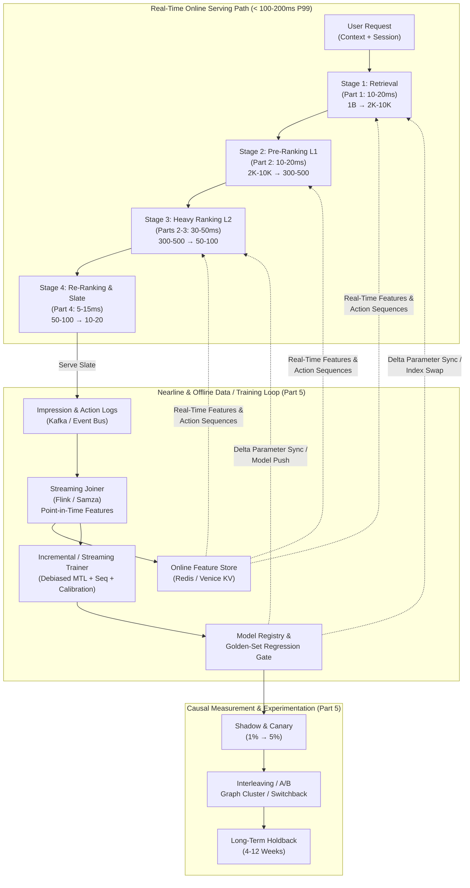
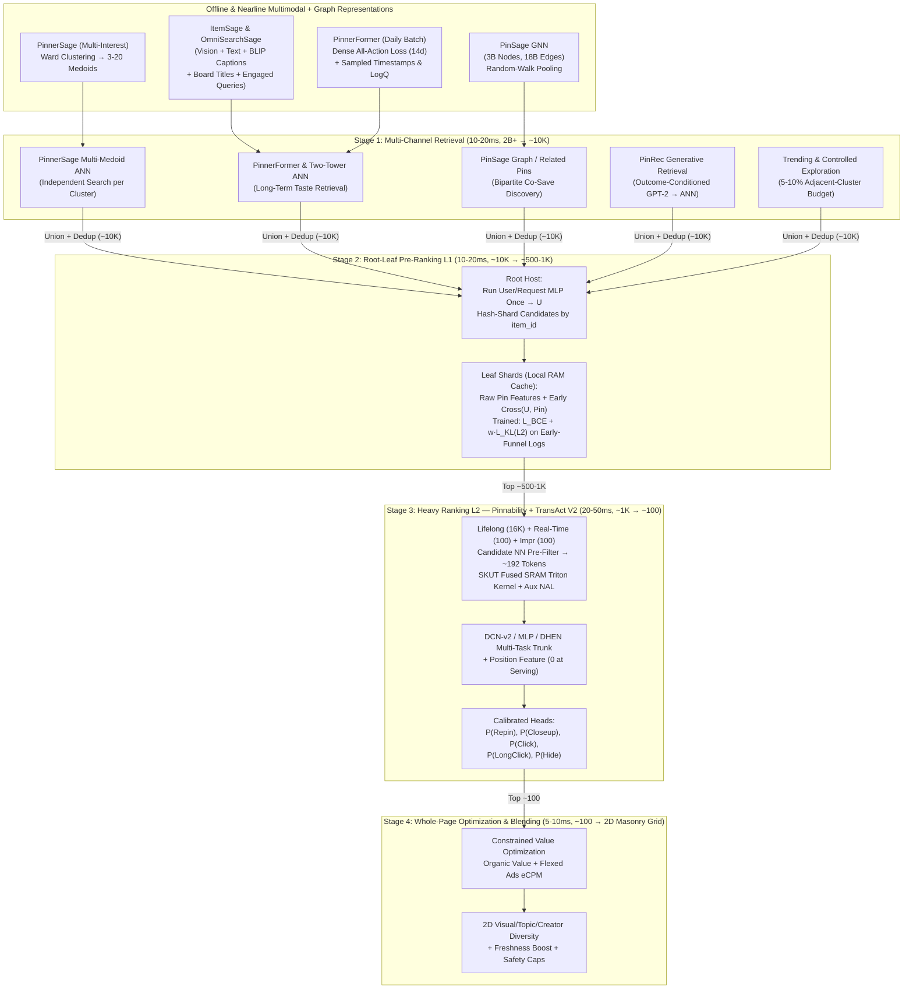
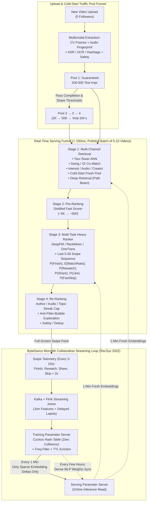
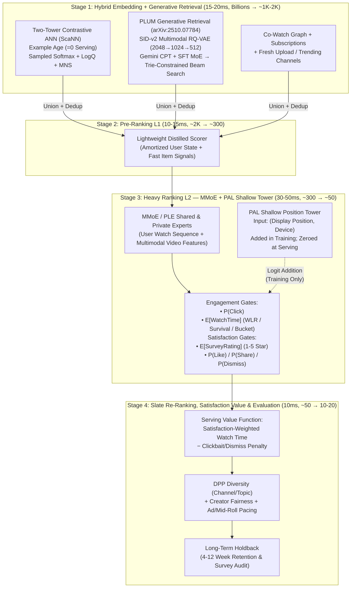
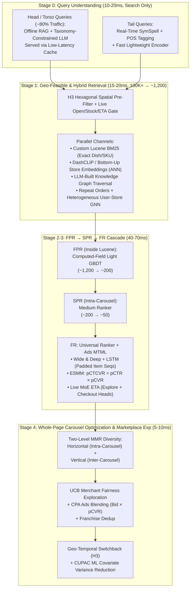
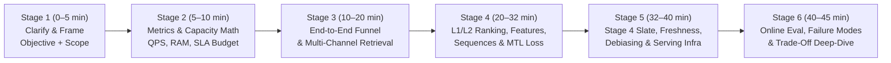
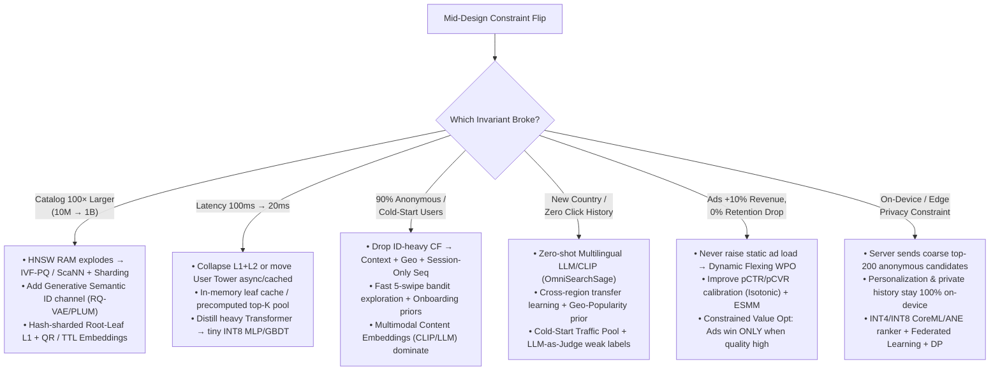
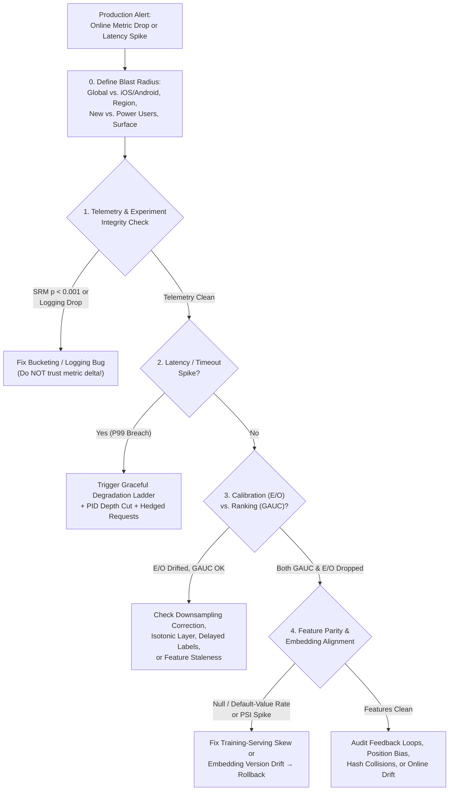
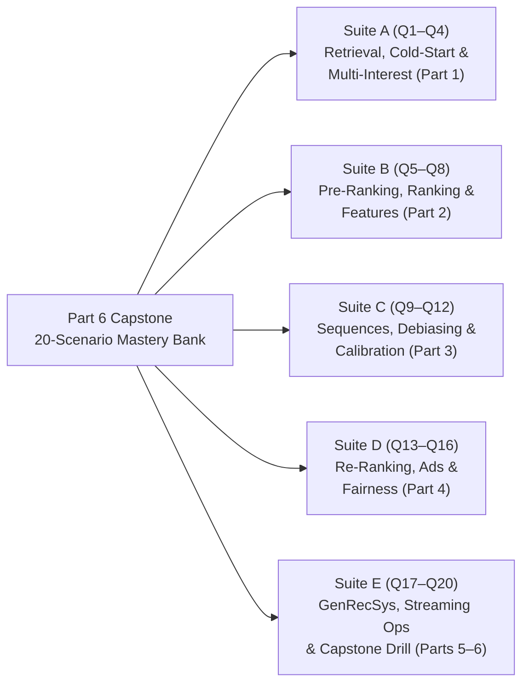

# Part 6: Real-World Industry Architectures Deconstructed & ML System Design Execution Playbook

> The capstone guide synthesizing the entire 6-part Recommendation Systems series into complete, production-verified industry teardowns (**Pinterest**, **LinkedIn**, **TikTok / ByteDance**, **YouTube**, and **Two-Sided Local Marketplaces**), an actionable **45-minute ML System Design execution framework**, **back-of-the-envelope capacity & latency math**, a **constraint-shift pivot playbook**, a **12-incident production failure-mode diagnostic matrix**, and **20 end-to-end scenario Q&As**.

---

## 1. The Capstone Synthesis: Connecting Parts 1 Through 5

Across Parts 1–5, we dissected the individual building blocks of industrial recommendation systems:
*   [**Part 1**](./Part_1_Retrieval_and_Candidate_Generation.md) narrowed $`100\text{M}\text{–}10\text{B}`$ items down to $`1,000\text{–}5,000`$ candidates in $`\le 15\text{ms}`$ via multi-channel retrieval (Two-Tower ANN, Graph/I2I, Multi-Interest clustering, Filtered GPU search, and Generative Semantic IDs).
*   [**Part 2**](./Part_2_Ranking_PreRanking_and_Feature_Engineering.md) engineered the Pre-Ranking (L1) and Heavy Ranking (L2) scoring engines—solving the Feature Availability Trap, terabyte sparse embeddings, explicit feature crosses (DCN-v2, DLRM, DHEN), and multi-task probability calibration decoupled from serving value functions.
*   [**Part 3**](./Part_3_Sequential_Behavior_and_Loss_Debiasing.md) modeled temporal user intent across $`100\text{–}16,000+`$ historical actions (DIN/DIEN, SIM/TWIN, TransAct, Feed SR) and debiased training logs against position bias (PAL Shallow Tower, IPS/SNIPW), negative downsampling, and delayed conversions.
*   [**Part 4**](./Part_4_ReRanking_Diversity_and_Slate_Optimization.md) transformed pointwise scores into coherent, multi-stakeholder user slates (MMR, DPP, Submodular optimization, PRM/Seq2Slate, Ads-Organic pacing, and global attention budgeting).
*   [**Part 5**](./Part_5_Generative_RecSys_Streaming_MLOps_and_Experimentation.md) bridged the modern frontier: Generative RecSys scaling laws (HSTU, Foundation Models), minute-level streaming parameter servers (Monolith), point-in-time feature stores, and network-aware causal experimentation (CUPED/CUPAC, Interleaving, Graph Cluster Randomization, and Switchback tests).

In real production environments, however, **no component exists in isolation**. Every architectural decision at one stage reverberates across the entire pipeline: a change in retrieval shifts the negative distribution of L1 pre-ranking; a calibration bug in L2 silently breaks Stage 4 ads-organic auctions; and network spillover invalidates naive user-level A/B tests.



### 1.1 Cross-Company Architectural Synthesis Matrix

Before deconstructing each company end-to-end, study **why** five world-class systems diverge dramatically in their choices despite sharing the same 4-stage skeleton. Every divergence traces directly back to **domain physics**: item lifespan, interaction granularity, network topology, and physical constraints.

| Dimension | **Pinterest Homefeed** | **LinkedIn Feed & Jobs** | **TikTok / ByteDance FYP** | **YouTube Home & Watch Next** | **Local Marketplace (DoorDash / E-Com)** |
|---|---|---|---|---|---|
| **Domain Physics** | Visual inspiration & multi-board planning; evergreen + seasonal pins | Professional Economic Graph; two-sided career & creator ecosystem | Full-screen autoplay swipe; 15s–3m clips; ultra-fast taste discovery | Long-form (10–60m) + Shorts; massive creator catalog & search/browse | Perishable physical inventory; geospatial ETA & courier/kitchen supply |
| **Catalog Scale & Churn** | $`2\text{B}+`$ pins, $`3\text{B}`$ graph nodes; moderate churn, long tail | $`1.2\text{B}+`$ members, $`10\text{M}+`$ active jobs; posts peak in $`\lt 24\text{h}`$ | $`100\text{M}+`$ active videos; millions uploaded daily; viral half-life hours | $`800\text{M}\text{–}5\text{B}+`$ videos; $`500+`$ hours uploaded every minute | $`100\text{K}\text{–}1\text{M}`$ stores, $`10\text{M}+`$ SKUs; live open/stock/ETA churn |
| **End-to-End Latency SLA** | $`\lt 200\text{ms}`$ P99 | $`\lt 200\text{–}500\text{ms}`$ P99 (Feed vs. LLM Search) | $`\lt 100\text{ms}`$ P99 (batched prefetch of next 5–10 videos) | $`\lt 150\text{–}200\text{ms}`$ P99 | $`\lt 150\text{–}200\text{ms}`$ P99 |
| **Stage 1: Multi-Channel Retrieval** | **PinSage** (GNN), **PinnerSage** (Ward medoids), **PinnerFormer**, **ItemSage / OmniSearchSage**, **PinRec** (generative) | **LiNR / GPU-RAR** (pre-filtered exhaustive GPU), **PYMK** graph walks, In-Network fan-out, 4B–8B / LLaMA-3 LLM bi-encoders | Two-Tower ANN, **Swing / I2I**, Creator/Audio channels, **Cold-Start Traffic Pool**, Deep Retrieval | Two-Tower (Example Age, LogQ, MNS), Co-Watch, Subscriptions, **PLUM** (RQ-VAE Semantic IDs + Trie beam search) | **H3 Geo & Live-Open Hard Filter**, BM25 (Lucene), **DashCLIP** / bottom-up store embeddings, Knowledge Graph, Repeat/GNN |
| **Stage 2: Pre-Ranking (L1)** | **Root-Leaf Early-Fusion** (amortized User MLP + leaf RAM shards), Early-Funnel Logging + KL Distillation | **GPU-RAR** in-retrieval scorer (Search); lightweight DNN/GBDT filter (Feed) | Lightweight Two-Tower / distilled shallow MLP with real-time counters | Lightweight dot-product / shallow DNN distilled from L2 | **FPR** inside Lucene computed fields + **SPR** intra-carousel GBDT/MLP |
| **Stage 3: Heavy Ranking & Sequence (L2)** | **Pinnability** + **TransAct V2** ($`16\text{K}`$ actions $`\to`$ NN pre-filter $`\to`$ **SKUT** SRAM kernel + NAL) + DCN-v2/DHEN MTL | **LiRank** (Residual DCN + Dense Gating + Isotonic Calibration) $`\to`$ **Feed SR / LiGR** ($`O(N)`$ single-pass Transformer + SRMIS + MMoE) | Multi-task DeepFM / RankMixer / OneTrans with short-term swipe sequence (completion, rewatch, share, fast-skip) | **MMoE / PLE** (Click, WLR/Survival Watch Time, Satisfaction Surveys) + **PAL Shallow Position Tower** | **Universal Ranker** (Wide & Deep + LSTM over padded item sequences) + **ESMM** ($`\text{CTR}\times\text{CVR}`$) + live ETA MoE |
| **Stage 3: Heavy Ranking & Sequence (L2)** | **Pinnability** + **TransAct V2** ($`16\text{K}`$ actions $`\to`$ NN pre-filter $`\to`$ **SKUT** SRAM kernel + NAL) + DCN-v2/DHEN MTL | **LiRank** (Residual DCN + Dense Gating + Isotonic Calibration) $`\to`$ **Feed SR** ($`O(N)`$ single-pass Transformer + SRMIS + MMoE) | Multi-task DeepFM / RankMixer / OneTrans with short-term swipe sequence (completion, rewatch, share, fast-skip) | **MMoE / PLE** (Click, WLR/Survival Watch Time, Satisfaction Surveys) + **PAL Shallow Position Tower** | **Universal Ranker** (Wide & Deep + LSTM over padded item sequences) + **ESMM** ($`\text{CTR}\times\text{CVR}`$) + live ETA MoE |
| **Stage 4: Re-Ranking & Slate** | 2D grid **Whole-Page Optimization**, visual/topic diversity, dynamic ad load & **Constrained Value Opt** | Multi-stakeholder value (Viewer + Creator + Recruiter), DetGreedy fairness, **Air Traffic Controller (ATC)** | Author/audio/topic streak caps, anti-filter-bubble injection, creator exposure floor | **DPP** diversity, creator fairness, mid-roll/pre-roll ad pacing, safety suppression | **Two-Level MMR** (intra- & inter-carousel), **UCB** merchant exploration, CPA ads blending, franchise dedup |
| **Freshness & Training Cadence** | Daily auto-retrain + real-time TransAct feature stream + nearline index | Daily incremental Feed SR + Kafka/Samza/Venice nearline CDC updates (seconds) | **Monolith**: **1-min dirty-row sparse PS sync** + hourly dense sync + Kafka/Flink joiner | Continuous/hourly incremental updates + Example Age freshness + daily full retrain | Daily batch (Fabricator) + Kafka/Flink/Redis real-time session & supply signals (Riviera) |
| **North-Star vs. Guardrail Metrics** | **NS:** Repins / Saves, Long Clicks, 7d/30d Return Rate<br/>**GR:** Hide rate, visual diversity, ad fatigue | **NS:** Weekly Engaged Sessions, Qualified Applicants, Viral Contributions<br/>**GR:** Hide/report, creator Gini, legal hiring parity | **NS:** Completion Rate, Rewatch, Share, Daily Time Spent, D7 Retention<br/>**GR:** Fast-skip $`\lt 2\text{s}`$, creator pool coverage, safety | **NS:** Satisfaction-Weighted Watch Time, Survey Score, Long-Term Retention<br/>**GR:** Clickbait/dismiss rate, borderline content, latency | **NS:** Order Conversion (CVR), GMV / LTV, On-Time Delivery<br/>**GR:** ETA error/jumps, courier utilization, merchant fairness |
| **Experimentation Signature** | Multi-week user A/B (exploration needs long horizon) | **Graph Cluster Randomization** & **UniCoRn** producer-side counterfactuals | High-velocity user A/B + stratified creator-pool traffic experiments | Interleaving + user A/B + **4–12 week Long-Term Holdbacks** | **H3 Geo-Temporal Switchback** + **CUPAC** ML covariate variance reduction |

---

## Table of Contents

1. [The Capstone Synthesis: Connecting Parts 1 Through 5](#1-the-capstone-synthesis-connecting-parts-1-through-5)
   - [1.1 Cross-Company Architectural Synthesis Matrix](#11-cross-company-architectural-synthesis-matrix)
2. [Industry Teardown #1: Pinterest Homefeed (Visual Discovery & Multi-Interest Graph Stack)](#2-industry-teardown-1-pinterest-homefeed-visual-discovery--multi-interest-graph-stack)
   - [2.1 End-to-End Architecture Overview](#21-end-to-end-architecture-overview)
   - [2.2 Representation & Retrieval: PinSage, ItemSage, OmniSearchSage, PinnerFormer & PinnerSage](#22-representation--retrieval-pinsage-itemsage-omnisearchsage-pinnerformer--pinnersage)
   - [2.3 Stage 2 Pre-Ranking: Root-Leaf Early Fusion, Early-Funnel Logging & KL Distillation](#23-stage-2-pre-ranking-root-leaf-early-fusion-early-funnel-logging--kl-distillation)
   - [2.4 Stage 3 Heavy Ranking: Pinnability & TransAct V2](#24-stage-3-heavy-ranking-pinnability--transact-v2)
   - [2.5 Stage 4 Whole-Page Diversity, Ads-Organic Blending & Constrained Value Optimization](#25-stage-4-whole-page-diversity-ads-organic-blending--constrained-value-optimization)
   - [2.6 Key Pinterest Design Insights & Trade-Offs](#26-key-pinterest-design-insights--trade-offs)
3. [Industry Teardown #2: LinkedIn Feed, Jobs & Ecosystem Optimization](#3-industry-teardown-2-linkedin-feed-jobs--ecosystem-optimization)
   - [3.1 End-to-End Architecture Overview](#31-end-to-end-architecture-overview)
   - [3.2 Retrieval: LiNR / GPU-RAR, PYMK Graph Walks & 360Brew Foundation Signals](#32-retrieval-linr--gpu-rar-pymk-graph-walks--360brew-foundation-signals)
   - [3.3 Heavy Ranking: LiRank (KDD 2024) to Feed SR & LiGR](#33-heavy-ranking-lirank-kdd-2024-to-feed-sr--ligr)
   - [3.3 Heavy Ranking: LiRank (KDD 2024) to Feed SR (CIKM 2026)](#33-heavy-ranking-lirank-kdd-2024-to-feed-sr-cikm-2026)
   - [3.4 Stage 4 Multi-Stakeholder Re-Ranking, Air Traffic Controller (ATC) & Network-Aware Experimentation](#34-stage-4-multi-stakeholder-re-ranking-air-traffic-controller-atc--network-aware-experimentation)
   - [3.5 Key LinkedIn Design Insights & Trade-Offs](#35-key-linkedin-design-insights--trade-offs)
4. [Industry Teardown #3: TikTok / ByteDance For You Feed (Real-Time Streaming Loop)](#4-industry-teardown-3-tiktok--bytedance-for-you-feed-real-time-streaming-loop)
   - [4.1 End-to-End Architecture Overview](#41-end-to-end-architecture-overview)
   - [4.2 The Short-Video Signal Regime & The Cold-Start Traffic Pool Funnel](#42-the-short-video-signal-regime--the-cold-start-traffic-pool-funnel)
   - [4.3 Multi-Channel Retrieval & Short-Video Multi-Task Ranking](#43-multi-channel-retrieval--short-video-multi-task-ranking)
   - [4.4 Monolith: Collisionless Cuckoo Hashing & 1-Minute Streaming Parameter Sync](#44-monolith-collisionless-cuckoo-hashing--1-minute-streaming-parameter-sync)
   - [4.5 Key TikTok Design Insights & Trade-Offs](#45-key-tiktok-design-insights--trade-offs)
5. [Industry Teardown #4: YouTube Home & Watch Next (Billion-Scale Multi-Modal & Generative Frontier)](#5-industry-teardown-4-youtube-home--watch-next-billion-scale-multi-modal--generative-frontier)
   - [5.1 End-to-End Architecture Overview](#51-end-to-end-architecture-overview)
   - [5.2 Retrieval Evolution: Canonical Two-Tower to PLUM Generative Retrieval](#52-retrieval-evolution-canonical-two-tower-to-plum-generative-retrieval)
   - [5.3 Heavy Ranking: MMoE, Watch-Time Modeling & PAL Shallow Position Tower](#53-heavy-ranking-mmoe-watch-time-modeling--pal-shallow-position-tower)
   - [5.4 Solving the Watch-Time Trap: Explicit Satisfaction Surveys & Long-Term Holdbacks](#54-solving-the-watch-time-trap-explicit-satisfaction-surveys--long-term-holdbacks)
   - [5.5 Key YouTube Design Insights & Trade-Offs](#55-key-youtube-design-insights--trade-offs)
6. [Industry Teardown #5: Two-Sided Local Marketplace (DoorDash / E-Commerce Discovery)](#6-industry-teardown-5-two-sided-local-marketplace-doordash--e-commerce-discovery)
   - [6.1 End-to-End Architecture Overview](#61-end-to-end-architecture-overview)
   - [6.2 Geospatial Constraints, Live ETA & Two-Sided Capacity](#62-geospatial-constraints-live-eta--two-sided-capacity)
   - [6.3 Marketplace Ranking, ESMM, Whole-Page Carousels & Switchback + CUPAC Experimentation](#63-marketplace-ranking-esmm-whole-page-carousels--switchback--cupac-experimentation)
   - [6.4 Key Local Marketplace Design Insights & Trade-Offs](#64-key-local-marketplace-design-insights--trade-offs)
7. [The 45-Minute 6-Stage ML System Design Execution Blueprint](#7-the-45-minute-6-stage-ml-system-design-execution-blueprint)
   - [7.1 Time-Boxed Execution Roadmap](#71-time-boxed-execution-roadmap)
   - [7.2 Back-of-the-Envelope Capacity, Memory & Latency Cheat Sheet](#72-back-of-the-envelope-capacity-memory--latency-cheat-sheet)
   - [7.3 The Constraint-Shift Pivot Playbook](#73-the-constraint-shift-pivot-playbook)
8. [Production Failure-Mode & Debugging Diagnostic Matrix](#8-production-failure-mode--debugging-diagnostic-matrix)
   - [8.1 Incident Triage Flow & Graceful Degradation Ladder](#81-incident-triage-flow--graceful-degradation-ladder)
   - [8.2 The 12-Incident Production Diagnostic Matrix](#82-the-12-incident-production-diagnostic-matrix)
9. [20 End-to-End System Design & Rapid-Fire Scenario Q&As](#9-20-end-to-end-system-design--rapid-fire-scenario-qas)
   - [Suite A: Retrieval, Cold-Start & Multi-Interest (Q1–Q4)](#suite-a-retrieval-cold-start--multi-interest-q1q4)
   - [Suite B: Pre-Ranking, Ranking & Feature Engineering (Q5–Q8)](#suite-b-pre-ranking-ranking--feature-engineering-q5q8)
   - [Suite C: Sequences, Debiasing & Calibration (Q9–Q12)](#suite-c-sequences-debiasing--calibration-q9q12)
   - [Suite D: Re-Ranking, Ads Blending & Multi-Stakeholder Fairness (Q13–Q16)](#suite-d-re-ranking-ads-blending--multi-stakeholder-fairness-q13q16)
   - [Suite E: Generative RecSys, Streaming Ops & Experimentation (Q17–Q20)](#suite-e-generative-recsys-streaming-ops--experimentation-q17q20)

---

## 2. Industry Teardown #1: Pinterest Homefeed (Visual Discovery & Multi-Interest Graph Stack)

Pinterest's Homefeed is the canonical blueprint for **visual discovery and multi-interest graph recommendations**. Unlike a news feed (dominated by social graph recency) or a video autoplay loop (dominated by single-item sequential consumption), a Pinterest user is simultaneously curating multiple long-running projects—planning a kitchen remodel, collecting autumn fashion outfits, and saving sourdough recipes—viewed on a dense **2-column visual masonry grid**.

### 2.1 End-to-End Architecture Overview



### 2.2 Representation & Retrieval: PinSage, ItemSage, OmniSearchSage, PinnerFormer & PinnerSage

Pinterest solves visual discovery by combining **four complementary representation paradigms** so that neither cold-start visuals, board taxonomy, long-term taste, nor multi-faceted hobbies fall through the cracks:

1.  **PinSage (Ying et al., KDD 2018 — Web-Scale Bipartite Graph Embeddings):**
    *   Operates on Pinterest's $`3\text{B}`$-node, $`18\text{B}`$-edge Pin–Board bipartite graph. Instead of aggregating explosive full $`k`$-hop neighborhoods, PinSage launches short random walks from each target pin $`u`$, ranks neighbors by $`L_1`$-normalized visit frequency (**Importance Pooling**, yielding a $`+46\%`$ improvement over uniform pooling), and fuses visual + text node features via localized graph convolutions.
    *   Trained via curriculum learning with **Personalized PageRank (PPR) hard negatives** (items structurally close in the graph but not co-saved) under a max-margin loss. Crucially, the instant a brand-new pin is saved to even *one* user board, it inherits board-neighborhood semantics immediately.
2.  **ItemSage (KDD 2022) & OmniSearchSage (WWW 2024 — Unified Multimodal & Metadata Enrichment):**
    *   Roughly $`30\%`$ of uploaded pins lack usable titles or descriptions. **OmniSearchSage** solves visual metadata sparsity offline by enriching every pin/product with three synthetic/crowdsourced text signals: (i) **BLIP-generated visual captions**, (ii) the **top-10 board titles** the pin has been saved to, and (iii) the **top-20 engaged search queries** over a 2-year window.
    *   Both models train with **Mixed Negative Sampling (MNS)** combining in-batch positives (with Count-Min Sketch **LogQ** popularity correction) and uniform random catalog negatives as *separate* loss terms ($`\mathcal{L}_{\text{total}} = \mathcal{L}_{\text{in-batch}} + \mathcal{L}_{\text{random}}`$), preventing popular items from dominating top-$`K`$ while retaining hard-negative discrimination.
    *   OmniSearchSage also introduces **Compatibility Encoders** trained against *frozen* PinSage/ItemSage embeddings so new DistilBERT query encoders can immediately query legacy HNSW indexes during gradual infrastructure migration without rebuilding billion-scale indexes overnight, paired with a **30-day popular query cache** that cuts real-time DistilBERT GPU load **`600x`** (`300K RPS -> 500 QPS`).
3.  **PinnerFormer (Pancha et al., KDD 2022 — Long-Term User Sequence Representations):**
    Running a heavy sequence transformer on every user request at billion-user scale is expensive, yet standard next-item prediction (`SASRec`) decays rapidly if cached for 24 hours. PinnerFormer bridges daily batch efficiency with long-term accuracy using **Dense All-Action Loss**: by randomly sampling multiple historical timestamps $`t`$ along a user's sequence and training each hidden state $`h_t`$ to predict **all** positive engagements occurring across the next **14-day window** $`[t, t + 14\text{d}]`$ (with LogQ correction over in-batch and random negatives), the daily batch user embedding stays durable over a full 24-hour cache horizon without overfitting to transient next-click whims:

```math
\mathcal{L}_{\text{DAA}} = \frac{1}{|S|} \sum_{t \in S} \sum_{p \in \mathcal{P}(t, t+14\text{d})} -\log \frac{\exp\left(\langle h_t, e_p \rangle / \tau - \log Q(p)\right)}{\exp\left(\langle h_t, e_p \rangle / \tau - \log Q(p)\right) + \sum_{n \in \mathcal{N}} \exp\left(\langle h_t, e_n \rangle / \tau - \log Q(n)\right)}
```

4.  **PinnerSage (Pal et al., KDD 2020 — Multi-Interest Medoid Retrieval), DCM & PinRec (2025):**
    *   Compressing a user who likes *wedding florals*, *ultralight hiking*, and *pasta recipes* into one vector produces a geometric average that matches none of the three. **PinnerSage** applies temporally decayed **Ward hierarchical clustering** over a user's PinSage action embeddings, dynamically yielding $`3\text{–}20`$ interest clusters. Each cluster is represented by its **medoid pin** (an actual real pin minimizing sum of distances within the cluster—making clusters directly inspectable for debugging) and an importance weight. At serving time, top clusters launch **independent parallel ANN queries**. Subsequent architectures evolve beyond offline Ward clustering via a **Differentiable Clustering Module (DCM)** that learns $`K`$ user interest clusters end-to-end jointly with the retrieval loss.
    *   **PinRec** augments embedding retrieval with **outcome-conditioned multi-token generative retrieval**: a causal GPT-2 decoder outputs dense target vectors conditioned on learnable outcome embeddings (`e_repin` vs. `e_grid_click`) and temporal offsets $`\delta`$, allowing product teams to dial the save-vs-click retrieval mix via an inference-time budget $`B = \{\text{repin}: 0.6, \text{click}: 0.4\}`$ without retraining.

### 2.3 Stage 2 Pre-Ranking: Root-Leaf Early Fusion, Early-Funnel Logging & KL Distillation

Pinterest's modernization of Homefeed Pre-Ranking (`~10K -> ~500–1,000` in `10–20ms`) is one of the cleanest systems-ML blueprints in the industry:
*   **Why Legacy Two-Tower Per Source Failed:** Running a separate two-tower pre-ranker per retrieval channel created a deployment sync nightmare (blocking automated daily retraining) and suffered from the **late-fusion bottleneck**—user sequences could only interact with candidate pins via a single final dot product.
*   **Unified Joint Request + Item Model on a Root-Leaf Topology:**
    *   **Root Host:** Computes a rich Request/User MLP **once per request** (consuming PinnerSage clusters, compressed TransAct state, and context) to output user representation $`U`$, then hash-partitions the $`10,000`$ candidate IDs across deterministic Leaf hosts.
    *   **Leaf Hosts:** Because each leaf owns a fixed `item_id` shard of the $`2\text{B}+`$ catalog, it caches **raw pin features** in local RAM at near-100% hit rate—completely sidestepping the network KV-fetch bottleneck ("Feature Availability Trap" from Part 2). Each leaf executes a lightweight early-fusion MLP over $`[U, \text{pin\_raw}, U \odot \text{pin\_emb}]`$.
*   **Curing Sample Selection Bias (SSB) via Early-Funnel Logging + KL Distillation:** Training L1 strictly on user impressions teaches it only about items that already survived the *old* pre-ranker. Pinterest logs a uniform sample of **unimpressed early-funnel candidates** alongside actual impressions as real negatives, and trains with a joint objective:

```math
\mathcal{L}_{\text{L1}} = \mathcal{L}_{\text{BCE}}\left(\hat{y}_{\text{L1}}, y_{\text{engage}}\right) + w_{\text{distill}} \cdot D_{\text{KL}}\left(\sigma\left(z_{\text{L2}} / T\right) \,\Big\|\, \sigma\left(z_{\text{L1}} / T\right)\right)
```

This guarantees that L1 preserves the *multi-objective* ordering of L2 (saves over clickbait), not just raw clicks.

### 2.4 Stage 3 Heavy Ranking: Pinnability & TransAct V2

Batch embeddings (PinnerFormer/PinnerSage) capture stable 14-day tastes, but fail when a user suddenly starts planning a birthday party two minutes ago. **TransAct** (Xia et al., KDD 2023) and **TransAct V2** fuse batch user profiles with real-time sequential transformers inside Pinnability:
*   **Early Candidate Fusion & Random Time-Window Masking (TransAct):** Rather than encoding user history blindly, TransAct concatenates the candidate pin embedding onto every historical action token *before* self-attention (**Early Candidate Fusion**). To prevent real-time "rabbit hole" over-specialization—where a single accidental misclick hijacks the entire grid—TransAct applies **Random Time-Window Masking** during training, sampling $`T \sim \text{Uniform}(0, 24\text{h})`$ and masking all actions within the most recent $`T`$ hours so the ranker learns to stay responsive without over-reacting to transient noise.
*   **Three-Sequence Input (`16,000+` Actions):** TransAct V2 ingests **Lifelong** ($`S_{\text{LL}}`$, up to $`16\text{K}`$ actions over 2 years), **Real-Time** ($`S_{\text{RT}}`$, last $`\sim 100`$), and **Impression** ($`S_{\text{imp}}`$, shown-but-unclicked pins) sequences, storing compact `int8`-quantized 32-d PinSage embeddings per token.
*   **Candidate-Aware NN Pre-Filtering:** Running $`O(L^2)`$ self-attention over $`16\text{K}`$ tokens per candidate is impossible within `50ms`. Instead, the candidate pin acts as a query to select top-$`K`$ relevant historical tokens via fast dot product (`NN(S_LL, cand) + recent S_RT[:r] + NN(S_RT[r:], cand) + NN(S_imp, cand)`), collapsing the sequence to **`~192` candidate-relevant tokens**.
*   **SKUT (Single Kernel Unified Transformer):** Because the sequence encoder is compact (`d_model=64`, 2 layers, FFN=32), all weights and tiled inputs fit inside `~6MB` of GPU SRAM. Pinterest wrote a fused Triton kernel (**SKUT**) that computes QKV projections, custom causal attention, LayerNorm, and FFN in a single kernel launch without materializing intermediate matrices to HBM—cutting attention latency by **85%**.
*   **Next Action Loss (NAL):** An auxiliary causal contrastive loss ($`\mathcal{L}_{\text{total}} = \mathcal{L}_{\text{CE}} + 0.01 \cdot \mathcal{L}_{\text{NAL}}`$) predicts the PinSage embedding of the user's *next positive pin* against **hard impression negatives** (pins the user saw and scrolled past), forcing the hidden states to anticipate future intent.
*   **Multi-Task Heads & Debiasing:** Pinnability predicts calibrated probabilities for `Repin (Save)`, `Closeup`, `Outbound Click`, `Long Click`, and `Hide` (with position passed as a feature during training and zeroed at inference).

### 2.5 Stage 4 Whole-Page Diversity, Ads-Organic Blending & Constrained Value Optimization

Because Pinterest renders a **2-column visual masonry grid**, adjacent visual duplicates immediately cause eye fatigue. Stage 4 executes **Whole-Page Optimization (WPO)**:
*   **Organic + Ads Unified Utility:** Organic pins are scored by $`V_{\text{org}}(i) = w_{\text{save}}\hat{p}_{\text{save}} + w_{\text{long\_click}}\hat{p}_{\text{long\_click}} + w_{\text{closeup}}\hat{p}_{\text{closeup}} - w_{\text{hide}}\hat{p}_{\text{hide}}`$. Promoted Pins carry calibrated commercial eCPM plus organic-like save/hide utility.
*   **Constrained Value Optimization & Flexing Ad Load:** Rather than hardcoding "1 ad every 5 organic pins," WPO solves a constrained slate allocation problem—maximizing combined user inspiration and ad value subject to global spacing, creator/visual/topic diversity caps, and long-term engagement guardrails. When a user shows high commercial intent (e.g., saving shoppable furniture), the solver dynamically **flexes ad load upward** because relevant product ads *increase* rather than harm user utility; during pure browsing inspiration, ad density relaxes.

### 2.6 Key Pinterest Design Insights & Trade-Offs

*   **Why Multi-Interest + Random Time-Window Masking Is Essential:** Visual discovery users juggle orthogonal aesthetics concurrently. Single-vector compression blurs interests, while naive next-click transformers over-react to a single accidental tap and flood the entire 2D grid with off-topic visuals. Combining **PinnerSage medoids** + **PinnerFormer 14-day Dense All-Action durability** + **TransAct short-term recency (regularized via Random Time-Window Masking)** achieves both instantaneous session responsiveness and multi-project stability.
*   **Exploration Horizon Trade-Off:** Controlled serendipity (`5–10%` adjacent-cluster slots) almost always shows a *negative* short-term CTR delta on Day 1–3, but wins decisively on **7-day and 30-day return rates**—forcing multi-week A/B evaluations with retention guardrails.

---

## 3. Industry Teardown #2: LinkedIn Feed, Jobs & Ecosystem Optimization

LinkedIn is the quintessential **professional Economic Graph and multi-stakeholder marketplace** (`1.2B+` members, tens of millions of perishable job postings, creators, and enterprise recruiters). Unlike entertainment apps where "more minutes spent scrolling" is almost always better, a job seeker who finds a great role in 10 minutes and stops scrolling is a **massive product success**—and a feed dominated by clickbait polls destroys long-term member trust and creator participation.

### 3.1 End-to-End Architecture Overview

```mermaid
flowchart TB
    subgraph GraphFoundation ["Economic Graph & LLM / Foundation Layer"]
        direction LR
        EG["Economic Graph<br/>(Members, Jobs, Companies,<br/>Canonical Skills & Titles)"]
        ProdLLM["Production LLM Stack<br/>(8B SAGE Oracle → 0.6B MixLM SLM<br/>& Qwen3-0.6B Profile Encoders)"]
        Brew["360Brew (150B Research /<br/>Pre-Prod FM Exploration)"]
        Venice["Venice KV Store + Kafka/Samza<br/>(Nearline CDC Updates in Seconds)"]
    end

    subgraph Stage1 ["Stage 1: Multi-Channel & Pre-Filtered GPU Retrieval"]
        direction TB
        LiNR["LiNR / GPU-RAR (Search & Jobs)<br/>GPU-Resident Embeddings + CSR Filters<br/>Pre-Filter → Exact Cos + Personalization RAR"]
        Net["In-Network Feed Fan-Out &<br/>Out-of-Network EBR (LLaMA-3 Dual Encoder)"]
        PYMK["PYMK Graph Walks (RWR)<br/>+ Super-Node Downweighting"]
    end

    subgraph Stage3 ["Stage 2-3: Heavy Ranking (LiRank → Feed SR / LiGR)"]
    subgraph Stage3 ["Stage 2-3: Heavy Ranking (LiRank → Feed SR)"]
        direction TB
        LiRank["LiRank (KDD 2024):<br/>Residual DCN + Dense Gating<br/>+ Joint Feature-Conditioned Isotonic Calibration"]
        FeedSR["Feed SR / LiGR (2025-2026):<br/>Interleaved [Post, Action] (2,000 Tokens)<br/>Pre-LN + RoPE + Scaled Residual + SRMIS FlashAttn<br/>Late-Fused Dwell Buckets → MMoE (Passive/Active)"]
        FeedSR["Feed SR (CIKM 2026):<br/>Interleaved [Post, Action] (2,000 Tokens)<br/>Pre-LN + RoPE + Scaled Residual + SRMIS FlashAttn<br/>Late-Fused Dwell Buckets → MMoE (Passive/Active)"]
    end

    subgraph Stage4 ["Stage 4: Multi-Stakeholder Re-Ranking & Global Control"]
        direction LR
        MOO["Multi-Stakeholder Value:<br/>Viewer (LongDwell/Contrib) +<br/>Creator Uplift + Job Qualified/HearBack Caps"]
        Fair["Fairness & Policy Layer:<br/>DetGreedy Representation Parity<br/>+ Zero Demographic Features"]
        ATC["Air Traffic Controller (ATC):<br/>Samza + Decision Transformer<br/>Global Push/Email Attention Budget"]
    end

    subgraph ExpLayer ["Network-Aware Causal Evaluation"]
        direction LR
        Cluster["Graph Cluster Randomization<br/>(SUTVA-Safe Community Splits)"]
        UniCoRn["UniCoRn Producer-Side<br/>Counterfactual Attribution"]
    end

    EG & ProdLLM --> LiNR & Net & PYMK
    Brew -.->|"Offline Research / Pre-Prod"| ProdLLM
    Venice -.->|"CDC Live Index & Features"| LiNR & FeedSR
    LiNR & Net & PYMK -->|"Top 1K-2K"| LiRank & FeedSR
    LiRank & FeedSR --> MOO --> Fair
    Fair -->|"Cross-Channel Orchestration"| ATC
    Fair --> Cluster & UniCoRn
```

### 3.2 Retrieval: LiNR / GPU-RAR, PYMK Graph Walks & 360Brew Foundation Signals

1.  **Solving the Filtered Retrieval Liquidity Problem with LiNR / GPU-RAR:**
    *   In Job Search and People Search, users apply strict multi-attribute filters (`"remote"`, `"Bay Area"`, `"posted past week"`, `"Easy Apply"`). Standard ANN indexes (HNSW/IVF) perform **post-filtering**: they retrieve $`K=1,000`$ nearest vectors first and then discard non-matching documents, often leaving only 30–50 sparse results (**liquidity collapse**).
    *   LinkedIn's **LiNR (LinkedIn Neural Retrieval)** flips this architecture by co-locating item embeddings, a compact CSR attribute-filter matrix, and lightweight scoring weights **inside one GPU-resident binary** (e.g., $`1.3\text{B}`$ docs $`\times 128\text{d} \times 2\text{B} \approx 333\text{GB}`$ sharded across 8–16 H100 GPUs, updated within seconds via a Venice CDC stream).
    *   A custom CUDA kernel applies **pre-filtering** (Similarity Masking for high pass-rate filters; Explicit Matrix Slicing for low pass-rate filters) *before* scoring, then runs **GPU-RAR (Retrieval-as-Ranking)** directly inside the retrieval pass:

```math
S_{\text{RAR}}(q, d) = w_0 \cdot \cos(e_q, e_d) + \sum_{i} w_i \cdot f_i(q, d)
```

Here $`f_i(q, d)`$ includes 1st/2nd-degree network proximity, profile popularity, and historical CTR, trained via multi-task BCE against both 8B LLM oracle relevance labels and engagement logs. One GPU call replaces multiple legacy retrieval stacks split by network degree, lifting Click AUC by $`+1.7\%`$ and NDCG@10 by $`+1.28\%`$.

2.  **PYMK (People You May Know):** Unlike content items, connection recommendations live on a social graph where $`O(N^2)`$ pairs exist. LinkedIn relies on **Random Walk with Restart (RWR)** and triangle-closing graph traversals with **super-node downweighting** (preventing a 30,000-connection recruiter from acting as a noisy bridge between unrelated members), precomputed offline and refreshed nearline upon high-signal events (new job change, invite acceptance).
3.  **Production LLM Stack vs. 360Brew Research Exploration:** LinkedIn cleanly separates what runs at full production QPS from frontier foundation-model research:
    *   **Production Semantic Search & Cold-Start LLM Stack:** Online Semantic Search deploys a multi-stage LLM distillation pipeline—**`Qwen 1.5B`** for Query Understanding, **`4B–8B`** bi-encoders for dense retrieval, and an **`8B SAGE`** oracle judge distilling through **`1.7B`** teachers into a **`0.6B MixLM`** pruned cross-encoder SLM achieving **`22,000 items/s/GPU`** (`76x` throughput over raw LLM scoring). Separately, Feed SR consumes offline **`Qwen3-0.6B`** dense member-profile embeddings to give cold-start members with $`\lt 10`$ actions a **`+2%` AUC lift** on Day 1.
    *   **360Brew V1.0 (`150B` MoE — Research / Pre-Production Exploration):** As detailed in Part 5, **360Brew** is a 150B-parameter decoder-only MoE foundation model explored in **research and pre-production** to unify 30+ platform tasks over raw natural-language profiles, career histories, posts, and job descriptions via in-context generalization—not served directly at full online QPS.

### 3.3 Heavy Ranking: LiRank (KDD 2024) to Feed SR & LiGR
### 3.3 Heavy Ranking: LiRank (KDD 2024) to Feed SR (CIKM 2026)

LinkedIn's ranking evolution illustrates the industry's landmark transition from feature-engineered DLRMs to industrial sequential transformers:

*   **LiRank (Borisyuk et al., KDD 2024):**
    *   Unified Feed, Jobs, and Ads ranking on **Residual DCN** (stabilizing DCN-v2 cross layers with explicit residual pathways), **Dense Gating**, and **Embedding Dictionary Compression**.
    *   Introduced **Joint Feature-Conditioned Isotonic Calibration** inside the model graph—guaranteeing calibrated probabilities across feature slices (essential when blending organic posts with Ads eCPM or gating downstream products). Delivered `+0.5%` Feed sessions, `+1.76%` qualified job applicants, and `+4.3%` Ads CTR.
*   **Feed SR (Hertel et al., 2026) & LiGR (Large-Scale Generative Ranking):**
*   **Feed SR (Hertel et al., CIKM 2026):** *(Note: An earlier 2025 preprint exploring set-wise generative ranking, `LiGR` / `arXiv:2502.03417`, was formally withdrawn by its authors and superseded in production by Feed SR.)*
    *   Replaced hundreds of hand-crafted tabular features (~80% reduction in feature count) with a single **decoder-only Transformer** over each member's last $`T=1,000`$ chronologically ordered impressions interleaved with multi-hot action vectors (`[Post_1, Action_1, ..., Post_T, Action_T]`, 2,000 tokens total):
        *   **$`O(N)`$ Single-Pass Parallel Training:** One causal forward pass computes predictions at all 1,000 even (post) positions simultaneously (discarding odd action outputs)—achieving $`O(N)`$ amortized training efficiency instead of $`1,000`$ separate pointwise forward passes.
        *   **Stabilization Stack:** **Pre-LayerNorm** (without it, AUC collapses to 0.5), **RoPE** with identical position indices shared by each `(Post_t, Action_t)` pair (eliminating instability from skewed history lengths), and **learnable scaled residuals** ($`x + \alpha \cdot \text{sublayer}(x)`$).
        *   **Late Fusion of Candidate Context:** Context signals that describe the *candidate* rather than historical behavior—especially **bucketed dwell-time popularity** (`0–5s`, `5–15s`, `15–30s`, `30–60s`, `>60s`, worth **`+2.5%` absolute Long Dwell AUC**), post age, and member profile embeddings—are concatenated *after* the transformer and fed into a two-group **MMoE head** (`Passive`: click/skip/long-dwell vs. `Active`: like/comment/share).
        *   **Auto-Normalized Long Dwell:** Rather than a static `30s` cutoff (which blindly favors videos over text posts), `long_dwell = 1` is defined dynamically as exceeding the $`x`$-th daily percentile for that `(content_type, creator_type, distribution_method)` slice (~10–15s for text vs. ~45–60s for video).
        *   **Debiasing & Serving Speed:** Combines **IPW** loss weighting + a $`60 \times 6`$ table of **learned position offsets** subtracted at serving time, plus **within-session order randomization** to kill in-session dwell leakage. Online serving uses disaggregated CPU/GPU with **Shared-Context Batching** (running the 1,000-post user prefix *once* for all ~512 candidates for an **`80x` speedup**) and a custom **SRMIS Flash Attention kernel** (`2x` speedup by avoiding $`O((L+N)^2)`$ mask materialization)—yielding **`+2.10%` overall time spent** at **$`0.7\times`$ the inference energy** of CPU DCN-v2!
        *   **LiGR** extends this paradigm with **set-wise attention** across candidate groups so the ranker models cross-item context and diversity natively before Stage 4.
        *   **Debiasing & Serving Speed:** Combines **IPW** loss weighting + a $`60 \times 6`$ table of **learned position offsets** subtracted at serving time, plus **within-session order randomization** to kill in-session dwell leakage. Online serving uses disaggregated CPU/GPU with **Shared-Context Batching** (running the 1,000-post user prefix *once* for all ~512 candidates for an **`80x` speedup**) and a custom **SRMIS Flash Attention kernel** (`2x` speedup by avoiding $`O((L+N)^2)`$ mask materialization)—yielding **`+2.10%` overall time spent** and **`+3.52%` contributions** at **$`0.7\times`$ the inference energy** of CPU DCN-v2!
*   **Semantic Search Production Calibration & Serving Efficiency:** To serve LLM-derived search rankers within strict SLAs without sacrificing calibration, LinkedIn pairs three lightweight systems patterns:
    *   **26-Head Position-Conditional Calibration:** Decouples relevance from position bias via 1 global head + 25 per-rank heads trained with loss masking, lifting Click AUROC from **`0.6704 -> 0.7095`**.
    *   **Couchbase Score Caching:** Caches stable query-item SLM scores at a **`>50%` hit rate**, trimming end-to-end serving latency by **`8%–10%`**.
    *   **PID Dynamic Scoring Depth:** A closed-loop proportional-integral-derivative controller automatically dials heavy-ranking candidate depth from **`250` off-peak down to `130` during peak traffic**, cutting peak GPU capacity requirements by **`48%`** without SLA breaches.

### 3.4 Stage 4 Multi-Stakeholder Re-Ranking, Air Traffic Controller (ATC) & Network-Aware Experimentation

1.  **Three-Way Ecosystem Re-Ranking (Viewer + Creator + Recruiter):**
    *   *Feed:* Pure viewer-side optimization concentrates 90% of impressions on mega-influencers, causing regular members to stop posting (shrinking content supply). Stage 4 blends viewer utility with **Creator Marginal Utility** ($`\lambda \cdot \Delta P(\text{Creator Posts Again} \mid \text{Engagement})`$) so early feedback reaches emerging creators.
    *   *Jobs:* Optimizing `pApply` alone floods big-brand postings with unqualified resumes. LinkedIn models two-sided outcomes—`pApply`, `pQualified` (joined from downstream recruiter advances), and `pHearBack`—and enforces **applicant-overload caps** and **under-served job boosts** in Stage 4, plus **representative fairness (`DetGreedy`)** and strict prohibition of demographic features in Recruiter Search.
2.  **Air Traffic Controller (ATC — Global Attention Budgeting):**
    *   When Feed, Jobs, Messages, and PYMK teams independently trigger push/email notifications, members experience notification fatigue and disable notifications permanently. **ATC** (built on **Apache Samza** + **Venice KV**) intercepts every candidate alert across the entire company and runs an **Offline RL / Decision Transformer** policy conditioned on a circular buffer of recent member interactions, deciding whether to *send now*, *batch into a digest*, *downgrade to email*, or *drop* to maximize long-term weekly engaged sessions under strict disable-rate guardrails.
3.  **Network-Aware Experimentation (Graph Cluster Randomization & UniCoRn):**
    *   Standard member-level A/B testing violates **SUTVA** on a social graph: when Treatment viewers like a post more, that post virally enters Control viewers' feeds (spillover), and boosting Creator A steals finite impressions from Creator B. LinkedIn mitigates this via **Graph Cluster / Ego-Network Randomization** (randomizing dense communities together so edge crossings are minimized) and **UniCoRn** (computing counterfactual rankings per request to attribute producer-side distribution lift without requiring sparse graph cuts).

### 3.5 Key LinkedIn Design Insights & Trade-Offs

*   **Long-Term Career Outcomes Over Raw Clickbait:** Professional feeds fail catastrophically when tuned for raw CTR or unnormalized watch time. Auto-normalized long dwell, active viral contributions (comments/shares), qualified job applications, and ATC attention budgeting align short-term ranking signals with multi-quarter retention.
*   **Late Fusion vs. Early Fusion in Sequence Models:** Moving candidate-only statistics (bucketed dwell popularity, post age) *out* of the 2,000-token Transformer into late fusion saved 12% training compute and massive online history storage at a negligible `-0.07%` offline AUC delta—proving that only truly *sequential* signals belong inside self-attention.

---

## 4. Industry Teardown #3: TikTok / ByteDance For You Feed (Real-Time Streaming Loop)

TikTok's For You Page (FYP) represents the opposite extreme of the design spectrum: **ultra-short-video consumption (`15s–3m`), zero-follower cold-start virality, and sub-minute real-time model adaptation**. While Netflix or LinkedIn can absorb a 24-hour model refresh lag, a TikTok trend or a new user's immediate session mood shifts within **60 seconds**.

### 4.1 End-to-End Architecture Overview



### 4.2 The Short-Video Signal Regime & The Cold-Start Traffic Pool Funnel

Two structural UX properties separate short-video feeds from every other recommender:
1.  **Full-Screen Autoplay = Forced Precision@1 & Dense Implicit Telemetry:** Because the user does not pick from a grid of 10 thumbnails, the system makes an irrevocable choice on every swipe. In return, the system harvests an extraordinarily rich feedback vector every `3–15 seconds`:
    *   **Fast-Skip (`< 2s`):** Immediate, high-precision negative signal (stronger and far denser than a rare "Hide" click on a feed).
    *   **Completion Rate ($`\text{watch\_time} / \text{video\_duration}`$):** Normalized against video length so a `12s` full watch beats a `15s` bounce on a `3m` clip.
    *   **Intentional Rewatch / Loop Ratio ($`\gt 1.0`$) & Share / Follow:** The strongest satisfaction proxies (explicitly separating deliberate rewatches from accidental unattended looping).
2.  **The Cold-Start Traffic Pool Funnel:** On follower-graph platforms, an unknown creator with 0 followers never accumulates engagement data, locking the platform into a **rich-get-richer popularity trap**. TikTok shatters this trap by guaranteeing every policy-safe upload an initial micro-audience and promoting winners through exponential traffic gates:

```text
THE GRADUATED COLD-START TRAFFIC POOL FUNNEL (ZERO-FOLLOWER MERITOCRACY):
┌──────────────────────────────────────────────────────────────────────────────┐
│  New Video Upload (0 followers) ──► Safety + Multimodal Tagging (CV/ASR/BGM) │
└──────────────────────────────────────┬───────────────────────────────────────┘
                                       ▼
┌──────────────────────────────────────────────────────────────────────────────┐
│  TIER 1: Cold-Start Seed Pool (200 – 500 guaranteed impressions)             │
│  • Routed via content/audio/visual ANN to topically matched seed viewers     │
│  • Measured in minutes: Completion Rate, Fast-Skip Rate, Like/Share/Comment  │
└──────────────┬───────────────────────────────────────────────────────────────┘
               │ Pass Gate? (e.g., Completion > 40%, Share > 1%, Fast-Skip < 20%)
               ├── NO  ──► Traffic decays gracefully (long-tail niche only)
               ▼ YES
┌──────────────────────────────────────────────────────────────────────────────┐
│  TIER 2: Regional / Interest Expansion Pool (2,000 – 10,000 impressions)     │
│  • Collaborative ID embedding warms up via Monolith 1-min streaming updates  │
└──────────────┬───────────────────────────────────────────────────────────────┘
               │ Pass Stricter Gate on Broader Audience?
               ▼ YES
┌──────────────────────────────────────────────────────────────────────────────┐
│  TIER 3 (50K – 200K) ──► TIER 4: Global Viral Pool (1M – 50M+ impressions)   │
│  • Heavy Ranker + Collaborative Retrieval take over; diversity caps applied  │
└──────────────────────────────────────────────────────────────────────────────┘
```

### 4.3 Multi-Channel Retrieval & Short-Video Multi-Task Ranking

*   **Multi-Channel Retrieval:** Combines (1) **Two-Tower ANN** on real-time updated user/video embeddings, (2) **Swing / I2I** co-watch graphs (downweighting super-active hub users so co-watches reflect genuine niche overlap), (3) **Audio/BGM, Creator, and Hashtag channels** (crucial when a trending sound connects thousands of remix videos), (4) the **Cold-Start Traffic Pool** injector, and (5) **Deep Retrieval** (hierarchical path-based beam search trained via EM, scaling independently of corpus size).
*   **Multi-Task Heavy Ranking & Rapid Cold-Start Personalization:**
    *   Modern ByteDance rankers evolve beyond DeepFM/DCN along two GPU-native scaling paths—**RankMixer (2025)**, which replaces quadratic self-attention with hardware-aware **multi-head token mixing + Sparse-MoE per-token FFNs** (lifting GPU MFU from `~4.5%` to `~45%`), and **OneTrans (2025)**, a unified single-backbone Transformer combining sequential and non-sequential tokens with cross-request KV caching—to jointly predict $`P(\text{Finish})`$, $`\mathbb{E}[\text{WatchRatio}]`$, $`P(\text{Rewatch})`$, $`P(\text{Like})`$, $`P(\text{Comment})`$, $`P(\text{Share})`$, $`P(\text{Follow})`$, and $`P(\text{FastSkip})`$.
    *   **5–10 Swipe User Cold-Start:** For a brand-new user with zero history, the first 5–10 videos are deliberately drawn from orthogonal high-performing interest clusters. Because session swipe features stream into the ranker immediately and Monolith updates sparse embeddings every minute, the feed visibly locks onto a brand-new user's niche within **minutes** rather than days.
*   **Stage 4 Re-Ranking:** Prevents monotonous streaks (no two consecutive videos from the same creator, same background audio track, or narrow sub-topic) and enforces an **anti-filter-bubble exploration quota** (injecting adjacent-interest and cold-start pool videos) alongside strict trust-and-safety filters.

### 4.4 Monolith: Collisionless Cuckoo Hashing & 1-Minute Streaming Parameter Sync

ByteDance's **Monolith** (Liu et al., RecSys 2022) solves two failure modes that cripple conventional deep learning frameworks (TensorFlow/PyTorch) on high-churn short-video catalogs:

1.  **Zero-Collision Embeddings via Cuckoo Hash Tables:**
    *   Standard frameworks allocate fixed-size tables indexed via `hash(id) % M`. When billions of ephemeral user/video/cross IDs collide into the same bucket, unrelated videos share a vector and poison each other's gradients.
    *   Monolith replaces static arrays with a **collisionless Cuckoo Hash Table** (two tables $`T_0, T_1`$ with hash functions $`h_0, h_1`$; colliding keys displace existing keys to their alternate table, guaranteeing worst-case $`O(1)`$ lookup and zero hash collisions).
    *   To prevent unbounded memory growth, Monolith layers two admission/eviction controls: (a) **Frequency Filtering** (an ID must appear at least $`k`$ times before an embedding slot is allocated, filtering one-off noise), and (b) **TTL Expirable Embeddings** (IDs untouched for $`D`$ days are automatically evicted so expired viral trends free RAM).
2.  **Asymmetric 1-Minute Dirty-Row Parameter Synchronization:**
    *   User swipe logs stream through **Kafka + Flink** into a **real-time streaming joiner** that pairs request features with engagement labels as they arrive (emitting immediate negative/skip samples and updating positive likes/completions incrementally) and feeds a single-epoch **Online Training Parameter Server (PS)**.
    *   Shipping an entire terabyte model to the Serving PS every minute would saturate datacenter networks. Monolith exploits an empirical asymmetry:
        *   **Sparse Parameters (99%+ of RAM):** Within any 1-minute window, only a tiny fraction of IDs receive gradient updates. Monolith tracks **dirty keys** and pushes *only* those updated sparse rows to the Serving PS **every 1 minute** (megabytes, not terabytes!).
        *   **Dense Parameters (MLP/Attention Weights):** Dense weights move slowly under momentum optimizers and tolerate staleness—so Monolith syncs dense weights only **every few hours**.

### 4.5 Key TikTok Design Insights & Trade-Offs

*   **How 1-Minute Freshness + Traffic Pools Create a Viral Flywheel:** Neither piece works alone. Without guaranteed cold-start pools, Monolith has no impressions to learn from for new uploads; without 1-minute sparse sync, a breakout video detected in Pool 1 would sit stale for 24 hours before collaborative retrieval noticed it.
*   **Trade-Off — Training Complexity & Online Drift:** Continuous 1-minute streaming training trades away reproducibility and risks **catastrophic forgetting** or sudden label-pipeline bugs poisoning live serving weights within 60 seconds. Production Monolith deployments require automated online anomaly circuit-breakers, periodic snapshot checkpoints, and batch backfill reconciliation for delayed labels.

---

## 5. Industry Teardown #4: YouTube Home & Watch Next (Billion-Scale Multi-Modal & Generative Frontier)

YouTube spans the broadest content-length and intent spectrum in consumer AI: from 15-second **Shorts** to 3-hour **podcasts and tutorials**, with $`500+`$ hours of video uploaded every minute to an $`800\text{M}\text{–}5\text{B}+`$ corpus. YouTube's published papers (Covington et al. 2016, Yi et al. 2019, Zhao et al. 2019, and **PLUM** 2025) define both the classical baseline and the generative frontier of industrial RecSys.

### 5.1 End-to-End Architecture Overview



### 5.2 Retrieval Evolution: Canonical Two-Tower to PLUM Generative Retrieval

1.  **The Canonical Two-Tower Backbone (Covington 2016; Yi 2019):**
    *   **Example Age Trick:** Users strongly prefer newly uploaded videos, but an ID-based model naturally memorizes older videos with more historical views. By feeding `example_age` (time since video upload at the moment of the training event) into the network during training and setting `example_age = 0` (maximum freshness) at inference time, the model learns an explicit freshness boost without distorting evergreen quality scores.
    *   **LogQ Popularity Debiasing & Mixed Negative Sampling (MNS):** Sampling negatives purely from in-batch clicks over-penalizes popular videos (which appear in nearly every batch). Subtracting $`\log Q(j)`$ (estimated via a streaming frequency table) from negative logits recovers an unbiased softmax gradient, while mixing in uniformly sampled random corpus negatives ensures long-tail videos receive negative supervision too.
    *   **ScaNN Vector Search:** Anisotropic vector quantization optimizes inner-product accuracy specifically along the parallel component of high-similarity MIPS neighbors rather than uniform Euclidean error.
2.  **Generative Retrieval Frontier — YouTube PLUM (`arXiv:2510.07784`, 2025):**
    *   Building on **TIGER** (Rajput et al., NeurIPS 2023), **PLUM** reframes retrieval from nearest-neighbor vector search into **autoregressive Semantic ID generation**:
        *   **Stage 1 — SID-v2 Multimodal RQ-VAE:** Compresses video, audio, and text metadata embeddings through hierarchical residual codebooks of decreasing cardinality ($`2048 \to 1024 \to 512`$) trained with reconstruction + commitment + **co-occurrence contrastive regularization** (so videos watched together share coarse semantic prefixes). A new video receives a valid Semantic ID `(c_1, c_2, c_3)` immediately upon upload via one forward pass and is inserted into a **prefix Trie in microseconds**.
        *   **Stage 2 — Continued Pre-Training (CPT):** A Gemini-family LLM/MoE backbone is continued-pretrained on a 50/50 mix of user watch histories (encoded as Semantic ID token sequences) and video metadata text mapped to SIDs—bridging world knowledge with collaborative watch patterns.
        *   **Stage 3 — SFT & Trie-Constrained Beam Search:** Fine-tuned to autoregressively predict the next engaged video's SID tokens. At serving time, **Trie-constrained beam search** masks out invalid codebook tokens at each decoding step so the model *can never hallucinate a non-existent video ID*.
    *   **Production Impact & Reality Check:** In live A/B tests, PLUM delivered **`+4.96%` Panel CTR on YouTube Shorts** and expanded the **effective unique video vocabulary by `13.24x`** (massively boosting long-tail discovery). Crucially, PLUM runs **as an additional retrieval channel alongside Two-Tower ANN**, not as a rip-and-replace—combining the precision/efficiency of MIPS with the multi-hop semantic reasoning and long-tail breadth of generative models.

### 5.3 Heavy Ranking: MMoE, Watch-Time Modeling & PAL Shallow Position Tower

In *"Recommending What Video to Watch Next: A Multitask Ranking System"* (Zhao et al., RecSys 2019), YouTube codified three industrial standards:
1.  **MMoE for Engagement vs. Satisfaction:** Separating **Engagement objectives** (`P(Click)`, `E[WatchTime]`) from **Satisfaction objectives** (`P(Like)`, `P(Dismiss)`, `E[SurveyRating]`) via task-specific gates over shared expert MLPs eliminates negative transfer when a sensational video triggers high clicks but terrible satisfaction ratings.
2.  **Watch-Time Modeling Without MSE Explosion:** Raw MSE over video watch duration suffers from extreme heavy tails (3-hour playlists explode gradients). Production video rankers replace MSE with:
    *   **Weighted Logistic Regression (WLR):** Weight positive click examples by watch time $`T_i`$ and non-clicks by $`1`$ inside standard BCE; under small CTR, the learned odds $`e^z \approx \mathbb{E}[T \mid x]`$.
    *   **Log/Huber, Quantile Bucketing, or Discrete Survival Curves** ($`S(t) = P(T \gt t)`$, integrating $`\mathbb{E}[T] = \sum_t S(t)`$ cleanly handles right-censored sessions).
3.  **PAL Shallow Position Tower (Factorized Selection-Bias Debiasing):**
    *   In "Watch Next," Position 1 receives dramatically higher CTR than Position 10 regardless of video quality. Feeding `position` directly into deep cross layers allows arbitrary feature-position entanglement.
    *   YouTube isolates selection bias in a dedicated **Shallow Side Tower** whose input is *strictly* bias features (`display_position`, `device_type`) with dropout regularization, added additively to the main MMoE click logit during training:

```math
\hat{p}_{\text{click}}(x, \text{pos}) = \sigma\Big(f_{\text{MMoE}}(x_{\text{user}}, x_{\text{video}}) + f_{\text{shallow}}(\text{pos}, \text{device})\Big)
```

At serving time, $`f_{\text{shallow}}`$ is discarded (or fixed to a neutral constant), guaranteeing that candidates are ordered purely by debiased user utility $`f_{\text{MMoE}}`$.

### 5.4 Solving the Watch-Time Trap: Explicit Satisfaction Surveys & Long-Term Holdbacks

A foundational lesson from YouTube's history: **optimizing raw Watch Time is better than CTR, but still dangerously incomplete.** Pure watch-time maximization systematically rewards:
*   Autoplay rabbit holes (users falling asleep or passively leaving tabs running).
*   Clickbait thumbnails with padded 12-minute intros before answering a 10-second question.
*   Polarizing or conspiratorial outrage videos that hold attention in the moment but leave users regretting their session and churning over weeks.

**YouTube's Solution:**
*   **Explicit User Satisfaction Surveys:** YouTube serves lightweight 1–5 star in-feed micro-surveys (*"Was this video a good recommendation for you?"* / *"How satisfied are you with this watch?"*) to a stratified sample of sessions. Although surveys are sparse ($`\lt 1\%`$ of views), training a dedicated **Survey-Predicted Satisfaction head** inside MMoE—assisted by denser proxy signals like likes, shares, and "Not Interested" dismissals—allows the serving Value Function to optimize **Satisfaction-Weighted Watch Time**:

```math
V(u, i) = w_{\text{wt}} \cdot \hat{p}_{\text{click}} \cdot \hat{T}_{\text{watch}} \cdot g\left(\hat{s}_{\text{survey}}\right) + w_{\text{like}} \cdot \hat{p}_{\text{like}} + w_{\text{share}} \cdot \hat{p}_{\text{share}} - w_{\text{dismiss}} \cdot \hat{p}_{\text{dismiss}}
```

*   **Long-Term Holdback Evaluation:** Because changes that curb sensational clickbait often *reduce* short-term watch time during Week 1 before lifting user satisfaction and retention in Weeks 4–12, YouTube maintains persistent **long-term holdback groups** to verify durable platform health.

### 5.5 Key YouTube Design Insights & Trade-Offs

*   **Proxy-to-North-Star Alignment:** Every engagement proxy (CTR $`\to`$ Watch Time $`\to`$ Satisfaction-Weighted Watch Time) eventually hits Goodhart's Law when optimized aggressively. Grounding sparse explicit surveys inside an MTL ranker is the cleanest scalable defense.
*   **Stage 4 DPP & Ecosystem Balance:** **Determinantal Point Processes (DPP)** (covered in Part 4) balance relevance with kernel similarity so a single creator or narrow sub-genre cannot monopolize the Home screen, while mid-roll/pre-roll ad pacing respects session-level ad tolerance.

---

## 6. Industry Teardown #5: Two-Sided Local Marketplace (DoorDash / E-Commerce Discovery)

Content feeds (Pinterest, TikTok, YouTube) recommend **infinite digital copies**—showing the same video to 10 million users simultaneously costs nothing extra. In a **two-sided local marketplace** (DoorDash, Uber Eats, Airbnb, Instacart) or physical e-commerce platform, **physical geography, finite kitchen/inventory capacity, and real-time logistics constraints** fundamentally reshape every stage of the pipeline.

### 6.1 End-to-End Architecture Overview



### 6.2 Geospatial Constraints, Live ETA & Two-Sided Capacity

1.  **H3 Hexagonal Pre-Filtering & Live Availability:** You cannot recommend a closed restaurant, an out-of-stock SKU, or a store 18 miles away. Physical marketplaces index stores into hierarchical **H3 hexagonal grids** and enforce **hard pre-filters** (`is_open`, `in_stock`, `delivery_polygon`, `ETA < max_threshold`) *before* vector scoring—avoiding both wasted compute and zero-conversion UX failures.
2.  **Live ETA as a First-Class Non-Linear Ranking Feature:** A 4.8-star restaurant with a 65-minute ETA loses to a 4.4-star restaurant with a 25-minute ETA during a Tuesday dinner rush. Modern delivery platforms feed real-time streaming supply-demand time series (Kafka $`\to`$ Flink $`\to`$ Redis, 5-minute buckets of order volume, prep queues, and courier supply ratio) into an **MoE ETA predictor** (DeepNet + CrossNet + Time-Series Transformer).
    *   *Weibull Probabilistic ETA + Downstream Decision Layer:* Rather than predicting a single brittle mean ETA, DoorDash outputs a full parametric **Weibull probability distribution** over delivery duration. One unified distribution feeds a downstream **Decision Layer** tailored to each stakeholder's asymmetric loss: an optimistic point/range estimate for the **Consumer UI**, a conservative upper-quantile buffer for **Dispatch routing**, and an actionable prep lead-time trigger for the **Merchant kitchen**.
    *   *Explore vs. Checkout Consistency:* Training separate models for the browse card (no cart) and checkout screen (full cart) creates jarring 20-minute ETA jumps that destroy conversion. Sharing 95% of weights via **sequential multi-task training** (train shared trunk + checkout head first on rich cart data, freeze trunk, then train the explore head) keeps explore-to-checkout deltas under 5 minutes.
3.  **Offline RAG-Constrained LLM Query Understanding:** Rather than calling an LLM on the critical path, DoorDash runs an offline LLM constrained to select strictly from the top-100 ANN-retrieved **Knowledge Graph taxonomy labels** (eliminating hallucinated cuisines/tags), caches head/torso queries (~80% of traffic), and falls back to real-time SymSpell + BM25 + Siamese embeddings for tail queries.

### 6.3 Marketplace Ranking, ESMM, Whole-Page Carousels & Switchback + CUPAC Experimentation

*   **Bottom-Up Store Embeddings & Mixed-Entity Universal Ranking:** A restaurant is a portfolio of dishes; representing a store as the order-weighted average of its **DashCLIP** item embeddings ($`\text{emb}_{\text{store}} = \sum_i w_i \cdot \text{emb}_{\text{item}_i}`$) distinguishes curry-heavy vs. noodle-heavy Thai spots. To rank apples and oranges (stores, single dishes, themed carousels) on one unified homepage, the **Universal Ranker** represents every entity as a padded sequence of items fed through an LSTM + Wide & Deep trunk.
*   **ESMM & Value-Based Conversion Objectives:** Because purchases/orders are sparse (`1–5%` of sessions) and only occur after a click, **ESMM** ($`\hat{p}_{\text{CTCVR}} = \hat{p}_{\text{CTR}} \times \hat{p}_{\text{CVR}}`$) eliminates sample selection bias over unclicked impressions, while serving value functions combine conversion probability with expected basket size / LTV and CPA Ads bids (`Bid × pCVR`). Note a key empirical production lesson: in marketplace Ads, **feature quality and staleness reduction** routinely outpaces exotic interaction-layer architectures—cutting feature lag from `T-3` to `T-1` shrank DoorDash's DNN online-offline AUC gap from **`4.3%` down to `0.76%`**. Crucially, this staleness bug remained *invisible* under legacy GBDTs because decision trees bucketize continuous values into the same leaf across modest shifts, whereas parametric DNN weights continuously amplify subtle distribution offsets across layers.
*   **Two-Level MMR & UCB Merchant Exploration:** Stage 4 applies **MMR** both horizontally (no 3 identical pizza chains side-by-side inside one carousel) and vertically (no two adjacent carousels sharing the same theme), plus **UCB exploration** ($`\text{Score} = \hat{p}_{\text{conv}} + C \sqrt{\ln N_{\text{total}} / N_{\text{entity}}}`$) so new merchants gain fair discovery impressions.
*   **Switchback Experiments + CUPAC (Solving Supply Interference):** User-level A/B testing breaks down in local marketplaces because treatment users ordering from Restaurant A consume finite kitchen prep slots and pull shared couriers away from control users (violating SUTVA). Marketplaces instead randomize across **H3 geographic clusters $`\times`$ 30-minute time blocks (Switchback Experiments)**, and recover the lost statistical power using **CUPAC (Control Using Predictions as Covariates)**—using exogenous ML predictions (weather, baseline traffic, historical store prep) as control variates to slash experiment duration by **`25%–40%`**.

### 6.4 Key Local Marketplace Design Insights & Trade-Offs

*   **DNN vs. GBDT Feature Staleness Sensitivity:** Migrating marketplace rankers from GBDTs to deep neural networks exposes hidden upstream feature lags (`T-3` vs. `T-1`) that tree splits silently absorb via leaf bucketing. Investing in point-in-time feature parity and nearline freshness pays higher online AUC dividends than stacking extra cross layers.
*   **Physical-Capacity Constraints Break SUTVA:** Unlike infinite digital feeds, every marketplace recommendation consumes rivalrous real-world capacity (kitchen prep queues, courier supply, store inventory). Ranking without live supply/ETA awareness causes fulfillment collapse, and evaluating without **H3 Geo-Temporal Switchback + CUPAC** misattributes cannibalized supply as false lift.
*   **Explore-to-Checkout Trust Consistency & Probabilistic Decoupling:** Predicting one calibrated **Weibull ETA distribution** (paired with 95%-shared sequential multi-task weights between Browse and Checkout) ensures consumers never face bait-and-switch ETA jumps while allowing Dispatch and Merchant systems to act on distinct risk quantiles from the exact same model.

---

## 7. The 45-Minute 6-Stage ML System Design Execution Blueprint

Knowing individual algorithms (PinSage, DCN-v2, TransAct, Monolith, PLUM) is only half the game. In a real 45-minute architecture review or ML System Design session, **the most common failure mode is diving into neural network layers at Minute 3** without clarifying the business objective, capacity constraints, latency budget, or evaluation strategy. Remember the core production ratio: **~30% is modeling; ~70% is framing, systems architecture, data parity, trade-off justification, and causal measurement**.

### 7.1 Time-Boxed Execution Roadmap



Use this exact 6-stage script to drive the room with clarity and zero wasted minutes:

| Time Box | Stage | What You Must Produce Out Loud | Classic Mistake to Avoid |
|---|---|---|---|
| **0 – 5 min** | **1. Clarify & Frame** | Confirm product surface (Feed vs. Search vs. Marketplace), user journey, catalog size & churn, cold-start ratio, explicit vs. implicit signals, latency SLA, and regulatory/privacy rules. Close with a 1-sentence framing: *"This is a multi-stage retrieval + multi-objective ranking system optimizing [North-Star], subject to [Latency / Freshness / Two-Sided Constraints]."* | Jumping straight to "I'll use a Two-Tower model" before knowing whether catalog is `10K` items (no ANN needed!) or `1B` items, or whether items are perishable. |
| **5 – 10 min** | **2. Metrics & Capacity Math** | Define **1 North-Star Business Metric**, **Offline Model Proxy Metrics** (Recall@K, NE/LogLoss, GAUC, ECE), and **2–3 Guardrail Metrics** (hide/dismiss rate, latency P99, diversity/creator Gini). Explicitly call out where offline/online metrics diverge (e.g., CTR $`\to`$ clickbait). Run 90 seconds of **Back-of-the-Envelope math** (Peak QPS, ANN RAM, Embedding RAM, KV bandwidth) so every downstream choice is *forced* by numbers. | Optimizing pure CTR for a retention problem, or quoting architecture choices without showing the QPS/RAM/latency math that justifies them. |
| **10 – 20 min** | **3. Funnel & Stage 1 Retrieval** | Draw the 4-stage funnel with explicit **candidate counts** and **latency budget splits** (`15ms + 15ms + 45ms + 10ms < 100ms`). Design **3–4 parallel retrieval channels** (Two-Tower ANN with LogQ/MNS + Graph/I2I + Freshness/Cold-Start + Exploration/Business). Explain index choice (HNSW vs. IVF-PQ vs. GPU pre-filtered search), **Hybrid Batch vs. Real-Time** updates (precomputed batch user/item embeddings + hot delta index), **Scroll Pagination over Cached Candidate Pools** (paginate over a cached top `1–2K` pool with a seen-set filter instead of re-running ANN on every scroll swipe; re-retrieve only on pool exhaustion or TTL expiry), and quota merging. | Designing a single retrieval channel (starves cold-start and new users), forgetting LogQ correction with in-batch negatives, re-running full ANN on every pagination scroll, or ignoring hard metadata filtering liquidity. |
| **20 – 32 min** | **4. L1/L2 Ranking, Features & MTL** | Explain **why L1 Pre-Ranking exists** (Feature Availability Trap + Root-Leaf amortized User MLP + Early-Funnel Logging + KL Distillation). For **L2 Heavy Ranking**, specify the 4 feature groups (User, Item, Context, Real-Time Crosses), Three-Tier Feature Store (Batch/Nearline/Online) with point-in-time joins, Sequential Encoder (TransAct/SIM/Feed SR with NN pre-filter or shared-context batching), Interaction Backbone (DCN-v2 / DLRM), and **MTL Heads (MMoE/PLE)** with explicit separation between **Training Loss Weights ($`\alpha_k`$)** and **Serving Value Weights ($`w_k`$)**. | Claiming you raise training loss weight $`\alpha_{\text{dwell}}`$ to increase product dwell time, ignoring probability calibration (ECE/Isotonic), or skipping L1 and trying to fetch 3,000 full payloads in L2. |
| **32 – 40 min** | **5. Re-Ranking, Debiasing & Serving Ops** | Cover **Debiasing** (PAL Shallow Tower or IPS for position bias; exact log-odds correction for negative downsampling; ES-DFM/FSIW for delayed conversions), **Stage 4 Slate Logic** (MMR/DPP diversity, author/category caps, exploration quota, Ads-Organic constrained value optimization), **Hybrid Batch vs. Real-Time Freshness Cadence** (matching update frequency to domain half-life: 1-min Monolith vs. hourly incremental vs. daily retrain), and **Serving Ops** (Triton/TensorRT, INT8/BF16, shared-context batching, PID dynamic depth, and graceful degradation ladder). | Treating re-ranking as an afterthought ("we'll add some rules"), or ignoring how online feature pipelines avoid training-serving skew. |
| **40 – 45 min** | **6. Online Eval, Failure Modes & Trade-Offs** | Lay out the launch ladder: **Offline Golden-Set Calibration Gate $`\to`$ Counterfactual IPS Replay $`\to`$ Shadow Traffic $`\to`$ Interleaving $`\to`$ Canary (1–5%) $`\to`$ Randomized A/B Test (with CUPED/CUPAC or Graph Cluster / Switchback if SUTVA fails, plus Always-Valid Sequential Testing via alpha-spending / mSPRT for safe early harm stopping and daily lift trajectories distinguishing Novelty vs. Primacy / Change-Aversion) $`\to`$ Long-Term Holdback**. Proactively name the top 2–3 production failure modes (feedback loop, feature staleness, tail latency storm) and their mitigations. | Stopping at "we'll run a 2-week user A/B test" on a social network or local marketplace where network/supply interference invalidates user-level randomization, or peeking at fixed-horizon p-values without sequential testing. |

#### Scale-Tiered Architecture Decision Matrix & L1 Trigger Rule

Never over-engineer a `500K`-item catalog with a billion-scale stack, or under-size a billion-item feed with single-node HNSW. Anchor your architecture directly to catalog scale:

| Catalog Scale | Retrieval Index & Strategy | Pre-Ranking (L1) & Heavy Ranking (L2) | Sparse Embeddings & Freshness Tier |
|---|---|---|---|
| **$`\lt 1\text{M}`$ items** | Exact brute-force SIMD/GPU inner product or single-node HNSW (`< 1 GB` RAM); hard metadata pre-filter trivial | **Skip L1** if direct L2 scoring fits SLA; lightweight GBDT / shallow DCN-v2 + session features | Fits in single-GPU HBM (`< 2 GB`); nightly retrain + Redis session counters |
| **$`1\text{M}\text{–}100\text{M}`$ items** | Sharded HNSW or IVF-PQ (`2–100 GB` RAM) + Hot HNSW delta index (`< 5m` freshness) + multi-channel I2I | Introduce L1 Pre-Ranking (`3K -> 300`); DCN-v2 / MMoE + compact TransAct/SIM sequence encoder | FP16 serving on 1–2 hosts; Row-wise Adagrad training; hourly/daily incremental retrain |
| **$`100\text{M}\text{–}1\text{B}`$ items** | Sharded IVF-PQ / ScaNN or GPU-resident pre-filtered search (`LiNR/GPU-RAR`) + Multi-Interest (`PinnerSage`) | **Root-Leaf L1** (`10K -> 500`, local RAM item cache + KL distillation); GPU L2 with shared-context batching | Hybrid Model/Data Parallelism + QR Hashing / INT8 serving; nearline CDC + streaming features |
| **$`\gt 1\text{B}`$ items** | Multi-shard ScaNN / DiskANN + **Generative Semantic IDs (`RQ-VAE` / `PLUM` Trie)** whose decoding is catalog-size independent | Distributed Root-Leaf L1 + early-funnel logging; SRAM-fused L2 (`SKUT` / `SRMIS`) + PID dynamic depth | Monolith Cuckoo Hash + Freq Filter + TTL eviction (1-min dirty-row sync if viral half-life is hours) |

**The L1 Trigger Rule:** Do not add an L1 Pre-Ranker by reflex—introduce L1 strictly when:

```math
N_{\text{retrieved}} \times \text{Cost}_{\text{L2\_per\_item}} \; \gt \; \text{Latency or GPU / KV-Bandwidth Budget}
```

Whenever `retrieved_N × L2_cost_per_item` (including feature-store network I/O + serialization + GPU FLOPs) exceeds your `35–50ms` L2 SLA or GPU fleet budget, insert a Root-Leaf L1 stage with local RAM item caching trained via Early-Funnel Logging + KL Distillation.

---

### 7.2 Back-of-the-Envelope Capacity, Memory & Latency Cheat Sheet

Never guess scale in a design review—derive the hardware requirements cleanly in 60–90 seconds using five compact equations.

```text
THE POCKET CAPACITY & LATENCY REFERENCE CARD (MEMORIZE THESE ANCHORS):
┌────────────────────────────────────────────────────────────────────────────┐
│  1. TRAFFIC (QPS)                                                          │
│     • 1 day = 86,400 sec ≈ 10^5 sec  (fast mental division!)               │
│     • Avg QPS = (DAU × Req_per_User_per_Day) / 86,400                      │
│     • Peak QPS = 3× to 5× Avg QPS  (plan hardware for Peak × 1.5 headroom) │
│                                                                            │
│  2. MEMORY FOOTPRINT ANCHORS                                               │
│     • FP32 = 4 B  |  FP16/BF16 = 2 B  |  INT8 = 1 B  |  1-bit = 0.125 B    │
│     • Adam optimizer state = 3×–4× weight RAM (w + grad + m + v)           │
│     • Row-wise Adagrad     = ~1.05× weight RAM (1 scalar per embedding row)│
│     • Single H100/A100 GPU = 80 GB HBM (~2–3.35 TB/s memory bandwidth)     │
│     • Typical Serving Host = 256–512 GB CPU RAM, 10–25 Gbps NIC (~1–3 GB/s)│
│                                                                            │
│  3. LATENCY ANCHORS (P99 REAL-WORLD BUDGETS)                               │
│     • L1/L2 RAM lookup: ~100 ns        • Same-AZ Redis GET (batch): 2–5 ms │
│     • HNSW / IVF-PQ (100M): 5–15 ms    • GPU L2 Batch (300 items): 15–35ms │
│     • Cross-DC RPC hop: 20–50 ms       • Serialization + Net overhead: 10ms│
└────────────────────────────────────────────────────────────────────────────┘
```

#### Worked End-to-End Capacity Calculation
Suppose you are asked to design a global feed for **$`100\text{M}`$ DAU**, **`10` feed requests per user per day**, a catalog of **$`100\text{M}`$ active items**, **`128`-dimensional** embeddings, and an end-to-end **P99 latency SLA of `100ms`**.

**1. QPS & Peak Throughput:**

```math
\text{Avg QPS} = \frac{100 \times 10^6 \times 10}{86,400} \approx 11,574\text{ QPS}, \qquad \text{Peak QPS} \approx 4 \times 11,574 \approx 46,300\text{ QPS}
```

At `~50K` Peak QPS (rounded up from `46,300` for clean sizing), any expensive per-request operation must be amortized or sharded horizontally across stateless replicas.

**2. Sparse Embedding Table RAM (Training vs. Serving):**
Suppose L2 tracks $`N_{\text{IDs}} = 500\text{M}`$ sparse entities (`100M` items + `300M` users + `100M` creator/cross IDs) at $`d = 128`$ dimensions:

```math
\text{Serving RAM (FP16)} = 5 \times 10^8 \times 128 \times 2\text{ B} = 128\text{ GB}
```

```math
\text{Training RAM (FP32 Dense Adam, } 4\times\text{ peak)} = 5 \times 10^8 \times 128 \times 4\text{ B} \times 4 \approx 1.024\text{ TB}
```

*   **Architectural Consequence:** Dense Adam stores $`4\times`$ weight memory (`w + grad + m + v = 1.024 TB`), while sparse embedding tables store $`3\times`$ persistent state (`w + m + v = 768 GB`, since gradients are sparse per minibatch). Either way, a `768 GB–1.024 TB` training table **cannot fit on a single 80 GB GPU**—forcing **Hybrid Model Parallelism (All-to-All)** for sparse embeddings + **Data Parallelism (All-Reduce)** for dense MLP weights (Part 2), or switching to **Row-wise Adagrad** (storing `1` scalar accumulator per `128`-d row: $`1.008\times \approx 258\text{ GB}`$, or `~270 GB` with metadata—a **$`\sim 3\times`$ persistent / $`\sim 3.8\times`$ peak reduction**), or applying **QR Compositional Hashing / Middle-Max INT8 Quantization** (`~64 GB` serving RAM).

**3. ANN Vector Index RAM (HNSW vs. IVF-PQ16) for $`N = 100\text{M}`$, $`d = 128`$:**
*   **Raw FP32 Vectors + HNSW Graph** ($`M = 32`$ bidirectional links $`\approx 2M \times 4\text{ B} = 256\text{ B}`$/node):

```math
\text{RAM}_{\text{HNSW}} = N \times \left(4d + 8M\right) = 10^8 \times \left(512 + 256\right)\text{ B} \approx 76.8\text{ GB}
```

Adding `~1.3x` graph/metadata overhead yields $`\mathbf{\approx 100\text{ GB}}`$ (fits comfortably in RAM on one 256 GB host, or sharded across 4–8 nodes for `50K` Peak QPS throughput!).

*   **IVF-PQ16** (`16` sub-quantizers $`\times 1\text{ B} = 16\text{ B}`$ per vector + `8 B` ID + centroids):

```math
\text{RAM}_{\text{IVF-PQ16}} \approx 10^8 \times 24\text{ B} \approx \mathbf{2.4\text{ GB}} \quad (32\times \text{ vs. raw HNSW, or } \approx 42\times \text{ vs. } 100\text{ GB with overhead!})
```

*Trade-off:* IVF-PQ shrinks RAM by $`32\times\text{–}42\times`$ (unlocking billion-item catalogs on modest RAM), at the cost of `2–5%` quantization recall drop—mitigated by oversampling $`2\times\text{–}3\times`$ candidates and re-scoring with exact FP16 vectors stored on SSD/RAM.

**4. Feature Store (Redis / KV) Network Bandwidth — Proving the Feature Availability Trap:**
Suppose each L2 candidate needs `200` dense/sparse features (`~1 KB` serialized payload per item). Compare fetching full L2 features for `3,000` retrieved candidates directly vs. after L1 pruning to `300`:

```math
\text{Payload}_{\text{No L1}} = 3,000 \times 1\text{ KB} = 3\text{ MB/req} \implies \text{Cluster BW} = 50,000 \times 3\text{ MB/s} = \mathbf{150\text{ GB/s}} \; (\mathbf{1.2\text{ Tbps!}})
```

```math
\text{Payload}_{\text{With L1 (300)}} = 300 \times 1\text{ KB} = 300\text{ KB/req} \implies \text{Cluster BW} = 50,000 \times 0.3\text{ MB/s} = \mathbf{15\text{ GB/s}}
```

*   **Architectural Consequence:** That single multiplication proves mathematically why **L1 Pre-Ranking with local Leaf RAM caching (Root-Leaf topology)** cuts feature-store network bandwidth and serialization tail latency by **$`10\times`$**!

**5. L2 Heavy Ranker GPU Fleet Sizing (Throughput & FLOPs):**
Assume L2 scores `300` candidates per request using a DCN-v2 + MMoE + compact TransAct model (`~20M` FLOPs per candidate after **Shared-Context Batching** amortizes the user sequence once per request):
*   Per request compute: $`300 \times 20\text{M} = 6\text{ GFLOPs}`$.
*   At `50,000` Peak QPS: $`50,000 \times 6\text{ GFLOPs} = 300\text{ TFLOPs/s}`$.
*   Because traditional DLRM/DCN-v2 L2 inference under a strict `35ms` P99 dynamic-batching SLA is heavily **memory-bandwidth bound** (small batches + irregular embedding gathers), an NVIDIA L4 / A10G typically achieves only **`~2%–5%` MFU**—delivering **`~2–4` effective BF16 TFLOPs/s** (versus `120–312` theoretical peak TFLOPs).
*   At `6 GFLOPs/req`, a single GPU sustains **`~330–660 QPS`** (`~100K–200K` item scorings/sec), requiring **`~75–150` active GPUs** (or **`~115–225` GPUs** globally with `1.5x` multi-region N+1 headroom)—directly motivating **TensorRT kernel fusion**, **BF16/INT8 quantization**, high-MFU token mixing (**`RankMixer`**), and **PID dynamic scoring depth** (`300 -> 150` under traffic spikes).

---

### 7.3 The Constraint-Shift Pivot Playbook

Once your baseline design is on the whiteboard, architecture and design reviewers almost always test **adaptability under a sudden constraint flip**. Do not memorize disconnected answers—run this **4-step invariant-breaking loop** out loud every time:

1.  **Name the Switch:** *"We are shifting from [Old Constraint] to [New Constraint]."*
2.  **Identify the Broken Invariant:** *"My original design assumed [X] fit in memory / ran within 45ms / had collaborative interaction density. That invariant just broke."*
3.  **Swap the Component:** State the exact architectural replacement.
4.  **Restate Latency, Cost & Quality Impact:** Quantify the new trade-off explicitly.



#### Detailed Playbook for the 6 Highest-Frequency Pivots

| Constraint Shift | Broken Invariant | Exact Architectural Pivot | New Trade-Off & Verification |
|---|---|---|---|
| **1. Catalog grows $`100\times`$ (`10M -> 1B` items)** | Uncompressed HNSW (`768 GB`+ RAM) and full-catalog item-ID embedding tables blow past single-node RAM; random negatives miss the long tail. | **Retrieval:** Move from flat HNSW to sharded **IVF-PQ / ScaNN** (`~24 GB` RAM for 1B vectors!) + **Generative Semantic IDs (RQ-VAE + Trie)** whose inference cost is independent of catalog size. **L1:** Deterministic `item_id` hash-sharded **Root-Leaf** cluster. **L2:** **QR Compositional Hashing** or **Monolith Cuckoo + Frequency/TTL eviction** to cap sparse RAM. | Slight ANN quantization recall loss (`-2%`, offset by oversampling); requires distributed scatter-gather hedging for P99 shard tail latency. |
| **2. End-to-end latency SLA drops `100ms -> 20ms`** | Network RPC hops (`20–30ms`), deep sequential transformers (`35ms`), and multi-stage fan-out exceed the entire budget before scoring finishes. | **Collapse & Precompute:** Push user embedding + session state updates **asynchronously** on click/swipe events (zero online user-tower compute). Precompute & cache per-user candidate pools with short TTLs (paginate on scroll). Replace L2 cross-encoder/Transformer with a **distilled INT8 shallow MLP or LightGBM** co-located in-process with the feature cache; enforce strict **early termination** and `8ms` retrieval timeout. | Loses intra-request real-time cross-attention (`-1–3%` offline AUC); validate that snappier UX latency offsets modeling delta via online A/B. |
| **3. `90%` of traffic is anonymous / logged-out cold-start** | Long-term user ID embeddings, 1,000-action lifelong transformers (PinnerFormer/Feed SR), and batch user profiles have near-zero coverage. | **Session-First Architecture:** Shift retrieval to **Geo + Time-of-Day Popularity**, **Content-Based Multimodal (CLIP/BERT)**, and **Item-to-Item (Swing/Co-Watch)** triggered off the *very first* click/view in the anonymous cookie/device session. Replace lifelong transformers with an **ultra-short session encoder** (last `3–10` clicks) + **contextual bandits (Thompson Sampling)** over broad initial categories to narrow intent within 5 interactions. | Higher exploration variance on Impressions 1–5; measure **Session Depth** and **Anonymous-to-Signup Conversion** rather than 30-day logged-in retention. |
| **4. Launch in a brand-new country / vertical with zero clicks** | Collaborative ID embeddings (ALS, Two-Tower IDs, PinSage co-saves) have zero training edges in the new locale; English-only text encoders fail. | **Zero-Shot Transfer & Bootstrapping:** Use **multilingual multimodal encoders** (Multilingual DistilBERT / CLIP / BLIP captions as in OmniSearchSage) to populate retrieval immediately. Warm-start L2 via **domain-adversarial / multi-domain transfer** from mature regions with **ID Dropout** (forcing reliance on content/category features). Bootstrap initial labels via **Cold-Start Traffic Pools**, **LLM-as-Judge synthetic relevance pairs**, and localized **trending pools**. | Early predictions lack local cultural nuances; rapidly transition via daily incremental retraining + high exploration rate (`15–20%`) for Weeks 1–4. |
| **5. Ads revenue must rise `+10%` with ZERO retention drop** | Naively increasing fixed ad-load (`1-in-5 -> 1-in-3`) spikes hide rates and destroys long-term DAU retention. | **Quality-Driven Monetization (WPO):** (1) Keep organic + ads in a **Constrained Value Optimization** blender that **flexes ad load dynamically**—showing more ads *only* in high-commercial-intent sessions and *fewer* during passive browsing. (2) Upgrade **pCTR/pCVR accuracy & Isotonic calibration** (better targeting yields higher eCPM *at the same ad load!*). (3) Penalize low-quality/high-hide ads explicitly via negative-experience terms in the auction score: $`\text{Score}_{\text{ad}} = \text{Bid} \cdot \hat{p}_{\text{CTR}} \cdot \hat{p}_{\text{CVR}} - \gamma \cdot \hat{p}_{\text{hide}}`$. | Requires 4–8 week **Long-Term Holdback** to prove zero delayed retention erosion, plus advertiser ROI guardrails. |
| **6. On-Device / Privacy-Preserving Edge Ranking** | Raw user history, location, and personal interactions cannot leave the user's phone; centralized GPU serving & feature stores violate the privacy boundary. | **Hybrid Server-Coarse + On-Device-Fine Split:** Server performs privacy-preserving coarse retrieval (contextual / topic-cohort / trending top-200 candidates—no raw user profile sent). The phone downloads candidates + compact item vectors and executes an **INT4/INT8 quantized on-device ranker** (CoreML / Neural Engine / TFLite, `< 20MB` RAM, `< 15ms` profiled on oldest supported device) using private on-device behavioral history. Global model weights improve via **Federated Learning + Differential Privacy (DP)** without centralizing raw logs. | Strict memory/battery/thermal budget caps model size; offline evaluation runs via privacy-preserving aggregated telemetry and on-device shadow replay. |

> **Sublinear Streaming Sketches Callout (When Exact Sets & Counters Blow Past RAM):** At `100M+` DAU and `1B+` items, exact per-user seen sets and global frequency maps exhaust RAM fast. Four probabilistic structures solve streaming state in fixed sublinear memory:
> *   **Count-Min Sketch (CMS):** Estimates real-time item frequencies $`Q(j)`$ for **LogQ** popularity debiasing in Retrieval using megabytes of RAM instead of exact hash maps (conservative over-estimation error only).
> *   **Bloom Filter (or Cuckoo Filter):** Tracks per-user **seen-item deduplication** during scroll pagination at **`~10 bits/item`** (`< 1%` false-positive rate; zero false negatives—never shows a duplicate, at worst skips 1% of unseen candidates).
> *   **HyperLogLog (HLL):** Tracks approximate **unique user reach / creator impression cardinality** across sliding time windows in `~1.5 KB` per counter for frequency caps and fairness dashboards.
> *   **Reservoir Sampling:** Draws a strictly uniform fixed-size sample of **unimpressed early-funnel candidates** from a streaming retrieval log of unknown length (for L1 Sample Selection Bias debiasing) in $`O(k)`$ memory.

---

## 8. Production Failure-Mode & Debugging Diagnostic Matrix

In real-world RecSys operations, **models rarely fail with a clean HTTP 500 error**. They fail *silently*—serving valid JSON payloads in `40ms` while eCPM collapses by 15%, cold-start items starve to zero, or a hidden feature bug gradually degrades DAU over three weeks.

### 8.1 Incident Triage Flow & Graceful Degradation Ladder



**Proactive Feature-Health & TTL Monitoring:** Alongside latency and E/O calibration alerts, track two silent-failure leading indicators on every online feature store:
*   **Default-Value Coverage Rate:** Alert whenever the fraction of requests falling back to default/imputed values (`0`, `-1`, global mean) exceeds baseline (`+0.5%` delta)—catching upstream ETL breaks or serialization mismatches before AUC visibly decays.
*   **Soft TTL vs. Hard TTL Expiration:** Enforce a **Soft TTL** (serve slightly stale cached features with an explicit `is_stale` / `feature_age` flag while triggering an async refresh, preserving zero-latency availability) paired with a **Hard TTL** (evict expired features and fall back to safe defaults or lower degradation tiers once staleness risks actively harmful predictions, such as closed stores or out-of-stock inventory).

When latency spikes or downstream services fail, a production recommender must **never return an empty feed**. Every stage implements a strict **Graceful Degradation Ladder**:

```text
THE GRACEFUL DEGRADATION LADDER (ZERO-EMPTY-FEED GUARANTEE):
┌────────────────────────────────────────────────────────────────────────────┐
│  TIER 0 (Normal):   Full Multi-Channel Retrieval → L1 → L2/GR → Stage 4    │
│      │  (L2 GPU timeout > 45ms or OOM / circuit-breaker trips)             │
│      ▼                                                                     │
│  TIER 1 (Degraded): Skip L2 → Serve L1 Pre-Ranker scores + Stage 4 rules   │
│      │  (Feature Store Redis outage or L1 cluster timeout > 20ms)          │
│      ▼                                                                     │
│  TIER 2 (Cached):   Serve last-known Personalized Candidate Pool from      │
│                     per-user short-TTL cache (seen-items filtered out)     │
│      │  (Cache miss + total Retrieval outage)                              │
│      ▼                                                                     │
│  TIER 3 (Fallback): Serve Geo + Language + Time-of-Day Trending Pool       │
│                     pre-cached in edge CDN / API Gateway RAM (< 2ms!)      │
└────────────────────────────────────────────────────────────────────────────┘
```

### 8.2 The 12-Incident Production Diagnostic Matrix

| # | Production Failure Mode | Observable Symptom | Underlying Root Cause | Exact Detection Signal / Alert | Concrete Production Fix |
|---|---|---|---|---|---|
| **1** | **Training-Serving Feature Skew** | Offline AUC looks stellar (`+1.5%`), but live A/B tanks (`-3%` CTR/CVR) immediately upon launch. | Offline batch pipeline (Spark) computes a feature differently than online serving (C++/Flink)—e.g., different null defaults (`0` vs. `-1`), timezone mismatch, point-in-time leakage, or **cross-day snapshot skew** (e.g., Pinterest's classic bug where Day `T` embeddings were joined with Day `T+3` CVR labels in training while online serving scored with Day `T+3` embeddings). | **Online-Offline Feature Parity Monitor:** Log raw online feature vectors at serving time, join with offline recomputed vectors on exact `(req_id, item_id)`, alert on **PSI $`\gt 0.1`$, KS-test, or default-value/null-rate delta $`\gt 0.5\%`$**. | Use **Log-and-Wait** (train directly on logged online serving snapshots!) + unified Feature Store transformation code + strict point-in-time (`as-of`) joins. |
| **2** | **Embedding Version Drift (Index/Encoder Desync)** | Retrieval Recall@K drops abruptly right after a weekly Two-Tower model deploy; users see nonsensical recommendations. | Online User Tower switched to Model `v2`, while the ANN Index still holds Item embeddings from Model `v1`. Because contrastive embedding spaces are rotation-invariant, `v2` user vectors are geometrically misaligned with `v1` item vectors! | **Live Dot-Product Distribution Monitor** (mean/std of top-$`K`$ ANN cosine scores collapses toward `0`) + strict version-tag mismatch assertion. | **Atomic Versioned Dual-Index Swap:** Build `v2` ANN index offline, deploy `v2` User Tower + `v2` Index behind a single atomic version routing key, or use **Compatibility Projection Encoders** (OmniSearchSage pattern) during migration. |
| **3** | **Popularity Feedback Loop ("Rich-Get-Richer")** | Short-term CTR creeps up for 2 weeks, then long-term DAU, catalog coverage, and creator posting steadily decline. | Model over-exposes already-popular items $`\to`$ those items accumulate even more clicks $`\to`$ retraining amplifies their ID embeddings $`\to`$ long-tail items receive zero impressions and starve. | **Catalog Coverage / Gini Coefficient** of impressions (e.g., top 1% items taking $`\gt 50\%`$ of feed), **Novelty@K**, and creator retention drops. | Apply **LogQ correction** in retrieval, reserve `5–10%` **exploration slots** (UCB / Thompson Sampling), enforce **exposure caps / creator fairness** in Stage 4, and inject **Cold-Start Traffic Pools**. |
| **4** | **Negative Downsampling eCPM / Calibration Blowup** | Ads revenue spikes artificially for 1 hour, then advertisers burn daily budgets early with terrible ROI; organic/ads blend breaks. | Training downsampled negative impressions by rate $`r = 0.1`$ ($`10\times`$ speedup), inflating predicted probabilities by $`\sim 10\times`$, and someone forgot the log-odds recalibration shift before serving. | **Calibration Ratio ($`\text{E/O} = \sum \hat{p}_i / \sum y_i`$)** jumps from `1.00` to `4.0–10.0`; **ECE** and **Normalized Entropy** blow up on the Golden-Set CI gate. | Apply exact analytic log-odds recalibration at serving: $`z_{\text{cal}} = z_{\text{raw}} + \log r`$ (equivalently $`p_{\text{cal}} = \frac{r \cdot p_{\text{raw}}}{r \cdot p_{\text{raw}} + (1 - p_{\text{raw}})}`$) + **Isotonic Calibration** CI gate. |
| **5** | **Position-Bias Overfitting & Below-the-Fold Spike** | Model over-ranks stale items that historically sat at Slot 1; debiasing causes strange ordering swaps at Slot 4–5 on mobile. | Position was fed directly into deep cross layers (entangling item quality with slot history), or naive monotonic IPS over-corrected a non-monotonic scroll-past-the-fold user self-selection spike. | **Randomized Top-K (`RandTopK`) Probe:** Compare model CTR curve vs. randomized-position true relevance curve; check feature-importance dominance of `position`. | Isolate bias in a **PAL Shallow Tower** (additive in logit space, zeroed at serving) or combine **IPW + Learned Per-Position Offsets** (Feed SR), empirically calibrated via `1%` RandTopK traffic. |
| **6** | **Delayed Feedback CVR Collapse** | Real-time/daily CVR model severely under-predicts conversions (`E/O < 0.6`), starving high-value long-consideration campaigns. | Users click today and purchase 2–7 days later. Daily training pipelines label clicks that haven't converted *yet* as false negatives (`y = 0`), systematically biasing predicted CVR downward. | **Cohort Calibration Lag Curve:** Compare predicted CVR against true 7-day matured conversion rate by click-age cohort. | Deploy **Delayed Feedback Modeling (DFM / ES-DFM / FSIW)**: duplicate unattributed clicks as provisional negatives initially, re-insert positives upon arrival, and apply importance weighting $`w(x, t)`$ estimated from a conversion-delay survival model. |
| **7** | **Cold-Start Item Starvation** | Newly uploaded videos/listings/jobs receive near-zero impressions for 24–48 hours; creators churn. | Retrieval/L2 relies heavily on item ID embeddings and historical CTR counts; brand-new items have zero-initialized IDs and `0` clicks, losing every tie to older items. | **Time-to-First-100-Impressions (P50/P95)** for new uploads and **New-Item Share of Impressions** drop below SLA. | Apply **ID Dropout** during training (randomly mask item IDs `10–20%` of the time so the network learns content/multimodal backup paths), **Example Age** (`=0` at serving), **Content Residual Connections**, and **Guaranteed Cold-Start Traffic Pools**. |
| **8** | **Sparse Hash Collision Degradation** | Model AUC plateaus or drops steadily as catalog grows; niche items inherit bizarre predictions from unrelated viral items. | Fixed modulo hashing (`hash(id) % M`) maps millions of distinct sparse IDs into the same embedding rows; high-frequency viral items overwrite gradients for colliding long-tail items. | **Hash Load Factor** (`#unique_IDs / table_size > 1.0`) and **Tail-Slice GAUC** degrades while Head-Slice GAUC stays flat. | Replace naive modulo hashing with **Monolith Cuckoo Hash Tables** (collisionless + Frequency Filter + TTL eviction) or **Quotient-Remainder (QR) Compositional Hashing** (`~1,000x` compression with unique pairwise compositions). |
| **9** | **Tail-Latency Timeout Storms (Fan-Out Amplification)** | P50 latency is healthy (`45ms`), but P99 spikes to `400ms+` during peak hours, triggering cascading retries and dropped requests. | Scatter-gather across `N=32` ANN or Leaf shards means request latency equals $`\max(t_1, \dots, t_{32})`$: if each shard has a `1%` slow-request rate, $`1 - 0.99^{32} = 27.5\%`$ of requests hit a slow shard! Retries amplify load $`3\times`$. | **Per-Shard P99 / P99.9 Divergence**, thread-pool queue depth, and retry-storm counters. | Implement **Hedged Requests** (issue backup RPC if shard hasn't responded by P95), **Partial-Result Acceptance** (proceed if `30/32` shards respond within `15ms`), **PID Dynamic Scoring Depth** (LinkedIn pattern: drop L2 depth `250 -> 130` under load), and circuit-breaker shedding. |
| **10** | **Sample Ratio Mismatch (SRM) & A/B Network Leakage** | A/B test shows an implausibly large `+4%` lift that vanishes completely after a 100% ramp, or `50.0% / 50.0%` split reads `50.4% / 49.6%`. | **SRM:** Triggering/logging bug (e.g., new model times out more for heavy users, dropping them from treatment logs). **Leakage:** Social spillover or marketplace supply cannibalization violates SUTVA between Treatment and Control. | Automated **Chi-Square SRM test ($`p \lt 0.001`$)** auto-blocks experiment readouts; **A/A sanity check** and **Global vs. Local Lift** divergence. | Fix bucketing upstream of model latency (log assignment *before* scoring); use **Graph Cluster Randomization / UniCoRn** for social graphs and **H3 Geo-Temporal Switchback + CUPAC** for supply-constrained marketplaces. |
| **11** | **Filter-Bubble Stagnation & User Entropy Collapse** | Power users show declining session length over months despite high immediate CTR; feed visually repeats 1–2 narrow topics. | Greedy short-term exploitation + single-vector user embeddings collapse user representation onto the single highest-CTR historical cluster; users experience boredom fatigue. | **Per-User Category Shannon Entropy** drops below threshold; **Repeat-Topic Streak Rate** and **Long-Term Hide Rate** climb. | Use **Multi-Interest Retrieval (PinnerSage/MIND)**, **Stage 4 DPP/MMR + Steck Calibrated Diversity**, and an **Adaptive Exploration Control Loop** (increase exploration budget automatically whenever a user's engagement entropy drops). |
| **12** | **Catastrophic Forgetting / Online Learning Instability** | Streaming/incremental model AUC suddenly collapses to `0.50` or wildly oscillates mid-day during breaking events. | Non-stationary bursts (viral holiday/election traffic), unclipped outlier regression labels, or missing Pre-LN / aggressive learning rates overwrite long-term representations during online SGD. | **Streaming Online AUC / LogLoss (5-min rolling window)** + **Gradient Norm & Weight Drift Monitor** + **Golden-Set Canary Probe** on every delta sync. | Enforce **Pre-LayerNorm + Scaled Residuals** (Feed SR), **Gradient Clipping**, **Dual-Reference Fisher EWC / Replay Buffers**, **Automated Snapshot Rollback** on canary loss spikes, and periodic **batch full retrains** to reset accumulated drift. |

---

## 9. 20 End-to-End System Design & Rapid-Fire Scenario Q&As

Use these 20 production-grounded scenarios as a final mastery self-check across the entire 6-part series. Each answer models the exact structured depth—**mechanism, math, trade-off, and concrete production pattern**—expected in real-world engineering design reviews.



---

### Suite A: Retrieval, Cold-Start & Multi-Interest (Q1–Q4)

#### Q1. A user equally loves *ultralight hiking*, *sourdough baking*, and *mid-century furniture*, yet our Two-Tower feed returns generic lifestyle pins that match none of the three. What failed, and how do you fix it?
**Answer:**
*   **Root Cause (Single-Vector Collapse):** A standard Two-Tower User Encoder compresses heterogeneous interaction history into a single $`d`$-dimensional vector $`u \in \mathbb{R}^d`$. Geometrically, minimizing contrastive loss across three orthogonal modes pushes $`u`$ toward their **centroid**—an empty region of vector space that retrieves mediocre compromises rather than sharp matches for any single interest.
*   **Production Fixes:**
    1.  **Offline Hierarchical Clustering (Pinterest PinnerSage):** Apply temporally decayed **Ward hierarchical clustering** over the user's engaged item embeddings to dynamically discover $`K \in [3, 20]`$ clusters. Represent each cluster by its **medoid pin** (actual item for interpretability) + importance weight, and run **parallel independent ANN queries** per top cluster at serving time.
    2.  **End-to-End Neural Multi-Interest (MIND / ComiRec / Multi-Embedding Retrieval):** Use dynamic routing (capsule networks) or multi-head self-attention inside the User Tower to output $`K`$ interest vectors $`\{u_1, \dots, u_K\}`$, supervised via max-over-heads similarity $`\max_k \langle u_k, v_i \rangle`$.
*   **Trade-Off:** Multi-vector retrieval multiplies ANN query fan-out by $`K`$ (`~3–5` active clusters) and requires quota-weighted deduplication—well worth the `~3–5ms` parallel fan-out cost on multi-project discovery surfaces.

---

#### Q2. Your Job Search system uses HNSW for semantic retrieval, followed by post-filtering for `remote = true AND posted_last_7d AND location = SF`. Users complain of seeing only 12 results instead of 1,000. How do you redesign retrieval?
**Answer:**
*   **Root Cause (Post-Filtering Liquidity Collapse):** HNSW retrieves the globally nearest $`K=1,000`$ job vectors first, then discards any job failing the filter predicates. If the filter selectivity is $`1\%`$, $`99\%`$ of the retrieved slots are wasted, collapsing recall to `~10` jobs.
*   **Production Solutions (by Filter Selectivity & Budget):**
    1.  **GPU-Resident Pre-Filtered Exhaustive Search (LinkedIn LiNR / GPU-RAR):** Co-locate item embeddings + a compact CSR attribute-filter matrix directly on sharded GPUs. Apply a custom CUDA **pre-filter kernel** (explicit matrix slicing for low pass-rate filters; similarity masking for high pass-rate filters) *before* scoring, then compute exact cosine + linear personalization features (`RAR`) over all surviving items. Guarantees **100% recall** and full liquidity in `~20–50ms`.
    2.  **Selective Inverted-Index Pre-Filter + Exact MatMul (CPU/GPU Hybrid):** When filter cardinality is small ($`\lt 50\text{K}`$ surviving docs), intersect roaring bitmaps from an inverted index first and run exact SIMD/GPU inner products directly—bypassing ANN entirely.
    3.  **Filterable HNSW (ACORN / DiskANN Filtered):** Traverse graph edges while checking predicate bitmasks inline with adaptive expansion when selectivity is moderate (`5–30%`).

---

#### Q3. Your video platform ingests 500 hours of new content per minute. Brand-new uploads get zero impressions because established videos have massive historical CTR and ID embeddings. How do you solve item cold-start end-to-end?
**Answer:**
Solve cold-start **across all four stages**, never with a single band-aid:
1.  **Representation (Minute 0):** Extract multimodal content embeddings immediately on upload (ViT/CLIP frames + audio fingerprint + ASR/OCR text + BLIP synthetic captions, as in **OmniSearchSage** / **DashCLIP**). Train L2 with **ID Dropout** (`10–20%`) and **Content Residual Connections** so zero-initialized IDs gracefully back off to content + creator-history features.
2.  **Retrieval:** Include a dedicated **Fresh / Cold-Start Channel** + **Example Age** feature in Two-Tower (set `example_age = 0` at serving, per YouTube) + **Semantic ID RQ-VAE** (one forward pass inserts the new video into the prefix Trie in microseconds).
3.  **Guaranteed Exploration Funnel (TikTok Traffic Pool Pattern):** Route every policy-safe upload into a **Tier 1 seed pool (`200–500` impressions)** matched via multimodal ANN to topically receptive viewers; promote winners exponentially (`2K -> 50K -> 1M+`) based on early completion/share rates, or apply **UCB / Thompson Sampling** bonuses in Stage 4.
4.  **Streaming Warmup:** Push early engagement features via Kafka/Flink into the online Feature Store within seconds (or 1-min dirty-row sparse updates in Monolith) so breakout items transition into collaborative retrieval within minutes.

---

#### Q4. How do you serve newly published items within `< 5 minutes` while avoiding Embedding Version Drift when your Two-Tower encoder retrains weekly?
**Answer:**
*   **Dual-Index Architecture for `< 5 min` Freshness:** Maintain two ANN indexes searched in parallel and merged at fan-in: (1) a **Cold/Base Index** (IVF-PQ / ScaNN over `100M+` items, rebuilt nightly/weekly) and (2) a **Hot/Delta Index** (HNSW or flat GPU buffer holding the last 24 hours of uploads, supporting real-time streaming inserts via Kafka/CDC within seconds, plus a Tombstone Bitset for deleted/expired items).
*   **Preventing Version Drift (Encoder–Index Synchronization):** Contrastive embeddings are rotation-invariant—querying a `v1` index with a `v2` User Tower breaks geometry. Enforce strict **Atomic Versioned Swaps**:
    1.  When `v2` finishes training, run offline batch inference over the full catalog to build `Index_v2` *and* backfill the Hot Index using `ItemTower_v2`.
    2.  Shadow-verify dot-product distributions and Recall@K, then atomically flip the routing pointer `(UserTower_v1, Index_v1) -> (UserTower_v2, Index_v2)` together.
    3.  *(Zero-rebuild migration alternative)*: Train a lightweight **Compatibility Encoder** (Pinterest OmniSearchSage) mapping `UserTower_v2` into frozen `Index_v1` space during phased rollouts.

---

### Suite B: Pre-Ranking, Ranking & Feature Engineering (Q5–Q8)

#### Q5. Why can't we just shrink our L2 Heavy Ranker (fewer MLP layers, exact same features) and use it as our L1 Pre-Ranker?
**Answer:**
Because of the **Feature Availability Trap** (Part 2):
*   **Network I/O Dominates Compute:** Fetching `200` dynamic L2 features (`~1 KB` each) from a remote Redis/KV store for `3,000–10,000` retrieved candidates requires transferring `3–10 MB` per request (`150+ GB/s` cluster bandwidth at `50K` QPS), burning `30–60ms` in serialization and tail latency *before a single neural layer executes*.
*   **The Production Architecture (Pinterest Root-Leaf Early Fusion):**
    1.  Compute an expressive **Request/User MLP once on the Root host** $`\to`$ compressed user vector $`U`$.
    2.  Hash-shard candidate IDs to deterministic **Leaf hosts** that cache raw/compact item features for their fixed item partition in **local RAM** (near-100% cache hit, zero remote KV hops), running a fast early-fusion crossing MLP over `[U, raw_item_feats]`.
    3.  **Training Alignment:** Train L1 on **Early-Funnel Logs** (impressed + unimpressed candidates to cure Sample Selection Bias) with **Joint BCE + Temperature-Scaled KL Distillation** from the L2 heavy ranker so L1 preserves L2's multi-objective top-$`K`$ ordering.

---

#### Q6. Product leadership wants to increase user Long Dwell Time by 20%. Should you double the training loss weight $`\alpha_{\text{dwell}}`$ on the Dwell head in your MMoE ranker?
**Answer:**
*   **No—never conflate Training Loss Weights ($`\alpha_k`$) with Serving Value Weights ($`w_k`$)!**
*   **Why Modifying $`\alpha_{\text{dwell}}`$ Fails:** In multi-task training ($`\mathcal{L} = \sum_k \alpha_k \mathcal{L}_k`$), $`\alpha_k`$ exists strictly to **balance gradient magnitudes** across shared layers (e.g., normalizing scale differences between BCE and regression or rare vs. dense tasks) so *every* head converges to its true, calibrated probability $`\hat{p}_k = P(Y_k = 1 \mid x)`$. Cranking $`\alpha_{\text{dwell}}`$ up by $`5\times`$ starves shared capacity from `pClick` and `pShare` without changing how the final list is sorted!
*   **The Correct Production Mechanism:** Keep every MTL head calibrated to physical reality (using **Auto-Normalized Long Dwell** percentiles per content type, or WLR/Survival/Bucketing so videos don't drown out text posts), increase the **Serving Value Function weight** $`w_{\text{dwell}}`$ in Stage 3/4, and tune $`(w_1, \dots, w_K)`$ via **Online Constrained Bayesian Optimization** against true north-star metrics (weekly engaged sessions, retention) subject to hide-rate and clickbait guardrails:

```math
\text{Serving Score}(x) = w_{\text{click}}\hat{p}_{\text{click}} + w_{\text{dwell}}\hat{p}_{\text{long\_dwell}} + w_{\text{share}}\hat{p}_{\text{share}} - w_{\text{hide}}\hat{p}_{\text{hide}}
```

---

#### Q7. Your sparse embedding tables reached 1.6 TB in FP32 training (400 GB FP32 serving), exceeding GPU HBM by $`20\times`$. How do you train and serve this model without destroying accuracy?
**Answer:**
Attack memory at **four orthogonal layers**:
1.  **Optimizer State Compression (Training):** Replace Adam ($`3\text{–}4\times`$ weight memory) with **Row-wise Adagrad** (stores 1 scalar accumulator per embedding row $`\to \sim 1.05\times`$ weight RAM, cutting 1.6 TB to `~420 GB` with virtually zero AUC loss).
2.  **Distributed Placement (Hybrid Parallelism):** Apply **DLRM Hybrid Parallelism**—shard massive embedding tables across GPUs (**Model Parallelism** with `All-to-All` embedding communication) while replicating dense DCN/MLP trunks across GPUs (**Data Parallelism** with `All-Reduce` gradients).
3.  **Embedding Compression & Eviction:**
    *   **Quotient-Remainder (QR) Compositional Hashing:** Factor index $`i`$ into $`(i \div P,\; i \bmod P)`$ across two tiny tables (`~1,000x` compression, zero hash collisions).
    *   **Frequency Filtering + TTL Eviction (Monolith):** Drop singleton IDs and evict inactive viral IDs after $`D`$ days.
    *   **Middle-Max INT8 Quantization (Serving):** Quantize serving embedding tables to 8-bit (`~73%` serving RAM reduction, dropping 400 GB to `~105 GB`) with negligible calibration shift.

---

#### Q8. Your new L2 heavy ranker improved offline AUC by `+1.5%`, yet in a live A/B test revenue and engagement dropped `-2.0%`. List the 5 most likely root causes and how you diagnose each.
**Answer:**
1.  **Calibration Shift Broken Multi-Head / Ads Blending:** AUC is strictly rank-invariant—multiplying all logits by `2.0` leaves AUC unchanged while breaking `eCPM = Bid × pCTR` and multi-task sums $`\sum w_k \hat{p}_k`$. *Check:* **Calibration Ratio (E/O)** and **ECE** per head/slice.
2.  **Position Bias or Target Leakage in Offline Split:** The new model exploited a leaked feature (e.g., future-updated popularity counter or entangled display position) that isn't present or behaves differently online. *Check:* **Point-in-time feature audit** + **online-offline feature parity (PSI)** + **RandTopK** evaluation.
3.  **Offline Selection Bias (Logged Policy Bias):** Offline AUC only measures items the *old* ranker chose to show; the new ranker promotes unlogged low-quality candidates from the retrieval tail. *Check:* **Counterfactual IPS Replay** and **Early-Funnel negative evaluation**.
4.  **Metric / Objective Mismatch (Clickbait Trap):** Offline click AUC rose by rewarding sensational clickbait that users immediately bounced from, depressing session duration and repeat visits. *Check:* **Short-click vs. Long-dwell / Hide-rate** slice breakdown.
5.  **Serving Tail Latency Regression:** The heavier model added `+45ms` P99 latency, causing silent timeouts/fallbacks for active users or mobile drop-offs. *Check:* **P95/P99 latency** and **timeout-excluded vs. intent-to-treat** SRM slices.

---

### Suite C: Sequences, Debiasing & Calibration (Q9–Q12)

#### Q9. You want to scale user action sequences in L2 from 100 actions to 16,000+ lifelong actions inside a 40ms P99 GPU budget. How do you avoid the $`O(L^2)`$ attention wall?
**Answer:**
Combine **two-stage candidate-aware pruning**, **shared-context amortization**, and **SRAM-fused kernels**:
1.  **Candidate-Aware Two-Stage Pruning (Alibaba SIM / TWIN & Pinterest TransAct V2):** Never run full self-attention on $`16\text{K}`$ tokens. Quantize lifelong history item embeddings to `int8` (e.g., 32-d) and run a fast dot-product **General Search Unit (GSU) / NN pre-filter** using the candidate item as the query, keeping `top-K` relevant historical actions + the most recent $`r`$ real-time actions + top impression negatives—collapsing $`16,000 \to \mathbf{\sim 192}`$ **tokens** before the Transformer ever runs!
2.  **Shared-Context Batching & Custom Attention Kernels (LinkedIn Feed SR & TransAct V2):**
    *   When the historical prefix is candidate-independent (as in **Feed SR**'s 1,000-post causal history), run the user history prefix **once per request** and broadcast the KV cache across all ~512 candidates (**`80x` speedup**), using a mask-free kernel (**SRMIS Flash Attention**) to avoid $`O((L+N)^2)`$ mask materialization.
    *   For candidate-specific compact transformers (TransAct V2, `d=64`, 2 layers), fuse QKV projection + attention + LayerNorm + FFN into one **SRAM-resident Triton kernel (SKUT)**—eliminating HBM round-trips and slashing latency by **85%**.

---

#### Q10. Compare PAL (Shallow Position Tower) vs. IPS / SNIPW for position debiasing. What happens when mobile CTR *spikes* at Position 4 instead of decaying monotonically?
**Answer:**
*   **IPS / SNIPW (Inverse Propensity Weighting):** Reweights each positive training sample by $`1 / p(\text{examine} \mid \text{pos})`$ (using propensities measured via 1% **RandTopK** randomization), with clamping and batch normalization (`SNIPW`) to bound variance. *Strength:* Mathematically unbiased gradient estimator. *Weakness:* High variance at deep positions (tiny propensities $`p \approx 0.01 \implies 100\times`$ gradient spikes) and requires fresh RandTopK probes whenever UI layout changes.
*   **PAL / Shallow Position Tower (YouTube RecSys 2019):** Adds a low-capacity side network $`f_{\text{shallow}}(\text{pos}, \text{device})`$ additively in logit space during training ($`z = f_{\text{main}}(x) + f_{\text{shallow}}(\text{pos})`$); discards $`f_{\text{shallow}}`$ at serving. *Strength:* Zero variance explosion, automatically adapts to device/surface differences, and **natively captures non-monotonic fold effects** (e.g., on mobile where only 3 items appear above the fold, Position 4 gets a CTR spike due to self-selection of motivated scrollers—a per-position learned offset/tower learns this exact curve without a monotonic decay assumption!).
*   **Production Best Practice (LinkedIn Feed SR):** Combine **clamped IPW** (fixing training exposure skew) + **learned per-position offsets / shallow tower** subtracted at serving time (fixing inference calibration).

---

#### Q11. To cut Ads CTR training cost by $`10\times`$, your team downsamples negative impressions by rate $`r = 0.10`$. Derive the exact recalibration formula required at serving time and explain what breaks if you skip it.
**Answer:**
Let true positive probability be $`p = P(Y=1 \mid x)`$ and let $`S=1`$ denote inclusion in the downsampled training set (all positives kept with probability $`1`$; negatives kept with probability $`r`$). By Bayes' rule, the probability $`q`$ learned by the downsampled model is:

```math
q = P(Y=1 \mid x, S=1) = \frac{1 \cdot p}{1 \cdot p + r(1 - p)}
```

Taking the log-odds (logit) of both sides:

```math
z_{\text{raw}} = \log \frac{q}{1 - q} = \log \frac{p}{r(1 - p)} = \log \frac{p}{1 - p} - \log r = z_{\text{true}} - \log r
```

Therefore, exact analytic recalibration at serving time is a **single constant logit shift** (or equivalent probability transform):

```math
z_{\text{true}} = z_{\text{raw}} + \log r \qquad \Longleftrightarrow \qquad p_{\text{true}} = \frac{r \cdot q}{r \cdot q + (1 - q)}
```

*   **What Breaks If You Skip It:** For $`r = 0.10`$ and true $`p = 0.02`$, the uncalibrated model outputs $`q \approx 0.169`$ (**$`8.5\times`$ inflated!**). In a GSP/VCG Ads auction (`eCPM = Bid × pCTR × 1000`), inflated `pCTR` causes over-bidding against reserve prices, destroys Ads-vs-Organic value blending, exhausts advertiser budgets prematurely, and invalidates ROAS guarantees.

---

#### Q12. Your e-commerce CVR model retrains daily, but 45% of purchases occur 2–7 days after a click. As a result, predicted CVR is systematically 30% too low. How do you fix delayed conversion feedback?
**Answer:**
*   **Root Cause:** Waiting 7 full days before training kills model freshness (missing flash sales and new items); training immediately treats not-yet-converted clicks as false negatives (`y = 0`), biasing $`\hat{p}_{\text{CVR}}`$ downward.
*   **Production Solutions:**
    1.  **ES-DFM / FSIW (Elapsed-Time Sampling / Fake-Negative Importance Weighting):** Stream every click into training immediately with provisional label `y = 0` (after a short elapsed window $`e`$, e.g., 1 hour), and emit a duplicate `y = 1` sample whenever the delayed conversion actually arrives within the 7-day attribution window. Because observed negatives now contain hidden future positives, reweight negative examples by importance weights derived from an auxiliary **conversion-delay survival model** $`P(D \gt e \mid x, Y=1)`$ to recover unbiased gradients.
    2.  **Dual-Horizon Multi-Task Heads:** Jointly train a fast **1-hour conversion head** (zero label delay, maximally fresh for live bidding) alongside a matured **7-day conversion head** (calibrated via survival ratio scaling) to capture both immediate trends and full-funnel LTV.

---

### Suite D: Re-Ranking, Ads Blending & Multi-Stakeholder Fairness (Q13–Q16)

#### Q13. Compare MMR, Determinantal Point Processes (DPP), and Listwise Neural Re-Rankers (PRM / Seq2Slate) for Stage 4 slate construction (`100 -> 20` items in `10ms`). When do you choose each?
**Answer:**
*   **MMR (Maximal Marginal Relevance):** Greedy step-by-step selection maximizing $`\lambda \cdot s_i - (1 - \lambda) \max_{j \in S} \text{sim}(i, j)`$. Complexity: $`O(K N d)`$ (`< 1ms`). *Use when:* You need rock-solid, interpretable horizontal/vertical diversity rules (e.g., DoorDash two-level carousel MMR) with minimal engineering overhead. *Limitation:* Only penalizes the *single* closest already-selected item (ignores collective redundancy across the whole slate).
*   **DPP (Determinantal Point Processes):** Models global slate quality + diversity via the determinant of a PSD kernel matrix $`L_{ij} = q_i \cdot \phi_i^\top \phi_j \cdot q_j`$, where $`\det(L_S)`$ equals the squared volume spanned by selected item vectors (parallel/duplicate items collapse the volume to 0!). Using fast Cholesky greedy MAP inference runs in $`O(K^2 N)`$ (`~2–5ms` for $`N=100, K=20`$). *Use when:* Visual/video slates (YouTube, Pinterest) require mathematically global subspace diversity without manual pairwise rules.
*   **Listwise Neural Re-Rankers (PRM / Seq2Slate):** Run a self-attention Transformer or pointer network across the top `50–100` L2 candidates jointly, learning implicit cross-item effects (comparison pricing, sequence fatigue, visual harmony, and complementarity—like camera + lens). *Use when:* Cross-item interactions go *beyond* simple similarity/diversity and you have GPU budget (`5–10ms`) + logged listwise training data.

---

#### Q14. How do you blend Ads (priced in dollar eCPM) with Organic content (scored in engagement probabilities) inside one unified feed without alienating users?
**Answer:**
Never use a naive hardcoded slot rule ("always put an Ad at Position 3")—that wastes slots during low-intent sessions and leaves revenue on the table during high-intent shopping sessions.
1.  **Common Utility Projection (Unified Value Space):** Convert both organic items and ads into a common **Expected Total Value** currency:

```math
V_{\text{organic}}(i) = \sum_{k} w_k \cdot \hat{p}_k(i), \qquad V_{\text{ad}}(a) = \underbrace{\alpha_{\text{rev}} \cdot \text{Bid}_a \cdot \hat{p}_{\text{CTR}}(a) \cdot \hat{p}_{\text{CVR}}(a)}_{\text{Expected Revenue Value}} + \underbrace{\sum_k w_k^{\text{ad}} \cdot \hat{p}_k(a) - \gamma \cdot \hat{p}_{\text{hide}}(a)}_{\text{User Experience Quality / Penalty}}
```

2.  **Constrained Value Optimization & Dynamic Ad-Load Flexing (Pinterest WPO):** Solve a constrained allocation problem maximizing $`\sum_{t=1}^K V(\text{item}_t)`$ subject to hard **minimum-gap spacing rules**, **session ad-load ceilings**, and **long-term retention shadow prices** ($`\alpha_{\text{rev}}`$ tuned via dual Lagrangian optimization / online Pareto sweeps). Ads automatically appear more densely when commercial intent is high (where relevant ads have high $`\hat{p}_{\text{CTR}}`$ and low $`\hat{p}_{\text{hide}}`$) and vanish when organic relevance dominates.
3.  **Strict Calibration Gate:** Both organic and ad heads must pass Isotonic Calibration + Golden-Set ECE checks so neither side silently hijacks the blend.

---

#### Q15. In a two-sided job marketplace, optimizing `pApply` floods famous tech companies with 10,000 unqualified resumes while great mid-sized roles get zero applicants. Where should `pHearBack`, applicant caps, and fairness constraints live—inside L2 or Stage 4?
**Answer:**
*   **Predict Two-Sided Probabilities Upstream, Enforce Global Constraints in Stage 4 (LinkedIn Pattern):**
    *   In **L2**, train calibrated multi-task heads for `pApply` (member interest) and `pQualified` (joined from downstream recruiter advances/interviews—treating unobserved/unreviewed applies carefully to avoid missing-not-at-random bias). Keep `pHearBack` available as a feature if it improves relevance.
    *   In **Stage 4 Re-Ranking**, enforce **hard marketplace policies**: (1) **Applicant-Overload Caps & Diminishing-Return Pacing** (soft/hard decay once a posting nears its target qualified-applicant threshold), (2) **Under-Served Job Boosts** (UCB exploration for fresh postings), and (3) **Legal Fairness / Representative Ranking (`DetGreedy`)** ensuring equitable visibility across candidate groups while strictly excluding protected demographic attributes from model features.
*   **Why Stage 4 Beats L2 for Hard Caps:** Global supply-demand constraints change minute-by-minute as applicants apply; decoupling them into Stage 4 gives transparent, auditable guarantees and lets marketplace teams tune supply knobs instantly without retraining L2.

---

#### Q16. Five product teams (Feed, Jobs, Connections, Messages, Breaking News) each send push notifications from their own CTR models. Unsubscribe rates spiked `+40%`. How do you architect a company-wide solution?
**Answer:**
Build a centralized **Air Traffic Controller (ATC — LinkedIn Pattern)** governing a **global per-user attention budget**:
1.  **Centralized Interception & Channel Orchestration:** Route every notification candidate across all product teams through a single streaming gateway (**Kafka + Samza/Flink + Venice/Redis state store**) instead of letting teams call APNs/FCM directly.
2.  **Long-Horizon Sequential Decision Making (Offline RL / Decision Transformer):** Per-notification CTR models are myopic—they ignore cumulative fatigue. Maintain a circular buffer of each user's recent notification history, opens, dismissals, and mute signals, and run a **Decision Transformer / Offline RL policy** optimizing **cumulative 7–14 day Engaged Sessions minus Mute/Uninstall Cost**.
3.  **Action Space Beyond Send/Drop:** For each candidate, ATC chooses among `{Send Push Now, Defer to Optimal Send-Time (STO), Batch into Daily Digest, Downgrade to Email/In-App Badge, Drop}`—and measures true incremental lift via persistent **notification holdout groups** so teams aren't rewarded for taking credit when a user would have opened the app organically.

---

### Suite E: Generative RecSys, Streaming Ops & Experimentation (Q17–Q20)

#### Q17. When does Generative Semantic ID Retrieval (RQ-VAE / TIGER / YouTube PLUM) beat Two-Tower ANN, how does it prevent hallucinating fake item IDs, and why do companies still run both side-by-side?
**Answer:**
*   **Where Generative Retrieval Wins:** Two-Tower dot products cannot easily model rich multi-hop sequential trajectories or leverage world knowledge from pretrained LLMs. By quantizing multimodal + co-occurrence item embeddings into hierarchical **Semantic IDs** `(c_1, c_2, c_3)` via **RQ-VAE** (e.g., YouTube SID-v2 `2048 -> 1024 -> 512`), an LLM/MoE backbone predicts next-item tokens autoregressively—sharing token prefixes across semantically similar items, handling cold-start items instantly (one RQ-VAE forward pass), and dramatically expanding long-tail discovery (`13.24x` unique video vocabulary and `+4.96%` Shorts Panel CTR in PLUM).
*   **Preventing Hallucinations (Trie-Constrained Beam Search):** Every valid catalog item's Semantic ID tuple is stored in a compact in-memory **Prefix Trie** (supporting microsecond inserts/deletes for catalog churn). At each autoregressive decoding step $`k`$, logits for any codebook token not present as a valid child in the Trie are masked to $`-\infty`$, mathematically guaranteeing `100%` valid catalog IDs.
*   **Why Run Alongside Two-Tower ANN:** Beam search over an LLM/MoE requires substantial GPU/TPU compute and struggles when rapid real-time catalog churn outpaces Semantic ID codebook drift. Running PLUM as a high-serendipity retrieval channel alongside cheap, ultra-fresh Two-Tower ANN gives the best of both worlds.

---

#### Q18. Should every company build ByteDance Monolith's 1-minute streaming parameter server? Give a principled framework for choosing model freshness cadence.
**Answer:**
*   **No—match parameter freshness strictly to your domain's Content Half-Life & Feedback Density!** Over-engineering 1-minute streaming training introduces severe operational fragility (non-reproducible state, online gradient instability, delayed-label bias, and catastrophic forgetting risk).
*   **The Domain Freshness Decision Matrix:**
    1.  **Minute-Level Streaming Sparse Sync (`1–5 min`, e.g., TikTok Monolith / Breaking News / Live Flash Ads):** Justified *only* when item half-life is hours, feedback arrives every 3–15 seconds (swipes/skips), and a 2-hour delay misses viral peaks. Sync dirty sparse rows every 1 min; sync dense weights every few hours.
    2.  **Hybrid Incremental + Daily Retrain (`15–60 min` nearline + daily full retrain, e.g., Meta Feeds / LinkedIn / YouTube):** Optimal default for most large-scale feeds and ads. Stream real-time *features and action sequences* into Redis/Venice in seconds (capturing 90% of session responsiveness cleanly via TransAct/Feed SR!) while refreshing weights hourly/daily with golden-set safety gates.
    3.  **Nightly Batch Retrain with Warm-Start (`24h`, e.g., Netflix Movies / Slow-Churn E-Commerce / Course Recs):** Best when catalog churn is slow, item lifespans are months/years, and stability + offline reproducibility dominate.

---

#### Q19. Why does standard user-level A/B testing fail on social feeds and local food delivery marketplaces, and what exact experimental designs replace it?
**Answer:**
Standard user-level A/B testing requires **SUTVA** (Stable Unit Treatment Value Assumption: assigning User A to Treatment has zero effect on User B's outcome). Both social networks and physical marketplaces violate SUTVA:
1.  **Social Graph Spillover (LinkedIn / Meta):** If Treatment viewers engage more with Creator X's post, that boosted post virally enters Control viewers' feeds (contaminating Control), and boosting Creator X steals finite reach from Creator Y (zero-sum competition).
    *   *Fix:* **Graph Cluster / Ego-Network Randomization** (partition the graph via min-cut clustering and randomize whole communities so spillover stays inside variant boundaries) + **Producer-Side Counterfactual Attribution (UniCoRn)** computing dual rankings per request to measure creator-side lift without network-density loss.
2.  **Physical Supply Cannibalization (DoorDash / Uber / Airbnb):** If Treatment diners order more from Restaurant A, they fill Restaurant A's kitchen queue and consume shared local couriers—driving up ETAs and hurting conversion for Control diners in the same neighborhood!
    *   *Fix:* **Geo-Temporal Switchback Experiments** (partition cities into **H3 hexagonal clusters** and toggle Treatment vs. Control across alternating 30-minute time windows) paired with **CUPAC** (using exogenous ML predictions of weather/traffic/baseline demand as control variates to slash switchback variance and cut test duration by **`25%–40%`**).

---

#### Q20. Capstone End-to-End Drill: Design a Multi-Modal Short-Video & Shoppable Product Feed from scratch for 200M DAU, 500M videos + 50M shoppable SKUs, under 100ms P99 latency.
**Answer (Compact 6-Stage Execution Blueprint):**
1.  **Clarify, Metrics & Capacity (`0–10m`):**
    *   *North-Star:* Joint **Satisfaction-Weighted Watch Time + Shoppable GMV/User**; *Guardrails:* Fast-skip $`\lt 2\text{s}`$, hide/return rate, P99 $`\lt 100\text{ms}`$, creator & merchant Gini.
    *   *Scale Math:* `200M DAU × 15 req/day ÷ 86,400 ≈ 35K Avg QPS`, **`~140K Peak QPS`**. `550M` items at `128d` $`\to`$ **IVF-PQ16** (`~13 GB` RAM sharded across replicas for throughput + hot HNSW delta index for `< 2 min` upload freshness).
2.  **Stage 1 Multi-Channel Retrieval (`15ms`, `550M -> 4,000`):**
    *   Run 5 channels in parallel: (a) **Two-Tower Multimodal ANN** (LogQ + MNS + Example Age = 0, unified video/product space like **ItemSage**), (b) **PinnerSage-style Multi-Interest Medoids** (`3–5` active interest clusters), (c) **Swing / I2I Co-Watch & Co-Purchase Graph**, (d) **Cold-Start Traffic Pool** (`200–500` guaranteed impressions for new uploads via multimodal CV/audio/caption embeddings), and (e) **Generative Semantic ID channel (RQ-VAE + Trie)** for long-tail serendipity. Apply hard live `in_stock` filter on shoppable SKUs.
3.  **Stage 2 Root-Leaf Pre-Ranking (`15ms`, `4,000 -> 300`):**
    *   Amortize Request/User MLP once on Root host; hash-shard candidates to Leaf hosts with local RAM item feature caches for early-fusion scoring. Train on **Early-Funnel Logs** with `L_BCE + w·L_KL(L2)` distillation.
4.  **Stage 3 Heavy Ranking & Sequences (`45ms`, `300 -> 50`):**
    *   **Real-Time + Lifelong Sequence Encoder:** Last `10K` actions NN-filtered to `~192` tokens + last `30` live swipes via SRAM-fused **SKUT** attention (or shared-context batched causal transformer).
    *   **Interaction + MTL Backbone:** **Residual DCN-v2 + PLE** separating Entertainment tasks (`P(Finish)`, `E[WatchRatio]`, `P(Rewatch)`, `P(Share)`, `P(FastSkip)`) from Commerce tasks (`ESMM: pCTCVR = pCTR × pCVR`, `E[GMV]`) and explicit **Satisfaction Survey** head; **PAL Shallow Position Tower** for debiasing; **Joint Feature-Conditioned Isotonic Calibration** + **ES-DFM** for delayed purchase attribution.
5.  **Stage 4 Whole-Page Slate & Commerce Blending (`10ms`, `50 -> 10` prefetch batch):**
    *   Project entertainment value and calibrated GMV/CPA revenue into one **Constrained Value Optimization** objective that **flexes shoppable card density** dynamically based on real-time commercial intent. Enforce **DPP diversity**, author/audio/brand streak caps, and `5–10%` adaptive exploration when user category entropy dips.
6.  **Streaming Ops, Degradation & Experimentation:**
    *   Kafka + Flink streaming feature joiner into Redis/Venice (`< 5s` session freshness); **1-min dirty-row sparse PS sync** (Monolith) for breakout short videos + daily full retrain with Golden-Set Calibration CI gates.
    *   4-tier **Graceful Degradation Ladder** (L2 $`\to`$ L1 $`\to`$ User Pool Cache $`\to`$ Edge Geo-Trending) + hedged shard RPCs.
    *   Launch via **Shadow $`\to`$ Interleaving $`\to`$ Stratified User A/B (CUPED) + Creator-Side Counterfactual Audit (UniCoRn) $`\to`$ 6-Week Long-Term Holdback**.

---

### Series Navigation

| Part | Title | Core Focus |
|---|---|---|
| [**Part 1**](./Part_1_Retrieval_and_Candidate_Generation.md) | The Funnel Blueprint, Vector Space Intelligence & Candidate Retrieval | Two-Tower, LogQ/MNS, HNSW/IVF-PQ/ScaNN, LiNR/GPU-RAR, PinSage/PinnerSage, RQ-VAE/PLUM |
| [**Part 2**](./Part_2_Ranking_PreRanking_and_Feature_Engineering.md) | Pre-Ranking (L1) & Heavy Ranking (L2): Feature Crosses, DLRM & Multi-Task Learning | Root-Leaf L1, Sparse Embeddings, DCN-v2/DLRM/DHEN, MMoE/PLE, ESMM, Value Functions & Calibration |
| [**Part 3**](./Part_3_Sequential_Behavior_and_Loss_Debiasing.md) | Sequential User Behavior Modeling & Production Loss Debiasing | SASRec/DIN/DIEN, SIM/TWIN, TransAct, Feed SR, PAL/IPS Position Bias, Downsampling & Delayed Feedback |
| [**Part 4**](./Part_4_ReRanking_Diversity_and_Slate_Optimization.md) | Re-Ranking, Diversity, Freshness, Business Logic & Slate Optimization | MMR, DPP, Submodular Opt, PRM/Seq2Slate, Calibrated Diversity, Ads-Organic Pacing & ATC |
| [**Part 5**](./Part_5_Generative_RecSys_Streaming_MLOps_and_Experimentation.md) | Generative RecSys, Real-Time Streaming ML Ops & Experimentation Playbook | HSTU, Foundation Models, Monolith Streaming PS, Feature Stores, CUPED/CUPAC, Interleaving & Cluster/Switchback A/B |
| **Part 6 (This Guide)** | **Real-World Industry Architectures Deconstructed & ML System Design Execution Playbook** | **Pinterest, LinkedIn, TikTok, YouTube & Marketplace Teardowns, 45-Min Blueprint, Capacity Math, 12 Failure Modes & 20 Q&As** |
