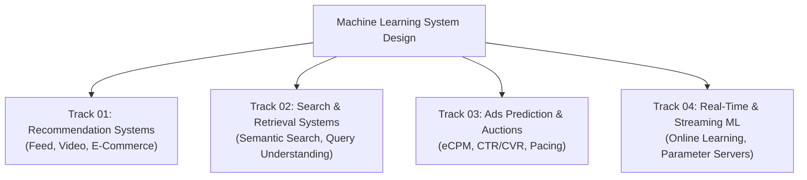
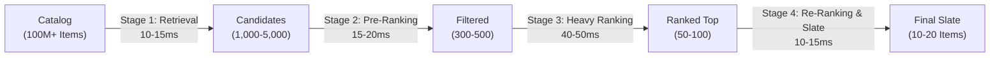

# Machine Learning System Design (MLSD) Interview Guides

> In-depth, staff-level study guides and architectural reference playbooks for Machine Learning System Design interviews at Tier-1 tech companies (Meta, Google, LinkedIn, Netflix, Pinterest, ByteDance).

---

## 🗺️ System Design Tracks

---

## Track 01: Recommendation Systems (The 6-Part Master Architecture)

Industrial recommendation systems are multi-stage pipelines engineered to balance hundreds of millions of candidates against strict real-time latency budgets (typically $< 100\text{ms}$ P99).

### 📚 Available Master Guides

#### [Part 1: The Funnel Blueprint, Vector Space Intelligence & Candidate Retrieval](./01_Recommendation_Systems/Part_1_Retrieval_and_Candidate_Generation.md)
*The coarse filtering layer reducing $100\text{M}+$ items to $\approx 1,000$ candidates in $<15\text{ms}$.*
*   **The 4-Stage Funnel & Latency Budgets:** Why single-stage end-to-end models fail; Recall@K vs. Precision@K.
*   **Classical Baselines:** Explicit vs. Implicit feedback, Collaborative Filtering (UBCF vs. IBCF, Pearson vs. Cosine), Funk SVD, SVD++, Implicit ALS with the Spark sparsity derivation ($Q^T C_u Q = Q^T Q + Q^T(C_u - I)Q$), and Bayesian Personalized Ranking (BPR).
*   **Two-Tower Contrastive Encoders:** Decoupled User and Item towers; the dot-product serving constraint; YouTube 2016 Deep Candidate Generation architecture; the **"Example Age" feature trick**.
*   **InfoNCE & Sampling Dynamics:** In-batch negatives; mathematical derivation of the **LogQ popularity correction formula**; hard negative mining spectrum (80/20 mix ratio, curriculum learning); temperature parameter ($\tau$) sensitivity.
*   **Vector Search & Indexing:** IVF Voronoi partitions; Product Quantization (PQ-16) and Asymmetric Distance Computation (ADC); IVF-PQ residual quantization math; Hierarchical Navigable Small World (HNSW) graphs; Google SCaNN (Anisotropic MIPS loss); 6-way Vector DB comparison matrix.
*   **The "Metadata Filtering Dilemma":** Pre vs. Post filtering liquidity collapse; **LinkedIn's GPU Exhaustive + RAR** (Retrieve and Rerank on Tensor Cores in $<1.5\text{ms}$).
*   **Multi-Interest & Graph Retrieval:** The single-vector collapse; **Pinterest PinnerSage** (Ward's clustering into $K$ medoids); **Pinterest PinSage** (random walk graph convolutions) & **LinkedIn PYMK**; multimodal item fusion (**ItemSage**).
*   **Generative Retrieval Frontier (2024–2026):** MIPS vector search vs. Token generation; Semantic IDs via Residual Quantized VAE (**RQ-VAE / TIGER**); Trie-constrained beam search; **YouTube PLUM (2025)** deep dive (+4.96% CTR on Shorts, $13.24\times$ catalog vocabulary).
*   **Staff-Level Interview Q&A:** 6 detailed, non-trivial questions with comprehensive model answers.

---

#### [Part 2: Pre-Ranking (L1) & Heavy Ranking (L2): Feature Crosses, DLRM & Multi-Task Learning](./01_Recommendation_Systems/Part_2_Ranking_PreRanking_and_Feature_Engineering.md)
*The scoring engine truncating and ranking $1,000$ candidates down to top-50 items in $<40\text{ms}$.*
*   **The Pre-Ranking (L1) Dilemma:** Why L1 cannot simply be a smaller L2; the **"Feature Availability Trap"** (network serialization of 600,000 keys takes $30-60\text{ms}$); **Pinterest's Root-Leaf Serving Topology** (local RAM item shards + single user broadcast).
*   **L1 Training Objectives:** Distillation from L2 teacher logits vs. Early-Funnel Logging to eliminate Sample Selection Bias (Missing-Not-At-Random).
*   **High-Cardinality Sparse Feature Space:** Dense log-transform and bucketization; Terabyte-scale embedding tables; Modulo hashing tricks and collisions; Dynamic frequency cutoffs and TTL eviction.
*   **The Embedding Disconnect:** Why Retrieval (Metric Space), Ranking (Feature Input Space), and Semantic (Universal Knowledge Space) embeddings are completely decoupled and cannot be intermixed.
*   **Pre-Neural Baseline (Facebook 2014):** GBDT + Logistic Regression; automated boolean categorical cross-features; decoupling daily batch GBDT training from real-time streaming online SGD.
*   **Explicit Polynomial Feature Crosses:** Why standard MLPs fail at polynomial interactions; Google Wide & Deep (Memorization vs. Generalization); **Deep & Cross Network (DCN-v1 vs. DCN-v2)**: mathematical proof of the rank-1 outer product bottleneck ($W = x_0 w_l^T$), DCN-v2 full-rank matrix formulation ($x_0 \odot (W_l x_l + b_l)$), Stacked vs. Parallel architectures, and Low-Rank MoE.
*   **DLRM (Meta):** Architecture anatomy; explicit dot-product interaction matrix ($\frac{(M+1)M}{2}$ pairwise combinations); Distributed hybrid scaling: **Model Parallelism** for memory-bound sparse tables (GPU VRAM with All-to-All communication) vs. **Data Parallelism** for compute-bound MLPs (All-Reduce gradient synchronization).
*   **Multi-Task Learning (MTL) at Scale:** Combating clickbait; Shared-Bottom $\to$ **MMoE** $\to$ **PLE (Progressive Layered Extraction)**; how PLE's separation of task-specific and shared experts eliminates negative transfer.
*   **The Number One Staff Interview Test:** Decoupling training multi-task loss weights ($\alpha_k$) from the real-time serving **Value Function** ($V = \sum w_k \hat{p}_k$); why engineers never modify training loss weights to adjust business priorities.
*   **Stage 2 Evaluation Metrics:** NDCG@K with graded relevance; **Group AUC (GAUC - user-weighted AUC)** and why global AUC is misleading; Expected Calibration Error (ECE) for ad auctions.
*   **Staff-Level Interview Q&A:** 5 deep, non-trivial questions with comprehensive model answers.

---

### 🚀 Upcoming Parts in Track 01

*   **Part 3: Sequential User Behavior Modeling & Production Loss Engineering** — Dynamic intent evolution (DIN, DIEN, SIM for 10,000+ behaviors), industrial transformers (Pinterest TransAct, LinkedIn Feed SR $O(N)$ single-pass training), and production loss debiasing (Position bias Shallow Tower vs. SNIPW, Negative downsampling with log-odds correction, delayed conversions).
*   **Part 4: Re-Ranking, Diversity, Freshness, Business Logic & Slate Optimization** — Stage 4 slate construction: MMR with surface-tuned $\lambda$, Determinantal Point Processes (DPP), Submodular Optimization ($1 - 1/e$ bound), Seq2Slate (RL), Steck's Calibrated Recs, filter bubble breaking quotas, and LinkedIn Air Traffic Controller (ATC).
*   **Part 5: Generative RecSys (HSTU/LLMs), Real-Time Streaming Ops & Evaluation Playbook** — Meta HSTU pointwise attention, Netflix Foundation Models, ByteDance Monolith online streaming learning, point-in-time feature stores, GAUC, Expected Calibration Error, Team Draft Interleaving (50x sensitivity), and debugging the Offline-to-Online correlation gap.
*   **Part 6: Real-World Industry Architectures Deconstructed & Staff Interview Playbook** — Full architectural teardowns of Pinterest, LinkedIn, TikTok, and YouTube; plus the 45-minute 6-stage interview execution blueprint, failure modes, and 20 staff-level grilling questions.
