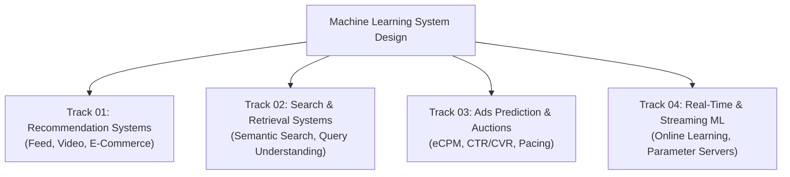
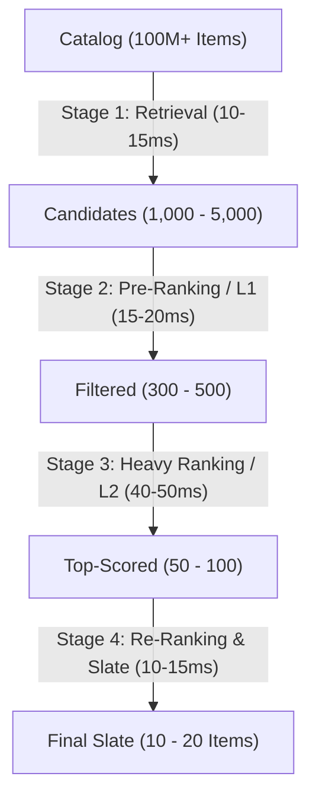

# Machine Learning System Design (MLSD) Guides

> In-depth, production-focused study guides and architectural reference playbooks for Machine Learning System Design at large-scale tech companies (Meta, Google, LinkedIn, Netflix, Pinterest, ByteDance).

---

## 🗺️ System Design Tracks

---

## Track 01: Recommendation Systems (The 6-Part Master Architecture)

Industrial recommendation systems are multi-stage pipelines engineered to narrow hundreds of millions of items down to a final slate under strict real-time latency budgets (typically $`\lt 100\text{ms}`$ P99).

### 📚 Available Master Guides

#### [Part 1: The Funnel Blueprint, Vector Space Intelligence & Candidate Retrieval](./01_Recommendation_Systems/Part_1_Retrieval_and_Candidate_Generation.md)
*The coarse filtering layer reducing $`100\text{M}+`$ items to $`\approx 1,000\text{–}5,000`$ candidates in $`\lt 15\text{ms}`$.*
*   **The 4-Stage Funnel, Multi-Channel Retrieval & Cold-Start:** Compute-latency boundaries; Recall vs. Precision; parallel retrieval fan-out/fan-in (Two-Tower ANN + Graph/I2I + Trending/Freshness + Bandit Exploration) with quota blending and cold-start handling.
*   **Classical Foundations at Scale:** Explicit vs. implicit feedback, UBCF vs. IBCF (Cosine vs. Pearson vs. Jaccard), weighted-centroid Content-Based Filtering, Funk SVD, SVD++, Implicit ALS with the Spark sparsity derivation ($`Y^T C_u Y = Y^T Y + Y^T(C_u - I)Y`$), and BPR pairwise ranking.
*   **Deep Two-Tower Contrastive Encoders:** Decoupled User and Item towers; the strict no-cross-feature serving rule; MIPS $`\leftrightarrow`$ Cosine $`\leftrightarrow`$ $`L_2`$ unit-sphere geometry; YouTube's **"Example Age"** trick; In-Batch Negatives with **Accidental Hit Masking**; **LogQ popularity bias correction** ($`\frac{s}{\tau} - \log p_j`$); **Mixed Negative Sampling (MNS)**; 80/20 random-vs-hard-negative mix (avoiding false negatives); and temperature ($`\tau`$) gradient sensitivity.
*   **Vector Search Infrastructure & Filtered Retrieval:** IVF Voronoi partitions; Product Quantization (PQ-16) and Asymmetric Distance Computation (ADC); residual IVF-PQ; HNSW construction & tuning knobs (`M`, `efConstruction`, `efSearch`); **Google ScaNN** anisotropic MIPS loss; the **Metadata Filtering Dilemma** (Filterable HNSW, selective inverted-index prefilter + exact GPU MatMul, and **LinkedIn LiNR / GPU-RAR: Retrieval-as-Ranking**); 6-way Vector DB matrix; and **Distributed Sharding, Dual-Index Freshness (< 10 min SLA) & Embedding Version Drift**.
*   **Multi-Interest & Graph Retrieval:** Solving single-vector collapse with **Pinterest PinnerSage** (Ward's clustering + importance-sampled medoids), neural multi-interest alternatives (**MIND**, **ComiRec**) & **Swing**; **Pinterest PinSage** (random-walk importance pooling & PPR hard negatives), **LinkedIn PYMK** (RWR & super-node downweighting), and multimodal **ItemSage**.
*   **Generative Retrieval Frontier (2024–2026):** MIPS vector search vs. autoregressive token generation; **RQ-VAE / TIGER Semantic IDs** (codebook training, PQ vs. RQ-VAE contrast, $`c_4`$ collision disambiguation, Trie-constrained beam search & microsecond cold-start Trie inserts); **YouTube PLUM** (`arXiv:2510.07784`, +4.96% Panel CTR, $`13.24\times`$ effective vocabulary, MoE scaling laws).
*   **Stage 1 Evaluation & Deep-Dive Q&A:** Recall@K, HitRate@K, MRR@K, Catalog Coverage, ANN-vs-Engagement Recall & logging-bias traps, serving SLAs, and 6 detailed interview Q&As.

---

#### [Part 2: Pre-Ranking (L1) & Heavy Ranking (L2): Feature Crosses, DLRM & Multi-Task Learning](./01_Recommendation_Systems/Part_2_Ranking_PreRanking_and_Feature_Engineering.md)
*The scoring engine truncating and ranking $`1,000\text{–}5,000`$ candidates down to top $`50\text{–}100`$ items in $`\lt 50\text{ms}`$.*
*   **Pre-Ranking (L1) Architecture & Training:** The **"Feature Availability Trap"** (fetching 3,000 heavy multi-feature payloads / ~600k feature values takes $`30\text{–}60\text{ms}`$); **Pinterest's Root-Leaf Serving Topology** (amortized User Tower + local Leaf RAM item shards); Request-Level User Broadcasting; L1 architecture spectrum (GPU Two-Tower, Per-Source FPR, LambdaMART, **ColBERT `MaxSim`** L1.5) & early safety gating; **Joint BCE + Temperature-Scaled KL Distillation** and Early-Funnel Logging.
*   **High-Cardinality Feature Space & Production Parity:** Power-law scaling (`log1p`, `RobustScaler`, exponential recency decay, quantile/AutoDis bucketization, explicit missingness indicators); terabyte embedding tables + optimizer state memory (Row-wise Adagrad); **Quotient-Remainder (QR) Compositional Hashing** ($`1,000\times`$ compression), **Middle-Max 8-bit Quantization** (~73% memory cut), frequency cutoffs & Monolith TTL/LFU eviction; the **Embedding Disconnect** (Retrieval vs. Ranking vs. Semantic + Selective Initialization); and **Three-Tier Feature Stores, Log-and-Wait, One-Epoch Phenomenon, ID Dropout & Content Residual Connections**.
*   **Explicit Feature Crosses:** **Facebook GBDT + LR (2014)**; why ReLU MLPs struggle with multiplicative crosses; **Wide & Deep** and **DeepFM** ($`O(kM)`$ pairwise rewrite); **DCN-v1 vs. DCN-v2** (rank-1 bottleneck proof, full-rank Hadamard derivation & worked degree-2 matrix example, Stacked vs. Parallel); **Low-Rank Decomposition, DCN-Mix (MoE), Residual DCN & Dense Gating (LiRank)**.
*   **DLRM, Modern Interaction Backbones & LLM+DLRM Hybrids:** **DLRM** field-wise dot products ($`\frac{(M+1)M}{2}`$) & hybrid **Model Parallelism (All-to-All)** + **Data Parallelism (All-Reduce)**; post-DLRM architectures (**DHEN**, **MaskNet / FinalMLP**, **Wukong**); **LLM & Multimodal + DLRM/DCN Hybrids** (Async Item-LLM + Nearline User-LLM $`\to`$ Projection Adapter, **Semantic IDs as native sparse ranking features**, Early/Mid/Late multimodal fusion, **LLM-as-Oracle Sigmoid Distillation**, and **MixLM + In-Batch Prefix Caching**); plus **L2 Serving Optimization** (Triton, TensorRT, structured pruning, PID dynamic depth) and **Dual-Reference Fisher EWC Continual Retraining**.
*   **Multi-Task Learning, Loss Normalization & Ranking Losses:** Shared-Bottom $`\to`$ **MMoE** $`\to`$ **PLE** (1-layer CGC vs. multi-layer isolation) + Multi-Domain Unification & MoE stability; **Multi-Task Loss Normalization & Watch-Time Modeling** (BCE vs. MSE scale explosion, positive-rate entropy gap, `log1p`/Huber, Watch-Time Bucketing, **YouTube WLR**, Censored/Survival loss, Focal Loss, Kendall Uncertainty Weighting, **GradNorm**, **PCGrad**); **ESMM** ($`\hat{p}_{\text{CTCVR}} = \hat{p}_{\text{CTR}} \times \hat{p}_{\text{CVR}}`$); decoupling **Training Loss Weights ($`\alpha_k`$)** from **Serving Value Functions ($`w_k`$)** tuned via **Online Constrained Bayesian Optimization**; and **Pointwise BCE vs. Pairwise/Listwise/LambdaRank & Production Hybrids**.
*   **Ranking Evaluation, Calibration & Deep-Dive Q&A:** L1 Recall@K alignment, **Normalized Entropy (NE)**, NDCG@K / MAP / MRR, **GAUC** & **PR-AUC** for rare heads, **Calibration Ratio (E/O), ECE, MCE, Brier Score**, **Joint Feature-Conditioned Isotonic Calibration** & **Multi-Head Position-Conditional Calibration**, **Offline-to-Online Correlation Gaps & Team-Draft Interleaving**, and 6 detailed Q&As.

---

### 🚀 Upcoming Parts in Track 01
---

*   **Part 3: Sequential User Behavior Modeling & Production Loss Debiasing** — Target-aware and temporal intent modeling (**SASRec / BERT4Rec $`\to`$ DIN $`\to`$ DIEN**), scaling to 10,000+ historical actions (**Alibaba SIM** GSU+ESU & **TWIN**), industrial real-time action transformers (**Pinterest TransAct**, **LinkedIn Feed SR** $`O(N)`$ single-pass training), and deep production debiasing (**Position Bias**: PAL / Shallow Tower vs. IPS / SNIPW & RandTopK propensities; **Negative Downsampling** exact log-odds calibration derivation; **Delayed Feedback / Conversion Modeling**: DFM, ES-DFM, FSIW).
*   **Part 4: Re-Ranking, Diversity, Freshness, Business Logic & Slate Optimization** — Stage 4 slate construction (`50–100 → 10–20` in `10–15ms`): **MMR**, **Determinantal Point Processes (DPP)** with fast greedy MAP inference, **Submodular Optimization** ($`1 - 1/e`$ bound), listwise neural slate rankers (**PRM**, **Seq2Slate**), **Steck's Calibrated Recommendations**, filter-bubble breaking quotas & creator fairness, Ads-Organic pacing & GSP/VCG auction integration, and **LinkedIn Air Traffic Controller (ATC)**.
*   **Part 5: Generative RecSys (HSTU / Foundation Models), Real-Time Streaming ML Ops & Experimentation Playbook** — **Meta HSTU** pointwise aggregated attention & trillion-parameter scaling laws, **Netflix Foundation Models** & end-to-end generative funnels; **ByteDance Monolith** collisionless streaming parameter servers, near-line residual updates, and point-in-time Feature Store internals; **Online Causal Experimentation** (**CUPED** variance reduction, **Team-Draft / Balanced Interleaving** math, **Network Effects / Graph Cluster & Switchback A/B Tests**, long-term holdbacks, and offline-to-online debugging playbooks).
*   **Part 6: Real-World Industry Architectures Deconstructed & System Design Execution Playbook** — Complete end-to-end teardowns of **Pinterest, LinkedIn, TikTok, and YouTube** tying Parts 1–5 together; plus a time-boxed **45-minute 6-stage ML System Design Execution Blueprint**, production failure-mode checklists, and 20 end-to-end scenario Q&As.
#### [Part 3: Sequential User Behavior Modeling & Production Loss Debiasing](./01_Recommendation_Systems/Part_3_Sequential_Behavior_and_Loss_Debiasing.md)
*Capturing real-time & lifelong user intent trajectories while debiasing confounded production training logs.*
*   **Static Pooling Collapse & Sequential Paradigms:** Why mean-pooling destroys multi-faceted intent; Target-Agnostic sequence encoders (**GRU4Rec**, **SASRec**, **BERT4Rec**, **TiSASRec**, **YouTube GRU + Latent Cross**, **Spotify CoSeRNN**) vs. Target-Aware ranking attention & weight-tying contrasts.
*   **Target-Aware & Interest-Evolution Architectures:** **Alibaba DIN** (4-way Local Activation Unit, unnormalized intensity preservation, Dice activation), **DIEN** (GRU + next-click Auxiliary Loss + **AUGRU** $`\tilde{u}_t = a_t \cdot u_t`$), **BST** (relative timestamp encoding), and **DFN** dual-feedback modeling (positive + explicit/implicit negative sequences).
*   **Scaling to Lifelong Sequences ($`10,000\text{–}100,000+`$ Actions):** **MIMN / UBR4CTR** stepping stones; **Alibaba SIM** (Hard vs. Soft **GSU** + **ESU**); **Kuaishou TWIN** (Consistency-Preserving CP-GSU caching inherent projections) & **TWIN-V2** (hierarchical K-means virtual items); and **Meituan SDIM** ($`O(1)`$ SimHash/LSH collision sampling).
*   **Industrial Real-Time Action Transformers (2023–2026):** **Pinterest PinnerFormer** (Dense All-Action Loss), **TransAct** (early candidate fusion + **Random Time-Window Masking**) & **TransAct V2** ($`16\text{K}`$ actions, NN pre-filter, **SKUT** SRAM Triton kernel, Next Action Loss); **LinkedIn Feed SR (CIKM 2026)** ($`O(N)`$ single-pass interleaved causal training, Pre-LN + RoPE + scaled residuals, Shared-Context Batching & SRMIS Flash Attention, empirical comparison vs. HSTU); plus sub-10ms Kafka/Flink/Redis ring-buffer serving.
*   **Three Pillars of Production Loss Debiasing:**
    *   **Position, Exposure & Popularity Bias:** Examination Hypothesis, **YouTube Shallow Position Tower / PAL** (with position dropout & collinearity traps), **IPS / RandTopK / DLA / Clipped SNIPS** + $`60 \times 6`$ learned position offsets (`k=5` division of labor), **Doubly Robust (DR)** estimators, and **MACR** counterfactual inference.
    *   **Negative Downsampling & Prior-Shift Calibration:** Exact Bayes' Theorem derivation ($`\text{logit}(p) = \text{logit}(q) + \log s`$), preventing $`5.5\times`$ eCPM bidding disasters, and why unweighted training + exact logit offset beats sample-weighted BCE ($`O(1/s_i)`$ Bernoulli gradient variance).
    *   **Delayed Feedback & Conversion Modeling (CVR):** **DFM** (exponential survival), **FNW/FNC**, **FSIW** (non-duplicate elapsed-time weighting), **ES-DFM** (short waiting window + duplicate-positive streaming), **DeFER / DEFUSE**, plus **Auxiliary Loss Modifiers** (Focal Loss, Label Smoothing, Example Age, Unified Composite Production Weight) and 7 deep-dive Q&As.

---

#### [Part 4: Re-Ranking, Diversity, Freshness, Business Logic & Slate Optimization](./01_Recommendation_Systems/Part_4_ReRanking_Diversity_and_Slate_Optimization.md)
*Constructing the optimal final slate (`50–100` $`\to`$ `10–20` items) in $`10\text{–}15\text{ms}`$ P99.*
*   **Why Pointwise Optimal $`\neq`$ Slate Optimal:** Redundancy/cannibalization proof, cross-item externalities (substitution, anchor pricing, complementarity, fatigue), and the **Three-Layer Re-Ranking Stack** with CPU fallback circuit breakers.
*   **Classical & Mathematical Diversity Optimization:** Hard dedup & impression-fatigue filters (Redis/Bloom/Cuckoo, pHash); **MMR** ($`O(KN)`$ cached greedy); **Submodular Maximization** ($`1 - 1/e`$ Nemhauser–Wolsey–Fisher guarantee & Minoux Lazy Greedy); and **Fast Greedy Cholesky DPP** (Chen et al., NeurIPS 2018 — parallelepiped geometry, $`O(K^2 N)`$ incremental Cholesky, $`O(w K N)`$ Sliding-Window DPP, and **Personalized DPP**).
*   **Listwise Neural Slate Optimization & Whole-Page Layouts:** **PRM** (Alibaba) & **SetRank** (ordinal embeddings + Attention Rank); **Seq2Slate**; two-stage Generator–Evaluator (**PRS**, **PIER**); **NAR4Rec** (KDD 2024 non-autoregressive $`5\times`$ speedup); frontier **Discrete Diffusion (DCDR)** & RL-distilled LLM rerankers; and **2D Whole-Page Optimization** (carousels, GenAI offline personalized carousels, 2-level horizontal/vertical MMR).
*   **Calibrated Preferences, Freshness, Exploration & Multi-Stakeholder Fairness:** **Steck's Calibrated Recommendations** (fixed-$`K`$ shifted submodular surrogate + $`\alpha`$-smoothed KL vs. probability calibration); 3-layer freshness & breaking-news boosts; **Dynamic Prior & Neural-Linear Thompson Sampling**, **LinUCB**; Formal Fairness Taxonomy, provider exposure floors, hub demotion, and cross-session temporal diversity.
*   **Ads-Organic Blending, Auctions, Pacing & Global Orchestration:** Unified eCPM/oCPM, **GSP vs. VCG** externality pricing & **Auto-Bidding Equilibrium**; Fixed vs. Dynamic Ads-Organic Blending (shadow price $`\gamma`$, uplift ad-fatigue, Ghost Ads iROAS, Brand Safety & HEC fairness); **PTR** throttling, Lagrangian **Bid Shading**, and **Positional Log-Space PID Pacing**; **Primal-Dual Optimization (`DuaLip`)**, **Bayesian Optimization** for Stage 4 weights, and **LinkedIn Air Traffic Controller (ATC)** (Concourse + Decision Transformer); plus offline/online slate metrics (**ILD**, $`\alpha`$-NDCG, **ERR-IA**, Gini) and 7 deep-dive Q&As.

---

#### [Part 5: Generative RecSys (HSTU & Foundation Models), Streaming ML Ops & Causal Experimentation](./01_Recommendation_Systems/Part_5_Generative_RecSys_Streaming_MLOps_and_Experimentation.md)
*The modern RecSys frontier: trillion-parameter generative transducers, minute-level streaming parameter servers, and causal experimentation at scale.*
*   **Generative RecSys & Foundation Models (2024–2026):** The 5 distinct roles of LLMs in RecSys; why DLRMs hit a memory-bandwidth scaling wall (5%–15% GPU MFU); **Meta HSTU (ICML 2024)** (Pointwise SiLU attention preserving intensity, ~58% activation memory savings, **Stochastic Length**, **M-FALCON** micro-batched KV-cached inference, 1.5T scaling laws); **Netflix Foundation Model (2025)** & **FM-Intent** (cross-surface tokenization, multi-token prediction, cold-start mixing) + **LinkedIn 360Brew** research overview; and **Kuaishou OneRec / OneRec-V2 (2025)** (IPA-DPO, Lazy Decoder-Only cutting compute 94%, Duration-Aware Reward Shaping & GBPO).
*   **Real-Time Streaming ML Ops & Collisionless Parameter Servers:** Concept drift half-life; **ByteDance Monolith (ORSUM@RecSys 2022)** (collisionless **Cuckoo Hash Tables**, occurrence admission + TTL/LFU eviction, Kafka/Flink streaming joiner, **1-minute dirty-row sparse PS sync** achieving $`1,000\times`$ bandwidth cut vs. daily dense sync); **Point-in-Time (ASOF) Feature Store Joins**, Batch/Nearline/Online feature tiers, PSI/KL drift monitoring, **Viral Item Embedding Instability**, and freshness-vs-stability anchoring.
*   **Online Causal Experimentation & Statistical Rigor:** **SRM** Chi-Squared detection, peeking & always-valid **mSPRT**, FDR control, A/A Testing, Overlapping Layers & Fractional Factorials; **CUPED** ($`1 - \rho^2`$ derivation) & **CUPAC vs. MLRATE** ($`K`$-fold cross-fitting + Lin's interaction estimator) + Delta Method; **Team-Draft Interleaving** math ($`50\times\text{–}100\times`$ power); **SUTVA & Interference** (**Ego-Cluster Randomization**, **Switchback Experiments** with washout buffers & CRSE, **Ads Budget-Split**, and **Quasi-Experimental DiD / Synthetic Control / Back-Door Adjustment**); Long-Term Holdbacks, **Surrogate Index**, **OPE (IPS/SNIPS)**, a **6-Gate Offline-to-Online Debugging Playbook**, and 8 deep-dive Q&As.

---

#### [Part 6: Real-World Industry Architectures Deconstructed & ML System Design Execution Playbook](./01_Recommendation_Systems/Part_6_Industrial_Teardowns_and_System_Design_Playbook.md)
*The complete capstone tying Parts 1–5 into five end-to-end production teardowns, capacity math, incident diagnostics, and 20 scenario Q&As.*
*   **Cross-Company Synthesis & 5 Full End-to-End Industry Teardowns:**
    *   **Pinterest Homefeed:** PinSage, ItemSage/OmniSearchSage (30-day query cache), PinnerFormer, PinnerSage/DCM, Root-Leaf Pre-Ranking, Pinnability + TransAct V2 (SKUT + Random Time-Window Masking), and 2D Whole-Page Optimization.
    *   **LinkedIn Feed, Jobs & Ecosystem:** LiNR/GPU-RAR, PYMK, Production LLM Search stack (`8B SAGE -> 0.6B MixLM`) vs. 360Brew research, **LiRank** $`\to`$ **Feed SR (CIKM 2026)**, 26-head position calibration + Couchbase caching + PID depth, Multi-Stakeholder Re-Ranking, **ATC**, and Graph Cluster Randomization.
    *   **TikTok / ByteDance For You Feed:** Full-screen swipe telemetry, Graduated Cold-Start Traffic Pool Funnel, RankMixer/OneTrans, and **Monolith** 1-minute streaming PS loop.
    *   **YouTube Home & Watch Next:** Two-Tower $`\to`$ **PLUM** (`arXiv:2510.07784`), MMoE + WLR/Survival + PAL Shallow Tower, Explicit Satisfaction Surveys, DPP, and Long-Term Holdbacks.
    *   **Two-Sided Local Marketplace (DoorDash / E-Commerce):** H3 spatial/live-open filtering, DashCLIP, Universal Ranker + ESMM, Weibull probabilistic ETA Decision Layer, DNN vs. GBDT feature-staleness mechanics, Two-Level MMR + UCB, and Switchback + CUPAC.
*   **45-Minute 6-Stage Execution Blueprint & Capacity Math:** Time-boxed design roadmap, Scale-Tiered Architecture Matrix (`<1M` to `>1B` items), **Back-of-the-Envelope QPS / Embedding RAM / ANN / Bandwidth / GPU MFU Cheat Sheet**, 6-scenario **Constraint-Shift Pivot Playbook** + Sublinear Streaming Sketches, **12-Incident Production Failure-Mode Matrix** (with Step 0 Blast Radius triage & Graceful Degradation Ladder), and **20 End-to-End Scenario Q&As**.
