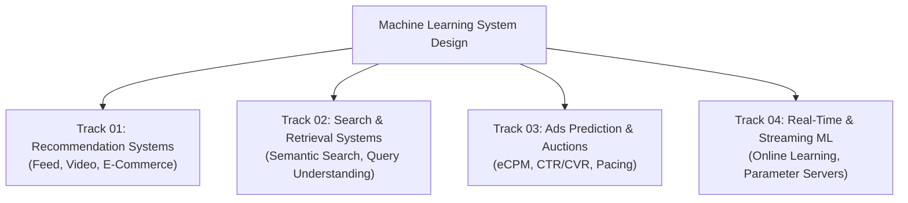
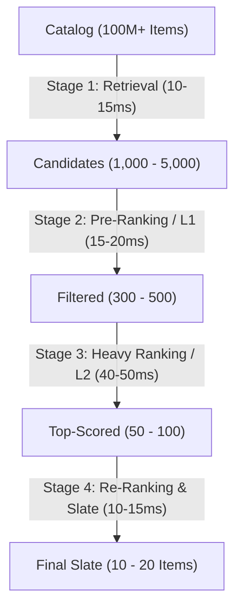

# Machine Learning System Design (MLSD) Guides

> In-depth, production-focused study guides and architectural reference playbooks for Machine Learning System Design at large-scale tech companies (Meta, Google, LinkedIn, Netflix, Pinterest, ByteDance).

---

## 🗺️ System Design Tracks

---

## Track 01: Recommendation Systems (The 6-Part Master Architecture)

Industrial recommendation systems are multi-stage pipelines engineered to narrow hundreds of millions of items down to a final slate under strict real-time latency budgets (typically $< 100\text{ms}$ P99).

### 📚 Available Master Guides

#### [Part 1: The Funnel Blueprint, Vector Space Intelligence & Candidate Retrieval](./01_Recommendation_Systems/Part_1_Retrieval_and_Candidate_Generation.md)
*The coarse filtering layer reducing $100\text{M}+$ items to $\approx 1,000\text{–}5,000$ candidates in $<15\text{ms}$.*
*   **The 4-Stage Funnel, Multi-Channel Retrieval & Cold-Start:** Compute-latency boundaries; Recall vs. Precision; parallel retrieval fan-out/fan-in (Two-Tower ANN + Graph/I2I + Trending/Freshness + Bandit Exploration) with quota blending and cold-start handling.
*   **Classical Foundations at Scale:** Explicit vs. implicit feedback, UBCF vs. IBCF (Cosine vs. Pearson vs. Jaccard), weighted-centroid Content-Based Filtering, Funk SVD, SVD++, Implicit ALS with the Spark sparsity derivation ($Y^T C_u Y = Y^T Y + Y^T(C_u - I)Y$), and BPR pairwise ranking.
*   **Deep Two-Tower Contrastive Encoders:** Decoupled User and Item towers; the strict no-cross-feature serving rule; MIPS $\leftrightarrow$ Cosine $\leftrightarrow$ $L_2$ unit-sphere geometry; YouTube's **"Example Age"** trick; In-Batch Negatives with **Accidental Hit Masking**; **LogQ popularity bias correction** ($\frac{s}{\tau} - \log p_j$); **Mixed Negative Sampling (MNS)**; 80/20 random-vs-hard-negative mix (avoiding false negatives); and temperature ($\tau$) gradient sensitivity.
*   **Vector Search Infrastructure & Filtered Retrieval:** IVF Voronoi partitions; Product Quantization (PQ-16) and Asymmetric Distance Computation (ADC); residual IVF-PQ; HNSW construction & tuning knobs (`M`, `efConstruction`, `efSearch`); **Google ScaNN** anisotropic MIPS loss; the **Metadata Filtering Dilemma** (Filterable HNSW, selective inverted-index prefilter + exact GPU MatMul, and **LinkedIn LiNR / GPU-RAR: Retrieval-as-Ranking**); 6-way Vector DB matrix; and **Distributed Sharding, Dual-Index Freshness (< 10 min SLA) & Embedding Version Drift**.
*   **Multi-Interest & Graph Retrieval:** Solving single-vector collapse with **Pinterest PinnerSage** (Ward's clustering + importance-sampled medoids), neural multi-interest alternatives (**MIND**, **ComiRec**) & **Swing**; **Pinterest PinSage** (random-walk importance pooling & PPR hard negatives), **LinkedIn PYMK** (RWR & super-node downweighting), and multimodal **ItemSage**.
*   **Generative Retrieval Frontier (2024–2026):** MIPS vector search vs. autoregressive token generation; **RQ-VAE / TIGER Semantic IDs** (codebook training, PQ vs. RQ-VAE contrast, $c_4$ collision disambiguation, Trie-constrained beam search & microsecond cold-start Trie inserts); **YouTube PLUM** (`arXiv:2510.07784`, +4.96% Panel CTR, $13.24\times$ effective vocabulary, MoE scaling laws).
*   **Stage 1 Evaluation & Deep-Dive Q&A:** Recall@K, HitRate@K, MRR@K, Catalog Coverage, ANN-vs-Engagement Recall & logging-bias traps, serving SLAs, and 6 detailed interview Q&As.

---

#### [Part 2: Pre-Ranking (L1) & Heavy Ranking (L2): Feature Crosses, DLRM & Multi-Task Learning](./01_Recommendation_Systems/Part_2_Ranking_PreRanking_and_Feature_Engineering.md)
*The scoring engine truncating and ranking $1,000\text{–}5,000$ candidates down to top $50\text{–}100$ items in $< 50\text{ms}$.*
*   **Pre-Ranking (L1) Architecture & Training:** The **"Feature Availability Trap"** (fetching 3,000 heavy multi-feature payloads / ~600k feature values takes $30\text{–}60\text{ms}$); **Pinterest's Root-Leaf Serving Topology** (amortized User Tower + local Leaf RAM item shards); Request-Level User Broadcasting; L1 architecture spectrum (GPU Two-Tower, Per-Source FPR, LambdaMART, **ColBERT `MaxSim`** L1.5) & early safety gating; **Joint BCE + Temperature-Scaled KL Distillation** and Early-Funnel Logging.
*   **High-Cardinality Feature Space & Production Parity:** Power-law scaling (`log1p`, `RobustScaler`, exponential recency decay, quantile/AutoDis bucketization, explicit missingness indicators); terabyte embedding tables + optimizer state memory (Row-wise Adagrad); **Quotient-Remainder (QR) Compositional Hashing** ($1,000\times$ compression), **Middle-Max 8-bit Quantization** (~73% memory cut), frequency cutoffs & Monolith TTL/LFU eviction; the **Embedding Disconnect** (Retrieval vs. Ranking vs. Semantic + Selective Initialization); and **Three-Tier Feature Stores, Log-and-Wait, One-Epoch Phenomenon, ID Dropout & Content Residual Connections**.
*   **Explicit Feature Crosses:** **Facebook GBDT + LR (2014)**; why ReLU MLPs struggle with multiplicative crosses; **Wide & Deep** and **DeepFM** ($O(kM)$ pairwise rewrite); **DCN-v1 vs. DCN-v2** (rank-1 bottleneck proof, full-rank Hadamard derivation & worked degree-2 matrix example, Stacked vs. Parallel); **Low-Rank Decomposition, DCN-Mix (MoE), Residual DCN & Dense Gating (LiRank)**.
*   **DLRM, Modern Interaction Backbones & LLM+DLRM Hybrids:** **DLRM** field-wise dot products ($\frac{(M+1)M}{2}$) & hybrid **Model Parallelism (All-to-All)** + **Data Parallelism (All-Reduce)**; post-DLRM architectures (**DHEN**, **MaskNet / FinalMLP**, **Wukong**); **LLM & Multimodal + DLRM/DCN Hybrids** (Async Item-LLM + Nearline User-LLM $\to$ Projection Adapter, **Semantic IDs as native sparse ranking features**, Early/Mid/Late multimodal fusion, **LLM-as-Oracle Sigmoid Distillation**, and **MixLM + In-Batch Prefix Caching**); plus **L2 Serving Optimization** (Triton, TensorRT, structured pruning, PID dynamic depth) and **Dual-Reference Fisher EWC Continual Retraining**.
*   **Multi-Task Learning, Loss Normalization & Ranking Losses:** Shared-Bottom $\to$ **MMoE** $\to$ **PLE** (1-layer CGC vs. multi-layer isolation) + Multi-Domain Unification & MoE stability; **Multi-Task Loss Normalization & Watch-Time Modeling** (BCE vs. MSE scale explosion, positive-rate entropy gap, `log1p`/Huber, Watch-Time Bucketing, **YouTube WLR**, Censored/Survival loss, Focal Loss, Kendall Uncertainty Weighting, **GradNorm**, **PCGrad**); **ESMM** ($\hat{p}_{\text{CTCVR}} = \hat{p}_{\text{CTR}} \times \hat{p}_{\text{CVR}}$); decoupling **Training Loss Weights ($\alpha_k$)** from **Serving Value Functions ($w_k$)** tuned via **Online Constrained Bayesian Optimization**; and **Pointwise BCE vs. Pairwise/Listwise/LambdaRank & Production Hybrids**.
*   **Ranking Evaluation, Calibration & Deep-Dive Q&A:** L1 Recall@K alignment, **Normalized Entropy (NE)**, NDCG@K / MAP / MRR, **GAUC** & **PR-AUC** for rare heads, **Calibration Ratio (E/O), ECE, MCE, Brier Score**, **Joint Feature-Conditioned Isotonic Calibration** & **Multi-Head Position-Conditional Calibration**, **Offline-to-Online Correlation Gaps & Team-Draft Interleaving**, and 6 detailed Q&As.

---

### 🚀 Upcoming Parts in Track 01

*   **Part 3: Sequential User Behavior Modeling & Production Loss Debiasing** — Target-aware and temporal intent modeling (**SASRec / BERT4Rec $\to$ DIN $\to$ DIEN**), scaling to 10,000+ historical actions (**Alibaba SIM** GSU+ESU & **TWIN**), industrial real-time action transformers (**Pinterest TransAct**, **LinkedIn Feed SR** $O(N)$ single-pass training), and deep production debiasing (**Position Bias**: PAL / Shallow Tower vs. IPS / SNIPW & RandTopK propensities; **Negative Downsampling** exact log-odds calibration derivation; **Delayed Feedback / Conversion Modeling**: DFM, ES-DFM, FSIW).
*   **Part 4: Re-Ranking, Diversity, Freshness, Business Logic & Slate Optimization** — Stage 4 slate construction (`50–100 → 10–20` in `10–15ms`): **MMR**, **Determinantal Point Processes (DPP)** with fast greedy MAP inference, **Submodular Optimization** ($1 - 1/e$ bound), listwise neural slate rankers (**PRM**, **Seq2Slate**), **Steck's Calibrated Recommendations**, filter-bubble breaking quotas & creator fairness, Ads-Organic pacing & GSP/VCG auction integration, and **LinkedIn Air Traffic Controller (ATC)**.
*   **Part 5: Generative RecSys (HSTU / Foundation Models), Real-Time Streaming ML Ops & Experimentation Playbook** — **Meta HSTU** pointwise aggregated attention & trillion-parameter scaling laws, **Netflix Foundation Models** & end-to-end generative funnels; **ByteDance Monolith** collisionless streaming parameter servers, near-line residual updates, and point-in-time Feature Store internals; **Online Causal Experimentation** (**CUPED** variance reduction, **Team-Draft / Balanced Interleaving** math, **Network Effects / Graph Cluster & Switchback A/B Tests**, long-term holdbacks, and offline-to-online debugging playbooks).
*   **Part 6: Real-World Industry Architectures Deconstructed & System Design Execution Playbook** — Complete end-to-end teardowns of **Pinterest, LinkedIn, TikTok, and YouTube** tying Parts 1–5 together; plus a time-boxed **45-minute 6-stage ML System Design Execution Blueprint**, production failure-mode checklists, and 20 end-to-end scenario Q&As.
